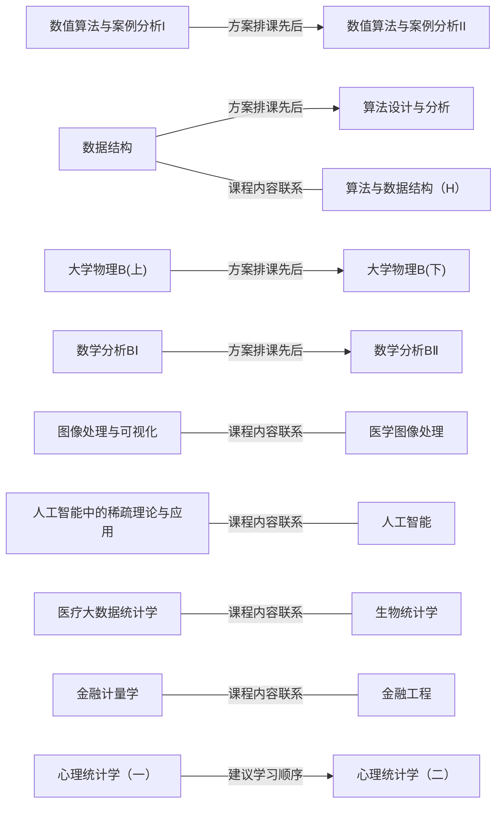

# 2024数据科学与大数据技术专业“2+X”教学培养方案

大数据学院 · 数据科学与大数据技术 · 方案 72617 · 73 个不同课程或科研条目。

[官方 Word](../originals/plan-72617.docx) · [教务详情](https://fdjwgl.fudan.edu.cn/manager/bizType/2/major-program-search/info/72617?skipAuth=1) · [方案快照](../raw/plan-72617.json.gz) · [年级目录](../README.md)

## 修读导读

- **建议先学**　《数据结构》（`CS20017`） → 《算法设计与分析》（`CS30016`）。数据组织与基本操作为算法设计提供基础。

- **可以对照着读**　《最优化方法》（`MATH20008`）与《数学模型》（`MATH20009`）。共同主题为模型目标、决策变量与优化求解。

- **查模块选课**　《统计计算》（`STAT30016`）、《数值算法与案例分析I》（`MATH20007`）列在“专业核心教育课程”中。原表见 `/courseModules/7`。

## 课程关系图

图中展示部分关系。下表保留全部已建立的课程对，来源位置使用本方案 JSON Pointer。

## 先修与内容联系

| 类型 | 起点 | 终点 | 依据 | 原表定位 |
| --- | --- | --- | --- | --- |
| 建议学习顺序 | 数据结构 (CS20017) | 算法设计与分析 (CS30016) | 数据组织与基本操作为算法设计提供基础。  | `/courseModules/7/planCourses/7`、`/courseModules/12/planCourses/7` |
| 建议学习顺序 | 数学分析BⅠ (MATH10012) | 数学分析BⅡ (MATH10013) | 同方案的课程题名具有连续分册或序号。  | `/courseModules/6/planCourses/2`、`/courseModules/6/planCourses/3` |
| 建议学习顺序 | 数值算法与案例分析I (MATH20007) | 数值算法与案例分析II (MATH50009) | 同方案的课程题名具有连续分册或序号。  | `/courseModules/7/planCourses/1`、`/courseModules/11/planCourses/0` |
| 建议学习顺序 | 大学物理B(上) (PHYS10003) | 大学物理B(下) (PHYS10004) | 同方案的课程题名具有连续分册或序号。  | `/courseModules/6/planCourses/0`、`/courseModules/6/planCourses/1` |
| 建议学习顺序 | 心理统计学（一） (PSYC30017) | 心理统计学（二） (PSYC30018) | 同方案的课程题名具有连续分册或序号。  | `/courseModules/13/planCourses/5`、`/courseModules/13/planCourses/6` |
| 方案排课先后 | 数据结构 (CS20017) | 算法设计与分析 (CS30016) | 同方案该课程全部明确数字学期均早于后者。  | `/courseModules/7/planCourses/7`、`/courseModules/12/planCourses/7` |
| 方案排课先后 | 数学分析BⅠ (MATH10012) | 数学分析BⅡ (MATH10013) | 同方案该课程全部明确数字学期均早于后者。  | `/courseModules/6/planCourses/2`、`/courseModules/6/planCourses/3` |
| 方案排课先后 | 数值算法与案例分析I (MATH20007) | 数值算法与案例分析II (MATH50009) | 同方案该课程全部明确数字学期均早于后者。  | `/courseModules/7/planCourses/1`、`/courseModules/11/planCourses/0` |
| 方案排课先后 | 大学物理B(上) (PHYS10003) | 大学物理B(下) (PHYS10004) | 同方案该课程全部明确数字学期均早于后者。  | `/courseModules/6/planCourses/0`、`/courseModules/6/planCourses/1` |
| 课程内容联系 | 人工智能中的稀疏理论与应用 (AIS631010) | 人工智能 (CS50020) | 本方案两门课程的题名均含“人工智能”，可据此对照这一主题。  | `/courseModules/11/planCourses/13`、`/courseModules/7/planCourses/3` |
| 课程内容联系 | 线性代数 (CS10003) | 高等线性代数 (MATH10003) | 本方案两门课程的题名均含“线性代数”，可据此对照这一主题。  | `/courseModules/6/planCourses/5`、`/courseModules/7/planCourses/12` |
| 课程内容联系 | 数据结构 (CS20017) | 算法与数据结构（H） (CS20017h) | 本方案两门课程的题名均含“数据结构”，可据此对照这一主题。  | `/courseModules/7/planCourses/7`、`/courseModules/16/planCourses/4` |
| 课程内容联系 | 图像处理与可视化 (CS30065) | 医学图像处理 (CS50026) | 本方案两门课程的题名均含“图像处理”，可据此对照这一主题。  | `/courseModules/7/planCourses/13`、`/courseModules/13/planCourses/2` |
| 课程内容联系 | 医学图像处理 (CS50026) | 图像处理与数据可视化（H） (DATA130012h) | 本方案两门课程的题名均含“图像处理”，可据此对照这一主题。  | `/courseModules/13/planCourses/2`、`/courseModules/16/planCourses/3` |
| 课程内容联系 | 医学图像处理 (CS50026) | 数字图像处理 (DATA130032) | 本方案两门课程的题名均含“图像处理”，可据此对照这一主题。  | `/courseModules/13/planCourses/2`、`/courseModules/12/planCourses/4` |
| 课程内容联系 | 金融风险管理与金融工程 (ECON40019) | 金融工程 (STAT50022) | 本方案两门课程的题名均含“金融”，可据此对照这一主题。  | `/courseModules/14/planCourses/9`、`/courseModules/14/planCourses/5` |
| 课程内容联系 | 最优化方法 (MATH20008) | 数学模型 (MATH20009) | 共同主题为模型目标、决策变量与优化求解。  | `/courseModules/7/planCourses/10`、`/courseModules/11/planCourses/5` |
| 课程内容联系 | 卫生统计学A (PHPM40014) | 生物统计学 (STAT50025) | 本方案两门课程的题名均含“统计学”，可据此对照这一主题。  | `/courseModules/13/planCourses/0`、`/courseModules/13/planCourses/3` |
| 课程内容联系 | 心理统计学（一） (PSYC30017) | 生物统计学 (STAT50025) | 本方案两门课程的题名均含“统计学”，可据此对照这一主题。  | `/courseModules/13/planCourses/5`、`/courseModules/13/planCourses/3` |
| 课程内容联系 | 心理统计学（二） (PSYC30018) | 生物统计学 (STAT50025) | 本方案两门课程的题名均含“统计学”，可据此对照这一主题。  | `/courseModules/13/planCourses/6`、`/courseModules/13/planCourses/3` |
| 课程内容联系 | 金融计量学 (STAT50018) | 金融工程 (STAT50022) | 本方案两门课程的题名均含“金融”，可据此对照这一主题。  | `/courseModules/14/planCourses/1`、`/courseModules/14/planCourses/5` |
| 课程内容联系 | 医疗大数据统计学 (STAT50020) | 生物统计学 (STAT50025) | 本方案两门课程的题名均含“统计学”，可据此对照这一主题。  | `/courseModules/13/planCourses/1`、`/courseModules/13/planCourses/3` |

本次未从可定位的明确表述中确认课程对课程预修。学期安排、系列分册与编辑建议均保留各自的依据。

## 按原方案模块阅读

同一模块展示原表中的课程归属。模块内课程之间的先后仍须逐项查阅。

- **统计与分析模块**　多模态数据同化、人工智能中的稀疏理论与应用、运筹学A、数学模型、计算方法、数值算法与案例分析II、应用泛函分析、线性规划、高等微积分、随机分析、时间序列与空间统计、随机过程导论、数据融合与同化、多元统计分析、统计学基础II：回归分析（原表模块 11）
- **系统与数据挖掘模块**　认知智能前沿技术与实践、算法设计与分析、高级大数据解析、大规模分布式系统、自然语言处理、计算理论、图数据管理与挖掘、计算机视觉、数字图像处理、强化学习算法与理论基础（原表模块 12）
- **理医工学大数据分析模块**　组学数据的统计分析和挖掘、生物医学工程学基础、医学图像处理、卫生统计学A、心理统计学（一）、心理统计学（二）、医疗大数据统计学、生物统计学（原表模块 13）
- **社会科学大数据分析模块**　社交网络挖掘、大数据传播与新媒体分析、商务分析、社会数据管理与分析、决策理论、金融风险管理与金融工程、社会科学方法论、金融计量学、社会科学数据挖掘、金融工程（原表模块 14）
- **类脑计算方向专业进阶模块**　多模态数据同化、认知智能前沿技术与实践、生物医学工程学基础、大规模分布式系统、自然语言处理、医学图像处理、非线性系统、复杂系统理论与仿真、应用泛函分析、生物数学、随机过程导论、数据融合与同化、医疗大数据统计学、生物统计学（原表模块 15）

## 课程表

同一课程在不同模块分别出现时，按原表逐行列出。季节字段保留原值。

| 课程 | 代码 | 学分 | 学期 | 模块 |
| --- | --- | ---: | --- | --- |
| 大学物理B(上) | PHYS10003 | 4.0 | 第1学期 | 培养方案 / 专业培养课程 / 大类基础课程 / 必修课程 |
| 大学物理B(下) | PHYS10004 | 4.0 | 第2学期 | 培养方案 / 专业培养课程 / 大类基础课程 / 必修课程 |
| 数学分析BⅠ | MATH10012 | 5.0 | 第1学期 | 培养方案 / 专业培养课程 / 大类基础课程 / 必修课程 |
| 数学分析BⅡ | MATH10013 | 5.0 | 第2学期 | 培养方案 / 专业培养课程 / 大类基础课程 / 必修课程 |
| 程序设计 | CS10004 | 4.0 | 第1学期 | 培养方案 / 专业培养课程 / 大类基础课程 / 必修课程 |
| 线性代数 | CS10003 | 3.0 | 第1学期 | 培养方案 / 专业培养课程 / 大类基础课程 / 必修课程 |
| 统计计算 | STAT30016 | 3.0 | 第1学期 | 培养方案 / 专业培养课程 / 专业核心教育课程 |
| 数值算法与案例分析I | MATH20007 | 3.0 | 第3学期 | 培养方案 / 专业培养课程 / 专业核心教育课程 |
| 统计（机器）学习概论 | STAT30015 | 3.0 | 第5学期 | 培养方案 / 专业培养课程 / 专业核心教育课程 |
| 人工智能 | CS50020 | 3.0 | 第5学期 | 培养方案 / 专业培养课程 / 专业核心教育课程 |
| 神经网络与深度学习 | CS30064 | 3.0 | 第6学期 | 培养方案 / 专业培养课程 / 专业核心教育课程 |
| 生产实习 | STAT40004 | 1.0 | 第7学期 | 培养方案 / 专业培养课程 / 专业核心教育课程 |
| 毕业论文 | STAT40005 | 6.0 | 第8学期 | 培养方案 / 专业培养课程 / 专业核心教育课程 |
| 数据结构 | CS20017 | 4.0 | 第3学期 | 培养方案 / 专业培养课程 / 专业核心教育课程 |
| 概率论基础 | STAT20011 | 3.0 | 第3学期 | 培养方案 / 专业培养课程 / 专业核心教育课程 |
| 计算机原理 | CS20018 | 3.0 | 第3学期 | 培养方案 / 专业培养课程 / 专业核心教育课程 |
| 最优化方法 | MATH20008 | 3.0 | 第4学期 | 培养方案 / 专业培养课程 / 专业核心教育课程 |
| 数据库及实现 | CS20019 | 3.0 | 第4学期 | 培养方案 / 专业培养课程 / 专业核心教育课程 |
| 高等线性代数 | MATH10003 | 3.0 | 第3学期 | 培养方案 / 专业培养课程 / 专业核心教育课程 |
| 图像处理与可视化 | CS30065 | 3.0 | 第5学期 | 培养方案 / 专业培养课程 / 专业核心教育课程 |
| 统计学基础：原理、方法及R应用 (I) | STAT20010 | 3.0 | 第4学期 | 培养方案 / 专业培养课程 / 专业核心教育课程 |
| 数值算法与案例分析II | MATH50009 | 3.0 | 第4学期、第6学期 | 培养方案 / 专业进阶模块二选一 / 大数据技术与应用方向专业进阶模块 / 统计与分析模块 |
| 随机过程导论 | STAT50017 | 3.0 | 第4学期、第6学期 | 培养方案 / 专业进阶模块二选一 / 大数据技术与应用方向专业进阶模块 / 统计与分析模块 |
| 统计学基础II：回归分析 | STAT50024 | 3.0 | 第3学期、第5学期 | 培养方案 / 专业进阶模块二选一 / 大数据技术与应用方向专业进阶模块 / 统计与分析模块 |
| 时间序列与空间统计 | STAT50016 | 3.0 | 第4学期、第6学期 | 培养方案 / 专业进阶模块二选一 / 大数据技术与应用方向专业进阶模块 / 统计与分析模块 |
| 数据融合与同化 | STAT50019 | 3.0 | 第4学期、第6学期 | 培养方案 / 专业进阶模块二选一 / 大数据技术与应用方向专业进阶模块 / 统计与分析模块 |
| 数学模型 | MATH20009 | 3.0 | 第4学期、第6学期 | 培养方案 / 专业进阶模块二选一 / 大数据技术与应用方向专业进阶模块 / 统计与分析模块 |
| 随机分析 | MATH60033 | 3.0 | 第3学期、第4学期、第5学期、第6学期 | 培养方案 / 专业进阶模块二选一 / 大数据技术与应用方向专业进阶模块 / 统计与分析模块 |
| 运筹学A | MATH130019 | 3.0 | 第4学期、第6学期 | 培养方案 / 专业进阶模块二选一 / 大数据技术与应用方向专业进阶模块 / 统计与分析模块 |
| 多元统计分析 | STAT50023 | 3.0 | 第4学期、第6学期 | 培养方案 / 专业进阶模块二选一 / 大数据技术与应用方向专业进阶模块 / 统计与分析模块 |
| 计算方法 | MATH30008 | 3.0 | 第3学期、第5学期 | 培养方案 / 专业进阶模块二选一 / 大数据技术与应用方向专业进阶模块 / 统计与分析模块 |
| 应用泛函分析 | MATH50011 | 3.0 | 第3学期、第5学期 | 培养方案 / 专业进阶模块二选一 / 大数据技术与应用方向专业进阶模块 / 统计与分析模块 |
| 线性规划 | MATH50012 | 3.0 | 第4学期、第6学期 | 培养方案 / 专业进阶模块二选一 / 大数据技术与应用方向专业进阶模块 / 统计与分析模块 |
| 多模态数据同化 | AIS410010 | 3.0 | 第4学期、第6学期 | 培养方案 / 专业进阶模块二选一 / 大数据技术与应用方向专业进阶模块 / 统计与分析模块 |
| 人工智能中的稀疏理论与应用 | AIS631010 | 3.0 | 第3学期、第5学期 | 培养方案 / 专业进阶模块二选一 / 大数据技术与应用方向专业进阶模块 / 统计与分析模块 |
| 高等微积分 | MATH50014 | 3.0 | AUTUMN | 培养方案 / 专业进阶模块二选一 / 大数据技术与应用方向专业进阶模块 / 统计与分析模块 |
| 大规模分布式系统 | CS50022 | 3.0 | 第4学期、第6学期 | 培养方案 / 专业进阶模块二选一 / 大数据技术与应用方向专业进阶模块 / 系统与数据挖掘模块 |
| 高级大数据解析 | CS50021 | 3.0 | 第3学期、第5学期 | 培养方案 / 专业进阶模块二选一 / 大数据技术与应用方向专业进阶模块 / 系统与数据挖掘模块 |
| 自然语言处理 | CS50023 | 3.0 | 第4学期、第6学期 | 培养方案 / 专业进阶模块二选一 / 大数据技术与应用方向专业进阶模块 / 系统与数据挖掘模块 |
| 计算理论 | CS50024 | 3.0 | 第3学期、第5学期 | 培养方案 / 专业进阶模块二选一 / 大数据技术与应用方向专业进阶模块 / 系统与数据挖掘模块 |
| 数字图像处理 | DATA130032 | 3.0 | 第3学期、第4学期、第5学期、第6学期 | 培养方案 / 专业进阶模块二选一 / 大数据技术与应用方向专业进阶模块 / 系统与数据挖掘模块 |
| 图数据管理与挖掘 | CS50027 | 3.0 | 第3学期、第5学期 | 培养方案 / 专业进阶模块二选一 / 大数据技术与应用方向专业进阶模块 / 系统与数据挖掘模块 |
| 强化学习算法与理论基础 | MATH50013 | 3.0 | 第3学期、第5学期 | 培养方案 / 专业进阶模块二选一 / 大数据技术与应用方向专业进阶模块 / 系统与数据挖掘模块 |
| 算法设计与分析 | CS30016 | 3.0 | 第4学期、第6学期 | 培养方案 / 专业进阶模块二选一 / 大数据技术与应用方向专业进阶模块 / 系统与数据挖掘模块 |
| 计算机视觉 | CS50028 | 3.0 | 第4学期、第6学期 | 培养方案 / 专业进阶模块二选一 / 大数据技术与应用方向专业进阶模块 / 系统与数据挖掘模块 |
| 认知智能前沿技术与实践 | AIT531023 | 3.0 | 第3学期、第5学期 | 培养方案 / 专业进阶模块二选一 / 大数据技术与应用方向专业进阶模块 / 系统与数据挖掘模块 |
| 卫生统计学A | PHPM40014 | 3.0 | 第3学期、第5学期 | 培养方案 / 专业进阶模块二选一 / 大数据技术与应用方向专业进阶模块 / 理医工学大数据分析模块 |
| 医疗大数据统计学 | STAT50020 | 3.0 | 第4学期、第6学期 | 培养方案 / 专业进阶模块二选一 / 大数据技术与应用方向专业进阶模块 / 理医工学大数据分析模块 |
| 医学图像处理 | CS50026 | 3.0 | 第4学期、第6学期 | 培养方案 / 专业进阶模块二选一 / 大数据技术与应用方向专业进阶模块 / 理医工学大数据分析模块 |
| 生物统计学 | STAT50025 | 3.0 | 第4学期、第6学期 | 培养方案 / 专业进阶模块二选一 / 大数据技术与应用方向专业进阶模块 / 理医工学大数据分析模块 |
| 组学数据的统计分析和挖掘 | BIOL130112 | 2.0 | 第3学期、第5学期 | 培养方案 / 专业进阶模块二选一 / 大数据技术与应用方向专业进阶模块 / 理医工学大数据分析模块 |
| 心理统计学（一） | PSYC30017 | 3.0 | 第3学期、第5学期 | 培养方案 / 专业进阶模块二选一 / 大数据技术与应用方向专业进阶模块 / 理医工学大数据分析模块 |
| 心理统计学（二） | PSYC30018 | 2.0 | 第4学期、第6学期 | 培养方案 / 专业进阶模块二选一 / 大数据技术与应用方向专业进阶模块 / 理医工学大数据分析模块 |
| 生物医学工程学基础 | BME30003 | 3.0 | 第4学期、第6学期 | 培养方案 / 专业进阶模块二选一 / 大数据技术与应用方向专业进阶模块 / 理医工学大数据分析模块 |
| 社交网络挖掘 | CS50019 | 3.0 | 第3学期、第5学期 | 培养方案 / 专业进阶模块二选一 / 大数据技术与应用方向专业进阶模块 / 社会科学大数据分析模块 |
| 金融计量学 | STAT50018 | 3.0 | 第3学期、第5学期 | 培养方案 / 专业进阶模块二选一 / 大数据技术与应用方向专业进阶模块 / 社会科学大数据分析模块 |
| 商务分析 | DATA130035 | 3.0 | 第3学期、第5学期 | 培养方案 / 专业进阶模块二选一 / 大数据技术与应用方向专业进阶模块 / 社会科学大数据分析模块 |
| 社会数据管理与分析 | DATA130037 | 3.0 | 第3学期、第4学期、第5学期、第6学期 | 培养方案 / 专业进阶模块二选一 / 大数据技术与应用方向专业进阶模块 / 社会科学大数据分析模块 |
| 决策理论 | DATA130038 | 3.0 | 第3学期、第5学期 | 培养方案 / 专业进阶模块二选一 / 大数据技术与应用方向专业进阶模块 / 社会科学大数据分析模块 |
| 金融工程 | STAT50022 | 3.0 | 第3学期、第5学期 | 培养方案 / 专业进阶模块二选一 / 大数据技术与应用方向专业进阶模块 / 社会科学大数据分析模块 |
| 社会科学方法论 | SOCI130062 | 2.0 | SPRING、AUTUMN | 培养方案 / 专业进阶模块二选一 / 大数据技术与应用方向专业进阶模块 / 社会科学大数据分析模块 |
| 社会科学数据挖掘 | STAT50021 | 3.0 | 第4学期、第6学期 | 培养方案 / 专业进阶模块二选一 / 大数据技术与应用方向专业进阶模块 / 社会科学大数据分析模块 |
| 大数据传播与新媒体分析 | CS50025 | 3.0 | 第4学期、第6学期 | 培养方案 / 专业进阶模块二选一 / 大数据技术与应用方向专业进阶模块 / 社会科学大数据分析模块 |
| 金融风险管理与金融工程 | ECON40019 | 3.0 | 第6学期 | 培养方案 / 专业进阶模块二选一 / 大数据技术与应用方向专业进阶模块 / 社会科学大数据分析模块 |
| 数据融合与同化 | STAT50019 | 3.0 | 第4学期、第6学期 | 培养方案 / 专业进阶模块二选一 / 类脑计算方向专业进阶模块 |
| 生物数学 | MATH70010 | 3.0 | 第3学期、第4学期、第5学期、第6学期 | 培养方案 / 专业进阶模块二选一 / 类脑计算方向专业进阶模块 |
| 非线性系统 | MATH40023 | 3.0 | 第3学期、第4学期、第5学期、第6学期 | 培养方案 / 专业进阶模块二选一 / 类脑计算方向专业进阶模块 |
| 医疗大数据统计学 | STAT50020 | 3.0 | 第4学期、第6学期 | 培养方案 / 专业进阶模块二选一 / 类脑计算方向专业进阶模块 |
| 大规模分布式系统 | CS50022 | 3.0 | 第4学期、第6学期 | 培养方案 / 专业进阶模块二选一 / 类脑计算方向专业进阶模块 |
| 随机过程导论 | STAT50017 | 3.0 | 第4学期、第6学期 | 培养方案 / 专业进阶模块二选一 / 类脑计算方向专业进阶模块 |
| 自然语言处理 | CS50023 | 3.0 | 第4学期、第6学期 | 培养方案 / 专业进阶模块二选一 / 类脑计算方向专业进阶模块 |
| 生物医学工程学基础 | BME30003 | 3.0 | 第3学期、第5学期 | 培养方案 / 专业进阶模块二选一 / 类脑计算方向专业进阶模块 |
| 应用泛函分析 | MATH50011 | 3.0 | 第3学期、第5学期 | 培养方案 / 专业进阶模块二选一 / 类脑计算方向专业进阶模块 |
| 复杂系统理论与仿真 | MATH50010 | 3.0 | 第3学期、第5学期 | 培养方案 / 专业进阶模块二选一 / 类脑计算方向专业进阶模块 |
| 医学图像处理 | CS50026 | 3.0 | 第4学期、第6学期 | 培养方案 / 专业进阶模块二选一 / 类脑计算方向专业进阶模块 |
| 生物统计学 | STAT50025 | 3.0 | 第4学期、第6学期 | 培养方案 / 专业进阶模块二选一 / 类脑计算方向专业进阶模块 |
| 多模态数据同化 | AIS410010 | 3.0 | 第4学期、第6学期 | 培养方案 / 专业进阶模块二选一 / 类脑计算方向专业进阶模块 |
| 认知智能前沿技术与实践 | AIT531023 | 3.0 | 第3学期、第5学期 | 培养方案 / 专业进阶模块二选一 / 类脑计算方向专业进阶模块 |
| 数值算法与案例分析I（H） | MATH20007h | 4.0 | 第3学期 | 培养方案 / 荣誉课程 |
| 高级回归分析（H） | DATA130004h | 4.0 | 第5学期 | 培养方案 / 荣誉课程 |
| 统计学基础I：数理统计（H） | STAT20010h | 4.0 | 第4学期 | 培养方案 / 荣誉课程 |
| 图像处理与数据可视化（H） | DATA130012h | 4.0 | 第6学期 | 培养方案 / 荣誉课程 |
| 算法与数据结构（H） | CS20017h | 5.0 | 第3学期 | 培养方案 / 荣誉课程 |
| 最优化方法（H） | MATH20008h | 4.0 | 第4学期 | 培养方案 / 荣誉课程 |
