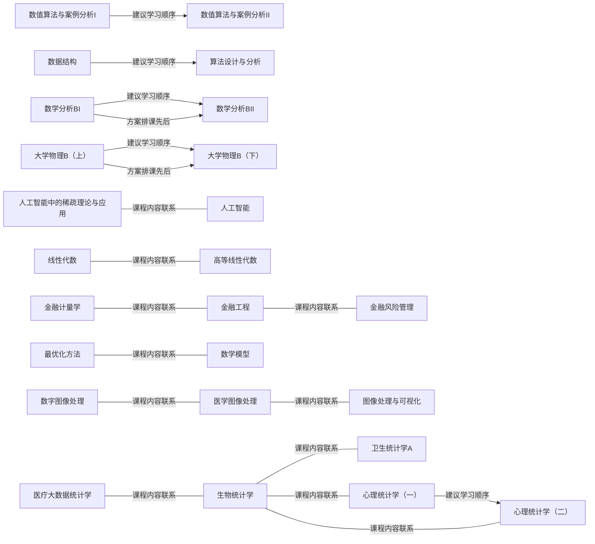

# 数据科学与大数据技术专业“2+X”教学培养方案

2024 年汇编印刷页 914–917。原表记录 66 个可配对的课程代码。

[本节原页](plan-914.pdf#page=1) · [逐行数据](plan-914.json) · [院系目录](README.md)

## 课程导读

想了解数据分析与统计方法的课程安排，可以在原表中找到《数据结构》（`DATA130023`）、《统计学基础：原理、方法及R应用(I)》（`DATA130005`）、《数据库及实现》（`DATA130039`）。 [原书 PDF 第 928 页](plan-914.pdf#page=1) · [原书 PDF 第 929 页](plan-914.pdf#page=2)

图中连接《医疗大数据统计学》（`DATA130033`）和《生物统计学》（`DATA130048`），两门课都从课程题名标出的“统计学”切入，可沿这一主题对照阅读。 [原书 PDF 第 930 页](plan-914.pdf#page=3)

## 课程关系图

图中展示最多 20 条关系。下表列出本节全部关系。建议学习顺序供规划课程使用，正式选课资格以教务规定为准。

| 课程 | 关联课程 | 关系 | 依据 |
| --- | --- | --- | --- |
| 数值算法与案例分析I（DATA130002） | 数值算法与案例分析II（DATA130010） | 建议学习顺序 | 同节课程题名标明连续分册或序号。 |
| 数据结构（DATA130023） | 算法设计与分析（COMP130011） | 建议学习顺序 | 数据组织与基本操作为算法设计提供基础。 |
| 数学分析BI（MATH120016） | 数学分析BII（MATH120017） | 建议学习顺序 | 同节课程题名标明连续分册或序号。 |
| 大学物理B（上）（PHYS120013） | 大学物理B（下）（PHYS120014） | 建议学习顺序 | 同节课程题名标明连续分册或序号。 |
| 心理统计学（一）（SOCI130158） | 心理统计学（二）（SOCI130159） | 建议学习顺序 | 同节课程题名标明连续分册或序号。 |
| 人工智能中的稀疏理论与应用（AIS631010） | 人工智能（DATA130008） | 课程内容联系 | 本方案两门课程的题名均含“人工智能”，可据此对照这一主题。 |
| 线性代数（COMP120004） | 高等线性代数（DATA130042） | 课程内容联系 | 本方案两门课程的题名均含“线性代数”，可据此对照这一主题。 |
| 金融计量学（DATA130021） | 金融工程（DATA130041） | 课程内容联系 | 本方案两门课程的题名均含“金融”，可据此对照这一主题。 |
| 最优化方法（DATA130026） | 数学模型（MATH130008） | 课程内容联系 | 模型目标、决策变量与优化求解 |
| 数字图像处理（DATA130032） | 医学图像处理（DATA130043） | 课程内容联系 | 本方案两门课程的题名均含“图像处理”，可据此对照这一主题。 |
| 医疗大数据统计学（DATA130033） | 生物统计学（DATA130048） | 课程内容联系 | 本方案两门课程的题名均含“统计学”，可据此对照这一主题。 |
| 金融工程（DATA130041） | 金融风险管理（ECON130183） | 课程内容联系 | 本方案两门课程的题名均含“金融”，可据此对照这一主题。 |
| 医学图像处理（DATA130043） | 图像处理与可视化（DATA130049） | 课程内容联系 | 本方案两门课程的题名均含“图像处理”，可据此对照这一主题。 |
| 生物统计学（DATA130048） | 卫生统计学A（PHPM130066） | 课程内容联系 | 本方案两门课程的题名均含“统计学”，可据此对照这一主题。 |
| 生物统计学（DATA130048） | 心理统计学（一）（SOCI130158） | 课程内容联系 | 本方案两门课程的题名均含“统计学”，可据此对照这一主题。 |
| 生物统计学（DATA130048） | 心理统计学（二）（SOCI130159） | 课程内容联系 | 本方案两门课程的题名均含“统计学”，可据此对照这一主题。 |
| 数学分析BI（MATH120016） | 数学分析BII（MATH120017） | 方案排课先后 | 本节原表所列全部明确学期均早于后者。 |
| 大学物理B（上）（PHYS120013） | 大学物理B（下）（PHYS120014） | 方案排课先后 | 本节原表所列全部明确学期均早于后者。 |

## 课程

| 课程代码 | 名称 | 开课学期原文 | 来源（PDF 页） |
| --- | --- | --- | --- |
| AIS410010 | 多模态数据同化 | 4、6 | 929, 931 |
| AIS631010 | 人工智能中的稀疏理论与应用 | 3、5 | 929 |
| AIT531023 | 认知智能前沿技术与实践 | 3、5 | 930, 931 |
| BIOL130112 | 组学数据的统计分析和挖掘 | 3、5 | 930 |
| COMP120004 | 线性代数 | 2 | 928 |
| COMP120006 | 程序设计 | 1 | 928 |
| COMP130011 | 算法设计与分析 | 3、5 | 930 |
| COMP130124 | 计算机视觉 | 4、6 | 930 |
| DATA130002 | 数值算法与案例分析I | 3 | 928 |
| DATA130003 | 统计（机器）学习概论 | 5 | 929 |
| DATA130005 | 统计学基础：原理、方法及R应用(I) | 4 | 929 |
| DATA130007 | 社交网络挖掘 | 3、5 | 930 |
| DATA130008 | 人工智能 | 5 | 929 |
| DATA130010 | 数值算法与案例分析II | 4、6 | 929 |
| DATA130011 | 神经网络与深度学习 | 6 | 929 |
| DATA130013 | 时间序列与空间统计 | 4、6 | 929 |
| DATA130014 | 高级大数据解析 | 4、6 | 930 |
| DATA130015 | 大规模分布式系统 | 4、6 | 930, 931 |
| DATA130016 | 生产实习 | 7 | 929 |
| DATA130017 | 毕业论文 | 8 | 929 |
| DATA130019 | 随机过程导论 | 4、6 | 929, 931 |
| DATA130021 | 金融计量学 | 3、5 | 930 |
| DATA130023 | 数据结构 | 3 | 928 |
| DATA130024 | 概率论基础 | 3 | 928 |
| DATA130025 | 计算机原理 | 3 | 929 |
| DATA130026 | 最优化方法 | 4 | 929 |
| DATA130030 | 自然语言处理 | 4、6 | 930, 931 |
| DATA130031 | 计算理论 | 3、5 | 930 |
| DATA130032 | 数字图像处理 | 4、6 | 930 |
| DATA130033 | 医疗大数据统计学 | 4、6 | 930 |
| DATA130035 | 商务分析 | 4、6 | 930 |
| DATA130036 | 大数据传播与新媒体分析 | 4、6 | 930 |
| DATA130037 | 社会数据管理与分析 | 4、6 | 930 |
| DATA130038 | 决策理论 | 4、6 | 930 |
| DATA130039 | 数据库及实现 | 4 | 929 |
| DATA130040 | 社会科学数据挖掘 | 4、6 | 930 |
| DATA130041 | 金融工程 | 3、5 | 930 |
| DATA130042 | 高等线性代数 | 3 | 928 |
| DATA130043 | 医学图像处理 | 4、6 | 930, 931 |
| DATA130044 | 多元统计分析 | 4、6 | 929 |
| DATA130045 | 图数据管理与挖掘 | 3、5 | 930 |
| DATA130046 | 统计学基础II：回归分析 | 3、5 | 929 |
| DATA130048 | 生物统计学 | 4、6 | 930, 931 |
| DATA130049 | 图像处理与可视化 | 5 | 929 |
| DATA130050 | 复杂系统理论与仿真 | 3、5 | 931 |
| DATA130056 | 应用泛函分析 | 3、5 | 929, 931 |
| DATA130058 | 线性规划 | 4、6 | 929 |
| DATA130059 | 因果推断与因果学习 | 4、6 | 929 |
| DATA130060 | 强化学习算法与理论基础 | 3、5 | 930 |
| DATA130062 | 统计计算 | 5 | 929 |
| ECON130183 | 金融风险管理 | 3、5 | 930 |
| INFO130020 | 生物医学工程学基础 | 3、5 | 931 |
| MATH120016 | 数学分析BI | 1 | 928 |
| MATH120017 | 数学分析BII | 2 | 928 |
| MATH130008 | 数学模型 | 3、5 | 929 |
| MATH130026 | 生物数学 | 3、5 | 931 |
| MATH130036 | 计算方法 | 3、5 | 929 |
| MATH130075 | 非线性系统 | 3、5 | 930 |
| MATH130116 | 随机分析 | 3、5 | 929 |
| MED130266 | 从生物学和统计学视角看人类疾病 | 4、6 | 930 |
| PHPM130066 | 卫生统计学A | 3、5 | 930 |
| PHYS120013 | 大学物理B（上） | 1 | 928 |
| PHYS120014 | 大学物理B（下） | 2 | 928 |
| SOCI130062 | 社会科学方法论 | 4、6 | 930 |
| SOCI130158 | 心理统计学（一） | 3、5 | 930 |
| SOCI130159 | 心理统计学（二） | 4、6 | 930 |
