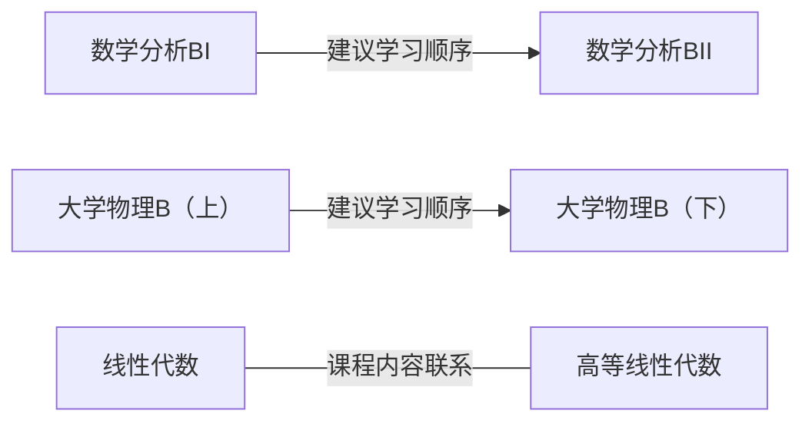

# 数据科学与大数据技术专业“2+X”修读建议

2024 年汇编印刷页 918–919。原表记录 26 个可配对的课程代码。

[本节原页](plan-914.pdf#page=5) · [逐行数据](plan-914.json) · [院系目录](README.md)

## 课程关系图

图中展示最多 20 条关系。下表列出本节全部关系。建议学习顺序供规划课程使用，正式选课资格以教务规定为准。

| 课程 | 关联课程 | 关系 | 依据 |
| --- | --- | --- | --- |
| 数学分析BI（MATH120016） | 数学分析BII（MATH120017） | 建议学习顺序 | 同节课程题名标明连续分册或序号。 |
| 大学物理B（上）（PHYS120013） | 大学物理B（下）（PHYS120014） | 建议学习顺序 | 同节课程题名标明连续分册或序号。 |
| 线性代数（COMP120004） | 高等线性代数（DATA130042） | 课程内容联系 | 本方案两门课程的题名均含“线性代数”，可据此对照这一主题。 |

## 课程

| 课程代码 | 名称 | 开课学期原文 | 来源（PDF 页） |
| --- | --- | --- | --- |
| COMP120004 | 线性代数 |  | 932 |
| COMP120006 | 程序设计 |  | 932 |
| DATA130002 | 数值算法与案例分析I |  | 932 |
| DATA130003 | 统计(机器)学习概论 |  | 932 |
| DATA130004 | 统计计算 |  | 932 |
| DATA130005 | 统计学基础：方法、原理及R应用(I) |  | 932 |
| DATA130008 | 人工智能 |  | 932 |
| DATA130011 | 神经网络与深度学习 |  | 933 |
| DATA130016 | 生产实习 |  | 933 |
| DATA130017 | 毕业论文 |  | 933 |
| DATA130023 | 数据结构 |  | 932 |
| DATA130024 | 概率论基础 |  | 932 |
| DATA130025 | 计算机原理 |  | 932 |
| DATA130026 | 最优化方法 |  | 932 |
| DATA130039 | 数据库及实现 |  | 932 |
| DATA130042 | 高等线性代数 |  | 932 |
| DATA130049 | 图像处理与可视化 |  | 933 |
| MATH120016 | 数学分析BI |  | 932 |
| MATH120017 | 数学分析BII |  | 932 |
| PHYS120013 | 大学物理B（上） |  | 932 |
| PHYS120014 | 大学物理B（下） |  | 932 |
| PTSS110082 | 毛泽东思想和中国特色社会主义理论体系概论 |  | 932 |
| PTSS110087 | 马克思主义基本原理 |  | 932 |
| PTSS110088 | 中国近现代史纲要 |  | 932 |
| PTSS110089 | 思想道德与法治 |  | 932 |
| PTSS110090 | 习近平新时代中国特色社会主义思想概论 |  | 932 |
