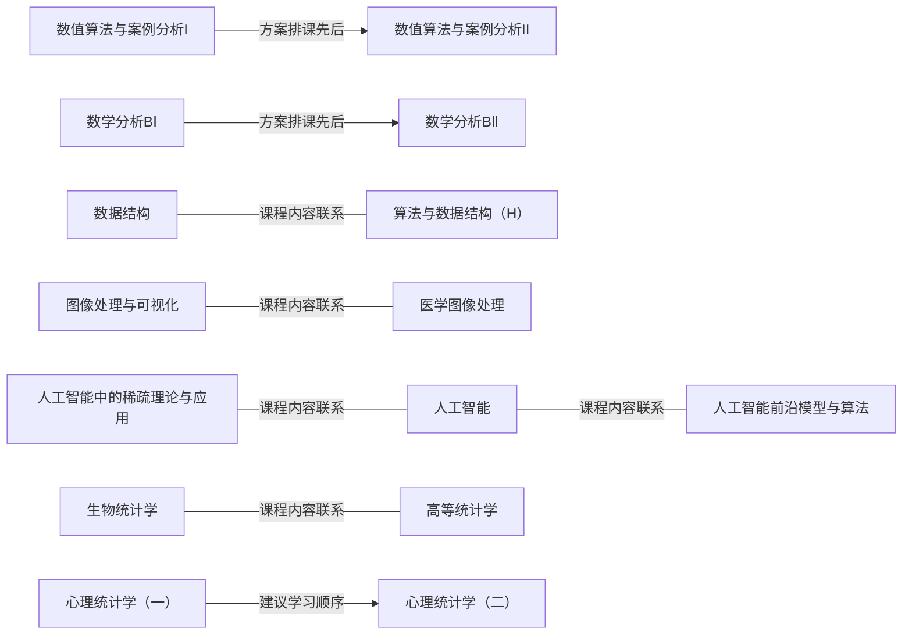

# 2025 数据科学与大数据技术专业本科培养方案（港澳台侨生适用）

大数据学院 · 数据科学与大数据技术 · 方案 96993 · 90 个不同课程或科研条目。

[官方 Word](../originals/plan-96993.docx) · [教务详情](https://fdjwgl.fudan.edu.cn/manager/bizType/2/major-program-search/info/96993?skipAuth=1) · [方案快照](../raw/plan-96993.json.gz) · [年级目录](../README.md)

## 修读导读

- **建议先学**　《数值算法与案例分析I》（`MATH20007`） → 《数值算法与案例分析II》（`MATH50009`）。题名列出连续册次或级别。把前一阶段的算法与案例对应起来，后续可用同样的输入比较解法。

- **可以对照着读**　《最优化方法》（`MATH20008`）与《数学模型》（`MATH20009`）。共同主题为模型目标、决策变量与优化求解。

- **查模块选课**　《高等线性代数》（`MATH10003`）、《概率论基础》（`STAT20006`）列在“专业核心教育课程”中。原表见 `/courseModules/6`。

## 课程关系图

图中展示部分关系。下表保留全部已建立的课程对，来源位置使用本方案 JSON Pointer。

## 先修与内容联系

| 类型 | 起点 | 终点 | 依据 | 原表定位 |
| --- | --- | --- | --- | --- |
| 建议学习顺序 | 数学分析BⅠ (MATH10012) | 数学分析BⅡ (MATH10013) | 同方案的课程题名具有连续分册或序号。  | `/courseModules/5/planCourses/0`、`/courseModules/5/planCourses/1` |
| 建议学习顺序 | 数值算法与案例分析I (MATH20007) | 数值算法与案例分析II (MATH50009) | 同方案的课程题名具有连续分册或序号。  | `/courseModules/6/planCourses/1`、`/courseModules/10/planCourses/5` |
| 建议学习顺序 | 心理统计学（一） (PSYC30017) | 心理统计学（二） (PSYC30018) | 同方案的课程题名具有连续分册或序号。  | `/courseModules/12/planCourses/7`、`/courseModules/17/planCourses/2` |
| 方案排课先后 | 数学分析BⅠ (MATH10012) | 数学分析BⅡ (MATH10013) | 同方案该课程全部明确数字学期均早于后者。  | `/courseModules/5/planCourses/0`、`/courseModules/5/planCourses/1` |
| 方案排课先后 | 数值算法与案例分析I (MATH20007) | 数值算法与案例分析II (MATH50009) | 同方案该课程全部明确数字学期均早于后者。  | `/courseModules/6/planCourses/1`、`/courseModules/10/planCourses/5` |
| 课程内容联系 | 人工智能的编程基础 (AIE310006) | 人工智能 (CS50020) | 本方案两门课程的题名均含“人工智能”，可据此对照这一主题。  | `/courseModules/5/planCourses/4`、`/courseModules/6/planCourses/8` |
| 课程内容联系 | 人工智能中的稀疏理论与应用 (AIS631010) | 人工智能 (CS50020) | 本方案两门课程的题名均含“人工智能”，可据此对照这一主题。  | `/courseModules/16/planCourses/0`、`/courseModules/6/planCourses/8` |
| 课程内容联系 | 线性代数 (CS10003) | 高等线性代数 (MATH10003) | 本方案两门课程的题名均含“线性代数”，可据此对照这一主题。  | `/courseModules/5/planCourses/2`、`/courseModules/6/planCourses/0` |
| 课程内容联系 | 数据结构 (CS20017) | 算法与数据结构（H） (CS20017h) | 本方案两门课程的题名均含“数据结构”，可据此对照这一主题。  | `/courseModules/6/planCourses/3`、`/courseModules/22/planCourses/0` |
| 课程内容联系 | 图像处理与可视化 (CS30065) | 医学图像处理 (CS50026) | 本方案两门课程的题名均含“图像处理”，可据此对照这一主题。  | `/courseModules/6/planCourses/9`、`/courseModules/12/planCourses/5` |
| 课程内容联系 | 人工智能 (CS50020) | 人工智能前沿模型与算法 (CS60004) | 本方案两门课程的题名均含“人工智能”，可据此对照这一主题。  | `/courseModules/6/planCourses/8`、`/courseModules/16/planCourses/4` |
| 课程内容联系 | 医学图像处理 (CS50026) | 图像处理与数据可视化（H） (DATA130012h) | 本方案两门课程的题名均含“图像处理”，可据此对照这一主题。  | `/courseModules/12/planCourses/5`、`/courseModules/22/planCourses/5` |
| 课程内容联系 | 最优化方法 (MATH20008) | 数学模型 (MATH20009) | 共同主题为模型目标、决策变量与优化求解。  | `/courseModules/6/planCourses/5`、`/courseModules/12/planCourses/8` |
| 课程内容联系 | 心理统计学（一） (PSYC30017) | 生物统计学 (STAT50025) | 本方案两门课程的题名均含“统计学”，可据此对照这一主题。  | `/courseModules/12/planCourses/7`、`/courseModules/12/planCourses/4` |
| 课程内容联系 | 心理统计学（二） (PSYC30018) | 生物统计学 (STAT50025) | 本方案两门课程的题名均含“统计学”，可据此对照这一主题。  | `/courseModules/17/planCourses/2`、`/courseModules/12/planCourses/4` |
| 课程内容联系 | 数量金融 (STAT50012) | 金融工程 (STAT50022) | 本方案两门课程的题名均含“金融”，可据此对照这一主题。  | `/courseModules/18/planCourses/3`、`/courseModules/18/planCourses/0` |
| 课程内容联系 | 数量金融 (STAT50012) | 大数据与金融风险管理 (STAT50028) | 本方案两门课程的题名均含“金融”，可据此对照这一主题。  | `/courseModules/18/planCourses/3`、`/courseModules/13/planCourses/2` |
| 课程内容联系 | 生物统计学 (STAT50025) | 高等统计学 (STAT50034) | 本方案两门课程的题名均含“统计学”，可据此对照这一主题。  | `/courseModules/12/planCourses/4`、`/courseModules/10/planCourses/8` |
| 课程内容联系 | 生物统计学 (STAT50025) | 统计学习方法 (STAT60006) | 本方案两门课程的题名均含“统计学”，可据此对照这一主题。  | `/courseModules/12/planCourses/4`、`/courseModules/10/planCourses/9` |

本次未从可定位的明确表述中确认课程对课程预修。学期安排、系列分册与编辑建议均保留各自的依据。

## 按原方案模块阅读

同一模块展示原表中的课程归属。模块内课程之间的先后仍须逐项查阅。

- **数计模块**　多模态数据同化、线性与整数规划、数值算法与案例分析II、高等微积分、统计计算、实验设计与属性数据分析、随机过程导论、因果推断与因果学习、高等统计学、统计学习方法、高等概率论、应用时间序列分析、应用多元统计分析（原表模块 10）
- **智计模块**　自然语言处理与大语言模型、高级大数据解析、计算理论、深度学习与空间智能、大规模分布式系统、强化学习算法与理论基础、知识图谱概念与技术（原表模块 11）
- **交叉模块**　生物医学工程学基础、医学图像处理、计算系统生物学、脑科学与类脑系统、数学模型、复杂系统理论与仿真、生物数学、心理统计学（一）、生物统计学（原表模块 12）
- **社计模块**　社交网络挖掘、社会科学数据挖掘、大数据与金融风险管理（原表模块 13）
- **数计模块**　非线性系统、应用泛函分析、随机分析、时间序列与空间统计、最优化理论、多元统计分析、贝叶斯方法与计算、高等统计学习理论、高维统计推断（原表模块 15）
- **智计模块**　人工智能中的稀疏理论与应用、认知智能前沿技术与实践、软件工程、图数据管理与挖掘、计算机视觉、人工智能前沿模型与算法、多模态大模型：算法、应用与微调、数据可视化应用及实现、算法导论（原表模块 16）
- **交叉模块**　组学数据的统计分析和挖掘、计算理论基础、心理统计学（二）、生存数据分析、医学影像分析与应用（原表模块 17）
- **社计模块**　智能体建模与计算社会科学、数量金融、金融工程、大数据环境与能源（原表模块 18）

## 课程表

同一课程在不同模块分别出现时，按原表逐行列出。季节字段保留原值。

| 课程 | 代码 | 学分 | 学期 | 模块 |
| --- | --- | ---: | --- | --- |
| 数学分析BⅠ | MATH10012 | 5.0 | 第1学期 | 培养方案 / 专业培养课程 / 学科基础课程 |
| 数学分析BⅡ | MATH10013 | 5.0 | 第2学期 | 培养方案 / 专业培养课程 / 学科基础课程 |
| 线性代数 | CS10003 | 3.0 | 第1学期 | 培养方案 / 专业培养课程 / 学科基础课程 |
| 程序设计 | CS10004 | 4.0 | 第1学期 | 培养方案 / 专业培养课程 / 学科基础课程 |
| 人工智能的编程基础 | AIE310006 | 2.0 | 第2学期 | 培养方案 / 专业培养课程 / 学科基础课程 |
| 高等线性代数 | MATH10003 | 3.0 | 第2学期 | 培养方案 / 专业培养课程 / 专业核心教育课程 |
| 数值算法与案例分析I | MATH20007 | 3.0 | 第3学期 | 培养方案 / 专业培养课程 / 专业核心教育课程 |
| 概率论基础 | STAT20006 | 4.0 | 第3学期 | 培养方案 / 专业培养课程 / 专业核心教育课程 |
| 数据结构 | CS20017 | 4.0 | 第3学期 | 培养方案 / 专业培养课程 / 专业核心教育课程 |
| 计算机原理 | CS20018 | 3.0 | 第4学期 | 培养方案 / 专业培养课程 / 专业核心教育课程 |
| 最优化方法 | MATH20008 | 3.0 | 第4学期 | 培养方案 / 专业培养课程 / 专业核心教育课程 |
| 统计学基础原理与方法 | STAT20004 | 4.0 | 第4学期 | 培养方案 / 专业培养课程 / 专业核心教育课程 |
| 数据库及实现 | CS20019 | 3.0 | 第4学期 | 培养方案 / 专业培养课程 / 专业核心教育课程 |
| 人工智能 | CS50020 | 3.0 | 第5学期 | 培养方案 / 专业培养课程 / 专业核心教育课程 |
| 图像处理与可视化 | CS30065 | 3.0 | 第5学期 | 培养方案 / 专业培养课程 / 专业核心教育课程 |
| 统计回归分析 | STAT30003 | 3.0 | 第5学期 | 培养方案 / 专业培养课程 / 专业核心教育课程 |
| 神经网络与深度学习 | CS30064 | 3.0 | 第6学期 | 培养方案 / 专业培养课程 / 专业核心教育课程 |
| 统计（机器）学习概论 | STAT30015 | 3.0 | 第6学期 | 培养方案 / 专业培养课程 / 专业核心教育课程 |
| 离散数学与算法设计 | STAT30004 | 4.0 | 第6学期 | 培养方案 / 专业培养课程 / 专业核心教育课程 |
| 高等微积分 | MATH50014 | 3.0 | 第3学期、第5学期、第7学期 | 培养方案 / 专业进阶模块 I / 数计模块 |
| 应用多元统计分析 | STAT70002 | 3.0 | 第3学期、第5学期、第7学期 | 培养方案 / 专业进阶模块 I / 数计模块 |
| 多模态数据同化 | AIS410010 | 3.0 | 第3学期、第5学期、第7学期 | 培养方案 / 专业进阶模块 I / 数计模块 |
| 随机过程导论 | STAT50017 | 3.0 | 第4学期、第6学期、第8学期 | 培养方案 / 专业进阶模块 I / 数计模块 |
| 线性与整数规划 | MATH20005 | 3.0 | 第4学期、第6学期、第8学期 | 培养方案 / 专业进阶模块 I / 数计模块 |
| 数值算法与案例分析II | MATH50009 | 3.0 | 第4学期、第6学期、第8学期 | 培养方案 / 专业进阶模块 I / 数计模块 |
| 应用时间序列分析 | STAT70001 | 3.0 | 第4学期、第6学期、第8学期 | 培养方案 / 专业进阶模块 I / 数计模块 |
| 因果推断与因果学习 | STAT50026 | 3.0 | 第4学期、第6学期、第8学期 | 培养方案 / 专业进阶模块 I / 数计模块 |
| 高等统计学 | STAT50034 | 3.0 | 第6学期、第8学期、第10学期、第12学期、第14学期 | 培养方案 / 专业进阶模块 I / 数计模块 |
| 统计学习方法 | STAT60006 | 3.0 | 第7学期、第9学期、第11学期、第13学期、第15学期 | 培养方案 / 专业进阶模块 I / 数计模块 |
| 高等概率论 | STAT60008 | 3.0 | 第7学期、第9学期、第11学期、第13学期、第15学期 | 培养方案 / 专业进阶模块 I / 数计模块 |
| 实验设计与属性数据分析 | STAT50011 | 3.0 | 第7学期、第8学期、第9学期、第10学期、第11学期 | 培养方案 / 专业进阶模块 I / 数计模块 |
| 统计计算 | STAT30016 | 3.0 | 第5学期、第7学期 | 培养方案 / 专业进阶模块 I / 数计模块 |
| 强化学习算法与理论基础 | MATH50013 | 3.0 | 第3学期、第5学期、第7学期 | 培养方案 / 专业进阶模块 I / 智计模块 |
| 知识图谱概念与技术 | STAT70012 | 3.0 | 第3学期、第5学期、第7学期 | 培养方案 / 专业进阶模块 I / 智计模块 |
| 计算理论 | CS50024 | 3.0 | 第3学期、第5学期、第7学期 | 培养方案 / 专业进阶模块 I / 智计模块 |
| 高级大数据解析 | CS50021 | 3.0 | 第4学期、第6学期、第8学期 | 培养方案 / 专业进阶模块 I / 智计模块 |
| 自然语言处理与大语言模型 | CS40008 | 3.0 | 第4学期、第6学期、第8学期 | 培养方案 / 专业进阶模块 I / 智计模块 |
| 深度学习与空间智能 | CS60003 | 3.0 | 第6学期、第8学期、第10学期、第12学期、第14学期 | 培养方案 / 专业进阶模块 I / 智计模块 |
| 大规模分布式系统 | MAS70004 | 3.0 | 第6学期、第8学期、第10学期、第12学期、第14学期 | 培养方案 / 专业进阶模块 I / 智计模块 |
| 生物医学工程学基础 | BME30003 | 3.0 | 第3学期、第5学期、第7学期 | 培养方案 / 专业进阶模块 I / 交叉模块 |
| 生物数学 | MATH70010 | 3.0 | 第3学期、第5学期、第7学期 | 培养方案 / 专业进阶模块 I / 交叉模块 |
| 脑科学与类脑系统 | CS50031 | 3.0 | 第3学期、第5学期、第7学期 | 培养方案 / 专业进阶模块 I / 交叉模块 |
| 复杂系统理论与仿真 | MATH50010 | 3.0 | 第3学期、第5学期、第7学期 | 培养方案 / 专业进阶模块 I / 交叉模块 |
| 生物统计学 | STAT50025 | 3.0 | 第4学期、第6学期、第8学期 | 培养方案 / 专业进阶模块 I / 交叉模块 |
| 医学图像处理 | CS50026 | 3.0 | 第4学期、第6学期、第8学期 | 培养方案 / 专业进阶模块 I / 交叉模块 |
| 计算系统生物学 | CS50030 | 3.0 | 第4学期、第6学期、第8学期 | 培养方案 / 专业进阶模块 I / 交叉模块 |
| 心理统计学（一） | PSYC30017 | 3.0 | 第7学期、第8学期 | 培养方案 / 专业进阶模块 I / 交叉模块 |
| 数学模型 | MATH20009 | 3.0 | 第4学期、第6学期、第8学期 | 培养方案 / 专业进阶模块 I / 交叉模块 |
| 社交网络挖掘 | CS50019 | 3.0 | 第3学期、第5学期、第7学期 | 培养方案 / 专业进阶模块 I / 社计模块 |
| 社会科学数据挖掘 | STAT50021 | 3.0 | 第4学期、第6学期、第8学期 | 培养方案 / 专业进阶模块 I / 社计模块 |
| 大数据与金融风险管理 | STAT50028 | 3.0 | 第9学期、第11学期、第13学期、第15学期 | 培养方案 / 专业进阶模块 I / 社计模块 |
| 非线性系统 | MATH40023 | 3.0 | 第3学期、第5学期、第7学期 | 培养方案 / 专业进阶模块 II / 数计模块 |
| 应用泛函分析 | MATH50011 | 3.0 | 第3学期、第5学期、第7学期 | 培养方案 / 专业进阶模块 II / 数计模块 |
| 多元统计分析 | STAT50023 | 3.0 | 第3学期、第5学期、第7学期 | 培养方案 / 专业进阶模块 II / 数计模块 |
| 高维统计推断 | STAT60007 | 3.0 | 第6学期、第8学期、第10学期、第12学期、第14学期 | 培养方案 / 专业进阶模块 II / 数计模块 |
| 随机分析 | MATH60033 | 3.0 | 第9学期、第11学期、第13学期、第15学期 | 培养方案 / 专业进阶模块 II / 数计模块 |
| 贝叶斯方法与计算 | STAT50029 | 3.0 | 第6学期、第8学期、第10学期、第12学期、第14学期 | 培养方案 / 专业进阶模块 II / 数计模块 |
| 最优化理论 | STAT40010 | 3.0 | 第7学期、第9学期、第11学期、第13学期、第15学期 | 培养方案 / 专业进阶模块 II / 数计模块 |
| 时间序列与空间统计 | STAT40008 | 3.0 | 第7学期、第9学期、第11学期、第13学期、第15学期 | 培养方案 / 专业进阶模块 II / 数计模块 |
| 高等统计学习理论 | STAT50033 | 3.0 | 第7学期、第9学期、第11学期、第13学期、第15学期 | 培养方案 / 专业进阶模块 II / 数计模块 |
| 人工智能中的稀疏理论与应用 | AIS631010 | 3.0 | 第3学期、第5学期、第7学期 | 培养方案 / 专业进阶模块 II / 智计模块 |
| 认知智能前沿技术与实践 | AIT531023 | 3.0 | 第3学期、第5学期、第7学期 | 培养方案 / 专业进阶模块 II / 智计模块 |
| 图数据管理与挖掘 | CS50027 | 3.0 | 第3学期、第5学期、第7学期 | 培养方案 / 专业进阶模块 II / 智计模块 |
| 计算机视觉 | CS50028 | 3.0 | 第6学期、第8学期、第10学期、第12学期、第14学期 | 培养方案 / 专业进阶模块 II / 智计模块 |
| 人工智能前沿模型与算法 | CS60004 | 3.0 | 第6学期、第8学期、第10学期、第12学期、第14学期 | 培养方案 / 专业进阶模块 II / 智计模块 |
| 数据可视化应用及实现 | STAT50027 | 3.0 | 第7学期、第9学期、第11学期、第13学期、第15学期 | 培养方案 / 专业进阶模块 II / 智计模块 |
| 算法导论 | STAT50031 | 3.0 | 第7学期、第9学期、第11学期、第13学期、第15学期 | 培养方案 / 专业进阶模块 II / 智计模块 |
| 软件工程 | CS30018 | 3.0 | 第9学期、第11学期、第13学期、第15学期 | 培养方案 / 专业进阶模块 II / 智计模块 |
| 多模态大模型：算法、应用与微调 | CS80001 | 3.0 | 第8学期、第10学期、第12学期、第14学期 | 培养方案 / 专业进阶模块 II / 智计模块 |
| 组学数据的统计分析和挖掘 | BIOL130112 | 2.0 | 第3学期、第5学期 | 培养方案 / 专业进阶模块 II / 交叉模块 |
| 生存数据分析 | STAT50005 | 3.0 | 第4学期、第6学期、第8学期 | 培养方案 / 专业进阶模块 II / 交叉模块 |
| 心理统计学（二） | PSYC30018 | 2.0 | 第7学期、第8学期 | 培养方案 / 专业进阶模块 II / 交叉模块 |
| 医学影像分析与应用 | STAT70013 | 3.0 | 第7学期、第9学期、第11学期、第13学期 | 培养方案 / 专业进阶模块 II / 交叉模块 |
| 计算理论基础 | MAS70003 | 3.0 | 第8学期、第10学期、第12学期、第14学期 | 培养方案 / 专业进阶模块 II / 交叉模块 |
| 金融工程 | STAT50022 | 3.0 | 第3学期、第5学期、第7学期 | 培养方案 / 专业进阶模块 II / 社计模块 |
| 大数据环境与能源 | STAT70010 | 3.0 | 第7学期、第9学期、第11学期、第13学期、第15学期 | 培养方案 / 专业进阶模块 II / 社计模块 |
| 智能体建模与计算社会科学 | AIT531024 | 3.0 | 第8学期、第10学期、第12学期、第15学期 | 培养方案 / 专业进阶模块 II / 社计模块 |
| 数量金融 | STAT50012 | 3.0 | 第9学期、第11学期、第13学期、第15学期 | 培养方案 / 专业进阶模块 II / 社计模块 |
| 算法与数据结构（H） | CS20017h | 5.0 | 第3学期 | 培养方案 / 荣誉项目 / 荣誉课程 |
| 数值算法与案例分析I（H） | MATH20007h | 4.0 | 第3学期 | 培养方案 / 荣誉项目 / 荣誉课程 |
| 统计学基础I：数理统计（H） | STAT20010h | 4.0 | 第3学期 | 培养方案 / 荣誉项目 / 荣誉课程 |
| 最优化方法（H） | MATH20008h | 4.0 | 第4学期 | 培养方案 / 荣誉项目 / 荣誉课程 |
| 统计计算（H） | STAT30016h | 4.0 | 第5学期 | 培养方案 / 荣誉项目 / 荣誉课程 |
| 图像处理与数据可视化（H） | DATA130012h | 4.0 | 第6学期 | 培养方案 / 荣誉项目 / 荣誉课程 |
| 前沿讲座 | 1061 | 0.0 |  | 融合创新能力 |
| 无学分讨论班 | 101 | 0.0 |  | 融合创新能力 |
| 复芏计划(FDUROP) | 102 | 0.0 |  | 融合创新能力 |
| 科研实践 | STAT30006 | 3.0 | 第3学期、第4学期、第5学期、第6学期 | 融合创新能力 |
| 生产实习 | STAT40004 | 1.0 | 第7学期 | 融合创新能力 |
| 毕业论文 | STAT40003 | 3.0 | 第8学期 | 融合创新能力 |
