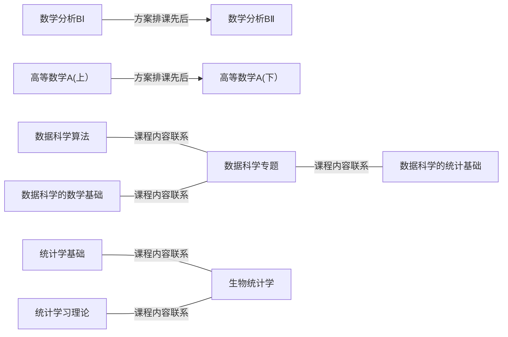

# 2025 数据科学与大数据技术专业培养方案（全英文项目）留学生适用

大数据学院 · 数据科学与大数据技术 · 方案 97084 · 40 个不同课程或科研条目。

[官方 Word](../originals/plan-97084.docx) · [教务详情](https://fdjwgl.fudan.edu.cn/manager/bizType/2/major-program-search/info/97084?skipAuth=1) · [方案快照](../raw/plan-97084.json.gz) · [年级目录](../README.md)

## 课程关系图

图中展示部分关系。下表保留全部已建立的课程对，来源位置使用本方案 JSON Pointer。

## 先修与内容联系

| 类型 | 起点 | 终点 | 依据 | 原表定位 |
| --- | --- | --- | --- | --- |
| 建议学习顺序 | 数学分析BⅠ (MATH10012) | 数学分析BⅡ (MATH10013) | 同方案的课程题名具有连续分册或序号。  | `/courseModules/7/planCourses/0`、`/courseModules/7/planCourses/1` |
| 建议学习顺序 | 高等数学A(上） (MATH10015) | 高等数学A(下） (MATH10016) | 同方案的课程题名具有连续分册或序号。  | `/courseModules/8/planCourses/0`、`/courseModules/8/planCourses/1` |
| 方案排课先后 | 数学分析BⅠ (MATH10012) | 数学分析BⅡ (MATH10013) | 同方案该课程全部明确数字学期均早于后者。  | `/courseModules/7/planCourses/0`、`/courseModules/7/planCourses/1` |
| 方案排课先后 | 高等数学A(上） (MATH10015) | 高等数学A(下） (MATH10016) | 同方案该课程全部明确数字学期均早于后者。  | `/courseModules/8/planCourses/0`、`/courseModules/8/planCourses/1` |
| 课程内容联系 | 数据科学算法 (CS20007) | 数据科学专题 (STAT30008) | 本方案两门课程的题名均含“数据科学”，可据此对照这一主题。  | `/courseModules/11/planCourses/3`、`/courseModules/11/planCourses/9` |
| 课程内容联系 | 数据科学与编程 (CS50004) | 数据科学专题 (STAT30008) | 本方案两门课程的题名均含“数据科学”，可据此对照这一主题。  | `/courseModules/17/planCourses/1`、`/courseModules/11/planCourses/9` |
| 课程内容联系 | 统计学基础 (STAT20005) | 生物统计学 (STAT50009) | 本方案两门课程的题名均含“统计学”，可据此对照这一主题。  | `/courseModules/11/planCourses/5`、`/courseModules/15/planCourses/2` |
| 课程内容联系 | 数据科学的数学基础 (STAT20008) | 数据科学专题 (STAT30008) | 本方案两门课程的题名均含“数据科学”，可据此对照这一主题。  | `/courseModules/11/planCourses/0`、`/courseModules/11/planCourses/9` |
| 课程内容联系 | 数据科学专题 (STAT30008) | 数据科学的统计基础 (STAT30010) | 本方案两门课程的题名均含“数据科学”，可据此对照这一主题。  | `/courseModules/11/planCourses/9`、`/courseModules/11/planCourses/10` |
| 课程内容联系 | 统计学习理论 (STAT30011) | 生物统计学 (STAT50009) | 本方案两门课程的题名均含“统计学”，可据此对照这一主题。  | `/courseModules/11/planCourses/11`、`/courseModules/15/planCourses/2` |

本次未从可定位的明确表述中确认课程对课程预修。学期安排、系列分册与编辑建议均保留各自的依据。

## 按原方案模块阅读

同一模块展示原表中的课程归属。模块内课程之间的先后仍须逐项查阅。

- **数学分析B**　数学分析BⅠ、数学分析BⅡ（原表模块 7）
- **高等数学A**　高等数学A(上）、高等数学A(下）（原表模块 8）
- **统计与分析 Statistics and Analytics**　统计案例分析、随机过程导论、统计计算与贝叶斯方法、生物统计学（原表模块 15）
- **系统和数据 Systems and Data Mining**　自然语言处理、大数据系统、MPI、OpenMP 和 CUDA 的并行计算导论、大数据挖掘（原表模块 16）
- **社会科学大数据 Data Science for Social Science**　数据科学与编程、数据可视化、计量经济学、社会科学中的数据挖掘（原表模块 17）

## 课程表

同一课程在不同模块分别出现时，按原表逐行列出。季节字段保留原值。

| 课程 | 代码 | 学分 | 学期 | 模块 |
| --- | --- | ---: | --- | --- |
| 数学分析BⅠ | MATH10012 | 5.0 | 第1学期 | 培养方案 / 专业培养课程 / 学科基础课程 / 数学组 / 数学分析B |
| 数学分析BⅡ | MATH10013 | 5.0 | 第2学期 | 培养方案 / 专业培养课程 / 学科基础课程 / 数学组 / 数学分析B |
| 高等数学A(上） | MATH10015 | 5.0 | 第1学期 | 培养方案 / 专业培养课程 / 学科基础课程 / 数学组 / 高等数学A |
| 高等数学A(下） | MATH10016 | 5.0 | 第2学期 | 培养方案 / 专业培养课程 / 学科基础课程 / 数学组 / 高等数学A |
| Python程序设计 | GEEC10072 | 2.0 | 第1学期 | 培养方案 / 专业培养课程 / 学科基础课程 / 必修课程 |
| 计算机导论 | MF20006 | 3.0 | 第3学期 | 培养方案 / 专业培养课程 / 学科基础课程 / 必修课程 |
| 线性代数 | MATH10017 | 3.0 | SPRING、AUTUMN | 培养方案 / 专业培养课程 / 学科基础课程 / 必修课程 / A组 |
| 线性代数 | CS10003 | 3.0 | 第1学期 | 培养方案 / 专业培养课程 / 学科基础课程 / 必修课程 / A组 |
| 线性代数 | MATH20002 | 4.0 | SPRING | 培养方案 / 专业培养课程 / 学科基础课程 / 必修课程 / A组 |
| 数据科学的数学基础 | STAT20008 | 3.0 | 第3学期 | 培养方案 / 专业培养课程 / 专业核心教育课程 |
| 概率论 | STAT20009 | 4.0 | 第3学期 | 培养方案 / 专业培养课程 / 专业核心教育课程 |
| 数据结构 | CS30013 | 3.0 | 第3学期 | 培养方案 / 专业培养课程 / 专业核心教育课程 |
| 数据科学算法 | CS20007 | 3.0 | 第3学期 | 培养方案 / 专业培养课程 / 专业核心教育课程 |
| 数据科学中的优化方法 | MATH20006 | 3.0 | 第4学期 | 培养方案 / 专业培养课程 / 专业核心教育课程 |
| 统计学基础 | STAT20005 | 4.0 | 第4学期 | 培养方案 / 专业培养课程 / 专业核心教育课程 |
| 人工智能 | CS30014 | 3.0 | 第4学期 | 培养方案 / 专业培养课程 / 专业核心教育课程 |
| 回归分析 | STAT30007 | 3.0 | 第5学期 | 培养方案 / 专业培养课程 / 专业核心教育课程 |
| 强化学习 | STAT50006 | 3.0 | 第5学期 | 培养方案 / 专业培养课程 / 专业核心教育课程 |
| 数据科学专题 | STAT30008 | 3.0 | 第5学期 | 培养方案 / 专业培养课程 / 专业核心教育课程 |
| 数据科学的统计基础 | STAT30010 | 3.0 | 第5学期、第6学期 | 培养方案 / 专业培养课程 / 专业核心教育课程 |
| 统计学习理论 | STAT30011 | 3.0 | 第5学期、第6学期 | 培养方案 / 专业培养课程 / 专业核心教育课程 |
| 深度学习 | CS30012 | 3.0 | 第6学期 | 培养方案 / 专业培养课程 / 专业核心教育课程 |
| 随机过程导论 | STAT50007 | 3.0 | 第4学期、第6学期 | 培养方案 / 专业进阶模块 I Regular Major Modules / 统计与分析 Statistics and Analytics |
| 统计计算与贝叶斯方法 | STAT50008 | 3.0 | 第3学期、第5学期、第7学期 | 培养方案 / 专业进阶模块 I Regular Major Modules / 统计与分析 Statistics and Analytics |
| 生物统计学 | STAT50009 | 3.0 | 第4学期、第6学期 | 培养方案 / 专业进阶模块 I Regular Major Modules / 统计与分析 Statistics and Analytics |
| 统计案例分析 | STAT50001 | 3.0 | 第3学期、第5学期、第7学期 | 培养方案 / 专业进阶模块 I Regular Major Modules / 统计与分析 Statistics and Analytics |
| MPI、OpenMP 和 CUDA 的并行计算导论 | STAT50003 | 3.0 | 第5学期、第7学期 | 培养方案 / 专业进阶模块 I Regular Major Modules / 系统和数据 Systems and Data Mining |
| 自然语言处理 | CS50023 | 3.0 | 第4学期、第6学期 | 培养方案 / 专业进阶模块 I Regular Major Modules / 系统和数据 Systems and Data Mining |
| 大数据系统 | STAT30009 | 3.0 | 第5学期、第7学期 | 培养方案 / 专业进阶模块 I Regular Major Modules / 系统和数据 Systems and Data Mining |
| 大数据挖掘 | STAT50004 | 3.0 | 第5学期、第7学期 | 培养方案 / 专业进阶模块 I Regular Major Modules / 系统和数据 Systems and Data Mining |
| 社会科学中的数据挖掘 | STAT50010 | 3.0 | 第4学期、第6学期 | 培养方案 / 专业进阶模块 I Regular Major Modules / 社会科学大数据 Data Science for Social Science |
| 数据科学与编程 | CS50004 | 3.0 | 第4学期、第6学期 | 培养方案 / 专业进阶模块 I Regular Major Modules / 社会科学大数据 Data Science for Social Science |
| 计量经济学 | STAT50002 | 3.0 | 第5学期、第7学期 | 培养方案 / 专业进阶模块 I Regular Major Modules / 社会科学大数据 Data Science for Social Science |
| 数据可视化 | CS50005 | 2.0 | 第5学期、第7学期 | 培养方案 / 专业进阶模块 I Regular Major Modules / 社会科学大数据 Data Science for Social Science |
| 前沿讲座 | 1061 | 0.0 |  | 融合创新能力 |
| 无学分讨论班 | 101 | 0.0 |  | 融合创新能力 |
| 复芏计划(FDUROP) | 102 | 0.0 |  | 融合创新能力 |
| 科研实践 | STAT30006 | 3.0 | 第3学期、第4学期、第5学期、第6学期 | 融合创新能力 |
| 生产实习 | STAT40004 | 1.0 | 第7学期 | 融合创新能力 |
| 毕业论文 | STAT40003 | 3.0 | 第8学期 | 融合创新能力 |
