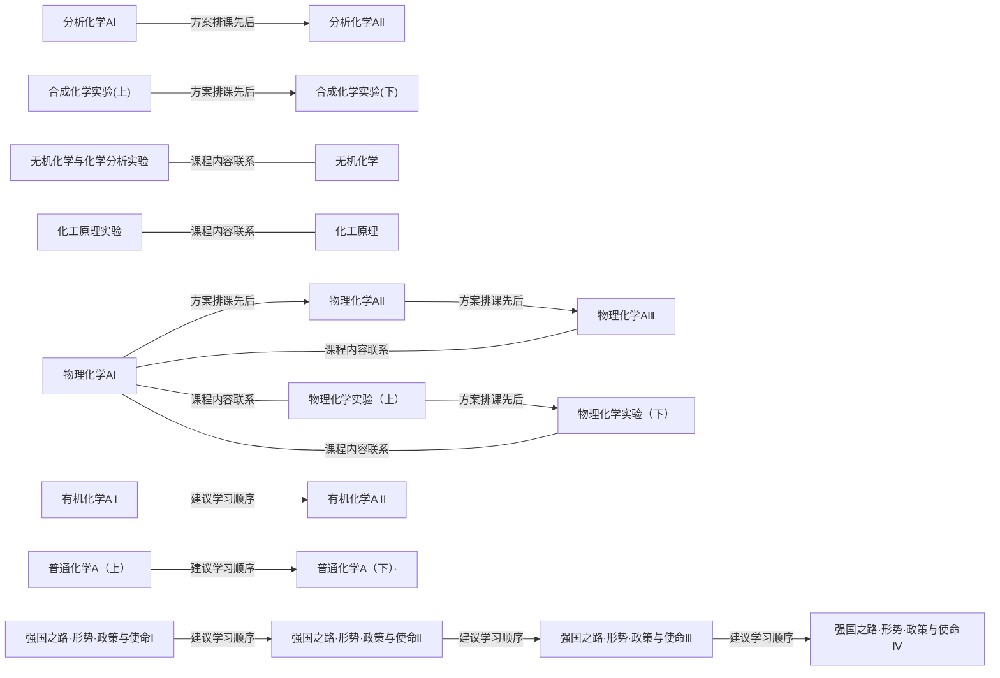

# 2023 化学专业教学培养方案（强基班适用）

化学系 · 化学(强基计划) · 方案 67733 · 214 个不同课程或科研条目。

[官方 Word](../originals/plan-67733.docx) · [教务详情](https://fdjwgl.fudan.edu.cn/manager/bizType/2/major-program-search/info/67733?skipAuth=1) · [方案快照](../raw/plan-67733.json.gz) · [年级目录](../README.md)

## 课程关系图

图中展示部分关系。下表保留全部已建立的课程对，来源位置使用本方案 JSON Pointer。

## 先修与内容联系

| 类型 | 起点 | 终点 | 依据 | 原表定位 |
| --- | --- | --- | --- | --- |
| 建议学习顺序 | 生物化学A(上) (BIOL30002) | 生物化学A(下) (BIOL30021) | 同方案的课程题名具有连续分册或序号。  | `/courseModules/23/planCourses/1`、`/courseModules/23/planCourses/3` |
| 建议学习顺序 | 普通化学A（上） (CHEM10003) | 普通化学A（下） (CHEM10004) | 同方案的课程题名具有连续分册或序号。  | `/courseModules/15/planCourses/2`、`/courseModules/15/planCourses/3` |
| 建议学习顺序 | 分析化学AⅠ (CHEM20001) | 分析化学AⅡ (CHEM20002) | 同方案的课程题名具有连续分册或序号。  | `/courseModules/17/planCourses/0`、`/courseModules/18/planCourses/0` |
| 建议学习顺序 | 合成化学实验(上) (CHEM20004) | 合成化学实验(下) (CHEM30003) | 同方案的课程题名具有连续分册或序号。  | `/courseModules/17/planCourses/1`、`/courseModules/17/planCourses/2` |
| 建议学习顺序 | 物理化学AⅠ (CHEM20005) | 物理化学AⅡ (CHEM20006) | 同方案的课程题名具有连续分册或序号。  | `/courseModules/18/planCourses/1`、`/courseModules/18/planCourses/2` |
| 建议学习顺序 | 物理化学AⅡ (CHEM20006) | 物理化学AⅢ (CHEM30004) | 同方案的课程题名具有连续分册或序号。  | `/courseModules/18/planCourses/2`、`/courseModules/18/planCourses/3` |
| 建议学习顺序 | 有机化学A I (CHEM20013) | 有机化学A II (CHEM20014) | 同方案的课程题名具有连续分册或序号。  | `/courseModules/18/planCourses/5`、`/courseModules/18/planCourses/6` |
| 建议学习顺序 | 物理化学实验（上） (CHEM30031) | 物理化学实验（下） (CHEM30032) | 同方案的课程题名具有连续分册或序号。  | `/courseModules/17/planCourses/7`、`/courseModules/18/planCourses/7` |
| 建议学习顺序 | 大学生创新创意创业实践B(一) (GEIN30002) | 大学生创新创意创业实践B(二) (GEIN30003) | 同方案的课程题名具有连续分册或序号。  | `/courseModules/11/planCourses/33`、`/courseModules/11/planCourses/34` |
| 建议学习顺序 | 大学生创新创意创业实践B(二) (GEIN30003) | 大学生创新创意创业实践B(三) (GEIN30004) | 同方案的课程题名具有连续分册或序号。  | `/courseModules/11/planCourses/34`、`/courseModules/11/planCourses/35` |
| 建议学习顺序 | 强国之路：形势、政策与使命Ⅰ (GESP10003) | 强国之路：形势、政策与使命Ⅱ (GESP10004) | 同方案的课程题名具有连续分册或序号。  | `/courseModules/5/planCourses/0`、`/courseModules/5/planCourses/1` |
| 建议学习顺序 | 强国之路：形势、政策与使命Ⅱ (GESP10004) | 强国之路：形势、政策与使命Ⅲ (GESP20003) | 同方案的课程题名具有连续分册或序号。  | `/courseModules/5/planCourses/1`、`/courseModules/5/planCourses/2` |
| 建议学习顺序 | 强国之路：形势、政策与使命Ⅲ (GESP20003) | 强国之路：形势、政策与使命Ⅳ (GESP20004) | 同方案的课程题名具有连续分册或序号。  | `/courseModules/5/planCourses/2`、`/courseModules/5/planCourses/3` |
| 建议学习顺序 | 高等数学B(上） (MATH10004) | 高等数学B(下） (MATH10005) | 同方案的课程题名具有连续分册或序号。  | `/courseModules/15/planCourses/5`、`/courseModules/15/planCourses/6` |
| 建议学习顺序 | 大学物理B(上) (PHYS10003) | 大学物理B(下) (PHYS10004) | 同方案的课程题名具有连续分册或序号。  | `/courseModules/15/planCourses/7`、`/courseModules/15/planCourses/8` |
| 方案排课先后 | 分析化学AⅠ (CHEM20001) | 分析化学AⅡ (CHEM20002) | 同方案该课程全部明确数字学期均早于后者。  | `/courseModules/17/planCourses/0`、`/courseModules/18/planCourses/0` |
| 方案排课先后 | 合成化学实验(上) (CHEM20004) | 合成化学实验(下) (CHEM30003) | 同方案该课程全部明确数字学期均早于后者。  | `/courseModules/17/planCourses/1`、`/courseModules/17/planCourses/2` |
| 方案排课先后 | 物理化学AⅠ (CHEM20005) | 物理化学AⅡ (CHEM20006) | 同方案该课程全部明确数字学期均早于后者。  | `/courseModules/18/planCourses/1`、`/courseModules/18/planCourses/2` |
| 方案排课先后 | 物理化学AⅡ (CHEM20006) | 物理化学AⅢ (CHEM30004) | 同方案该课程全部明确数字学期均早于后者。  | `/courseModules/18/planCourses/2`、`/courseModules/18/planCourses/3` |
| 方案排课先后 | 有机化学A I (CHEM20013) | 有机化学A II (CHEM20014) | 同方案该课程全部明确数字学期均早于后者。  | `/courseModules/18/planCourses/5`、`/courseModules/18/planCourses/6` |
| 方案排课先后 | 物理化学实验（上） (CHEM30031) | 物理化学实验（下） (CHEM30032) | 同方案该课程全部明确数字学期均早于后者。  | `/courseModules/17/planCourses/7`、`/courseModules/18/planCourses/7` |
| 方案排课先后 | 强国之路：形势、政策与使命Ⅰ (GESP10003) | 强国之路：形势、政策与使命Ⅱ (GESP10004) | 同方案该课程全部明确数字学期均早于后者。  | `/courseModules/5/planCourses/0`、`/courseModules/5/planCourses/1` |
| 方案排课先后 | 强国之路：形势、政策与使命Ⅱ (GESP10004) | 强国之路：形势、政策与使命Ⅲ (GESP20003) | 同方案该课程全部明确数字学期均早于后者。  | `/courseModules/5/planCourses/1`、`/courseModules/5/planCourses/2` |
| 方案排课先后 | 强国之路：形势、政策与使命Ⅲ (GESP20003) | 强国之路：形势、政策与使命Ⅳ (GESP20004) | 同方案该课程全部明确数字学期均早于后者。  | `/courseModules/5/planCourses/2`、`/courseModules/5/planCourses/3` |
| 课程内容联系 | 人工智能在化学中的应用 (AIS310014) | 人工智能化学计算模拟 (AIS531005) | 本方案两门课程的题名均含“人工智能”，可据此对照这一主题。  | `/courseModules/23/planCourses/63`、`/courseModules/23/planCourses/62` |
| 课程内容联系 | 人工智能化学计算模拟 (AIS531005) | 人工智能在分析化学中的应用 (AIT310024) | 本方案两门课程的题名均含“人工智能”，可据此对照这一主题。  | `/courseModules/23/planCourses/62`、`/courseModules/23/planCourses/0` |
| 课程内容联系 | 人工智能化学计算模拟 (AIS531005) | 人工智能在企业中的应用与创新A (DATA115003) | 本方案两门课程的题名均含“人工智能”，可据此对照这一主题。  | `/courseModules/23/planCourses/62`、`/courseModules/11/planCourses/8` |
| 课程内容联系 | 人工智能在分析化学中的应用 (AIT310024) | 分析化学AⅠ (CHEM20001) | 本方案两门课程的题名均含“分析化学”，可据此对照这一主题。  | `/courseModules/23/planCourses/0`、`/courseModules/17/planCourses/0` |
| 课程内容联系 | 生物化学A(上) (BIOL30002) | 生物化学B (BIOL30013) | 本方案两门课程的题名均含“生物化学”，可据此对照这一主题。  | `/courseModules/23/planCourses/1`、`/courseModules/23/planCourses/2` |
| 课程内容联系 | 生物化学B (BIOL30013) | 生物化学A(下) (BIOL30021) | 本方案两门课程的题名均含“生物化学”，可据此对照这一主题。  | `/courseModules/23/planCourses/2`、`/courseModules/23/planCourses/3` |
| 课程内容联系 | 应用电化学 (CHEM130033) | 光电化学 (CHEM130101) | 本方案两门课程的题名均含“电化学”，可据此对照这一主题。  | `/courseModules/23/planCourses/10`、`/courseModules/23/planCourses/41` |
| 课程内容联系 | 精细有机化学 (CHEM130037) | 有机化学选论 (CHEM130069) | 本方案两门课程的题名均含“有机化学”，可据此对照这一主题。  | `/courseModules/23/planCourses/12`、`/courseModules/23/planCourses/28` |
| 课程内容联系 | 化工原理实验 (CHEM130042) | 化工原理 (CHEM30015) | 题名显示相同主题的课程与实验、实践或实习。  | `/courseModules/23/planCourses/17`、`/courseModules/17/planCourses/6` |
| 课程内容联系 | 有机化学选论 (CHEM130069) | 有机化学A I (CHEM20013) | 本方案两门课程的题名均含“有机化学”，可据此对照这一主题。  | `/courseModules/23/planCourses/28`、`/courseModules/18/planCourses/5` |
| 课程内容联系 | 有机化学选论 (CHEM130069) | 有机化学A II (CHEM20014) | 本方案两门课程的题名均含“有机化学”，可据此对照这一主题。  | `/courseModules/23/planCourses/28`、`/courseModules/18/planCourses/6` |
| 课程内容联系 | 有机化学选论 (CHEM130069) | 高等有机化学(H) (CHEM40015h) | 本方案两门课程的题名均含“有机化学”，可据此对照这一主题。  | `/courseModules/23/planCourses/28`、`/courseModules/22/planCourses/1` |
| 课程内容联系 | 光电化学 (CHEM130101) | 绿色电化学合成 (CHEM30001) | 本方案两门课程的题名均含“电化学”，可据此对照这一主题。  | `/courseModules/23/planCourses/41`、`/courseModules/23/planCourses/60` |
| 课程内容联系 | 分析化学AⅠ (CHEM20001) | 分析化学AⅡ (CHEM20002) | 本方案两门课程的题名均含“分析化学”，可据此对照这一主题。  | `/courseModules/17/planCourses/0`、`/courseModules/18/planCourses/0` |
| 课程内容联系 | 分析化学AⅠ (CHEM20001) | 近代分析化学 (CHEM30008) | 本方案两门课程的题名均含“分析化学”，可据此对照这一主题。  | `/courseModules/17/planCourses/0`、`/courseModules/23/planCourses/7` |
| 课程内容联系 | 物理化学AⅠ (CHEM20005) | 物理化学AⅡ (CHEM20006) | 本方案两门课程的题名均含“物理化学”，可据此对照这一主题。  | `/courseModules/18/planCourses/1`、`/courseModules/18/planCourses/2` |
| 课程内容联系 | 物理化学AⅠ (CHEM20005) | 物理化学AⅢ (CHEM30004) | 本方案两门课程的题名均含“物理化学”，可据此对照这一主题。  | `/courseModules/18/planCourses/1`、`/courseModules/18/planCourses/3` |
| 课程内容联系 | 物理化学AⅠ (CHEM20005) | 物理化学实验（上） (CHEM30031) | 本方案两门课程的题名均含“物理化学”，可据此对照这一主题。  | `/courseModules/18/planCourses/1`、`/courseModules/17/planCourses/7` |
| 课程内容联系 | 物理化学AⅠ (CHEM20005) | 物理化学实验（下） (CHEM30032) | 本方案两门课程的题名均含“物理化学”，可据此对照这一主题。  | `/courseModules/18/planCourses/1`、`/courseModules/18/planCourses/7` |
| 课程内容联系 | 无机化学与化学分析实验 (CHEM20021) | 无机化学 (CHEM30005) | 本方案两门课程的题名均含“无机化学”，可据此对照这一主题。  | `/courseModules/17/planCourses/9`、`/courseModules/18/planCourses/4` |
| 课程内容联系 | 无机化学 (CHEM30005) | 高等无机化学(H) (CHEM40014h) | 本方案两门课程的题名均含“无机化学”，可据此对照这一主题。  | `/courseModules/18/planCourses/4`、`/courseModules/22/planCourses/0` |
| 课程内容联系 | 金融创新 (GEIN10006) | 创业企业金融与会计 (GEIN10029) | 本方案两门课程的题名均含“金融”，可据此对照这一主题。  | `/courseModules/11/planCourses/9`、`/courseModules/11/planCourses/52` |
| 课程内容联系 | 会计学原理 (GEIN10011) | 创业企业金融与会计 (GEIN10029) | 本方案两门课程的题名均含“会计”，可据此对照这一主题。  | `/courseModules/11/planCourses/14`、`/courseModules/11/planCourses/52` |
| 课程内容联系 | 心理健康教育行业创业与发展 (GEIN10050) | 心理健康教育行业创业与发展A (SOCI115006) | 本方案两门课程的题名均含“健康教育”，可据此对照这一主题。  | `/courseModules/11/planCourses/82`、`/courseModules/11/planCourses/86` |

本次未从可定位的明确表述中确认课程对课程预修。学期安排、系列分册与编辑建议均保留各自的依据。

## 按原方案模块阅读

同一模块展示原表中的课程归属。模块内课程之间的先后仍须逐项查阅。

- **思政A**　中国近现代史纲要、思想道德与法治、毛泽东思想和中国特色社会主义理论体系概论、习近平新时代中国特色社会主义思想概论、马克思主义基本原理（原表模块 4）
- **形势与政策**　强国之路：形势、政策与使命Ⅰ、强国之路：形势、政策与使命Ⅱ、强国之路：形势、政策与使命Ⅲ、强国之路：形势、政策与使命Ⅳ（原表模块 5）
- **军事理论**　军事理论、军事技能（原表模块 10）
- **创新创意创业**　环境空间健康与生活安全、人工智能在企业中的应用与创新A、创意网络视频策划、制作与营销、微电影编剧的方法与实践、纳米艺术的思维、审美与创造、微流控芯片实验室、传统文化资源的保护与利用、计算机与互联网的未来、行业大数据的应用与创新、金融创新、创新与经济学、保险企业经营管理、保险科技、像经济学家那样思考：信息、激励与政策、会计学原理、科技创新创业、设计驱动创新与创业、工程创新思维与方法等90项（原表模块 11）
- **心理健康教育课程**　健康行为心理、成功心理素质训练、幸福心理学、两性心理学、大学生心理健康导论、领导力与自我管理、大学生心理健康与发展、心理健康与大学生活、大学生心理健康与发展、咨询心理学与心智成长、国学涵养与心理成长、静心冥想与心理健康、朋辈心理辅导理论与实践、沟通心理学、从公共卫生视角看心理健康（原表模块 12）
- **必选1门**　量子化学原理及应用(H)、高等无机化学(H)、高等有机化学(H)（原表模块 22）

## 课程表

同一课程在不同模块分别出现时，按原表逐行列出。季节字段保留原值。

| 课程 | 代码 | 学分 | 学期 | 模块 |
| --- | --- | ---: | --- | --- |
| 毛泽东思想和中国特色社会主义理论体系概论 | GEIP30001 | 3.0 | SPRING、AUTUMN | 培养方案 / 通识教育课程 / 通识教育核心课程 / 思想政治理论课模块 / 思政A |
| 马克思主义基本原理 | GEIP40012 | 3.0 | SPRING、AUTUMN | 培养方案 / 通识教育课程 / 通识教育核心课程 / 思想政治理论课模块 / 思政A |
| 中国近现代史纲要 | GEIP20006 | 3.0 | SPRING、AUTUMN | 培养方案 / 通识教育课程 / 通识教育核心课程 / 思想政治理论课模块 / 思政A |
| 思想道德与法治 | GEIP20007 | 3.0 | SPRING、AUTUMN | 培养方案 / 通识教育课程 / 通识教育核心课程 / 思想政治理论课模块 / 思政A |
| 习近平新时代中国特色社会主义思想概论 | GEIP30002 | 3.0 | SPRING、AUTUMN | 培养方案 / 通识教育课程 / 通识教育核心课程 / 思想政治理论课模块 / 思政A |
| 强国之路：形势、政策与使命Ⅰ | GESP10003 | 0.5 | 第1学期 | 培养方案 / 通识教育课程 / 通识教育核心课程 / 思想政治理论课模块 / 思政A / 形势与政策 |
| 强国之路：形势、政策与使命Ⅱ | GESP10004 | 0.5 | 第2学期 | 培养方案 / 通识教育课程 / 通识教育核心课程 / 思想政治理论课模块 / 思政A / 形势与政策 |
| 强国之路：形势、政策与使命Ⅲ | GESP20003 | 0.5 | 第3学期 | 培养方案 / 通识教育课程 / 通识教育核心课程 / 思想政治理论课模块 / 思政A / 形势与政策 |
| 强国之路：形势、政策与使命Ⅳ | GESP20004 | 0.5 | 第4学期 | 培养方案 / 通识教育课程 / 通识教育核心课程 / 思想政治理论课模块 / 思政A / 形势与政策 |
| 英语诗歌选读 | GEEF20015 | 2.0 | SPRING、AUTUMN | 培养方案 / 通识教育课程 / 通识教育专项教育课程 / 大学外语 |
| 军事理论 | GEND10001 | 2.0 | SPRING、AUTUMN | 培养方案 / 通识教育课程 / 通识教育专项教育课程 / 军事理论 |
| 军事技能 | GEND10002 | 2.0 | SUMMER | 培养方案 / 通识教育课程 / 通识教育专项教育课程 / 军事理论 |
| 大气与海洋科学的行业创新与创业 | GEIN20002 | 1.0 | SPRING、AUTUMN | 培养方案 / 通识教育课程 / 通识教育专项教育课程 / 创新创意创业 |
| 走近红树林 | GEXZ10004 | 3.0 | SUMMER | 培养方案 / 通识教育课程 / 通识教育专项教育课程 / 创新创意创业 |
| 生物技术产业与大学生生涯发展 | GEIN20003 | 1.0 | SPRING、AUTUMN | 培养方案 / 通识教育课程 / 通识教育专项教育课程 / 创新创意创业 |
| 微流控芯片实验室 | GEIN10002 | 2.0 | SPRING、AUTUMN | 培养方案 / 通识教育课程 / 通识教育专项教育课程 / 创新创意创业 |
| 环境空间健康与生活安全 | CHEM115003 | 1.0 | SPRING、AUTUMN | 培养方案 / 通识教育课程 / 通识教育专项教育课程 / 创新创意创业 |
| 传统文化资源的保护与利用 | GEIN10003 | 1.0 | SPRING、AUTUMN | 培养方案 / 通识教育课程 / 通识教育专项教育课程 / 创新创意创业 |
| 计算机与互联网的未来 | GEIN10004 | 1.0 | SPRING、AUTUMN | 培养方案 / 通识教育课程 / 通识教育专项教育课程 / 创新创意创业 |
| 行业大数据的应用与创新 | GEIN10005 | 1.0 | SPRING、AUTUMN | 培养方案 / 通识教育课程 / 通识教育专项教育课程 / 创新创意创业 |
| 人工智能在企业中的应用与创新A | DATA115003 | 2.0 | SPRING、AUTUMN | 培养方案 / 通识教育课程 / 通识教育专项教育课程 / 创新创意创业 |
| 金融创新 | GEIN10006 | 2.0 | SPRING、AUTUMN | 培养方案 / 通识教育课程 / 通识教育专项教育课程 / 创新创意创业 |
| 创新与经济学 | GEIN10007 | 1.0 | SPRING、AUTUMN | 培养方案 / 通识教育课程 / 通识教育专项教育课程 / 创新创意创业 |
| 保险企业经营管理 | GEIN10008 | 2.0 | SPRING、AUTUMN | 培养方案 / 通识教育课程 / 通识教育专项教育课程 / 创新创意创业 |
| 保险科技 | GEIN10009 | 2.0 | SPRING、AUTUMN | 培养方案 / 通识教育课程 / 通识教育专项教育课程 / 创新创意创业 |
| 像经济学家那样思考：信息、激励与政策 | GEIN10010 | 2.0 | SPRING、AUTUMN | 培养方案 / 通识教育课程 / 通识教育专项教育课程 / 创新创意创业 |
| 会计学原理 | GEIN10011 | 2.0 | SPRING、AUTUMN | 培养方案 / 通识教育课程 / 通识教育专项教育课程 / 创新创意创业 |
| 科技创新创业 | GEIN10012 | 2.0 | SPRING、AUTUMN | 培养方案 / 通识教育课程 / 通识教育专项教育课程 / 创新创意创业 |
| 设计驱动创新与创业 | GEIN10013 | 2.0 | SPRING、AUTUMN | 培养方案 / 通识教育课程 / 通识教育专项教育课程 / 创新创意创业 |
| 工程创新思维与方法 | GEIN10014 | 1.0 | SPRING、AUTUMN | 培养方案 / 通识教育课程 / 通识教育专项教育课程 / 创新创意创业 |
| 创意可视化设计 | GEIN10015 | 1.0 | SPRING、AUTUMN | 培养方案 / 通识教育课程 / 通识教育专项教育课程 / 创新创意创业 |
| 创意网络视频策划、制作与营销 | FINE115002 | 1.0 | SPRING、AUTUMN | 培养方案 / 通识教育课程 / 通识教育专项教育课程 / 创新创意创业 |
| 微电影编剧的方法与实践 | FINE115003 | 1.0 | SPRING、AUTUMN | 培养方案 / 通识教育课程 / 通识教育专项教育课程 / 创新创意创业 |
| 纳米艺术的思维、审美与创造 | FINE115004 | 1.0 | SPRING、AUTUMN | 培养方案 / 通识教育课程 / 通识教育专项教育课程 / 创新创意创业 |
| 创意设计前沿 | GEIN10016 | 2.0 | SPRING、AUTUMN | 培养方案 / 通识教育课程 / 通识教育专项教育课程 / 创新创意创业 |
| 设计色彩与创意思维 | GEIN10017 | 2.0 | SPRING、AUTUMN | 培养方案 / 通识教育课程 / 通识教育专项教育课程 / 创新创意创业 |
| 数字影视动画 | GEIN10018 | 2.0 | SPRING、AUTUMN | 培养方案 / 通识教育课程 / 通识教育专项教育课程 / 创新创意创业 |
| 创意网络视频策划、制作与营销A | GEIN10019 | 2.0 | SPRING、AUTUMN | 培养方案 / 通识教育课程 / 通识教育专项教育课程 / 创新创意创业 |
| 扩展现实艺术与数字人文 | GEIN10020 | 2.0 | SPRING、AUTUMN | 培养方案 / 通识教育课程 / 通识教育专项教育课程 / 创新创意创业 |
| 外语专业创新创业理论与实践 | GEIN10021 | 1.0 | SPRING、AUTUMN | 培养方案 / 通识教育课程 / 通识教育专项教育课程 / 创新创意创业 |
| 留学生创新与创业 | GEIN30001 | 1.0 | SPRING、AUTUMN | 培养方案 / 通识教育课程 / 通识教育专项教育课程 / 创新创意创业 |
| 信息科学技术的创新创业与发展 | GEIN10022 | 1.0 | SPRING、AUTUMN | 培养方案 / 通识教育课程 / 通识教育专项教育课程 / 创新创意创业 |
| 设计思维 I | INFO115002 | 2.0 | SPRING、AUTUMN | 培养方案 / 通识教育课程 / 通识教育专项教育课程 / 创新创意创业 |
| 北欧企业创新创意实践 | INNO115003 | 2.0 | SPRING、AUTUMN | 培养方案 / 通识教育课程 / 通识教育专项教育课程 / 创新创意创业 |
| 大学生创新创意创业实践A | GEIN20004 | 1.0 | SPRING、AUTUMN | 培养方案 / 通识教育课程 / 通识教育专项教育课程 / 创新创意创业 |
| 大学生创新创意创业实践B(一) | GEIN30002 | 2.0 | SPRING、AUTUMN | 培养方案 / 通识教育课程 / 通识教育专项教育课程 / 创新创意创业 |
| 大学生创新创意创业实践B(二) | GEIN30003 | 2.0 | SPRING、AUTUMN | 培养方案 / 通识教育课程 / 通识教育专项教育课程 / 创新创意创业 |
| 大学生创新创意创业实践B(三) | GEIN30004 | 2.0 | SPRING、AUTUMN | 培养方案 / 通识教育课程 / 通识教育专项教育课程 / 创新创意创业 |
| 大学生创业实训 | GEIN20005 | 2.0 | SPRING、AUTUMN | 培养方案 / 通识教育课程 / 通识教育专项教育课程 / 创新创意创业 |
| 企业商战创新 | GEIN20006 | 2.0 | SPRING、AUTUMN | 培养方案 / 通识教育课程 / 通识教育专项教育课程 / 创新创意创业 |
| 创新创业大讲堂 | GEIN20007 | 2.0 | SPRING、AUTUMN | 培养方案 / 通识教育课程 / 通识教育专项教育课程 / 创新创意创业 |
| 科创法学 | GEIN30005 | 2.0 | SPRING、AUTUMN | 培养方案 / 通识教育课程 / 通识教育专项教育课程 / 创新创意创业 |
| 大学生创新实践A | GEIN40002 | 8.0 | SPRING、AUTUMN | 培养方案 / 通识教育课程 / 通识教育专项教育课程 / 创新创意创业 |
| 大学生创新实践C | GEIN20008 | 1.0 | SPRING、AUTUMN | 培养方案 / 通识教育课程 / 通识教育专项教育课程 / 创新创意创业 |
| 大学生创新实践D | GEIN10023 | 4.0 | SPRING、AUTUMN | 培养方案 / 通识教育课程 / 通识教育专项教育课程 / 创新创意创业 |
| 文化创意产业 | GEIN10024 | 1.0 | SPRING、AUTUMN | 培养方案 / 通识教育课程 / 通识教育专项教育课程 / 创新创意创业 |
| 思辨与创新 | GEIN10025 | 1.0 | SPRING、AUTUMN | 培养方案 / 通识教育课程 / 通识教育专项教育课程 / 创新创意创业 |
| 石墨烯：神奇材料的新机遇 | GEIN20009 | 1.0 | SPRING、AUTUMN | 培养方案 / 通识教育课程 / 通识教育专项教育课程 / 创新创意创业 |
| 电子信息与材料创新 | GEIN20010 | 2.0 | SPRING、AUTUMN | 培养方案 / 通识教育课程 / 通识教育专项教育课程 / 创新创意创业 |
| 设计创新思维下的精益创业 | MANA115001 | 1.0 | SPRING、AUTUMN | 培养方案 / 通识教育课程 / 通识教育专项教育课程 / 创新创意创业 |
| 大学生创业概论与实践 | MANA115002 | 2.0 | SPRING、AUTUMN | 培养方案 / 通识教育课程 / 通识教育专项教育课程 / 创新创意创业 |
| 营销创新 | GEIN10026 | 2.0 | SPRING、AUTUMN | 培养方案 / 通识教育课程 / 通识教育专项教育课程 / 创新创意创业 |
| 设计创新思维下的精益创业A | GEIN10027 | 2.0 | SPRING、AUTUMN | 培养方案 / 通识教育课程 / 通识教育专项教育课程 / 创新创意创业 |
| 创业企业战略与机会选择 | GEIN10028 | 2.0 | SPRING、AUTUMN | 培养方案 / 通识教育课程 / 通识教育专项教育课程 / 创新创意创业 |
| 创业企业金融与会计 | GEIN10029 | 2.0 | SPRING、AUTUMN | 培养方案 / 通识教育课程 / 通识教育专项教育课程 / 创新创意创业 |
| 材料科学前沿与商业应用 | GEIN10030 | 1.0 | SPRING、AUTUMN | 培养方案 / 通识教育课程 / 通识教育专项教育课程 / 创新创意创业 |
| 产品设计与开发 | GEIN10031 | 2.0 | SPRING、AUTUMN | 培养方案 / 通识教育课程 / 通识教育专项教育课程 / 创新创意创业 |
| 智能可穿戴材料导论 | GEIN10032 | 2.0 | SPRING、AUTUMN | 培养方案 / 通识教育课程 / 通识教育专项教育课程 / 创新创意创业 |
| 技术进步与专利制度发展 | GEIN10033 | 2.0 | SPRING、AUTUMN | 培养方案 / 通识教育课程 / 通识教育专项教育课程 / 创新创意创业 |
| 天才引导的历程——数学史上的重大发现 | GEIN10034 | 1.0 | SPRING、AUTUMN | 培养方案 / 通识教育课程 / 通识教育专项教育课程 / 创新创意创业 |
| 基于数学建模的创新实践 | GEIN10035 | 2.0 | SPRING、AUTUMN | 培养方案 / 通识教育课程 / 通识教育专项教育课程 / 创新创意创业 |
| 航空航天技术发展导论 | MECH115001 | 1.0 | SPRING、AUTUMN | 培养方案 / 通识教育课程 / 通识教育专项教育课程 / 创新创意创业 |
| 生物医学信息技术的变革与展望 | MED115001 | 1.0 | SPRING、AUTUMN | 培养方案 / 通识教育课程 / 通识教育专项教育课程 / 创新创意创业 |
| 智慧医疗概论与案例解析 | MED115003 | 1.0 | SPRING、AUTUMN | 培养方案 / 通识教育课程 / 通识教育专项教育课程 / 创新创意创业 |
| 智慧医疗概论与案例解析A | GEIN20011 | 2.0 | SPRING | 培养方案 / 通识教育课程 / 通识教育专项教育课程 / 创新创意创业 |
| 医学科学的前沿创新和实践 | GEIN10036 | 1.0 | SPRING、AUTUMN | 培养方案 / 通识教育课程 / 通识教育专项教育课程 / 创新创意创业 |
| 智能硬件创新与创业 | GEIN10037 | 1.0 | SPRING、AUTUMN | 培养方案 / 通识教育课程 / 通识教育专项教育课程 / 创新创意创业 |
| 智能硬件创新与创业A | GEIN10038 | 2.0 | SPRING | 培养方案 / 通识教育课程 / 通识教育专项教育课程 / 创新创意创业 |
| 文物艺术品保护与修复 | GEIN10039 | 1.0 | SPRING、AUTUMN | 培养方案 / 通识教育课程 / 通识教育专项教育课程 / 创新创意创业 |
| 个人基因组检测创业实践 | GEIN10040 | 2.0 | SPRING、AUTUMN | 培养方案 / 通识教育课程 / 通识教育专项教育课程 / 创新创意创业 |
| 人本视角下的创业实践 | NURS115001 | 1.0 | SPRING、AUTUMN | 培养方案 / 通识教育课程 / 通识教育专项教育课程 / 创新创意创业 |
| 人本视角下的创业实践A | GEIN10041 | 2.0 | SPRING、AUTUMN | 培养方案 / 通识教育课程 / 通识教育专项教育课程 / 创新创意创业 |
| 生物医药的创新、转化与创业 | GEIN10042 | 1.0 | SPRING、AUTUMN | 培养方案 / 通识教育课程 / 通识教育专项教育课程 / 创新创意创业 |
| 互联网医药与大健康 | GEIN10043 | 2.0 | SPRING、AUTUMN | 培养方案 / 通识教育课程 / 通识教育专项教育课程 / 创新创意创业 |
| 药学生涯规划与创新实践 | GEIN10044 | 2.0 | SPRING、AUTUMN | 培养方案 / 通识教育课程 / 通识教育专项教育课程 / 创新创意创业 |
| 哲学视野下的价值关怀与创业实践 | GEIN10045 | 1.0 | SPRING、AUTUMN | 培养方案 / 通识教育课程 / 通识教育专项教育课程 / 创新创意创业 |
| 大数据在健康产业中的应用 | GEIN10046 | 1.0 | SPRING、AUTUMN | 培养方案 / 通识教育课程 / 通识教育专项教育课程 / 创新创意创业 |
| 大数据在健康产业中的应用A | GEIN10047 | 2.0 | SPRING、AUTUMN | 培养方案 / 通识教育课程 / 通识教育专项教育课程 / 创新创意创业 |
| 物理学的新启示 | GEIN20012 | 1.0 | SPRING、AUTUMN | 培养方案 / 通识教育课程 / 通识教育专项教育课程 / 创新创意创业 |
| 科普创作 | GEIN10048 | 2.0 | SPRING、AUTUMN | 培养方案 / 通识教育课程 / 通识教育专项教育课程 / 创新创意创业 |
| 社会组织公益创新与创业设计 | GEIN40004 | 1.0 | SPRING、AUTUMN | 培养方案 / 通识教育课程 / 通识教育专项教育课程 / 创新创意创业 |
| 互联网公共服务创新创意 | POLI115002 | 1.0 | SPRING、AUTUMN | 培养方案 / 通识教育课程 / 通识教育专项教育课程 / 创新创意创业 |
| 创新创业与职业伦理A | PTSS115002 | 2.0 | SPRING、AUTUMN | 培养方案 / 通识教育课程 / 通识教育专项教育课程 / 创新创意创业 |
| 社会问题和社会创新 | GEIN10049 | 1.0 | SPRING、AUTUMN | 培养方案 / 通识教育课程 / 通识教育专项教育课程 / 创新创意创业 |
| 心理健康教育行业创业与发展 | GEIN10050 | 1.0 | SPRING、AUTUMN | 培养方案 / 通识教育课程 / 通识教育专项教育课程 / 创新创意创业 |
| 大学生创业:思维、能力与方法 | GEIN10051 | 2.0 | SPRING、AUTUMN | 培养方案 / 通识教育课程 / 通识教育专项教育课程 / 创新创意创业 |
| 批判性思维和有效沟通 | SOCI115004 | 2.0 | SPRING、AUTUMN | 培养方案 / 通识教育课程 / 通识教育专项教育课程 / 创新创意创业 |
| 社会问题和社会创新A | GEIN10052 | 2.0 | SPRING、AUTUMN | 培养方案 / 通识教育课程 / 通识教育专项教育课程 / 创新创意创业 |
| 心理健康教育行业创业与发展A | SOCI115006 | 2.0 | SPRING、AUTUMN | 培养方案 / 通识教育课程 / 通识教育专项教育课程 / 创新创意创业 |
| 软件技术创新 | GEIN10053 | 1.0 | SPRING、AUTUMN | 培养方案 / 通识教育课程 / 通识教育专项教育课程 / 创新创意创业 |
| 核事业与行业发展 | GEIN10054 | 1.0 | SPRING、AUTUMN | 培养方案 / 通识教育课程 / 通识教育专项教育课程 / 创新创意创业 |
| 旅游创新创业理论与实践 | GEIN10055 | 1.0 | SPRING、AUTUMN | 培养方案 / 通识教育课程 / 通识教育专项教育课程 / 创新创意创业 |
| 健康行为心理 | GEMH10005 | 1.0 | SPRING、AUTUMN | 培养方案 / 通识教育课程 / 通识教育专项教育课程 / 心理健康教育课程 |
| 从公共卫生视角看心理健康 | GEMH20001 | 2.0 | SPRING、AUTUMN | 培养方案 / 通识教育课程 / 通识教育专项教育课程 / 心理健康教育课程 |
| 成功心理素质训练 | GEMH10007 | 2.0 | SPRING | 培养方案 / 通识教育课程 / 通识教育专项教育课程 / 心理健康教育课程 |
| 幸福心理学 | GEMH10008 | 2.0 | AUTUMN | 培养方案 / 通识教育课程 / 通识教育专项教育课程 / 心理健康教育课程 |
| 两性心理学 | GEMH10009 | 2.0 | SPRING | 培养方案 / 通识教育课程 / 通识教育专项教育课程 / 心理健康教育课程 |
| 大学生心理健康导论 | GEMH10010 | 2.0 | SPRING | 培养方案 / 通识教育课程 / 通识教育专项教育课程 / 心理健康教育课程 |
| 领导力与自我管理 | GEMH10011 | 1.0 | AUTUMN | 培养方案 / 通识教育课程 / 通识教育专项教育课程 / 心理健康教育课程 |
| 大学生心理健康与发展 | GEMH10012 | 1.0 | SPRING、AUTUMN | 培养方案 / 通识教育课程 / 通识教育专项教育课程 / 心理健康教育课程 |
| 心理健康与大学生活 | GEMH10013 | 1.0 | SPRING、AUTUMN | 培养方案 / 通识教育课程 / 通识教育专项教育课程 / 心理健康教育课程 |
| 大学生心理健康与发展 | GEMH10014 | 2.0 | SPRING、AUTUMN | 培养方案 / 通识教育课程 / 通识教育专项教育课程 / 心理健康教育课程 |
| 咨询心理学与心智成长 | GEMH10015 | 2.0 | SPRING、AUTUMN | 培养方案 / 通识教育课程 / 通识教育专项教育课程 / 心理健康教育课程 |
| 国学涵养与心理成长 | GEMH10016 | 1.0 | SPRING、AUTUMN | 培养方案 / 通识教育课程 / 通识教育专项教育课程 / 心理健康教育课程 |
| 静心冥想与心理健康 | GEMH10017 | 1.0 | SPRING、AUTUMN | 培养方案 / 通识教育课程 / 通识教育专项教育课程 / 心理健康教育课程 |
| 沟通心理学 | GEMH10020 | 2.0 | SPRING、AUTUMN | 培养方案 / 通识教育课程 / 通识教育专项教育课程 / 心理健康教育课程 |
| 朋辈心理辅导理论与实践 | GEMH10018 | 1.0 | SPRING、AUTUMN | 培养方案 / 通识教育课程 / 通识教育专项教育课程 / 心理健康教育课程 |
| 复旦大学英语水平测试 | GEEF30031 | 2.0 | AUTUMN | 培养方案 / 通识教育课程 / 通识教育专项教育课程 / 复旦水平测试 |
| 现代生物科学导论A | BIOL10001 | 3.0 | SPRING、AUTUMN | 培养方案 / 专业培养课程 / 大类基础课程 |
| 现代生物科学实验 | BIOL10003 | 1.0 | AUTUMN | 培养方案 / 专业培养课程 / 大类基础课程 |
| 普通化学A（上） | CHEM10003 | 2.0 | AUTUMN | 培养方案 / 专业培养课程 / 大类基础课程 |
| 普通化学A（下） | CHEM10004 | 2.0 | SPRING | 培养方案 / 专业培养课程 / 大类基础课程 |
| 普通化学实验I | CHEM10005 | 1.0 | AUTUMN | 培养方案 / 专业培养课程 / 大类基础课程 |
| 高等数学B(上） | MATH10004 | 5.0 | AUTUMN | 培养方案 / 专业培养课程 / 大类基础课程 |
| 高等数学B(下） | MATH10005 | 5.0 | SPRING | 培养方案 / 专业培养课程 / 大类基础课程 |
| 大学物理B(上) | PHYS10003 | 4.0 | AUTUMN | 培养方案 / 专业培养课程 / 大类基础课程 |
| 大学物理B(下) | PHYS10004 | 4.0 | SPRING | 培养方案 / 专业培养课程 / 大类基础课程 |
| 基础物理实验 | PHYS10005 | 2.0 | AUTUMN | 培养方案 / 专业培养课程 / 大类基础课程 |
| 分析化学AⅠ | CHEM20001 | 2.0 | 第3学期 | 培养方案 / 专业培养课程 / 专业核心教育课程 / A组 |
| 合成化学实验(上) | CHEM20004 | 2.0 | 第4学期 | 培养方案 / 专业培养课程 / 专业核心教育课程 / A组 |
| 合成化学实验(下) | CHEM30003 | 2.0 | 第5学期 | 培养方案 / 专业培养课程 / 专业核心教育课程 / A组 |
| 谱学导论 | CHEM20007 | 3.0 | 第4学期 | 培养方案 / 专业培养课程 / 专业核心教育课程 / A组 |
| 生产实习 | CHEM40002 | 1.0 | 第7学期 | 培养方案 / 专业培养课程 / 专业核心教育课程 / A组 |
| 毕业论文 | CHEM40003 | 6.0 | 第8学期 | 培养方案 / 专业培养课程 / 专业核心教育课程 / A组 |
| 化工原理 | CHEM30015 | 2.0 | 第5学期 | 培养方案 / 专业培养课程 / 专业核心教育课程 / A组 |
| 物理化学实验（上） | CHEM30031 | 2.0 | 第5学期 | 培养方案 / 专业培养课程 / 专业核心教育课程 / A组 |
| 仪器分析实验 | CHEM20020 | 2.0 | 第4学期 | 培养方案 / 专业培养课程 / 专业核心教育课程 / A组 |
| 无机化学与化学分析实验 | CHEM20021 | 4.0 | 第3学期 | 培养方案 / 专业培养课程 / 专业核心教育课程 / A组 |
| 高分子化学B | MASE30007 | 2.0 | 第5学期 | 培养方案 / 专业培养课程 / 专业核心教育课程 / A组 |
| 分析化学AⅡ | CHEM20002 | 2.0 | 第4学期 | 培养方案 / 专业培养课程 / 专业核心教育课程 / B组 |
| 物理化学AⅠ | CHEM20005 | 3.0 | 第3学期 | 培养方案 / 专业培养课程 / 专业核心教育课程 / B组 |
| 物理化学AⅡ | CHEM20006 | 3.0 | 第4学期 | 培养方案 / 专业培养课程 / 专业核心教育课程 / B组 |
| 物理化学AⅢ | CHEM30004 | 3.0 | 第5学期 | 培养方案 / 专业培养课程 / 专业核心教育课程 / B组 |
| 无机化学 | CHEM30005 | 3.0 | 第5学期、第6学期 | 培养方案 / 专业培养课程 / 专业核心教育课程 / B组 |
| 有机化学A I | CHEM20013 | 4.0 | 第3学期 | 培养方案 / 专业培养课程 / 专业核心教育课程 / B组 |
| 有机化学A II | CHEM20014 | 2.0 | 第4学期 | 培养方案 / 专业培养课程 / 专业核心教育课程 / B组 |
| 物理化学实验（下） | CHEM30032 | 2.0 | 第6学期 | 培养方案 / 专业培养课程 / 专业核心教育课程 / B组 |
| 高等无机化学(H) | CHEM40014h | 4.0 | 第7学期 | 培养方案 / 专业选修课程 / 必选1门 |
| 高等有机化学(H) | CHEM40015h | 4.0 | 第7学期 | 培养方案 / 专业选修课程 / 必选1门 |
| 量子化学原理及应用(H) | CHEM30041h | 4.0 | 第5学期 | 培养方案 / 专业选修课程 / 必选1门 |
| 人工智能在分析化学中的应用 | AIT310024 | 2.0 | 第5学期 | 培养方案 / 专业选修课程 / 专业选修课程 |
| 生物化学A(上) | BIOL30002 | 3.0 | SPRING、AUTUMN | 培养方案 / 专业选修课程 / 专业选修课程 |
| 生物化学B | BIOL30013 | 3.0 | AUTUMN | 培养方案 / 专业选修课程 / 专业选修课程 |
| 生物化学A(下) | BIOL30021 | 2.0 | SPRING、AUTUMN | 培养方案 / 专业选修课程 / 专业选修课程 |
| 化学信息学 | CHEM30006 | 2.0 | AUTUMN | 培养方案 / 专业选修课程 / 专业选修课程 |
| 综合化学实验I | CHEM40004 | 2.0 | SPRING | 培养方案 / 专业选修课程 / 专业选修课程 |
| 无机合成化学 | CHEM30007 | 2.0 | SPRING | 培养方案 / 专业选修课程 / 专业选修课程 |
| 近代分析化学 | CHEM30008 | 2.0 | SPRING | 培养方案 / 专业选修课程 / 专业选修课程 |
| 胶体化学 | CHEM30009 | 2.0 | SPRING | 培养方案 / 专业选修课程 / 专业选修课程 |
| 有机合成及反应机理 | CHEM30010 | 2.0 | AUTUMN | 培养方案 / 专业选修课程 / 专业选修课程 |
| 应用电化学 | CHEM130033 | 2.0 | SPRING | 培养方案 / 专业选修课程 / 专业选修课程 |
| 环境化学B | CHEM30011 | 2.0 | AUTUMN | 培养方案 / 专业选修课程 / 专业选修课程 |
| 精细有机化学 | CHEM130037 | 2.0 | SPRING、AUTUMN | 培养方案 / 专业选修课程 / 专业选修课程 |
| 数理统计方法在化学中的应用 | CHEM20008 | 2.0 | SPRING | 培养方案 / 专业选修课程 / 专业选修课程 |
| 计算化学 | CHEM30012 | 2.0 | AUTUMN | 培养方案 / 专业选修课程 / 专业选修课程 |
| 化学专业英语 | CHEM20009 | 2.0 | SPRING | 培养方案 / 专业选修课程 / 专业选修课程 |
| 新型无机材料 | CHEM30013 | 2.0 | SPRING | 培养方案 / 专业选修课程 / 专业选修课程 |
| 化工原理实验 | CHEM130042 | 2.0 | SPRING | 培养方案 / 专业选修课程 / 专业选修课程 |
| 应用化学实验 | CHEM130043 | 2.0 | AUTUMN | 培养方案 / 专业选修课程 / 专业选修课程 |
| 化学反应工程 | CHEM30014 | 2.0 | SPRING | 培养方案 / 专业选修课程 / 专业选修课程 |
| 工业化学 | CHEM30016 | 2.0 | SPRING | 培养方案 / 专业选修课程 / 专业选修课程 |
| 化工制图 | CHEM20010 | 2.0 | AUTUMN | 培养方案 / 专业选修课程 / 专业选修课程 |
| 应用化学专题 | CHEM30017 | 2.0 | AUTUMN | 培养方案 / 专业选修课程 / 专业选修课程 |
| 光电功能材料 | CHEM30018 | 2.0 | AUTUMN | 培养方案 / 专业选修课程 / 专业选修课程 |
| 质谱学新技术的研究和应用 | CHEM130060 | 2.0 | AUTUMN | 培养方案 / 专业选修课程 / 专业选修课程 |
| 分子组装与分子器件 | CHEM30019 | 2.0 | SPRING、AUTUMN | 培养方案 / 专业选修课程 / 专业选修课程 |
| 溶胶-凝胶化学及实验 | CHEM30020 | 2.0 | SPRING、AUTUMN | 培养方案 / 专业选修课程 / 专业选修课程 |
| 配位化学 | CHEM30021 | 2.0 | AUTUMN | 培养方案 / 专业选修课程 / 专业选修课程 |
| 有机化学选论 | CHEM130069 | 2.0 | SPRING | 培养方案 / 专业选修课程 / 专业选修课程 |
| 纳米材料与功能器件 | CHEM30022 | 2.0 | SPRING | 培养方案 / 专业选修课程 / 专业选修课程 |
| 药物化学 | CHEM30023 | 2.0 | SPRING | 培养方案 / 专业选修课程 / 专业选修课程 |
| 天然产物全合成赏析 | CHEM30024 | 2.0 | SPRING | 培养方案 / 专业选修课程 / 专业选修课程 |
| 有机结构的探秘和解析 | CHEM30025 | 2.0 | SPRING | 培养方案 / 专业选修课程 / 专业选修课程 |
| 元素化学 | CHEM20017 | 2.0 | AUTUMN | 培养方案 / 专业选修课程 / 专业选修课程 |
| 金属有机化学的研究方法和策略 | CHEM30026 | 2.0 | SPRING、AUTUMN | 培养方案 / 专业选修课程 / 专业选修课程 |
| 现代化学专题（能源化学） | CHEM30027 | 1.0 | SPRING、AUTUMN | 培养方案 / 专业选修课程 / 专业选修课程 |
| 化学生物学基础 | CHEM130092 | 2.0 | SPRING | 培养方案 / 专业选修课程 / 专业选修课程 |
| 高等结构分析 | CHEM130094 | 3.0 | SPRING | 培养方案 / 专业选修课程 / 专业选修课程 |
| 生命中的化学 | CHEM20018 | 2.0 | SPRING、AUTUMN | 培养方案 / 专业选修课程 / 专业选修课程 |
| 微流控生命分析 | CHEM20019 | 2.0 | SPRING、AUTUMN | 培养方案 / 专业选修课程 / 专业选修课程 |
| 高能化学电源 | CHEM30028 | 2.0 | SPRING | 培养方案 / 专业选修课程 / 专业选修课程 |
| 光电化学 | CHEM130101 | 2.0 | AUTUMN | 培养方案 / 专业选修课程 / 专业选修课程 |
| 碳簇化学 | CHEM30029 | 2.0 | AUTUMN | 培养方案 / 专业选修课程 / 专业选修课程 |
| 探究性仪器分析实验 | CHEM30030 | 2.0 | SPRING、AUTUMN | 培养方案 / 专业选修课程 / 专业选修课程 |
| 药物杂环化学 | CHEM130106 | 2.0 | AUTUMN | 培养方案 / 专业选修课程 / 专业选修课程 |
| 计算谱学原理 | CHEM30033 | 2.0 | SPRING、AUTUMN | 培养方案 / 专业选修课程 / 专业选修课程 |
| 不对称合成化学 | CHEM30034 | 2.0 | AUTUMN | 培养方案 / 专业选修课程 / 专业选修课程 |
| 化学生物学前沿 | CHEM40005 | 2.0 | SUMMER | 培养方案 / 专业选修课程 / 专业选修课程 |
| 化学生物学基础 | CHEM30035 | 3.0 | SPRING | 培养方案 / 专业选修课程 / 专业选修课程 |
| 碳基能源化学 | CHEM30036 | 2.0 | AUTUMN | 培养方案 / 专业选修课程 / 专业选修课程 |
| DNA合成化学 | CHEM30037 | 2.0 | AUTUMN | 培养方案 / 专业选修课程 / 专业选修课程 |
| 能源材料化学 | CHEM40006 | 3.0 | SUMMER | 培养方案 / 专业选修课程 / 专业选修课程 |
| 切问近思 | CHEM20022 | 2.0 | SPRING、AUTUMN | 培养方案 / 专业选修课程 / 专业选修课程 |
| 科研实践 | CHEM30038 | 2.0 | SPRING、AUTUMN | 培养方案 / 专业选修课程 / 专业选修课程 |
| AI在有机化学中的应用 | CHEM30040 | 2.0 | 第6学期 | 培养方案 / 专业选修课程 / 专业选修课程 |
| 化学前沿专题 | CHEM20023 | 2.0 | SPRING | 培养方案 / 专业选修课程 / 专业选修课程 |
| 蛋白质与蛋白组分析：从蛋白质提取到质谱分析及其在生命科学和生物技术中的应用 | CHEM40007 | 2.0 | SPRING | 培养方案 / 专业选修课程 / 专业选修课程 |
| 线性代数（理工类） | MATH10014 | 3.0 | AUTUMN | 培养方案 / 专业选修课程 / 专业选修课程 |
| 数学物理方法A | PHYS20006 | 4.0 | 第4学期 | 培养方案 / 专业选修课程 / 专业选修课程 |
| 热力学与统计物理I | PHYS20013 | 4.0 | 第4学期 | 培养方案 / 专业选修课程 / 专业选修课程 |
| 绿色电化学合成 | CHEM30001 | 2.0 | AUTUMN | 培养方案 / 专业选修课程 / 专业选修课程 |
| 有机化学与化学生物学选论 | CHEM70002 | 3.0 | SUMMER | 培养方案 / 专业选修课程 / 专业选修课程 |
| 人工智能化学计算模拟 | AIS531005 | 2.0 | SPRING | 培养方案 / 专业选修课程 / 专业选修课程 |
| 人工智能在化学中的应用 | AIS310014 | 2.0 | AUTUMN | 培养方案 / 专业选修课程 / 专业选修课程 |
