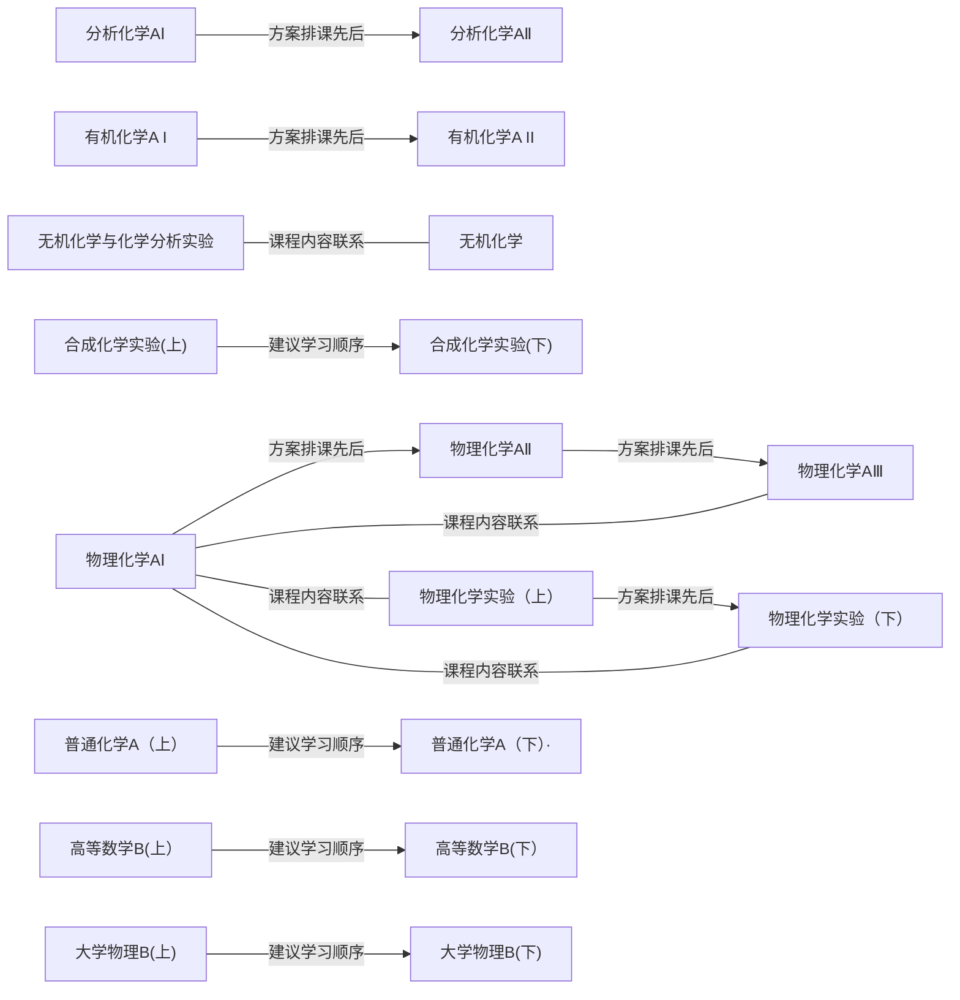

# 2024 能源化学专业“2+X”教学培养方案（港澳台适用）

化学系 · 能源化学 · 方案 150358 · 26 个不同课程或科研条目。

[官方 Word](../originals/plan-150358.docx) · [教务详情](https://fdjwgl.fudan.edu.cn/manager/bizType/2/major-program-search/info/150358?skipAuth=1) · [方案快照](../raw/plan-150358.json.gz) · [年级目录](../README.md)

## 修读导读

- **建议先学**　《物理化学实验（上）》（`CHEM30031`） → 《物理化学实验（下）》（`CHEM30032`）。题名列出连续册次或级别。可沿用前一阶段的实验记录格式，对照后来新增的测量方法和误差来源。方案分别列在第5、6学期。

- **可以对照着读**　《无机化学与化学分析实验》（`CHEM20021`）与《无机化学》（`CHEM30005`）。两门课的题名都涉及无机化学。选同一种无机物，把结构与性质的解释对应到可观察的现象。

- **查模块选课**　《分析化学AⅠ》（`CHEM20001`）、《合成化学实验(上)》（`CHEM20004`）列在“专业核心教育课程”中。原表见 `/courseModules/6`。

## 课程关系图

图中展示部分关系。下表保留全部已建立的课程对，来源位置使用本方案 JSON Pointer。

## 先修与内容联系

| 类型 | 起点 | 终点 | 依据 | 原表定位 |
| --- | --- | --- | --- | --- |
| 建议学习顺序 | 普通化学A（上） (CHEM10003) | 普通化学A（下） (CHEM10004) | 同方案的课程题名具有连续分册或序号。  | `/courseModules/5/planCourses/2`、`/courseModules/5/planCourses/3` |
| 建议学习顺序 | 分析化学AⅠ (CHEM20001) | 分析化学AⅡ (CHEM20002) | 同方案的课程题名具有连续分册或序号。  | `/courseModules/6/planCourses/2`、`/courseModules/6/planCourses/3` |
| 建议学习顺序 | 合成化学实验(上) (CHEM20004) | 合成化学实验(下) (CHEM30003) | 同方案的课程题名具有连续分册或序号。  | `/courseModules/6/planCourses/4`、`/courseModules/6/planCourses/5` |
| 建议学习顺序 | 物理化学AⅠ (CHEM20005) | 物理化学AⅡ (CHEM20006) | 同方案的课程题名具有连续分册或序号。  | `/courseModules/6/planCourses/6`、`/courseModules/6/planCourses/7` |
| 建议学习顺序 | 物理化学AⅡ (CHEM20006) | 物理化学AⅢ (CHEM30004) | 同方案的课程题名具有连续分册或序号。  | `/courseModules/6/planCourses/7`、`/courseModules/6/planCourses/8` |
| 建议学习顺序 | 有机化学A I (CHEM20013) | 有机化学A II (CHEM20014) | 同方案的课程题名具有连续分册或序号。  | `/courseModules/6/planCourses/11`、`/courseModules/6/planCourses/12` |
| 建议学习顺序 | 物理化学实验（上） (CHEM30031) | 物理化学实验（下） (CHEM30032) | 同方案的课程题名具有连续分册或序号。  | `/courseModules/6/planCourses/0`、`/courseModules/6/planCourses/1` |
| 建议学习顺序 | 高等数学B(上） (MATH10004) | 高等数学B(下） (MATH10005) | 同方案的课程题名具有连续分册或序号。  | `/courseModules/5/planCourses/5`、`/courseModules/5/planCourses/6` |
| 建议学习顺序 | 大学物理B(上) (PHYS10003) | 大学物理B(下) (PHYS10004) | 同方案的课程题名具有连续分册或序号。  | `/courseModules/5/planCourses/7`、`/courseModules/5/planCourses/8` |
| 方案排课先后 | 分析化学AⅠ (CHEM20001) | 分析化学AⅡ (CHEM20002) | 同方案该课程全部明确数字学期均早于后者。  | `/courseModules/6/planCourses/2`、`/courseModules/6/planCourses/3` |
| 方案排课先后 | 物理化学AⅠ (CHEM20005) | 物理化学AⅡ (CHEM20006) | 同方案该课程全部明确数字学期均早于后者。  | `/courseModules/6/planCourses/6`、`/courseModules/6/planCourses/7` |
| 方案排课先后 | 物理化学AⅡ (CHEM20006) | 物理化学AⅢ (CHEM30004) | 同方案该课程全部明确数字学期均早于后者。  | `/courseModules/6/planCourses/7`、`/courseModules/6/planCourses/8` |
| 方案排课先后 | 有机化学A I (CHEM20013) | 有机化学A II (CHEM20014) | 同方案该课程全部明确数字学期均早于后者。  | `/courseModules/6/planCourses/11`、`/courseModules/6/planCourses/12` |
| 方案排课先后 | 物理化学实验（上） (CHEM30031) | 物理化学实验（下） (CHEM30032) | 同方案该课程全部明确数字学期均早于后者。  | `/courseModules/6/planCourses/0`、`/courseModules/6/planCourses/1` |
| 课程内容联系 | 分析化学AⅠ (CHEM20001) | 分析化学AⅡ (CHEM20002) | 本方案两门课程的题名均含“分析化学”，可据此对照这一主题。  | `/courseModules/6/planCourses/2`、`/courseModules/6/planCourses/3` |
| 课程内容联系 | 物理化学AⅠ (CHEM20005) | 物理化学AⅡ (CHEM20006) | 本方案两门课程的题名均含“物理化学”，可据此对照这一主题。  | `/courseModules/6/planCourses/6`、`/courseModules/6/planCourses/7` |
| 课程内容联系 | 物理化学AⅠ (CHEM20005) | 物理化学AⅢ (CHEM30004) | 本方案两门课程的题名均含“物理化学”，可据此对照这一主题。  | `/courseModules/6/planCourses/6`、`/courseModules/6/planCourses/8` |
| 课程内容联系 | 物理化学AⅠ (CHEM20005) | 物理化学实验（上） (CHEM30031) | 本方案两门课程的题名均含“物理化学”，可据此对照这一主题。  | `/courseModules/6/planCourses/6`、`/courseModules/6/planCourses/0` |
| 课程内容联系 | 物理化学AⅠ (CHEM20005) | 物理化学实验（下） (CHEM30032) | 本方案两门课程的题名均含“物理化学”，可据此对照这一主题。  | `/courseModules/6/planCourses/6`、`/courseModules/6/planCourses/1` |
| 课程内容联系 | 有机化学A I (CHEM20013) | 有机化学A II (CHEM20014) | 本方案两门课程的题名均含“有机化学”，可据此对照这一主题。  | `/courseModules/6/planCourses/11`、`/courseModules/6/planCourses/12` |
| 课程内容联系 | 无机化学与化学分析实验 (CHEM20021) | 无机化学 (CHEM30005) | 本方案两门课程的题名均含“无机化学”，可据此对照这一主题。  | `/courseModules/6/planCourses/15`、`/courseModules/6/planCourses/9` |

本次未从可定位的明确表述中确认课程对课程预修。学期安排、系列分册与编辑建议均保留各自的依据。

## 课程表

同一课程在不同模块分别出现时，按原表逐行列出。季节字段保留原值。

| 课程 | 代码 | 学分 | 学期 | 模块 |
| --- | --- | ---: | --- | --- |
| 现代生物科学导论A | BIOL10001 | 3.0 | SPRING、AUTUMN | 培养方案 / 专业培养课程 / 大类基础课程 |
| 现代生物科学实验 | BIOL10003 | 1.0 | AUTUMN | 培养方案 / 专业培养课程 / 大类基础课程 |
| 普通化学A（上） | CHEM10003 | 2.0 | AUTUMN | 培养方案 / 专业培养课程 / 大类基础课程 |
| 普通化学A（下） | CHEM10004 | 2.0 | SPRING | 培养方案 / 专业培养课程 / 大类基础课程 |
| 普通化学实验I | CHEM10005 | 1.0 | AUTUMN | 培养方案 / 专业培养课程 / 大类基础课程 |
| 高等数学B(上） | MATH10004 | 5.0 | AUTUMN | 培养方案 / 专业培养课程 / 大类基础课程 |
| 高等数学B(下） | MATH10005 | 5.0 | SPRING | 培养方案 / 专业培养课程 / 大类基础课程 |
| 大学物理B(上) | PHYS10003 | 4.0 | AUTUMN | 培养方案 / 专业培养课程 / 大类基础课程 |
| 大学物理B(下) | PHYS10004 | 4.0 | SPRING | 培养方案 / 专业培养课程 / 大类基础课程 |
| 基础物理实验 | PHYS10005 | 2.0 | AUTUMN | 培养方案 / 专业培养课程 / 大类基础课程 |
| 物理化学实验（上） | CHEM30031 | 2.0 | 第5学期 | 培养方案 / 专业培养课程 / 专业核心教育课程 |
| 物理化学实验（下） | CHEM30032 | 2.0 | 第6学期 | 培养方案 / 专业培养课程 / 专业核心教育课程 |
| 分析化学AⅠ | CHEM20001 | 2.0 | 第3学期 | 培养方案 / 专业培养课程 / 专业核心教育课程 |
| 分析化学AⅡ | CHEM20002 | 2.0 | 第4学期 | 培养方案 / 专业培养课程 / 专业核心教育课程 |
| 合成化学实验(上) | CHEM20004 | 2.0 | 第4学期 | 培养方案 / 专业培养课程 / 专业核心教育课程 |
| 合成化学实验(下) | CHEM30003 | 2.0 | 第4学期 | 培养方案 / 专业培养课程 / 专业核心教育课程 |
| 物理化学AⅠ | CHEM20005 | 3.0 | 第3学期 | 培养方案 / 专业培养课程 / 专业核心教育课程 |
| 物理化学AⅡ | CHEM20006 | 3.0 | 第4学期 | 培养方案 / 专业培养课程 / 专业核心教育课程 |
| 物理化学AⅢ | CHEM30004 | 3.0 | 第5学期 | 培养方案 / 专业培养课程 / 专业核心教育课程 |
| 无机化学 | CHEM30005 | 3.0 | 第5学期、第6学期 | 培养方案 / 专业培养课程 / 专业核心教育课程 |
| 毕业论文 | CHEM40003 | 6.0 | 第8学期 | 培养方案 / 专业培养课程 / 专业核心教育课程 |
| 有机化学A I | CHEM20013 | 4.0 | 第3学期 | 培养方案 / 专业培养课程 / 专业核心教育课程 |
| 有机化学A II | CHEM20014 | 2.0 | 第4学期 | 培养方案 / 专业培养课程 / 专业核心教育课程 |
| 高分子化学B | MASE30007 | 2.0 | 第5学期 | 培养方案 / 专业培养课程 / 专业核心教育课程 |
| 仪器分析实验 | CHEM20020 | 2.0 | 第4学期 | 培养方案 / 专业培养课程 / 专业核心教育课程 |
| 无机化学与化学分析实验 | CHEM20021 | 4.0 | 第3学期 | 培养方案 / 专业培养课程 / 专业核心教育课程 |
