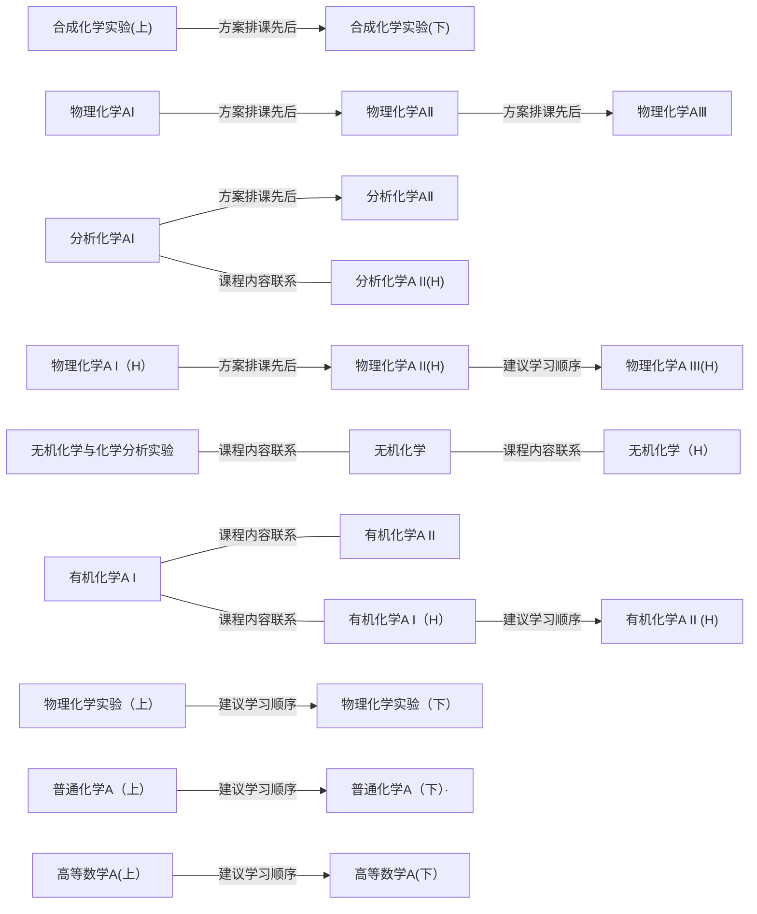

# 2024级化学专业教学培养方案（相辉计划适用）

化学系 · 化学(相辉计划) · 方案 72987 · 158 个不同课程或科研条目。

[官方 Word](../originals/plan-72987.docx) · [教务详情](https://fdjwgl.fudan.edu.cn/manager/bizType/2/major-program-search/info/72987?skipAuth=1) · [方案快照](../raw/plan-72987.json.gz) · [年级目录](../README.md)

## 课程关系图

图中展示部分关系。下表保留全部已建立的课程对，来源位置使用本方案 JSON Pointer。

## 先修与内容联系

| 类型 | 起点 | 终点 | 依据 | 原表定位 |
| --- | --- | --- | --- | --- |
| 建议学习顺序 | 人工智能导论 (AIE310005) | 模式识别与机器学习 (AIE410001) | 人工智能问题与模型类别可为学习模式识别作准备。  | `/courseModules/23/planCourses/2`、`/courseModules/23/planCourses/7` |
| 建议学习顺序 | 生物化学A(上) (BIOL30002) | 生物化学A(下) (BIOL30021) | 同方案的课程题名具有连续分册或序号。  | `/courseModules/22/planCourses/3`、`/courseModules/22/planCourses/17` |
| 建议学习顺序 | 普通化学A（上） (CHEM10003) | 普通化学A（下） (CHEM10004) | 同方案的课程题名具有连续分册或序号。  | `/courseModules/5/planCourses/2`、`/courseModules/5/planCourses/3` |
| 建议学习顺序 | 分析化学AⅠ (CHEM20001) | 分析化学AⅡ (CHEM20002) | 同方案的课程题名具有连续分册或序号。  | `/courseModules/6/planCourses/0`、`/courseModules/6/planCourses/1` |
| 建议学习顺序 | 合成化学实验(上) (CHEM20004) | 合成化学实验(下) (CHEM30003) | 同方案的课程题名具有连续分册或序号。  | `/courseModules/6/planCourses/3`、`/courseModules/6/planCourses/4` |
| 建议学习顺序 | 物理化学AⅠ (CHEM20005) | 物理化学AⅡ (CHEM20006) | 同方案的课程题名具有连续分册或序号。  | `/courseModules/6/planCourses/5`、`/courseModules/6/planCourses/7` |
| 建议学习顺序 | 物理化学A I（H） (CHEM20005h) | 物理化学A II(H) (CHEM20006h) | 同方案的课程题名具有连续分册或序号。  | `/courseModules/6/planCourses/6`、`/courseModules/6/planCourses/8` |
| 建议学习顺序 | 物理化学AⅡ (CHEM20006) | 物理化学AⅢ (CHEM30004) | 同方案的课程题名具有连续分册或序号。  | `/courseModules/6/planCourses/7`、`/courseModules/6/planCourses/9` |
| 建议学习顺序 | 物理化学A II(H) (CHEM20006h) | 物理化学A III(H) (CHEM30004h) | 同方案的课程题名具有连续分册或序号。  | `/courseModules/6/planCourses/8`、`/courseModules/6/planCourses/10` |
| 建议学习顺序 | 有机化学A I (CHEM20013) | 有机化学A II (CHEM20014) | 同方案的课程题名具有连续分册或序号。  | `/courseModules/6/planCourses/14`、`/courseModules/6/planCourses/16` |
| 建议学习顺序 | 有机化学A I（H） (CHEM20013h) | 有机化学A II (H) (CHEM20014h) | 同方案的课程题名具有连续分册或序号。  | `/courseModules/6/planCourses/15`、`/courseModules/6/planCourses/17` |
| 建议学习顺序 | 物理化学实验（上） (CHEM30031) | 物理化学实验（下） (CHEM30032) | 同方案的课程题名具有连续分册或序号。  | `/courseModules/6/planCourses/18`、`/courseModules/6/planCourses/19` |
| 建议学习顺序 | 集成电路实验(上) (ICSE40008) | 集成电路实验(下) (ICSE40009) | 同方案的课程题名具有连续分册或序号。  | `/courseModules/24/planCourses/0`、`/courseModules/24/planCourses/1` |
| 建议学习顺序 | 高等代数Ⅰ (MATH10009) | 高等代数II (MATH10019) | 同方案的课程题名具有连续分册或序号。  | `/courseModules/20/planCourses/2`、`/courseModules/20/planCourses/6` |
| 建议学习顺序 | 高等数学A(上） (MATH10015) | 高等数学A(下） (MATH10016) | 同方案的课程题名具有连续分册或序号。  | `/courseModules/5/planCourses/5`、`/courseModules/5/planCourses/6` |
| 建议学习顺序 | 经典数学思想I (MATH10021) | 经典数学思想Ⅱ (MATH10022) | 同方案的课程题名具有连续分册或序号。  | `/courseModules/20/planCourses/17`、`/courseModules/20/planCourses/18` |
| 建议学习顺序 | 实变函数 (MATH20017) | 泛函分析 (MATH30004) | 测度与积分有助于理解函数空间。  | `/courseModules/20/planCourses/14`、`/courseModules/20/planCourses/7` |
| 建议学习顺序 | 大学物理B(上) (PHYS10003) | 大学物理B(下) (PHYS10004) | 同方案的课程题名具有连续分册或序号。  | `/courseModules/5/planCourses/7`、`/courseModules/5/planCourses/8` |
| 建议学习顺序 | 大学物理实验Ⅱ (PHYS20015) | 大学物理实验Ⅲ (PHYS20016) | 同方案的课程题名具有连续分册或序号。  | `/courseModules/21/planCourses/12`、`/courseModules/21/planCourses/13` |
| 方案排课先后 | 生物化学A(上) (BIOL30002) | 生物化学A(下) (BIOL30021) | 同方案该课程全部明确数字学期均早于后者。  | `/courseModules/22/planCourses/3`、`/courseModules/22/planCourses/17` |
| 方案排课先后 | 普通化学A（上） (CHEM10003) | 普通化学A（下） (CHEM10004) | 同方案该课程全部明确数字学期均早于后者。  | `/courseModules/5/planCourses/2`、`/courseModules/5/planCourses/3` |
| 方案排课先后 | 分析化学AⅠ (CHEM20001) | 分析化学AⅡ (CHEM20002) | 同方案该课程全部明确数字学期均早于后者。  | `/courseModules/6/planCourses/0`、`/courseModules/6/planCourses/1` |
| 方案排课先后 | 合成化学实验(上) (CHEM20004) | 合成化学实验(下) (CHEM30003) | 同方案该课程全部明确数字学期均早于后者。  | `/courseModules/6/planCourses/3`、`/courseModules/6/planCourses/4` |
| 方案排课先后 | 物理化学AⅠ (CHEM20005) | 物理化学AⅡ (CHEM20006) | 同方案该课程全部明确数字学期均早于后者。  | `/courseModules/6/planCourses/5`、`/courseModules/6/planCourses/7` |
| 方案排课先后 | 物理化学A I（H） (CHEM20005h) | 物理化学A II(H) (CHEM20006h) | 同方案该课程全部明确数字学期均早于后者。  | `/courseModules/6/planCourses/6`、`/courseModules/6/planCourses/8` |
| 方案排课先后 | 物理化学AⅡ (CHEM20006) | 物理化学AⅢ (CHEM30004) | 同方案该课程全部明确数字学期均早于后者。  | `/courseModules/6/planCourses/7`、`/courseModules/6/planCourses/9` |
| 方案排课先后 | 物理化学A II(H) (CHEM20006h) | 物理化学A III(H) (CHEM30004h) | 同方案该课程全部明确数字学期均早于后者。  | `/courseModules/6/planCourses/8`、`/courseModules/6/planCourses/10` |
| 方案排课先后 | 有机化学A I (CHEM20013) | 有机化学A II (CHEM20014) | 同方案该课程全部明确数字学期均早于后者。  | `/courseModules/6/planCourses/14`、`/courseModules/6/planCourses/16` |
| 方案排课先后 | 有机化学A I（H） (CHEM20013h) | 有机化学A II (H) (CHEM20014h) | 同方案该课程全部明确数字学期均早于后者。  | `/courseModules/6/planCourses/15`、`/courseModules/6/planCourses/17` |
| 方案排课先后 | 物理化学实验（上） (CHEM30031) | 物理化学实验（下） (CHEM30032) | 同方案该课程全部明确数字学期均早于后者。  | `/courseModules/6/planCourses/18`、`/courseModules/6/planCourses/19` |
| 方案排课先后 | 集成电路实验(上) (ICSE40008) | 集成电路实验(下) (ICSE40009) | 同方案该课程全部明确数字学期均早于后者。  | `/courseModules/24/planCourses/0`、`/courseModules/24/planCourses/1` |
| 方案排课先后 | 高等代数Ⅰ (MATH10009) | 高等代数II (MATH10019) | 同方案该课程全部明确数字学期均早于后者。  | `/courseModules/20/planCourses/2`、`/courseModules/20/planCourses/6` |
| 方案排课先后 | 大学物理B(上) (PHYS10003) | 大学物理B(下) (PHYS10004) | 同方案该课程全部明确数字学期均早于后者。  | `/courseModules/5/planCourses/7`、`/courseModules/5/planCourses/8` |
| 课程内容联系 | 人工智能导论 (AIE310005) | 人工智能安全 (AIE831001) | 本方案两门课程的题名均含“人工智能”，可据此对照这一主题。  | `/courseModules/23/planCourses/2`、`/courseModules/23/planCourses/10` |
| 课程内容联系 | 人工智能的编程基础 (AIE310006) | 人工智能安全 (AIE831001) | 本方案两门课程的题名均含“人工智能”，可据此对照这一主题。  | `/courseModules/23/planCourses/3`、`/courseModules/23/planCourses/10` |
| 课程内容联系 | 人工智能的数学基础 (AIE310009) | 模式识别与机器学习 (AIE410001) | 数学表达与学习模型的统计、优化工具可对照。  | `/courseModules/23/planCourses/6`、`/courseModules/23/planCourses/7` |
| 课程内容联系 | 人工智能的数学基础 (AIE310009) | 人工智能安全 (AIE831001) | 本方案两门课程的题名均含“人工智能”，可据此对照这一主题。  | `/courseModules/23/planCourses/6`、`/courseModules/23/planCourses/10` |
| 课程内容联系 | 模式识别与机器学习 (AIE410001) | 机器学习在物理实验中的应用 (AIS310013) | 本方案两门课程的题名均含“机器学习”，可据此对照这一主题。  | `/courseModules/23/planCourses/7`、`/courseModules/21/planCourses/0` |
| 课程内容联系 | 人工智能安全 (AIE831001) | 人工智能生物学 (AIS310017) | 本方案两门课程的题名均含“人工智能”，可据此对照这一主题。  | `/courseModules/23/planCourses/10`、`/courseModules/22/planCourses/0` |
| 课程内容联系 | 人工智能在分析化学中的应用 (AIT310024) | 分析化学AⅠ (CHEM20001) | 本方案两门课程的题名均含“分析化学”，可据此对照这一主题。  | `/courseModules/17/planCourses/0`、`/courseModules/6/planCourses/0` |
| 课程内容联系 | 生物化学A(上) (BIOL30002) | 生物化学B (BIOL30013) | 本方案两门课程的题名均含“生物化学”，可据此对照这一主题。  | `/courseModules/22/planCourses/3`、`/courseModules/16/planCourses/0` |
| 课程内容联系 | 生物化学实验 (BIOL30003) | 生物化学B (BIOL30013) | 本方案两门课程的题名均含“生物化学”，可据此对照这一主题。  | `/courseModules/22/planCourses/4`、`/courseModules/16/planCourses/0` |
| 课程内容联系 | 细胞生物学 (BIOL30004) | 细胞生物学实验 (BIOL30005) | 题名显示相同主题的课程与实验、实践或实习。  | `/courseModules/22/planCourses/5`、`/courseModules/22/planCourses/6` |
| 课程内容联系 | 微生物学 (BIOL30006) | 微生物学实验 (BIOL30007) | 题名显示相同主题的课程与实验、实践或实习。  | `/courseModules/22/planCourses/7`、`/courseModules/22/planCourses/8` |
| 课程内容联系 | 遗传学 (BIOL30008) | 遗传学实验 (BIOL30009) | 题名显示相同主题的课程与实验、实践或实习。  | `/courseModules/22/planCourses/9`、`/courseModules/22/planCourses/10` |
| 课程内容联系 | 生理学 (BIOL30010) | 生理学实验 (BIOL30020) | 题名显示相同主题的课程与实验、实践或实习。  | `/courseModules/22/planCourses/11`、`/courseModules/22/planCourses/16` |
| 课程内容联系 | 生物化学B (BIOL30013) | 生物化学A(下) (BIOL30021) | 本方案两门课程的题名均含“生物化学”，可据此对照这一主题。  | `/courseModules/16/planCourses/0`、`/courseModules/22/planCourses/17` |
| 课程内容联系 | 分析化学AⅠ (CHEM20001) | 分析化学AⅡ (CHEM20002) | 本方案两门课程的题名均含“分析化学”，可据此对照这一主题。  | `/courseModules/6/planCourses/0`、`/courseModules/6/planCourses/1` |
| 课程内容联系 | 分析化学AⅠ (CHEM20001) | 分析化学A II(H) (CHEM20002h) | 本方案两门课程的题名均含“分析化学”，可据此对照这一主题。  | `/courseModules/6/planCourses/0`、`/courseModules/6/planCourses/2` |
| 课程内容联系 | 分析化学AⅠ (CHEM20001) | 近代分析化学 (CHEM30008) | 本方案两门课程的题名均含“分析化学”，可据此对照这一主题。  | `/courseModules/6/planCourses/0`、`/courseModules/14/planCourses/0` |
| 课程内容联系 | 物理化学AⅠ (CHEM20005) | 物理化学AⅡ (CHEM20006) | 本方案两门课程的题名均含“物理化学”，可据此对照这一主题。  | `/courseModules/6/planCourses/5`、`/courseModules/6/planCourses/7` |
| 课程内容联系 | 物理化学AⅠ (CHEM20005) | 物理化学AⅢ (CHEM30004) | 本方案两门课程的题名均含“物理化学”，可据此对照这一主题。  | `/courseModules/6/planCourses/5`、`/courseModules/6/planCourses/9` |
| 课程内容联系 | 物理化学AⅠ (CHEM20005) | 物理化学实验（上） (CHEM30031) | 本方案两门课程的题名均含“物理化学”，可据此对照这一主题。  | `/courseModules/6/planCourses/5`、`/courseModules/6/planCourses/18` |
| 课程内容联系 | 物理化学AⅠ (CHEM20005) | 物理化学实验（下） (CHEM30032) | 本方案两门课程的题名均含“物理化学”，可据此对照这一主题。  | `/courseModules/6/planCourses/5`、`/courseModules/6/planCourses/19` |
| 课程内容联系 | 有机化学A I (CHEM20013) | 有机化学A I（H） (CHEM20013h) | 本方案两门课程的题名均含“有机化学”，可据此对照这一主题。  | `/courseModules/6/planCourses/14`、`/courseModules/6/planCourses/15` |
| 课程内容联系 | 有机化学A I (CHEM20013) | 有机化学A II (CHEM20014) | 本方案两门课程的题名均含“有机化学”，可据此对照这一主题。  | `/courseModules/6/planCourses/14`、`/courseModules/6/planCourses/16` |
| 课程内容联系 | 有机化学A I (CHEM20013) | AI在有机化学中的应用 (CHEM30040) | 本方案两门课程的题名均含“有机化学”，可据此对照这一主题。  | `/courseModules/6/planCourses/14`、`/courseModules/17/planCourses/1` |
| 课程内容联系 | 有机化学A I (CHEM20013) | 高等有机化学(H) (CHEM40015h) | 本方案两门课程的题名均含“有机化学”，可据此对照这一主题。  | `/courseModules/6/planCourses/14`、`/courseModules/9/planCourses/4` |
| 课程内容联系 | 无机化学与化学分析实验 (CHEM20021) | 无机化学 (CHEM30005) | 本方案两门课程的题名均含“无机化学”，可据此对照这一主题。  | `/courseModules/6/planCourses/22`、`/courseModules/6/planCourses/11` |
| 课程内容联系 | 无机化学 (CHEM30005) | 无机化学（H） (CHEM30005h) | 本方案两门课程的题名均含“无机化学”，可据此对照这一主题。  | `/courseModules/6/planCourses/11`、`/courseModules/6/planCourses/12` |
| 课程内容联系 | 无机化学 (CHEM30005) | 高等无机化学(H) (CHEM40014h) | 本方案两门课程的题名均含“无机化学”，可据此对照这一主题。  | `/courseModules/6/planCourses/11`、`/courseModules/9/planCourses/3` |
| 课程内容联系 | 量子化学原理及应用(H) (CHEM30041h) | 量子力学I (PHYS30010) | 本方案两门课程的题名均含“量子”，可据此对照这一主题。  | `/courseModules/9/planCourses/5`、`/courseModules/21/planCourses/4` |
| 课程内容联系 | 半导体物理 (ICSE20007) | 半导体器件原理 (ICSE30020) | 本方案两门课程的题名均含“半导体”，可据此对照这一主题。  | `/courseModules/24/planCourses/6`、`/courseModules/24/planCourses/9` |
| 课程内容联系 | 专用集成电路设计方法 (ICSE30007) | 集成电路工艺原理 (ICSE30010) | 本方案两门课程的题名均含“集成电路”，可据此对照这一主题。  | `/courseModules/24/planCourses/2`、`/courseModules/24/planCourses/8` |
| 课程内容联系 | 集成电路工艺原理 (ICSE30010) | 数字集成电路设计原理 (ICSE30021) | 本方案两门课程的题名均含“集成电路”，可据此对照这一主题。  | `/courseModules/24/planCourses/8`、`/courseModules/24/planCourses/10` |
| 课程内容联系 | 集成电路工艺原理 (ICSE30010) | 集成电路实验(上) (ICSE40008) | 本方案两门课程的题名均含“集成电路”，可据此对照这一主题。  | `/courseModules/24/planCourses/8`、`/courseModules/24/planCourses/0` |
| 课程内容联系 | 集成电路工艺原理 (ICSE30010) | 集成电路实验(下) (ICSE40009) | 本方案两门课程的题名均含“集成电路”，可据此对照这一主题。  | `/courseModules/24/planCourses/8`、`/courseModules/24/planCourses/1` |

本次未从可定位的明确表述中确认课程对课程预修。学期安排、系列分册与编辑建议均保留各自的依据。

## 按原方案模块阅读

同一模块展示原表中的课程归属。模块内课程之间的先后仍须逐项查阅。

- **化学专业进阶模块I**　人工智能在化学中的应用、人工智能化学计算模拟、谱学导论、化学生物学基础、化工基础、量子化学原理及应用(H)、高等无机化学(H)、高等有机化学(H)（原表模块 9）
- **无机/材料类**　元素化学、无机合成化学、新型无机材料、光电功能材料、分子组装与分子器件、配位化学、纳米材料与功能器件、金属有机化学的研究方法和策略、碳簇化学（原表模块 11）
- **物化/能源类**　胶体化学、计算化学、溶胶-凝胶化学及实验、现代化学专题（能源化学）、高能化学电源、计算谱学原理、碳基能源化学（原表模块 12）
- **有机类**　有机合成及反应机理、药物化学、天然产物全合成赏析、有机结构的探秘和解析、不对称合成化学（原表模块 13）
- **分析类**　质谱学新技术的研究和应用、高等结构分析、微流控生命分析、近代分析化学、环境化学B、探究性仪器分析实验（原表模块 14）
- **化工/应化类**　化工原理实验、化工制图、化学反应工程、工业化学、应用化学专题（原表模块 15）
- **化生类**　生物化学B、生命中的化学、DNA合成化学（原表模块 16）
- **人工智能类**　人工智能在分析化学中的应用、AI在有机化学中的应用（原表模块 17）
- **专项**　数理统计方法在化学中的应用、化学专业英语、化学信息学、科研实践（原表模块 18）
- **数学组**　数据科学的逼近论基础、新型算法、高等代数Ⅰ、线性代数（理工类）、高等数学A(上）、高等数学A(下）、高等代数II、解析几何、经典数学思想I、经典数学思想Ⅱ、数学分析I（英才班）、数学分析II（英才班）、常微分方程、抽象代数、复变函数、实变函数、拓扑学、几何拓扑选讲等19项（原表模块 20）
- **物理组**　机器学习在物理实验中的应用、AI物理、经典力学、数学物理方法A、大学物理A：光学、大学物理A：原子物理、热力学与统计物理I、概率论与数理统计、大学物理实验Ⅱ、大学物理实验Ⅲ、量子力学I、固体物理、近代物理实验I、电动力学、复杂科学前沿与创新（原表模块 21）
- **生物科学组**　人工智能生物学、人工智能结构生物学、AI在生物分子结构中的研究及应用、普通生物学实验-动物、普通生物学实验-植物、生物化学A(上)、生物化学实验、细胞生物学、细胞生物学实验、微生物学、微生物学实验、遗传学、遗传学实验、生理学、分子生物学、普通生物学、生理学实验、生物化学A(下)（原表模块 22）
- **人工智能组**　计算机系统基础、计算机视觉、人工智能导论、人工智能的编程基础、数据结构、人工智能的软件基础、人工智能的数学基础、模式识别与机器学习、自然语言处理与大语言模型、人工智能前沿探索实践、人工智能安全（原表模块 23）
- **微电子组**　模拟电子线路、数字逻辑基础、信号与系统概论、半导体物理、嵌入式处理器与芯片系统设计、专用集成电路设计方法、集成电路工艺原理、半导体器件原理、数字集成电路设计原理、模拟集成电路设计原理、集成电路实验(上)、集成电路实验(下)（原表模块 24）
- **化学荣誉课程**　分析化学A II(H)、物理化学A I（H）、物理化学A II(H)、有机化学A I（H）、有机化学A II (H)、物理化学A III(H)、无机化学（H）、物理化学实验（下）(H)、量子化学原理及应用(H)、高等无机化学(H)、高等有机化学(H)（原表模块 26）

## 课程表

同一课程在不同模块分别出现时，按原表逐行列出。季节字段保留原值。

| 课程 | 代码 | 学分 | 学期 | 模块 |
| --- | --- | ---: | --- | --- |
| 现代生物科学导论A | BIOL10001 | 3.0 | 第1学期 | 培养方案 / 专业培养课程 / 大类基础课程 |
| 现代生物科学实验 | BIOL10003 | 1.0 | 第1学期 | 培养方案 / 专业培养课程 / 大类基础课程 |
| 普通化学A（上） | CHEM10003 | 2.0 | 第1学期 | 培养方案 / 专业培养课程 / 大类基础课程 |
| 普通化学A（下） | CHEM10004 | 2.0 | 第2学期 | 培养方案 / 专业培养课程 / 大类基础课程 |
| 普通化学实验I | CHEM10005 | 1.0 | 第1学期 | 培养方案 / 专业培养课程 / 大类基础课程 |
| 高等数学A(上） | MATH10015 | 5.0 | AUTUMN | 培养方案 / 专业培养课程 / 大类基础课程 |
| 高等数学A(下） | MATH10016 | 5.0 | SPRING | 培养方案 / 专业培养课程 / 大类基础课程 |
| 大学物理B(上) | PHYS10003 | 4.0 | 第1学期 | 培养方案 / 专业培养课程 / 大类基础课程 |
| 大学物理B(下) | PHYS10004 | 4.0 | 第2学期 | 培养方案 / 专业培养课程 / 大类基础课程 |
| 基础物理实验 | PHYS10005 | 2.0 | 第2学期 | 培养方案 / 专业培养课程 / 大类基础课程 |
| 分析化学AⅠ | CHEM20001 | 2.0 | 第3学期 | 培养方案 / 专业培养课程 / 专业核心教育课程 |
| 分析化学AⅡ | CHEM20002 | 2.0 | 第4学期 | 培养方案 / 专业培养课程 / 专业核心教育课程 |
| 分析化学A II(H) | CHEM20002h | 4.0 | 第4学期 | 培养方案 / 专业培养课程 / 专业核心教育课程 |
| 合成化学实验(上) | CHEM20004 | 2.0 | 第4学期 | 培养方案 / 专业培养课程 / 专业核心教育课程 |
| 合成化学实验(下) | CHEM30003 | 2.0 | 第5学期 | 培养方案 / 专业培养课程 / 专业核心教育课程 |
| 物理化学AⅠ | CHEM20005 | 3.0 | 第3学期 | 培养方案 / 专业培养课程 / 专业核心教育课程 |
| 物理化学A I（H） | CHEM20005h | 4.0 | 第3学期 | 培养方案 / 专业培养课程 / 专业核心教育课程 |
| 物理化学AⅡ | CHEM20006 | 3.0 | 第4学期 | 培养方案 / 专业培养课程 / 专业核心教育课程 |
| 物理化学A II(H) | CHEM20006h | 4.0 | 第4学期 | 培养方案 / 专业培养课程 / 专业核心教育课程 |
| 物理化学AⅢ | CHEM30004 | 3.0 | 第5学期 | 培养方案 / 专业培养课程 / 专业核心教育课程 |
| 物理化学A III(H) | CHEM30004h | 4.0 | 第5学期 | 培养方案 / 专业培养课程 / 专业核心教育课程 |
| 无机化学 | CHEM30005 | 3.0 | 第5学期、第6学期 | 培养方案 / 专业培养课程 / 专业核心教育课程 |
| 无机化学（H） | CHEM30005h | 4.0 | 第5学期、第6学期 | 培养方案 / 专业培养课程 / 专业核心教育课程 |
| 毕业论文 | CHEM40003 | 6.0 | 第8学期 | 培养方案 / 专业培养课程 / 专业核心教育课程 |
| 有机化学A I | CHEM20013 | 4.0 | 第3学期 | 培养方案 / 专业培养课程 / 专业核心教育课程 |
| 有机化学A I（H） | CHEM20013h | 5.0 | 第3学期 | 培养方案 / 专业培养课程 / 专业核心教育课程 |
| 有机化学A II | CHEM20014 | 2.0 | 第4学期 | 培养方案 / 专业培养课程 / 专业核心教育课程 |
| 有机化学A II (H) | CHEM20014h | 4.0 | 第4学期 | 培养方案 / 专业培养课程 / 专业核心教育课程 |
| 物理化学实验（上） | CHEM30031 | 2.0 | 第5学期 | 培养方案 / 专业培养课程 / 专业核心教育课程 |
| 物理化学实验（下） | CHEM30032 | 2.0 | 第6学期 | 培养方案 / 专业培养课程 / 专业核心教育课程 |
| 物理化学实验（下）(H) | CHEM30032h | 4.0 | 第6学期 | 培养方案 / 专业培养课程 / 专业核心教育课程 |
| 仪器分析实验 | CHEM20020 | 2.0 | 第4学期 | 培养方案 / 专业培养课程 / 专业核心教育课程 |
| 无机化学与化学分析实验 | CHEM20021 | 4.0 | 第3学期 | 培养方案 / 专业培养课程 / 专业核心教育课程 |
| 切问近思 | CHEM20022 | 2.0 | SPRING、AUTUMN | 培养方案 / 专业培养课程 / 专业核心教育课程 |
| 化学前沿专题 | CHEM20023 | 2.0 | SPRING | 培养方案 / 专业培养课程 / 专业核心教育课程 |
| 高分子化学B | MASE30007 | 2.0 | 第5学期 | 培养方案 / 专业培养课程 / 专业核心教育课程 |
| 人工智能在化学中的应用 | AIS310014 | 2.0 | AUTUMN | 培养方案 / 化学专业进阶模块I |
| 人工智能化学计算模拟 | AIS531005 | 2.0 | SPRING | 培养方案 / 化学专业进阶模块I |
| 谱学导论 | CHEM20007 | 3.0 | SPRING | 培养方案 / 化学专业进阶模块I |
| 高等无机化学(H) | CHEM40014h | 4.0 | AUTUMN | 培养方案 / 化学专业进阶模块I |
| 高等有机化学(H) | CHEM40015h | 4.0 | AUTUMN | 培养方案 / 化学专业进阶模块I |
| 量子化学原理及应用(H) | CHEM30041h | 4.0 | AUTUMN | 培养方案 / 化学专业进阶模块I |
| 化学生物学基础 | CHEM30035 | 3.0 | SPRING | 培养方案 / 化学专业进阶模块I |
| 化工基础 | CHEM30039 | 3.0 | AUTUMN | 培养方案 / 化学专业进阶模块I |
| 无机合成化学 | CHEM30007 | 2.0 | SPRING | 培养方案 / 化学专业进阶模块Ⅱ / 无机/材料类 |
| 新型无机材料 | CHEM30013 | 2.0 | SPRING | 培养方案 / 化学专业进阶模块Ⅱ / 无机/材料类 |
| 光电功能材料 | CHEM30018 | 2.0 | AUTUMN | 培养方案 / 化学专业进阶模块Ⅱ / 无机/材料类 |
| 分子组装与分子器件 | CHEM30019 | 2.0 | SPRING、AUTUMN | 培养方案 / 化学专业进阶模块Ⅱ / 无机/材料类 |
| 配位化学 | CHEM30021 | 2.0 | AUTUMN | 培养方案 / 化学专业进阶模块Ⅱ / 无机/材料类 |
| 纳米材料与功能器件 | CHEM30022 | 2.0 | AUTUMN | 培养方案 / 化学专业进阶模块Ⅱ / 无机/材料类 |
| 元素化学 | CHEM20017 | 2.0 | AUTUMN | 培养方案 / 化学专业进阶模块Ⅱ / 无机/材料类 |
| 金属有机化学的研究方法和策略 | CHEM30026 | 2.0 | SPRING、AUTUMN | 培养方案 / 化学专业进阶模块Ⅱ / 无机/材料类 |
| 碳簇化学 | CHEM30029 | 2.0 | AUTUMN | 培养方案 / 化学专业进阶模块Ⅱ / 无机/材料类 |
| 胶体化学 | CHEM30009 | 2.0 | SPRING | 培养方案 / 化学专业进阶模块Ⅱ / 物化/能源类 |
| 计算化学 | CHEM30012 | 2.0 | AUTUMN | 培养方案 / 化学专业进阶模块Ⅱ / 物化/能源类 |
| 溶胶-凝胶化学及实验 | CHEM30020 | 2.0 | SPRING | 培养方案 / 化学专业进阶模块Ⅱ / 物化/能源类 |
| 现代化学专题（能源化学） | CHEM30027 | 1.0 | SPRING | 培养方案 / 化学专业进阶模块Ⅱ / 物化/能源类 |
| 高能化学电源 | CHEM30028 | 2.0 | SPRING | 培养方案 / 化学专业进阶模块Ⅱ / 物化/能源类 |
| 计算谱学原理 | CHEM30033 | 2.0 | SPRING、AUTUMN | 培养方案 / 化学专业进阶模块Ⅱ / 物化/能源类 |
| 碳基能源化学 | CHEM30036 | 2.0 | AUTUMN | 培养方案 / 化学专业进阶模块Ⅱ / 物化/能源类 |
| 有机合成及反应机理 | CHEM30010 | 2.0 | AUTUMN | 培养方案 / 化学专业进阶模块Ⅱ / 有机类 |
| 药物化学 | CHEM30023 | 2.0 | SPRING | 培养方案 / 化学专业进阶模块Ⅱ / 有机类 |
| 天然产物全合成赏析 | CHEM30024 | 2.0 | SPRING | 培养方案 / 化学专业进阶模块Ⅱ / 有机类 |
| 有机结构的探秘和解析 | CHEM30025 | 2.0 | SPRING | 培养方案 / 化学专业进阶模块Ⅱ / 有机类 |
| 不对称合成化学 | CHEM30034 | 2.0 | SPRING、AUTUMN | 培养方案 / 化学专业进阶模块Ⅱ / 有机类 |
| 近代分析化学 | CHEM30008 | 2.0 | SPRING | 培养方案 / 化学专业进阶模块Ⅱ / 分析类 |
| 环境化学B | CHEM30011 | 2.0 | AUTUMN | 培养方案 / 化学专业进阶模块Ⅱ / 分析类 |
| 质谱学新技术的研究和应用 | CHEM130060 | 2.0 | AUTUMN | 培养方案 / 化学专业进阶模块Ⅱ / 分析类 |
| 高等结构分析 | CHEM130094 | 3.0 | SPRING | 培养方案 / 化学专业进阶模块Ⅱ / 分析类 |
| 微流控生命分析 | CHEM20019 | 2.0 | SPRING、AUTUMN | 培养方案 / 化学专业进阶模块Ⅱ / 分析类 |
| 探究性仪器分析实验 | CHEM30030 | 2.0 | SPRING、AUTUMN | 培养方案 / 化学专业进阶模块Ⅱ / 分析类 |
| 化工原理实验 | CHEM130042 | 2.0 | SPRING | 培养方案 / 化学专业进阶模块Ⅱ / 化工/应化类 |
| 化学反应工程 | CHEM30014 | 2.0 | SPRING | 培养方案 / 化学专业进阶模块Ⅱ / 化工/应化类 |
| 工业化学 | CHEM30016 | 2.0 | SPRING | 培养方案 / 化学专业进阶模块Ⅱ / 化工/应化类 |
| 化工制图 | CHEM20010 | 2.0 | AUTUMN | 培养方案 / 化学专业进阶模块Ⅱ / 化工/应化类 |
| 应用化学专题 | CHEM30017 | 2.0 | AUTUMN | 培养方案 / 化学专业进阶模块Ⅱ / 化工/应化类 |
| 生物化学B | BIOL30013 | 3.0 | AUTUMN | 培养方案 / 化学专业进阶模块Ⅱ / 化生类 |
| 生命中的化学 | CHEM20018 | 2.0 | SPRING、AUTUMN | 培养方案 / 化学专业进阶模块Ⅱ / 化生类 |
| DNA合成化学 | CHEM30037 | 2.0 | AUTUMN | 培养方案 / 化学专业进阶模块Ⅱ / 化生类 |
| 人工智能在分析化学中的应用 | AIT310024 | 2.0 | AUTUMN | 培养方案 / 化学专业进阶模块Ⅱ / 人工智能类 |
| AI在有机化学中的应用 | CHEM30040 | 2.0 | SPRING | 培养方案 / 化学专业进阶模块Ⅱ / 人工智能类 |
| 化学信息学 | CHEM30006 | 2.0 | AUTUMN | 培养方案 / 化学专业进阶模块Ⅱ / 专项 |
| 数理统计方法在化学中的应用 | CHEM20008 | 2.0 | SPRING | 培养方案 / 化学专业进阶模块Ⅱ / 专项 |
| 化学专业英语 | CHEM20009 | 2.0 | SPRING | 培养方案 / 化学专业进阶模块Ⅱ / 专项 |
| 科研实践 | CHEM30038 | 2.0 | SPRING、AUTUMN | 培养方案 / 化学专业进阶模块Ⅱ / 专项 |
| 数据科学的逼近论基础 | AIS631003 | 3.0 | 第3学期 | 培养方案 / 理工核心课程池 / 数学组 |
| 新型算法 | AIS631004 | 3.0 | 第3学期 | 培养方案 / 理工核心课程池 / 数学组 |
| 高等代数Ⅰ | MATH10009 | 5.0 | 第1学期 | 培养方案 / 理工核心课程池 / 数学组 |
| 线性代数（理工类） | MATH10014 | 3.0 | AUTUMN | 培养方案 / 理工核心课程池 / 数学组 |
| 高等数学A(上） | MATH10015 | 5.0 | 第1学期 | 培养方案 / 理工核心课程池 / 数学组 |
| 高等数学A(下） | MATH10016 | 5.0 | 第2学期 | 培养方案 / 理工核心课程池 / 数学组 |
| 高等代数II | MATH10019 | 5.0 | 第2学期 | 培养方案 / 理工核心课程池 / 数学组 |
| 泛函分析 | MATH30004 | 3.0 | 第4学期 | 培养方案 / 理工核心课程池 / 数学组 |
| 数学分析I（英才班） | MATH130154 | 6.0 | 第1学期 | 培养方案 / 理工核心课程池 / 数学组 |
| 数学分析II（英才班） | MATH130155 | 6.0 | 第2学期 | 培养方案 / 理工核心课程池 / 数学组 |
| 解析几何 | MATH10020 | 4.0 | 第4学期 | 培养方案 / 理工核心课程池 / 数学组 |
| 常微分方程 | MATH20014 | 4.0 | 第4学期 | 培养方案 / 理工核心课程池 / 数学组 |
| 抽象代数 | MATH20015 | 4.0 | 第4学期 | 培养方案 / 理工核心课程池 / 数学组 |
| 复变函数 | MATH20016 | 4.0 | 第4学期 | 培养方案 / 理工核心课程池 / 数学组 |
| 实变函数 | MATH20017 | 4.0 | 第4学期 | 培养方案 / 理工核心课程池 / 数学组 |
| 拓扑学 | MATH20018 | 4.0 | 第4学期 | 培养方案 / 理工核心课程池 / 数学组 |
| 几何拓扑选讲 | MATH20019 | 4.0 | 第4学期 | 培养方案 / 理工核心课程池 / 数学组 |
| 经典数学思想I | MATH10021 | 3.0 | 第3学期 | 培养方案 / 理工核心课程池 / 数学组 |
| 经典数学思想Ⅱ | MATH10022 | 3.0 | 第3学期 | 培养方案 / 理工核心课程池 / 数学组 |
| 机器学习在物理实验中的应用 | AIS310013 | 3.0 | SPRING | 培养方案 / 理工核心课程池 / 物理组 |
| AI物理 | AIS531004 | 3.0 | SPRING | 培养方案 / 理工核心课程池 / 物理组 |
| 经典力学 | PHYS20003 | 3.0 | AUTUMN | 培养方案 / 理工核心课程池 / 物理组 |
| 数学物理方法A | PHYS20006 | 4.0 | SPRING | 培养方案 / 理工核心课程池 / 物理组 |
| 量子力学I | PHYS30010 | 4.0 | AUTUMN | 培养方案 / 理工核心课程池 / 物理组 |
| 固体物理 | PHYS30011 | 4.0 | SPRING | 培养方案 / 理工核心课程池 / 物理组 |
| 近代物理实验I | PHYS30013 | 4.0 | SPRING | 培养方案 / 理工核心课程池 / 物理组 |
| 大学物理A：光学 | PHYS20010 | 3.0 | AUTUMN | 培养方案 / 理工核心课程池 / 物理组 |
| 大学物理A：原子物理 | PHYS20011 | 3.0 | SPRING | 培养方案 / 理工核心课程池 / 物理组 |
| 热力学与统计物理I | PHYS20013 | 4.0 | SPRING | 培养方案 / 理工核心课程池 / 物理组 |
| 电动力学 | PHYS30016 | 4.0 | AUTUMN | 培养方案 / 理工核心课程池 / 物理组 |
| 概率论与数理统计 | PHYS20014 | 2.0 | AUTUMN | 培养方案 / 理工核心课程池 / 物理组 |
| 大学物理实验Ⅱ | PHYS20015 | 2.0 | AUTUMN | 培养方案 / 理工核心课程池 / 物理组 |
| 大学物理实验Ⅲ | PHYS20016 | 2.0 | SPRING | 培养方案 / 理工核心课程池 / 物理组 |
| 复杂科学前沿与创新 | PHYS30024 | 3.0 | SPRING、AUTUMN | 培养方案 / 理工核心课程池 / 物理组 |
| 人工智能生物学 | AIS310017 | 2.0 | AUTUMN | 培养方案 / 理工核心课程池 / 生物科学组 |
| 人工智能结构生物学 | AIS410006 | 2.0 | AUTUMN | 培养方案 / 理工核心课程池 / 生物科学组 |
| AI在生物分子结构中的研究及应用 | AIS410014 | 2.0 | AUTUMN | 培养方案 / 理工核心课程池 / 生物科学组 |
| 生物化学A(上) | BIOL30002 | 3.0 | 第4学期 | 培养方案 / 理工核心课程池 / 生物科学组 |
| 生物化学实验 | BIOL30003 | 1.5 | 第4学期 | 培养方案 / 理工核心课程池 / 生物科学组 |
| 细胞生物学 | BIOL30004 | 3.0 | 第4学期 | 培养方案 / 理工核心课程池 / 生物科学组 |
| 细胞生物学实验 | BIOL30005 | 1.5 | 第4学期 | 培养方案 / 理工核心课程池 / 生物科学组 |
| 微生物学 | BIOL30006 | 3.0 | 第5学期 | 培养方案 / 理工核心课程池 / 生物科学组 |
| 微生物学实验 | BIOL30007 | 1.5 | 第5学期 | 培养方案 / 理工核心课程池 / 生物科学组 |
| 遗传学 | BIOL30008 | 3.0 | 第5学期 | 培养方案 / 理工核心课程池 / 生物科学组 |
| 遗传学实验 | BIOL30009 | 1.5 | 第5学期 | 培养方案 / 理工核心课程池 / 生物科学组 |
| 生理学 | BIOL30010 | 3.0 | 第4学期 | 培养方案 / 理工核心课程池 / 生物科学组 |
| 分子生物学 | BIOL30014 | 2.0 | 第5学期 | 培养方案 / 理工核心课程池 / 生物科学组 |
| 普通生物学 | BIOL30019 | 3.0 | 第3学期 | 培养方案 / 理工核心课程池 / 生物科学组 |
| 普通生物学实验-动物 | BIOL130185 | 1.5 | 第3学期 | 培养方案 / 理工核心课程池 / 生物科学组 |
| 普通生物学实验-植物 | BIOL130186 | 1.5 | 第3学期 | 培养方案 / 理工核心课程池 / 生物科学组 |
| 生理学实验 | BIOL30020 | 1.5 | 第4学期 | 培养方案 / 理工核心课程池 / 生物科学组 |
| 生物化学A(下) | BIOL30021 | 2.0 | 第5学期 | 培养方案 / 理工核心课程池 / 生物科学组 |
| 计算机系统基础 | AIE210006 | 3.0 | AUTUMN | 培养方案 / 理工核心课程池 / 人工智能组 |
| 计算机视觉 | AIE310004 | 3.0 | AUTUMN | 培养方案 / 理工核心课程池 / 人工智能组 |
| 人工智能导论 | AIE310005 | 3.0 | AUTUMN | 培养方案 / 理工核心课程池 / 人工智能组 |
| 人工智能的编程基础 | AIE310006 | 2.0 | AUTUMN | 培养方案 / 理工核心课程池 / 人工智能组 |
| 数据结构 | AIE310007 | 4.0 | AUTUMN | 培养方案 / 理工核心课程池 / 人工智能组 |
| 人工智能的软件基础 | AIE310008 | 3.0 | AUTUMN | 培养方案 / 理工核心课程池 / 人工智能组 |
| 人工智能的数学基础 | AIE310009 | 3.0 | AUTUMN | 培养方案 / 理工核心课程池 / 人工智能组 |
| 模式识别与机器学习 | AIE410001 | 3.0 | AUTUMN | 培养方案 / 理工核心课程池 / 人工智能组 |
| 自然语言处理与大语言模型 | AIE410002 | 3.0 | AUTUMN | 培养方案 / 理工核心课程池 / 人工智能组 |
| 人工智能前沿探索实践 | AIE531001 | 3.0 | AUTUMN | 培养方案 / 理工核心课程池 / 人工智能组 |
| 人工智能安全 | AIE831001 | 3.0 | AUTUMN | 培养方案 / 理工核心课程池 / 人工智能组 |
| 集成电路实验(上) | ICSE40008 | 3.0 | 第7学期 | 培养方案 / 理工核心课程池 / 微电子组 |
| 集成电路实验(下) | ICSE40009 | 2.0 | 第8学期 | 培养方案 / 理工核心课程池 / 微电子组 |
| 专用集成电路设计方法 | ICSE30007 | 2.0 | 第6学期 | 培养方案 / 理工核心课程池 / 微电子组 |
| 模拟电子线路 | ICSE20004 | 3.0 | 第3学期 | 培养方案 / 理工核心课程池 / 微电子组 |
| 数字逻辑基础 | ICSE20005 | 4.0 | 第3学期 | 培养方案 / 理工核心课程池 / 微电子组 |
| 信号与系统概论 | ICSE20006 | 3.0 | 第4学期 | 培养方案 / 理工核心课程池 / 微电子组 |
| 半导体物理 | ICSE20007 | 4.0 | 第4学期 | 培养方案 / 理工核心课程池 / 微电子组 |
| 嵌入式处理器与芯片系统设计 | ICSE20008 | 5.0 | 第4学期 | 培养方案 / 理工核心课程池 / 微电子组 |
| 集成电路工艺原理 | ICSE30010 | 3.0 | 第6学期 | 培养方案 / 理工核心课程池 / 微电子组 |
| 半导体器件原理 | ICSE30020 | 4.0 | 第5学期 | 培养方案 / 理工核心课程池 / 微电子组 |
| 数字集成电路设计原理 | ICSE30021 | 3.0 | 第5学期 | 培养方案 / 理工核心课程池 / 微电子组 |
| 模拟集成电路设计原理 | ICSE30022 | 3.0 | 第6学期 | 培养方案 / 理工核心课程池 / 微电子组 |
| 分析化学A II(H) | CHEM20002h | 4.0 | 第4学期 | 培养方案 / 化学荣誉课程 |
| 物理化学A I（H） | CHEM20005h | 4.0 | 第3学期 | 培养方案 / 化学荣誉课程 |
| 物理化学A II(H) | CHEM20006h | 4.0 | 第4学期 | 培养方案 / 化学荣誉课程 |
| 物理化学A III(H) | CHEM30004h | 4.0 | 第5学期 | 培养方案 / 化学荣誉课程 |
| 无机化学（H） | CHEM30005h | 4.0 | 第5学期、第6学期 | 培养方案 / 化学荣誉课程 |
| 有机化学A I（H） | CHEM20013h | 5.0 | 第3学期 | 培养方案 / 化学荣誉课程 |
| 有机化学A II (H) | CHEM20014h | 4.0 | 第4学期 | 培养方案 / 化学荣誉课程 |
| 高等无机化学(H) | CHEM40014h | 4.0 | 第7学期 | 培养方案 / 化学荣誉课程 |
| 高等有机化学(H) | CHEM40015h | 4.0 | 第7学期 | 培养方案 / 化学荣誉课程 |
| 量子化学原理及应用(H) | CHEM30041h | 4.0 | 第5学期 | 培养方案 / 化学荣誉课程 |
| 物理化学实验（下）(H) | CHEM30032h | 4.0 | 第6学期 | 培养方案 / 化学荣誉课程 |
