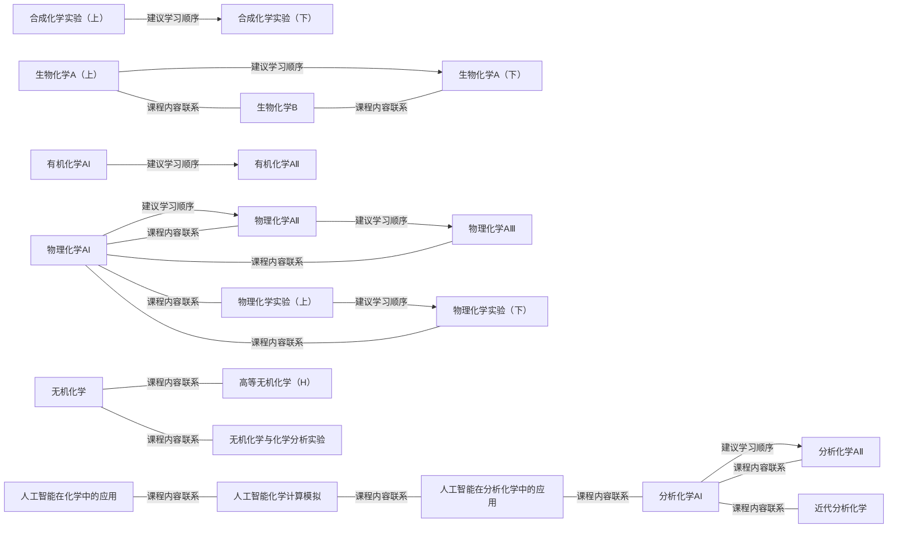

# 能源化学专业“2+X”教学培养方案

2024 年汇编印刷页 613–616。原表记录 72 个可配对的课程代码。

[本节原页](plan-613.pdf#page=1) · [逐行数据](plan-613.json) · [院系目录](README.md)

## 课程关系图

图中展示最多 20 条关系。下表列出本节全部关系。建议学习顺序供规划课程使用，正式选课资格以教务规定为准。

| 课程 | 关联课程 | 关系 | 依据 |
| --- | --- | --- | --- |
| 生物化学A（上）（BIOL130005） | 生物化学A（下）（BIOL130188） | 建议学习顺序 | 同节课程题名标明连续分册或序号。 |
| 分析化学AI（CHEM130001） | 分析化学AⅡ（CHEM130002） | 建议学习顺序 | 同节课程题名标明连续分册或序号。 |
| 合成化学实验（上）（CHEM130010） | 合成化学实验（下）（CHEM130011） | 建议学习顺序 | 同节课程题名标明连续分册或序号。 |
| 物理化学AI（CHEM130012） | 物理化学AⅡ（CHEM130013） | 建议学习顺序 | 同节课程题名标明连续分册或序号。 |
| 物理化学AⅡ（CHEM130013） | 物理化学AⅢ（CHEM130014） | 建议学习顺序 | 同节课程题名标明连续分册或序号。 |
| 有机化学AI（CHEM130067） | 有机化学AⅡ（CHEM130068） | 建议学习顺序 | 同节课程题名标明连续分册或序号。 |
| 物理化学实验（上）（CHEM130104） | 物理化学实验（下）（CHEM130105） | 建议学习顺序 | 同节课程题名标明连续分册或序号。 |
| 人工智能在化学中的应用（AIS310014） | 人工智能化学计算模拟（AIS531005） | 课程内容联系 | 本方案两门课程的题名均含“人工智能”，可据此对照这一主题。 |
| 人工智能化学计算模拟（AIS531005） | 人工智能在分析化学中的应用（AIT310024） | 课程内容联系 | 本方案两门课程的题名均含“人工智能”，可据此对照这一主题。 |
| 人工智能在分析化学中的应用（AIT310024） | 分析化学AI（CHEM130001） | 课程内容联系 | 本方案两门课程的题名均含“分析化学”，可据此对照这一主题。 |
| 生物化学A（上）（BIOL130005） | 生物化学B（BIOL130063） | 课程内容联系 | 本方案两门课程的题名均含“生物化学”，可据此对照这一主题。 |
| 生物化学B（BIOL130063） | 生物化学A（下）（BIOL130188） | 课程内容联系 | 本方案两门课程的题名均含“生物化学”，可据此对照这一主题。 |
| 分析化学AI（CHEM130001） | 分析化学AⅡ（CHEM130002） | 课程内容联系 | 本方案两门课程的题名均含“分析化学”，可据此对照这一主题。 |
| 分析化学AI（CHEM130001） | 近代分析化学（CHEM130027） | 课程内容联系 | 本方案两门课程的题名均含“分析化学”，可据此对照这一主题。 |
| 物理化学AI（CHEM130012） | 物理化学AⅡ（CHEM130013） | 课程内容联系 | 本方案两门课程的题名均含“物理化学”，可据此对照这一主题。 |
| 物理化学AI（CHEM130012） | 物理化学AⅢ（CHEM130014） | 课程内容联系 | 本方案两门课程的题名均含“物理化学”，可据此对照这一主题。 |
| 物理化学AI（CHEM130012） | 物理化学实验（上）（CHEM130104） | 课程内容联系 | 本方案两门课程的题名均含“物理化学”，可据此对照这一主题。 |
| 物理化学AI（CHEM130012） | 物理化学实验（下）（CHEM130105） | 课程内容联系 | 本方案两门课程的题名均含“物理化学”，可据此对照这一主题。 |
| 无机化学（CHEM130016） | 高等无机化学（H）（CHEM130093h） | 课程内容联系 | 本方案两门课程的题名均含“无机化学”，可据此对照这一主题。 |
| 无机化学（CHEM130016） | 无机化学与化学分析实验（CHEM130113） | 课程内容联系 | 本方案两门课程的题名均含“无机化学”，可据此对照这一主题。 |
| 有机化学AI（CHEM130067） | 有机化学AⅡ（CHEM130068） | 课程内容联系 | 本方案两门课程的题名均含“有机化学”，可据此对照这一主题。 |
| 有机化学AI（CHEM130067） | 金属有机化学的研究方法和策略（CHEM130077） | 课程内容联系 | 本方案两门课程的题名均含“有机化学”，可据此对照这一主题。 |
| 有机化学AI（CHEM130067） | 高等有机化学（H）（CHEM130095h） | 课程内容联系 | 本方案两门课程的题名均含“有机化学”，可据此对照这一主题。 |
| 有机化学AI（CHEM130067） | AI在有机化学中的应用（CHEM130119） | 课程内容联系 | 本方案两门课程的题名均含“有机化学”，可据此对照这一主题。 |
| 分析化学AI（CHEM130001） | 分析化学AⅡ（CHEM130002） | 方案排课先后 | 本节原表所列全部明确学期均早于后者。 |
| 合成化学实验（上）（CHEM130010） | 合成化学实验（下）（CHEM130011） | 方案排课先后 | 本节原表所列全部明确学期均早于后者。 |
| 物理化学AI（CHEM130012） | 物理化学AⅡ（CHEM130013） | 方案排课先后 | 本节原表所列全部明确学期均早于后者。 |
| 物理化学AⅡ（CHEM130013） | 物理化学AⅢ（CHEM130014） | 方案排课先后 | 本节原表所列全部明确学期均早于后者。 |
| 有机化学AI（CHEM130067） | 有机化学AⅡ（CHEM130068） | 方案排课先后 | 本节原表所列全部明确学期均早于后者。 |
| 物理化学实验（上）（CHEM130104） | 物理化学实验（下）（CHEM130105） | 方案排课先后 | 本节原表所列全部明确学期均早于后者。 |

## 课程

| 课程代码 | 名称 | 开课学期原文 | 来源（PDF 页） |
| --- | --- | --- | --- |
| AIS310014 | 人工智能在化学中的应用 | 秋 | 628 |
| AIS531005 | 人工智能化学计算模拟 | 春 | 628 |
| AIT310024 | 人工智能在分析化学中的应用 | 秋 | 630 |
| BIOL130005 | 生物化学A（上） | 春 | 629 |
| BIOL130063 | 生物化学B | 秋 | 629 |
| BIOL130188 | 生物化学A（下） | 秋 | 629 |
| CHEM130001 | 分析化学AI | 3 | 627 |
| CHEM130002 | 分析化学AⅡ | 4 | 627 |
| CHEM130010 | 合成化学实验（上） | 4 | 627 |
| CHEM130011 | 合成化学实验（下） | 5 | 627 |
| CHEM130012 | 物理化学AI | 3 | 627 |
| CHEM130013 | 物理化学AⅡ | 4 | 627 |
| CHEM130014 | 物理化学AⅢ | 5 | 627 |
| CHEM130015 | 谱学导论 | 春 | 628 |
| CHEM130016 | 无机化学 | 5、6 | 627 |
| CHEM130018 | 毕业论文 | 8 | 628 |
| CHEM130019 | 化学信息学 | 秋 | 630 |
| CHEM130026 | 无机合成化学 | 春 | 628 |
| CHEM130027 | 近代分析化学 | 春 | 629 |
| CHEM130029 | 胶体化学 | 春 | 629 |
| CHEM130031 | 有机合成及反应机理 |  | 629 |
| CHEM130035 | 环境化学B | 秋 | 629 |
| CHEM130038 | 数理统计方法在化学中的应用 | 春 | 630 |
| CHEM130039 | 计算化学 | 秋 | 629 |
| CHEM130040 | 化学专业英语 | 春 | 630 |
| CHEM130041 | 新型无机材料 | 春 | 628 |
| CHEM130042 | 化工原理实验 | 春 | 629 |
| CHEM130044 | 化学反应工程 | 春 | 628 |
| CHEM130046 | 工业化学 | 春 | 629 |
| CHEM130047 | 化工制图 | 秋 | 629 |
| CHEM130048 | 应用化学专题 | 秋 | 629 |
| CHEM130053 | 光电功能材料 | 秋 | 628 |
| CHEM130060 | 质谱学新技术的研究和应用 | 秋 | 629 |
| CHEM130061 | 分子组装与分子器件 | 春，秋 | 628 |
| CHEM130062 | 溶胶-凝胶化学及实验 | 春，秋 | 629 |
| CHEM130066 | 配位化学 | 秋 | 628 |
| CHEM130067 | 有机化学AI | 3 | 627 |
| CHEM130068 | 有机化学AⅡ | 4 | 628 |
| CHEM130070 | 纳米材料与功能器件 | 秋 | 628 |
| CHEM130073 | 药物化学 |  | 629 |
| CHEM130074 | 天然产物全合成赏析 |  | 629 |
| CHEM130075 | 有机结构的探秘和解析 |  | 629 |
| CHEM130076 | 元素化学 |  | 629 |
| CHEM130077 | 金属有机化学的研究方法和策略 |  | 629 |
| CHEM130081 | 现代化学专题（能源化学） | 春 | 628 |
| CHEM130093h | 高等无机化学（H） |  | 629 |
| CHEM130094 | 高等结构分析 | 春 | 629 |
| CHEM130095h | 高等有机化学（H） |  | 629 |
| CHEM130096h | 量子化学原理及应用（H） | 秋 | 629 |
| CHEM130097 | 生命中的化学 | 春 | 629 |
| CHEM130098 | 微流控生命分析 | 春，秋 | 629 |
| CHEM130100 | 高能化学电源 | 春 | 628 |
| CHEM130102 | 碳簇化学 |  | 629 |
| CHEM130103 | 探究性仪器分析实验 | 春，秋 | 629 |
| CHEM130104 | 物理化学实验（上） | 5 | 628 |
| CHEM130105 | 物理化学实验（下） | 6 | 628 |
| CHEM130107 | 仪器分析实验 | 4 | 628 |
| CHEM130108 | 计算谱学原理 | 春，秋 | 629 |
| CHEM130109 | 不对称合成化学 |  | 629 |
| CHEM130111 | 化学生物学基础 | 春 | 629 |
| CHEM130112 | 碳基能源化学 | 秋 | 628 |
| CHEM130113 | 无机化学与化学分析实验 | 3 | 628 |
| CHEM130114 | DNA合成化学 | 秋 | 629 |
| CHEM130116 | 切问近思 | 春，秋 | 630 |
| CHEM130117 | 科研实践 | 春，秋 | 630 |
| CHEM130118 | 化工基础 | 秋 | 628 |
| CHEM130119 | AI在有机化学中的应用 | 春 | 630 |
| CHEM130120 | 化学前沿专题 | 春 | 630 |
| MACR130009 | 高分子化学B | 5 | 628 |
| MATH120020 | 线性代数（理工类） | 秋 | 630 |
| PHYS130006 | 数学物理方法A | 春 | 630 |
| PHYS130113 | 热力学与统计物理I | 春 | 630 |
