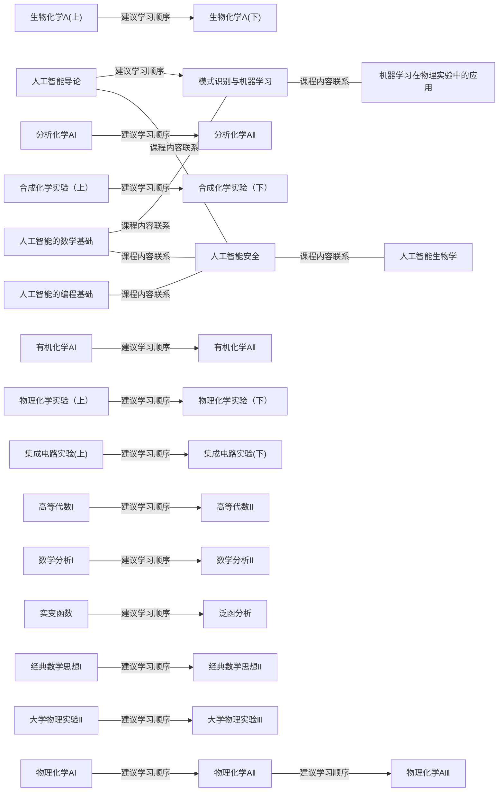

# 化学专业教学培养方案（相辉计划适用）

2024 年汇编印刷页 760–765。原表记录 139 个可配对的课程代码。

[本节原页](plan-760.pdf#page=1) · [逐行数据](plan-760.json) · [院系目录](README.md)

## 课程关系图

图中展示最多 20 条关系。下表列出本节全部关系。建议学习顺序供规划课程使用，正式选课资格以教务规定为准。

| 课程 | 关联课程 | 关系 | 依据 |
| --- | --- | --- | --- |
| 人工智能导论（AIE310005） | 模式识别与机器学习（AIE410001） | 建议学习顺序 | 人工智能问题与模型类别可为学习模式识别作准备。 |
| 生物化学A(上)（BIOL130005） | 生物化学A(下)（BIOL130188） | 建议学习顺序 | 同节课程题名标明连续分册或序号。 |
| 分析化学AI（CHEM130001） | 分析化学AⅡ（CHEM130002） | 建议学习顺序 | 同节课程题名标明连续分册或序号。 |
| 合成化学实验（上）（CHEM130010） | 合成化学实验（下）（CHEM130011） | 建议学习顺序 | 同节课程题名标明连续分册或序号。 |
| 物理化学AI（CHEM130012） | 物理化学AⅡ（CHEM130013） | 建议学习顺序 | 同节课程题名标明连续分册或序号。 |
| 物理化学AⅡ（CHEM130013） | 物理化学AⅢ（CHEM130014） | 建议学习顺序 | 同节课程题名标明连续分册或序号。 |
| 有机化学AI（CHEM130067） | 有机化学AⅡ（CHEM130068） | 建议学习顺序 | 同节课程题名标明连续分册或序号。 |
| 物理化学实验（上）（CHEM130104） | 物理化学实验（下）（CHEM130105） | 建议学习顺序 | 同节课程题名标明连续分册或序号。 |
| 集成电路实验(上)（INFO130027） | 集成电路实验(下)（INFO130028） | 建议学习顺序 | 同节课程题名标明连续分册或序号。 |
| 高等代数I（MATH120011） | 高等代数II（MATH130002） | 建议学习顺序 | 同节课程题名标明连续分册或序号。 |
| 数学分析I（MATH130154） | 数学分析II（MATH130155） | 建议学习顺序 | 同节课程题名标明连续分册或序号。 |
| 实变函数（MATH130186） | 泛函分析（MATH130011） | 建议学习顺序 | 测度与积分有助于理解函数空间。 |
| 经典数学思想Ⅰ（MATH130190） | 经典数学思想Ⅱ（MATH130191） | 建议学习顺序 | 同节课程题名标明连续分册或序号。 |
| 大学物理实验Ⅱ（PHYS130125） | 大学物理实验Ⅲ（PHYS130126） | 建议学习顺序 | 同节课程题名标明连续分册或序号。 |
| 人工智能导论（AIE310005） | 人工智能安全（AIE831001） | 课程内容联系 | 本方案两门课程的题名均含“人工智能”，可据此对照这一主题。 |
| 人工智能的编程基础（AIE310006） | 人工智能安全（AIE831001） | 课程内容联系 | 本方案两门课程的题名均含“人工智能”，可据此对照这一主题。 |
| 人工智能的数学基础（AIE310009） | 模式识别与机器学习（AIE410001） | 课程内容联系 | 数学表达与学习模型的统计、优化工具可对照。 |
| 人工智能的数学基础（AIE310009） | 人工智能安全（AIE831001） | 课程内容联系 | 本方案两门课程的题名均含“人工智能”，可据此对照这一主题。 |
| 模式识别与机器学习（AIE410001） | 机器学习在物理实验中的应用（AIS310013） | 课程内容联系 | 本方案两门课程的题名均含“机器学习”，可据此对照这一主题。 |
| 人工智能安全（AIE831001） | 人工智能生物学（AIS310017） | 课程内容联系 | 本方案两门课程的题名均含“人工智能”，可据此对照这一主题。 |
| 人工智能在分析化学中的应用（AIT310024） | 分析化学AI（CHEM130001） | 课程内容联系 | 本方案两门课程的题名均含“分析化学”，可据此对照这一主题。 |
| 生物化学A(上)（BIOL130005） | 生物化学B（BIOL130063） | 课程内容联系 | 本方案两门课程的题名均含“生物化学”，可据此对照这一主题。 |
| 生物化学实验（BIOL130007） | 生物化学B（BIOL130063） | 课程内容联系 | 本方案两门课程的题名均含“生物化学”，可据此对照这一主题。 |
| 细胞生物学（BIOL130008） | 细胞生物学实验（BIOL130009） | 课程内容联系 | 同节同题名的课程与实验、实习或实践。 |
| 微生物学（BIOL130010） | 微生物学实验（BIOL130011） | 课程内容联系 | 同节同题名的课程与实验、实习或实践。 |
| 遗传学（BIOL130012） | 遗传学实验（BIOL130013） | 课程内容联系 | 同节同题名的课程与实验、实习或实践。 |
| 生理学（BIOL130014） | 生理学实验（BIOL130187） | 课程内容联系 | 同节同题名的课程与实验、实习或实践。 |
| 生物化学B（BIOL130063） | 生物化学A(下)（BIOL130188） | 课程内容联系 | 本方案两门课程的题名均含“生物化学”，可据此对照这一主题。 |
| 分析化学AI（CHEM130001） | 分析化学AⅡ（CHEM130002） | 课程内容联系 | 本方案两门课程的题名均含“分析化学”，可据此对照这一主题。 |
| 分析化学AI（CHEM130001） | 近代分析化学（CHEM130027） | 课程内容联系 | 本方案两门课程的题名均含“分析化学”，可据此对照这一主题。 |
| 物理化学AI（CHEM130012） | 物理化学AⅡ（CHEM130013） | 课程内容联系 | 本方案两门课程的题名均含“物理化学”，可据此对照这一主题。 |
| 物理化学AI（CHEM130012） | 物理化学AⅢ（CHEM130014） | 课程内容联系 | 本方案两门课程的题名均含“物理化学”，可据此对照这一主题。 |
| 物理化学AI（CHEM130012） | 物理化学实验（上）（CHEM130104） | 课程内容联系 | 本方案两门课程的题名均含“物理化学”，可据此对照这一主题。 |
| 物理化学AI（CHEM130012） | 物理化学实验（下）（CHEM130105） | 课程内容联系 | 本方案两门课程的题名均含“物理化学”，可据此对照这一主题。 |
| 无机化学（CHEM130016） | 高等无机化学（H）（CHEM130093h） | 课程内容联系 | 本方案两门课程的题名均含“无机化学”，可据此对照这一主题。 |
| 无机化学（CHEM130016） | 无机化学与化学分析实验（CHEM130113） | 课程内容联系 | 本方案两门课程的题名均含“无机化学”，可据此对照这一主题。 |
| 有机化学AI（CHEM130067） | 有机化学AⅡ（CHEM130068） | 课程内容联系 | 本方案两门课程的题名均含“有机化学”，可据此对照这一主题。 |
| 有机化学AI（CHEM130067） | 金属有机化学的研究方法和策略（CHEM130077） | 课程内容联系 | 本方案两门课程的题名均含“有机化学”，可据此对照这一主题。 |
| 有机化学AI（CHEM130067） | 高等有机化学（H）（CHEM130095h） | 课程内容联系 | 本方案两门课程的题名均含“有机化学”，可据此对照这一主题。 |
| 有机化学AI（CHEM130067） | AI在有机化学中的应用（CHEM130119） | 课程内容联系 | 本方案两门课程的题名均含“有机化学”，可据此对照这一主题。 |
| 量子化学原理及应用（H）（CHEM130096h） | 量子力学I（PHYS130008） | 课程内容联系 | 本方案两门课程的题名均含“量子”，可据此对照这一主题。 |
| 集成电路实验(上)（INFO130027） | 集成电路工艺原理（MICR130007） | 课程内容联系 | 本方案两门课程的题名均含“集成电路”，可据此对照这一主题。 |
| 集成电路实验(下)（INFO130028） | 集成电路工艺原理（MICR130007） | 课程内容联系 | 本方案两门课程的题名均含“集成电路”，可据此对照这一主题。 |
| 专用集成电路设计方法（INFO130094） | 集成电路工艺原理（MICR130007） | 课程内容联系 | 本方案两门课程的题名均含“集成电路”，可据此对照这一主题。 |
| 半导体物理（MICR130005） | 半导体器件原理（MICR130028） | 课程内容联系 | 本方案两门课程的题名均含“半导体”，可据此对照这一主题。 |
| 集成电路工艺原理（MICR130007） | 数字集成电路设计原理（MICR130029） | 课程内容联系 | 本方案两门课程的题名均含“集成电路”，可据此对照这一主题。 |
| 分析化学AI（CHEM130001） | 分析化学AⅡ（CHEM130002） | 方案排课先后 | 本节原表所列全部明确学期均早于后者。 |
| 合成化学实验（上）（CHEM130010） | 合成化学实验（下）（CHEM130011） | 方案排课先后 | 本节原表所列全部明确学期均早于后者。 |
| 物理化学AI（CHEM130012） | 物理化学AⅡ（CHEM130013） | 方案排课先后 | 本节原表所列全部明确学期均早于后者。 |
| 物理化学AⅡ（CHEM130013） | 物理化学AⅢ（CHEM130014） | 方案排课先后 | 本节原表所列全部明确学期均早于后者。 |
| 有机化学AI（CHEM130067） | 有机化学AⅡ（CHEM130068） | 方案排课先后 | 本节原表所列全部明确学期均早于后者。 |

## 课程

| 课程代码 | 名称 | 开课学期原文 | 来源（PDF 页） |
| --- | --- | --- | --- |
| AIE210006 | 计算机系统基础 | 秋 | 778 |
| AIE310004 | 计算机视觉 | 秋 | 779 |
| AIE310005 | 人工智能导论 | 春 | 778 |
| AIE310006 | 人工智能的编程基础 | 春 | 778 |
| AIE310007 | 数据结构 | 秋 | 778 |
| AIE310008 | 人工智能的软件基础 | 春 | 778 |
| AIE310009 | 人工智能的数学基础 | 秋 | 778 |
| AIE410001 | 模式识别与机器学习 | 秋 | 778 |
| AIE410002 | 自然语言处理与大语言模型 | 春 | 778 |
| AIE531001 | 人工智能前沿探索实践 | 秋 | 779 |
| AIE831001 | 人工智能安全 | 秋 | 778 |
| AIS310013 | 机器学习在物理实验中的应用 | 春 | 778 |
| AIS310014 | 人工智能在化学中的应用 | 秋 | 775 |
| AIS310017 | 人工智能生物学 | 秋 | 778 |
| AIS410006 | 人工智能结构生物学 | 秋 | 778 |
| AIS410014 | AI在生物分子结构中的研究及应用 | 秋 | 778 |
| AIS531004 | 计算与AI物理 | 春 | 778 |
| AIS531005 | 人工智能化学计算模拟 | 春 | 775 |
| AIS631003 | 数据科学中的逼近论基础 | 秋 | 777 |
| AIS631004 | 新型算法 | 秋 | 777 |
| AIT310024 | 人工智能在分析化学中的应用 | 秋 | 776 |
| BIOL130005 | 生物化学A(上) | 春 | 778 |
| BIOL130007 | 生物化学实验 | 春 | 778 |
| BIOL130008 | 细胞生物学 | 春 | 778 |
| BIOL130009 | 细胞生物学实验 | 春 | 778 |
| BIOL130010 | 微生物学 | 秋 | 778 |
| BIOL130011 | 微生物学实验 | 秋 | 778 |
| BIOL130012 | 遗传学 | 秋 | 778 |
| BIOL130013 | 遗传学实验 | 秋 | 778 |
| BIOL130014 | 生理学 | 春 | 778 |
| BIOL130063 | 生物化学B | 秋 | 776 |
| BIOL130065 | 分子生物学 | 秋 | 778 |
| BIOL130184 | 普通生物学 | 秋 | 778 |
| BIOL130185 | 普通生物学实验-动物 | 秋 | 778 |
| BIOL130186 | 普通生物学实验-植物 | 秋 | 778 |
| BIOL130187 | 生理学实验 | 春 | 778 |
| BIOL130188 | 生物化学A(下) | 秋 | 778 |
| CHEM130001 | 分析化学AI | 3 | 774 |
| CHEM130002 | 分析化学AⅡ | 4 | 774 |
| CHEM130010 | 合成化学实验（上） | 4 | 774 |
| CHEM130011 | 合成化学实验（下） | 5 | 774 |
| CHEM130012 | 物理化学AI | 3 | 774 |
| CHEM130013 | 物理化学AⅡ | 4 | 774 |
| CHEM130014 | 物理化学AⅢ | 5 | 774 |
| CHEM130015 | 谱学导论 | 春 | 775 |
| CHEM130016 | 无机化学 | 5、6 | 774 |
| CHEM130018 | 毕业论文 | 8 | 775 |
| CHEM130019 | 化学信息学 | 秋 | 776 |
| CHEM130026 | 无机合成化学 | 春 | 775 |
| CHEM130027 | 近代分析化学 | 春 | 776 |
| CHEM130029 | 胶体化学 | 春 | 776 |
| CHEM130031 | 有机合成及反应机理 | 秋 | 776 |
| CHEM130035 | 环境化学B | 秋 | 776 |
| CHEM130038 | 数理统计方法在化学中的应用 | 春 | 777 |
| CHEM130039 | 计算化学 | 秋 | 776 |
| CHEM130040 | 化学专业英语 | 春 | 777 |
| CHEM130041 | 新型无机材料 | 春 | 775 |
| CHEM130042 | 化工原理实验 | 春 | 776 |
| CHEM130044 | 化学反应工程 | 春 | 776 |
| CHEM130046 | 工业化学 | 春 | 776 |
| CHEM130047 | 化工制图 | 秋 | 776 |
| CHEM130048 | 应用化学专题 | 秋 | 776 |
| CHEM130053 | 光电功能材料 | 秋 | 775 |
| CHEM130060 | 质谱学新技术的研究和应用 | 秋 | 776 |
| CHEM130061 | 分子组装与分子器件 | 春，秋 | 775 |
| CHEM130062 | 溶胶-凝胶化学及实验 | 春 | 776 |
| CHEM130066 | 配位化学 | 秋 | 775 |
| CHEM130067 | 有机化学AI | 3 | 775 |
| CHEM130068 | 有机化学AⅡ | 4 | 775 |
| CHEM130070 | 纳米材料与功能器件 | 秋 | 775 |
| CHEM130073 | 药物化学 | 春 | 776 |
| CHEM130074 | 天然产物全合成赏析 | 春 | 776 |
| CHEM130075 | 有机结构的探秘和解析 | 春 | 776 |
| CHEM130076 | 元素化学 | 秋 | 776 |
| CHEM130077 | 金属有机化学的研究方法和策略 | 春，秋 | 776 |
| CHEM130081 | 现代化学专题（能源化学） | 春 | 776 |
| CHEM130093h | 高等无机化学（H） | 秋 | 775 |
| CHEM130094 | 高等结构分析 | 春 | 776 |
| CHEM130095h | 高等有机化学（H） | 秋 | 775 |
| CHEM130096h | 量子化学原理及应用（H） | 秋 | 775 |
| CHEM130097 | 生命中的化学 | 春，秋 | 776 |
| CHEM130098 | 微流控生命分析 |  | 776 |
| CHEM130100 | 高能化学电源 | 春 | 776 |
| CHEM130102 | 碳簇化学 | 秋 | 776 |
| CHEM130103 | 探究性仪器分析实验 | 春，秋 | 776 |
| CHEM130104 | 物理化学实验（上） | 5 | 775 |
| CHEM130105 | 物理化学实验（下） | 4 | 775 |
| CHEM130107 | 仪器分析实验 | 4 | 775 |
| CHEM130108 | 计算谱学原理 | 春，秋 | 776 |
| CHEM130109 | 不对称合成化学 | 春，秋 | 776 |
| CHEM130111 | 化学生物学基础 | 春 | 775 |
| CHEM130112 | 碳基能源化学 | 秋 | 776 |
| CHEM130113 | 无机化学与化学分析实验 | 3 | 775 |
| CHEM130114 | DNA合成化学 | 秋 | 776 |
| CHEM130116 | 切问近思 | 春，秋 | 775 |
| CHEM130117 | 科研实践 | 春，秋 | 777 |
| CHEM130118 | 化工基础 | 秋 | 775 |
| CHEM130119 | AI在有机化学中的应用 | 春 | 776 |
| CHEM130120 | 化学前沿专题 | 春 | 775 |
| INFO130027 | 集成电路实验(上) | 秋 | 779 |
| INFO130028 | 集成电路实验(下) | 春 | 779 |
| INFO130094 | 专用集成电路设计方法 | 春 | 779 |
| MACR130009 | 高分子化学B | 5 | 775 |
| MATH120011 | 高等代数I | 秋 | 777 |
| MATH120020 | 线性代数（理工类） | 秋 | 777 |
| MATH130002 | 高等代数II | 春 | 777 |
| MATH130011 | 泛函分析 | 秋 | 777 |
| MATH130154 | 数学分析I | 秋 | 777 |
| MATH130155 | 数学分析II | 春 | 777 |
| MATH130182 | 解析几何 | 秋 | 777 |
| MATH130183 | 常微分方程 | 秋 | 777 |
| MATH130184 | 抽象代数 | 秋 | 777 |
| MATH130185 | 复变函数 | 春 | 777 |
| MATH130186 | 实变函数 | 春 | 777 |
| MATH130187 | 拓扑学 | 春 | 777 |
| MATH130189 | 几何拓扑选讲 | 秋 | 777 |
| MATH130190 | 经典数学思想Ⅰ | 秋 | 777 |
| MATH130191 | 经典数学思想Ⅱ | 春 | 777 |
| MICR130002 | 模拟电子线路 | 秋 | 779 |
| MICR130003 | 数字逻辑基础 | 秋 | 779 |
| MICR130004 | 信号与系统概论 | 春 | 779 |
| MICR130005 | 半导体物理 | 春 | 779 |
| MICR130006 | 嵌入式处理器与芯片系统设计 | 春 | 779 |
| MICR130007 | 集成电路工艺原理 | 春 | 779 |
| MICR130028 | 半导体器件原理 | 秋 | 779 |
| MICR130029 | 数字集成电路设计原理 | 秋 | 779 |
| MICR130030 | 模拟集成电路设计原理 | 春 | 779 |
| PHYS130003 | 经典力学 | 秋 | 777 |
| PHYS130006 | 数学物理方法A | 春 | 777 |
| PHYS130008 | 量子力学I | 秋 | 777 |
| PHYS130010 | 固体物理 | 春 | 777 |
| PHYS130058 | 近代物理实验I | 春 | 777 |
| PHYS130092 | 大学物理A：光学 | 秋 | 777 |
| PHYS130093 | 大学物理A：原子物理 | 春 | 778 |
| PHYS130113 | 热力学与统计物理I | 春 | 778 |
| PHYS130114 | 电动力学 | 秋 | 778 |
| PHYS130119 | 概率论与数理统计 | 秋 | 778 |
| PHYS130125 | 大学物理实验Ⅱ | 秋 | 777 |
| PHYS130126 | 大学物理实验Ⅲ | 春 | 777 |
