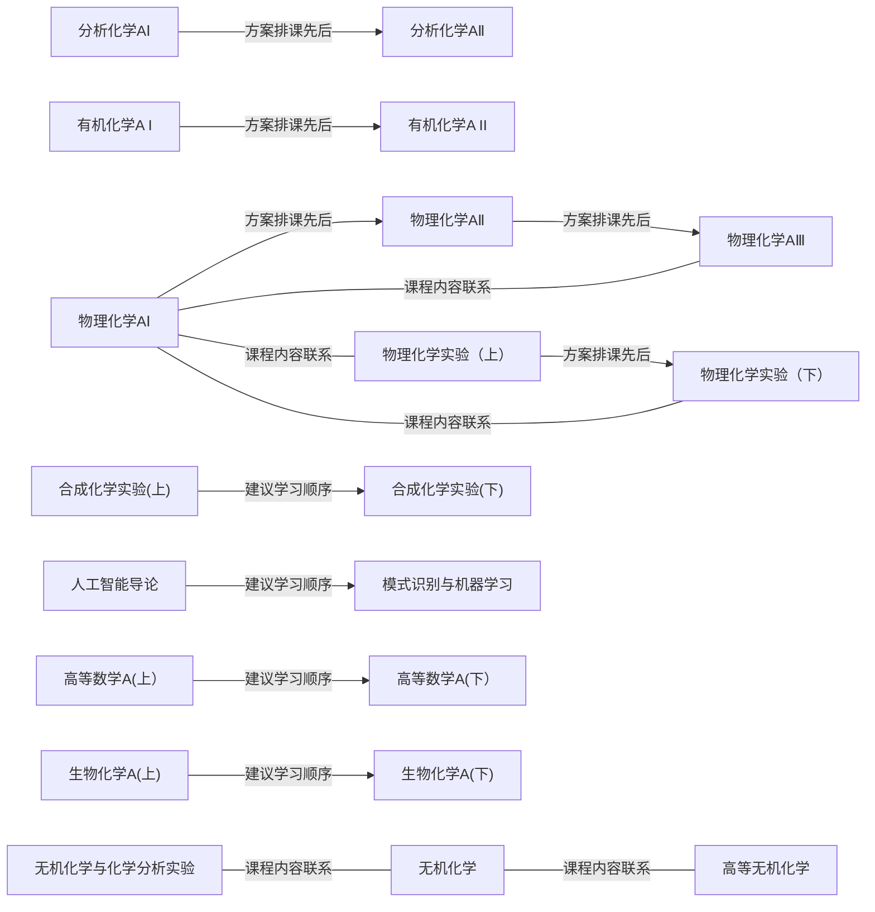

# 2025 化学-人工智能双学士学位项目本博融通培养方案（英才班适用）

化学系 · 化学-人工智能(双学士学位项目) · 方案 151312 · 131 个不同课程或科研条目。

[官方 Word](../originals/plan-151312.docx) · [教务详情](https://fdjwgl.fudan.edu.cn/manager/bizType/2/major-program-search/info/151312?skipAuth=1) · [方案快照](../raw/plan-151312.json.gz) · [年级目录](../README.md)

## 修读导读

- **建议先学**　《物理化学AⅠ》（`CHEM20005`） → 《物理化学AⅡ》（`CHEM20006`） → 《物理化学AⅢ》（`CHEM30004`）。题名列出连续册次或级别。可将前一册用到的结构、性质和变化条件做成索引，读后一册时回查。方案分别列在第3、4、5学期。

- **可以对照着读**　《无机化学与化学分析实验》（`CHEM20021`）与《无机化学》（`CHEM30005`）。两门课的题名都涉及无机化学。选同一种无机物，把结构与性质的解释对应到可观察的现象。

- **查模块选课**　《分析化学AⅠ》（`CHEM20001`）、《物理化学实验（上）》（`CHEM30031`）列在“必修课程”中。原表见 `/courseModules/10`。

## 课程关系图

图中展示部分关系。下表保留全部已建立的课程对，来源位置使用本方案 JSON Pointer。

## 先修与内容联系

| 类型 | 起点 | 终点 | 依据 | 原表定位 |
| --- | --- | --- | --- | --- |
| 建议学习顺序 | 人工智能导论 (AIE310005) | 模式识别与机器学习 (AIE410001) | 人工智能问题与模型类别可为学习模式识别作准备。  | `/courseModules/13/planCourses/5`、`/courseModules/13/planCourses/8` |
| 建议学习顺序 | 生物化学A(上) (BIOL30002) | 生物化学A(下) (BIOL30021) | 同方案的课程题名具有连续分册或序号。  | `/courseModules/20/planCourses/1`、`/courseModules/20/planCourses/47` |
| 建议学习顺序 | 分析化学AⅠ (CHEM20001) | 分析化学AⅡ (CHEM20002) | 同方案的课程题名具有连续分册或序号。  | `/courseModules/10/planCourses/3`、`/courseModules/10/planCourses/4` |
| 建议学习顺序 | 合成化学实验(上) (CHEM20004) | 合成化学实验(下) (CHEM30003) | 同方案的课程题名具有连续分册或序号。  | `/courseModules/10/planCourses/12`、`/courseModules/10/planCourses/13` |
| 建议学习顺序 | 物理化学AⅠ (CHEM20005) | 物理化学AⅡ (CHEM20006) | 同方案的课程题名具有连续分册或序号。  | `/courseModules/10/planCourses/0`、`/courseModules/10/planCourses/1` |
| 建议学习顺序 | 物理化学AⅡ (CHEM20006) | 物理化学AⅢ (CHEM30004) | 同方案的课程题名具有连续分册或序号。  | `/courseModules/10/planCourses/1`、`/courseModules/10/planCourses/2` |
| 建议学习顺序 | 有机化学A I (CHEM20013) | 有机化学A II (CHEM20014) | 同方案的课程题名具有连续分册或序号。  | `/courseModules/10/planCourses/9`、`/courseModules/10/planCourses/10` |
| 建议学习顺序 | 物理化学实验（上） (CHEM30031) | 物理化学实验（下） (CHEM30032) | 同方案的课程题名具有连续分册或序号。  | `/courseModules/10/planCourses/5`、`/courseModules/10/planCourses/6` |
| 建议学习顺序 | 高等数学A(上） (MATH10015) | 高等数学A(下） (MATH10016) | 同方案的课程题名具有连续分册或序号。  | `/courseModules/6/planCourses/3`、`/courseModules/6/planCourses/4` |
| 方案排课先后 | 人工智能导论 (AIE310005) | 模式识别与机器学习 (AIE410001) | 同方案该课程全部明确数字学期均早于后者。  | `/courseModules/13/planCourses/5`、`/courseModules/13/planCourses/8` |
| 方案排课先后 | 分析化学AⅠ (CHEM20001) | 分析化学AⅡ (CHEM20002) | 同方案该课程全部明确数字学期均早于后者。  | `/courseModules/10/planCourses/3`、`/courseModules/10/planCourses/4` |
| 方案排课先后 | 合成化学实验(上) (CHEM20004) | 合成化学实验(下) (CHEM30003) | 同方案该课程全部明确数字学期均早于后者。  | `/courseModules/10/planCourses/12`、`/courseModules/10/planCourses/13` |
| 方案排课先后 | 物理化学AⅠ (CHEM20005) | 物理化学AⅡ (CHEM20006) | 同方案该课程全部明确数字学期均早于后者。  | `/courseModules/10/planCourses/0`、`/courseModules/10/planCourses/1` |
| 方案排课先后 | 物理化学AⅡ (CHEM20006) | 物理化学AⅢ (CHEM30004) | 同方案该课程全部明确数字学期均早于后者。  | `/courseModules/10/planCourses/1`、`/courseModules/10/planCourses/2` |
| 方案排课先后 | 有机化学A I (CHEM20013) | 有机化学A II (CHEM20014) | 同方案该课程全部明确数字学期均早于后者。  | `/courseModules/10/planCourses/9`、`/courseModules/10/planCourses/10` |
| 方案排课先后 | 物理化学实验（上） (CHEM30031) | 物理化学实验（下） (CHEM30032) | 同方案该课程全部明确数字学期均早于后者。  | `/courseModules/10/planCourses/5`、`/courseModules/10/planCourses/6` |
| 方案排课先后 | 高等数学A(上） (MATH10015) | 高等数学A(下） (MATH10016) | 同方案该课程全部明确数字学期均早于后者。  | `/courseModules/6/planCourses/3`、`/courseModules/6/planCourses/4` |
| 课程内容联系 | 计算机系统基础 (AIE210006) | 计算机组成与体系结构 (CS30052) | 处理器、存储与系统执行模型具有共同内容。  | `/courseModules/13/planCourses/3`、`/courseModules/18/planCourses/1` |
| 课程内容联系 | 人工智能导论 (AIE310005) | 人工智能安全 (AIE831001) | 本方案两门课程的题名均含“人工智能”，可据此对照这一主题。  | `/courseModules/13/planCourses/5`、`/courseModules/13/planCourses/7` |
| 课程内容联系 | 人工智能的编程基础 (AIE310006) | 人工智能安全 (AIE831001) | 本方案两门课程的题名均含“人工智能”，可据此对照这一主题。  | `/courseModules/13/planCourses/0`、`/courseModules/13/planCourses/7` |
| 课程内容联系 | 人工智能的软件基础 (AIE310008) | 人工智能安全 (AIE831001) | 本方案两门课程的题名均含“人工智能”，可据此对照这一主题。  | `/courseModules/13/planCourses/4`、`/courseModules/13/planCourses/7` |
| 课程内容联系 | 人工智能的数学基础 (AIE310009) | 模式识别与机器学习 (AIE410001) | 数学表达与学习模型的统计、优化工具可对照。  | `/courseModules/13/planCourses/2`、`/courseModules/13/planCourses/8` |
| 课程内容联系 | 人工智能的数学基础 (AIE310009) | 人工智能安全 (AIE831001) | 本方案两门课程的题名均含“人工智能”，可据此对照这一主题。  | `/courseModules/13/planCourses/2`、`/courseModules/13/planCourses/7` |
| 课程内容联系 | 模式识别与机器学习 (AIE410001) | 机器学习系统 (CS30058) | 本方案两门课程的题名均含“机器学习”，可据此对照这一主题。  | `/courseModules/13/planCourses/8`、`/courseModules/18/planCourses/5` |
| 课程内容联系 | 人工智能在分析化学中的应用 (AIT310024) | 分析化学AⅠ (CHEM20001) | 本方案两门课程的题名均含“分析化学”，可据此对照这一主题。  | `/courseModules/18/planCourses/7`、`/courseModules/10/planCourses/3` |
| 课程内容联系 | 生物化学A(上) (BIOL30002) | 生物化学 (MED20048) | 本方案两门课程的题名均含“生物化学”，可据此对照这一主题。  | `/courseModules/20/planCourses/1`、`/courseModules/20/planCourses/53` |
| 课程内容联系 | 生物化学A(下) (BIOL30021) | 生物化学 (MED20048) | 本方案两门课程的题名均含“生物化学”，可据此对照这一主题。  | `/courseModules/20/planCourses/47`、`/courseModules/20/planCourses/53` |
| 课程内容联系 | 分析化学AⅠ (CHEM20001) | 分析化学AⅡ (CHEM20002) | 本方案两门课程的题名均含“分析化学”，可据此对照这一主题。  | `/courseModules/10/planCourses/3`、`/courseModules/10/planCourses/4` |
| 课程内容联系 | 分析化学AⅠ (CHEM20001) | 近代分析化学 (CHEM30008) | 本方案两门课程的题名均含“分析化学”，可据此对照这一主题。  | `/courseModules/10/planCourses/3`、`/courseModules/20/planCourses/8` |
| 课程内容联系 | 物理化学AⅠ (CHEM20005) | 物理化学AⅡ (CHEM20006) | 本方案两门课程的题名均含“物理化学”，可据此对照这一主题。  | `/courseModules/10/planCourses/0`、`/courseModules/10/planCourses/1` |
| 课程内容联系 | 物理化学AⅠ (CHEM20005) | 物理化学AⅢ (CHEM30004) | 本方案两门课程的题名均含“物理化学”，可据此对照这一主题。  | `/courseModules/10/planCourses/0`、`/courseModules/10/planCourses/2` |
| 课程内容联系 | 物理化学AⅠ (CHEM20005) | 物理化学实验（上） (CHEM30031) | 本方案两门课程的题名均含“物理化学”，可据此对照这一主题。  | `/courseModules/10/planCourses/0`、`/courseModules/10/planCourses/5` |
| 课程内容联系 | 物理化学AⅠ (CHEM20005) | 物理化学实验（下） (CHEM30032) | 本方案两门课程的题名均含“物理化学”，可据此对照这一主题。  | `/courseModules/10/planCourses/0`、`/courseModules/10/planCourses/6` |
| 课程内容联系 | 有机化学A I (CHEM20013) | 物理有机化学 (CHEM60014) | 本方案两门课程的题名均含“有机化学”，可据此对照这一主题。  | `/courseModules/10/planCourses/9`、`/courseModules/20/planCourses/29` |
| 课程内容联系 | 有机化学A II (CHEM20014) | 物理有机化学 (CHEM60014) | 本方案两门课程的题名均含“有机化学”，可据此对照这一主题。  | `/courseModules/10/planCourses/10`、`/courseModules/20/planCourses/29` |
| 课程内容联系 | 无机化学与化学分析实验 (CHEM20021) | 无机化学 (CHEM30005) | 本方案两门课程的题名均含“无机化学”，可据此对照这一主题。  | `/courseModules/10/planCourses/11`、`/courseModules/10/planCourses/8` |
| 课程内容联系 | 绿色电化学合成 (CHEM30001) | 分析电化学 (CHEM60016) | 本方案两门课程的题名均含“电化学”，可据此对照这一主题。  | `/courseModules/20/planCourses/69`、`/courseModules/20/planCourses/39` |
| 课程内容联系 | 无机化学 (CHEM30005) | 高等无机化学 (CHEM50002) | 本方案两门课程的题名均含“无机化学”，可据此对照这一主题。  | `/courseModules/10/planCourses/8`、`/courseModules/12/planCourses/0` |
| 课程内容联系 | 高等有机化学 (CHEM50003) | 物理有机化学 (CHEM60014) | 本方案两门课程的题名均含“有机化学”，可据此对照这一主题。  | `/courseModules/12/planCourses/1`、`/courseModules/20/planCourses/29` |
| 课程内容联系 | 物理有机化学 (CHEM60014) | 金属有机化学 (CHEM60024) | 本方案两门课程的题名均含“有机化学”，可据此对照这一主题。  | `/courseModules/20/planCourses/29`、`/courseModules/20/planCourses/32` |

本次未从可定位的明确表述中确认课程对课程预修。学期安排、系列分册与编辑建议均保留各自的依据。

## 按原方案模块阅读

同一模块展示原表中的课程归属。模块内课程之间的先后仍须逐项查阅。

- **双学位融合必修课程**　人工智能在化学中的应用、人工智能化学计算模拟（原表模块 11）
- **本研贯通课程**　高等无机化学、高等有机化学、量子化学原理及应用、高等结构分析（原表模块 12）

## 课程表

同一课程在不同模块分别出现时，按原表逐行列出。季节字段保留原值。

| 课程 | 代码 | 学分 | 学期 | 模块 |
| --- | --- | ---: | --- | --- |
| 现代生物科学导论A | BIOL10001 | 3.0 | 第1学期 | 培养方案 / 专业培养课程 / 学科基础课程 / A组 |
| 普通化学实验I | CHEM10005 | 1.0 | 第1学期 | 培养方案 / 专业培养课程 / 学科基础课程 / A组 |
| 线性代数（理工类） | MATH10014 | 3.0 | 第1学期 | 培养方案 / 专业培养课程 / 学科基础课程 / A组 |
| 高等数学A(上） | MATH10015 | 5.0 | 第1学期 | 培养方案 / 专业培养课程 / 学科基础课程 / A组 |
| 高等数学A(下） | MATH10016 | 5.0 | 第2学期 | 培养方案 / 专业培养课程 / 学科基础课程 / A组 |
| 大学物理A：力学 | PHYS10006 | 4.0 | 第1学期 | 培养方案 / 专业培养课程 / 学科基础课程 / A组 |
| 大学物理A：热学 | PHYS10007 | 2.0 | 第2学期 | 培养方案 / 专业培养课程 / 学科基础课程 / A组 |
| 大学物理A：电磁学 | PHYS10008 | 4.0 | 第2学期 | 培养方案 / 专业培养课程 / 学科基础课程 / A组 |
| 程序设计 | CS10004 | 4.0 | 第1学期 | 培养方案 / 专业培养课程 / 学科基础课程 / B组 |
| 物理化学AⅠ | CHEM20005 | 3.0 | 第3学期 | 培养方案 / 专业培养课程 / 专业核心教育课程 / A组 / 必修课程 |
| 物理化学AⅡ | CHEM20006 | 3.0 | 第4学期 | 培养方案 / 专业培养课程 / 专业核心教育课程 / A组 / 必修课程 |
| 物理化学AⅢ | CHEM30004 | 3.0 | 第5学期 | 培养方案 / 专业培养课程 / 专业核心教育课程 / A组 / 必修课程 |
| 分析化学AⅠ | CHEM20001 | 2.0 | 第3学期 | 培养方案 / 专业培养课程 / 专业核心教育课程 / A组 / 必修课程 |
| 分析化学AⅡ | CHEM20002 | 2.0 | 第4学期 | 培养方案 / 专业培养课程 / 专业核心教育课程 / A组 / 必修课程 |
| 物理化学实验（上） | CHEM30031 | 2.0 | 第5学期 | 培养方案 / 专业培养课程 / 专业核心教育课程 / A组 / 必修课程 |
| 物理化学实验（下） | CHEM30032 | 2.0 | 第6学期 | 培养方案 / 专业培养课程 / 专业核心教育课程 / A组 / 必修课程 |
| 仪器分析实验 | CHEM20020 | 2.0 | 第4学期 | 培养方案 / 专业培养课程 / 专业核心教育课程 / A组 / 必修课程 |
| 无机化学 | CHEM30005 | 3.0 | 第5学期、第6学期 | 培养方案 / 专业培养课程 / 专业核心教育课程 / A组 / 必修课程 |
| 有机化学A I | CHEM20013 | 4.0 | 第3学期 | 培养方案 / 专业培养课程 / 专业核心教育课程 / A组 / 必修课程 |
| 有机化学A II | CHEM20014 | 2.0 | 第4学期 | 培养方案 / 专业培养课程 / 专业核心教育课程 / A组 / 必修课程 |
| 无机化学与化学分析实验 | CHEM20021 | 4.0 | 第3学期 | 培养方案 / 专业培养课程 / 专业核心教育课程 / A组 / 必修课程 |
| 合成化学实验(上) | CHEM20004 | 2.0 | 第4学期 | 培养方案 / 专业培养课程 / 专业核心教育课程 / A组 / 必修课程 |
| 合成化学实验(下) | CHEM30003 | 2.0 | 第5学期 | 培养方案 / 专业培养课程 / 专业核心教育课程 / A组 / 必修课程 |
| 谱学导论 | CHEM20007 | 3.0 | 第4学期 | 培养方案 / 专业培养课程 / 专业核心教育课程 / A组 / 必修课程 |
| 化工基础 | CHEM30039 | 3.0 | 第5学期 | 培养方案 / 专业培养课程 / 专业核心教育课程 / A组 / 必修课程 |
| 化学生物学基础 | CHEM30035 | 3.0 | 第6学期 | 培养方案 / 专业培养课程 / 专业核心教育课程 / A组 / 必修课程 |
| 普通化学 | CHEM10001 | 4.0 | 第1学期 | 培养方案 / 专业培养课程 / 专业核心教育课程 / A组 / 必修课程 |
| 人工智能化学计算模拟 | AIS531005 | 2.0 | SPRING | 培养方案 / 专业培养课程 / 专业核心教育课程 / A组 / 双学位融合必修课程 |
| 人工智能在化学中的应用 | AIS310014 | 2.0 | AUTUMN | 培养方案 / 专业培养课程 / 专业核心教育课程 / A组 / 双学位融合必修课程 |
| 高等无机化学 | CHEM50002 | 3.0 | AUTUMN | 培养方案 / 专业培养课程 / 专业核心教育课程 / A组 / 本研贯通课程 |
| 高等有机化学 | CHEM50003 | 3.0 | AUTUMN | 培养方案 / 专业培养课程 / 专业核心教育课程 / A组 / 本研贯通课程 |
| 量子化学原理及应用 | CHEM50004 | 3.0 | AUTUMN | 培养方案 / 专业培养课程 / 专业核心教育课程 / A组 / 本研贯通课程 |
| 高等结构分析 | CHEM50005 | 3.0 | SPRING | 培养方案 / 专业培养课程 / 专业核心教育课程 / A组 / 本研贯通课程 |
| 人工智能的编程基础 | AIE310006 | 2.0 | 第2学期 | 培养方案 / 专业培养课程 / 专业核心教育课程 / B组 |
| 数据结构 | AIE310007 | 4.0 | 第3学期 | 培养方案 / 专业培养课程 / 专业核心教育课程 / B组 |
| 人工智能的数学基础 | AIE310009 | 3.0 | 第3学期 | 培养方案 / 专业培养课程 / 专业核心教育课程 / B组 |
| 计算机系统基础 | AIE210006 | 3.0 | 第3学期 | 培养方案 / 专业培养课程 / 专业核心教育课程 / B组 |
| 人工智能的软件基础 | AIE310008 | 3.0 | 第4学期 | 培养方案 / 专业培养课程 / 专业核心教育课程 / B组 |
| 人工智能导论 | AIE310005 | 3.0 | 第4学期 | 培养方案 / 专业培养课程 / 专业核心教育课程 / B组 |
| 人工智能的伦理与治理 | PHIL50006 | 2.0 | 第4学期、第6学期 | 培养方案 / 专业培养课程 / 专业核心教育课程 / B组 |
| 人工智能安全 | AIE831001 | 3.0 | 第5学期 | 培养方案 / 专业培养课程 / 专业核心教育课程 / B组 |
| 模式识别与机器学习 | AIE410001 | 3.0 | 第5学期 | 培养方案 / 专业培养课程 / 专业核心教育课程 / B组 |
| 自然语言处理与大语言模型 | AIE410002 | 3.0 | 第6学期 | 培养方案 / 专业培养课程 / 专业核心教育课程 / B组 |
| 计算机视觉 | AIE310004 | 3.0 | 第7学期 | 培养方案 / 专业培养课程 / 专业核心教育课程 / B组 |
| 人工智能前沿探索实践 | AIE531001 | 3.0 | 第7学期 | 培养方案 / 专业培养课程 / 专业核心教育课程 / B组 |
| 集合与图论 | CS30043 | 3.0 | AUTUMN | 培养方案 / 专业进阶课程 / 专业进阶模块II |
| 计算机组成与体系结构 | CS30052 | 4.0 | SPRING | 培养方案 / 专业进阶课程 / 专业进阶模块II |
| 数据库引论 | CS20010 | 3.0 | SPRING | 培养方案 / 专业进阶课程 / 专业进阶模块II |
| 计算机网络 | CS30036 | 3.0 | AUTUMN | 培养方案 / 专业进阶课程 / 专业进阶模块II |
| 软件工程 | CS30018 | 3.0 | SPRING | 培养方案 / 专业进阶课程 / 专业进阶模块II |
| 机器学习系统 | CS30058 | 3.0 | SPRING | 培养方案 / 专业进阶课程 / 专业进阶模块II |
| 计算机图形学A | CS30019 | 3.0 | SPRING | 培养方案 / 专业进阶课程 / 专业进阶模块II |
| 人工智能在分析化学中的应用 | AIT310024 | 2.0 | AUTUMN | 培养方案 / 专业进阶课程 / 专业进阶模块II |
| AI在生物分子结构中的研究及应用 | AIS410014 | 2.0 | AUTUMN | 培养方案 / 专业进阶课程 / 专业进阶模块II |
| 有机合成及反应机理 | CHEM30010 | 2.0 | AUTUMN | 培养方案 / 跨学科路径 / 专业进阶课程 |
| 生物化学A(上) | BIOL30002 | 3.0 | SPRING | 培养方案 / 跨学科路径 / 专业进阶课程 |
| AI在有机化学中的应用 | CHEM30040 | 2.0 | SPRING | 培养方案 / 跨学科路径 / 专业进阶课程 |
| 数理统计方法在化学中的应用 | CHEM20008 | 2.0 | SPRING | 培养方案 / 跨学科路径 / 专业进阶课程 |
| 生命中的化学 | CHEM20018 | 2.0 | SPRING | 培养方案 / 跨学科路径 / 专业进阶课程 |
| 胶体化学 | CHEM30009 | 2.0 | SPRING | 培养方案 / 跨学科路径 / 专业进阶课程 |
| 数学物理方法A | PHYS20006 | 4.0 | SPRING | 培养方案 / 跨学科路径 / 专业进阶课程 |
| 化学反应工程 | CHEM30014 | 2.0 | SPRING | 培养方案 / 跨学科路径 / 专业进阶课程 |
| 近代分析化学 | CHEM30008 | 2.0 | SPRING | 培养方案 / 跨学科路径 / 专业进阶课程 |
| 免疫学B | MED20013 | 3.0 | SPRING | 培养方案 / 跨学科路径 / 专业进阶课程 |
| 新型无机材料 | CHEM30013 | 2.0 | SPRING | 培养方案 / 跨学科路径 / 专业进阶课程 |
| 化学信息学 | CHEM30006 | 2.0 | AUTUMN | 培养方案 / 跨学科路径 / 专业进阶课程 |
| 集合与图论 | CS30043 | 3.0 | AUTUMN | 培养方案 / 跨学科路径 / 专业进阶课程 |
| 光电功能材料 | CHEM30018 | 2.0 | AUTUMN | 培养方案 / 跨学科路径 / 专业进阶课程 |
| 计算化学 | CHEM30012 | 2.0 | AUTUMN | 培养方案 / 跨学科路径 / 专业进阶课程 |
| 计算机组成与体系结构 | CS30052 | 4.0 | SPRING | 培养方案 / 跨学科路径 / 专业进阶课程 |
| 化学专业英语 | CHEM20009 | 2.0 | SPRING | 培养方案 / 跨学科路径 / 专业进阶课程 |
| DNA合成化学 | CHEM30037 | 2.0 | AUTUMN | 培养方案 / 跨学科路径 / 专业进阶课程 |
| 工业化学 | CHEM30016 | 2.0 | SPRING | 培养方案 / 跨学科路径 / 专业进阶课程 |
| 环境化学B | CHEM30011 | 2.0 | AUTUMN | 培养方案 / 跨学科路径 / 专业进阶课程 |
| 细胞超微结构与电镜技术 | MED20015 | 3.0 | AUTUMN | 培养方案 / 跨学科路径 / 专业进阶课程 |
| 概率论与数理统计 | PHYS20014 | 2.0 | AUTUMN | 培养方案 / 跨学科路径 / 专业进阶课程 |
| 细胞生物学 | BIOL30004 | 3.0 | SPRING | 培养方案 / 跨学科路径 / 专业进阶课程 |
| 药物化学 | CHEM30023 | 2.0 | SPRING | 培养方案 / 跨学科路径 / 专业进阶课程 |
| 电子显微基础与实验 | CHEM70018 | 2.0 | SPRING | 培养方案 / 跨学科路径 / 专业进阶课程 |
| 单分子科学原理与模型 | CHEM70017 | 2.0 | SPRING | 培养方案 / 跨学科路径 / 专业进阶课程 |
| X-射线衍射分析技术 | CHEM70024 | 2.0 | SPRING | 培养方案 / 跨学科路径 / 专业进阶课程 |
| XPS技术及其在化学中的应用 | CHEM70028 | 1.0 | AUTUMN | 培养方案 / 跨学科路径 / 专业进阶课程 |
| 生物质谱仪器和质谱分析 | CHEM60012 | 2.0 | AUTUMN | 培养方案 / 跨学科路径 / 专业进阶课程 |
| 物理有机化学 | CHEM60014 | 2.0 | AUTUMN | 培养方案 / 跨学科路径 / 专业进阶课程 |
| 生物色谱 | CHEM60013 | 2.0 | AUTUMN | 培养方案 / 跨学科路径 / 专业进阶课程 |
| 固体核磁共振谱学 | CHEM60028 | 2.0 | SPRING | 培养方案 / 跨学科路径 / 专业进阶课程 |
| 金属有机化学 | CHEM60024 | 2.0 | AUTUMN | 培养方案 / 跨学科路径 / 专业进阶课程 |
| 有机结构分析 | CHEM60026 | 2.0 | AUTUMN | 培养方案 / 跨学科路径 / 专业进阶课程 |
| 统计热力学 | CHEM60005 | 3.0 | AUTUMN | 培养方案 / 跨学科路径 / 专业进阶课程 |
| 无机合成 | CHEM60003 | 2.0 | AUTUMN | 培养方案 / 跨学科路径 / 专业进阶课程 |
| 稀土化学 | CHEM60010 | 2.0 | SPRING | 培养方案 / 跨学科路径 / 专业进阶课程 |
| 多相催化原理 | CHEM70009 | 2.0 | SPRING | 培养方案 / 跨学科路径 / 专业进阶课程 |
| 分子反应动力学 | CHEM70011 | 1.0 | AUTUMN | 培养方案 / 跨学科路径 / 专业进阶课程 |
| 分析电化学 | CHEM60016 | 2.0 | SPRING | 培养方案 / 跨学科路径 / 专业进阶课程 |
| 分子催化和表面化学 | CHEM60018 | 2.0 | SPRING | 培养方案 / 跨学科路径 / 专业进阶课程 |
| 催化反应机理及其研究方法 | CHEM70030 | 2.0 | AUTUMN | 培养方案 / 跨学科路径 / 专业进阶课程 |
| 分子组装与分子器件 | CHEM30019 | 2.0 | SPRING、AUTUMN | 培养方案 / 跨学科路径 / 专业进阶课程 |
| 数据库引论 | CS20010 | 3.0 | SPRING | 培养方案 / 跨学科路径 / 专业进阶课程 |
| 化工制图 | CHEM20010 | 2.0 | AUTUMN | 培养方案 / 跨学科路径 / 专业进阶课程 |
| 溶胶-凝胶化学及实验 | CHEM30020 | 2.0 | SPRING | 培养方案 / 跨学科路径 / 专业进阶课程 |
| 天然产物全合成赏析 | CHEM30024 | 2.0 | SPRING、AUTUMN | 培养方案 / 跨学科路径 / 专业进阶课程 |
| 生物化学A(下) | BIOL30021 | 2.0 | AUTUMN | 培养方案 / 跨学科路径 / 专业进阶课程 |
| 微流控生命分析 | CHEM20019 | 2.0 | SPRING、AUTUMN | 培养方案 / 跨学科路径 / 专业进阶课程 |
| 实验动物学 | MED20029 | 2.0 | AUTUMN | 培养方案 / 跨学科路径 / 专业进阶课程 |
| 应用化学专题 | CHEM30017 | 2.0 | AUTUMN | 培养方案 / 跨学科路径 / 专业进阶课程 |
| 探究性仪器分析实验 | CHEM30030 | 2.0 | SPRING、AUTUMN | 培养方案 / 跨学科路径 / 专业进阶课程 |
| 现代化学专题（能源化学） | CHEM30027 | 1.0 | SPRING | 培养方案 / 跨学科路径 / 专业进阶课程 |
| 生物化学 | MED20048 | 4.0 | AUTUMN | 培养方案 / 跨学科路径 / 专业进阶课程 |
| 计算机网络 | CS30036 | 3.0 | AUTUMN | 培养方案 / 跨学科路径 / 专业进阶课程 |
| 有机结构的探秘和解析 | CHEM30025 | 2.0 | SPRING | 培养方案 / 跨学科路径 / 专业进阶课程 |
| 配位化学 | CHEM30021 | 2.0 | AUTUMN | 培养方案 / 跨学科路径 / 专业进阶课程 |
| 不对称合成化学 | CHEM30034 | 2.0 | SPRING、AUTUMN | 培养方案 / 跨学科路径 / 专业进阶课程 |
| 纳米材料与功能器件 | CHEM30022 | 2.0 | AUTUMN | 培养方案 / 跨学科路径 / 专业进阶课程 |
| 高能化学电源 | CHEM30028 | 2.0 | SPRING | 培养方案 / 跨学科路径 / 专业进阶课程 |
| 软件工程 | CS30018 | 3.0 | SPRING | 培养方案 / 跨学科路径 / 专业进阶课程 |
| 机器学习系统 | CS30058 | 3.0 | SPRING | 培养方案 / 跨学科路径 / 专业进阶课程 |
| 计算谱学原理 | CHEM30033 | 2.0 | SPRING、AUTUMN | 培养方案 / 跨学科路径 / 专业进阶课程 |
| 元素化学 | CHEM20017 | 2.0 | AUTUMN | 培养方案 / 跨学科路径 / 专业进阶课程 |
| 计算机图形学A | CS30019 | 3.0 | SPRING | 培养方案 / 跨学科路径 / 专业进阶课程 |
| 碳基能源化学 | CHEM30036 | 2.0 | AUTUMN | 培养方案 / 跨学科路径 / 专业进阶课程 |
| 金属有机化学的研究方法和策略 | CHEM30026 | 2.0 | SPRING、AUTUMN | 培养方案 / 跨学科路径 / 专业进阶课程 |
| 人工智能在分析化学中的应用 | AIT310024 | 2.0 | AUTUMN | 培养方案 / 跨学科路径 / 专业进阶课程 |
| 碳簇化学 | CHEM30029 | 2.0 | AUTUMN | 培养方案 / 跨学科路径 / 专业进阶课程 |
| 绿色电化学合成 | CHEM30001 | 2.0 | AUTUMN | 培养方案 / 跨学科路径 / 专业进阶课程 |
| AI在生物分子结构中的研究及应用 | AIS410014 | 2.0 | AUTUMN | 培养方案 / 跨学科路径 / 专业进阶课程 |
| 切问近思 | CHEM20022 | 2.0 | SPRING、AUTUMN | 融合创新能力 |
| 化学前沿专题 | CHEM20023 | 2.0 | SPRING | 融合创新能力 |
| 综合化学实验I | CHEM40004 | 2.0 | AUTUMN | 融合创新能力 |
| 科研实践 | CHEM30038 | 2.0 | SPRING、AUTUMN | 融合创新能力 |
| 科学英语写作 | CHEM50009 | 1.0 | AUTUMN | 融合创新能力 |
| 毕业论文 | CHEM40001 | 2.0 | 第8学期 | 融合创新能力 |
| 其他 | 107 | 0.0 |  | 融合创新能力 |
| 复芏计划(FDUROP) | 102 | 0.0 |  | 融合创新能力 |
| 博士学位论文开题 | 1 | 0.0 |  | 融合创新能力 |
| 博士生资格考核 | 2 | 0.0 |  | 融合创新能力 |
| 博士论文中期考核 | 3 | 0.0 |  | 融合创新能力 |
| 博士学位论文预审 | 6 | 0.0 |  | 融合创新能力 |
| 助教助管 | 1062 | 1.0 |  | 融合创新能力 |
| 前沿讲座 | 1061 | 2.0 |  | 融合创新能力 |
| 化学实验室安全 | CHEM40008 | 1.0 | AUTUMN | 融合创新能力 |
