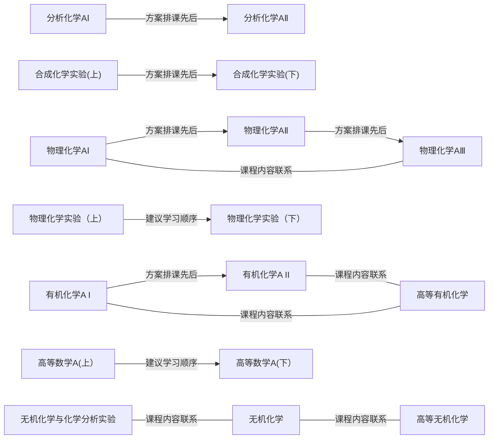

# 2025 化学专业本博融通培养方案（英才班）

化学系 · 化学 · 方案 96683 · 198 个不同课程或科研条目。

[官方 Word](../originals/plan-96683.docx) · [教务详情](https://fdjwgl.fudan.edu.cn/manager/bizType/2/major-program-search/info/96683?skipAuth=1) · [方案快照](../raw/plan-96683.json.gz) · [年级目录](../README.md)

## 课程关系图

图中展示部分关系。下表保留全部已建立的课程对，来源位置使用本方案 JSON Pointer。

## 先修与内容联系

| 类型 | 起点 | 终点 | 依据 | 原表定位 |
| --- | --- | --- | --- | --- |
| 建议学习顺序 | 分析化学AⅠ (CHEM20001) | 分析化学AⅡ (CHEM20002) | 同方案的课程题名具有连续分册或序号。  | `/courseModules/19/planCourses/1`、`/courseModules/19/planCourses/2` |
| 建议学习顺序 | 合成化学实验(上) (CHEM20004) | 合成化学实验(下) (CHEM30003) | 同方案的课程题名具有连续分册或序号。  | `/courseModules/19/planCourses/3`、`/courseModules/19/planCourses/4` |
| 建议学习顺序 | 物理化学AⅠ (CHEM20005) | 物理化学AⅡ (CHEM20006) | 同方案的课程题名具有连续分册或序号。  | `/courseModules/19/planCourses/5`、`/courseModules/19/planCourses/6` |
| 建议学习顺序 | 物理化学AⅡ (CHEM20006) | 物理化学AⅢ (CHEM30004) | 同方案的课程题名具有连续分册或序号。  | `/courseModules/19/planCourses/6`、`/courseModules/19/planCourses/7` |
| 建议学习顺序 | 有机化学A I (CHEM20013) | 有机化学A II (CHEM20014) | 同方案的课程题名具有连续分册或序号。  | `/courseModules/19/planCourses/10`、`/courseModules/19/planCourses/11` |
| 建议学习顺序 | 物理化学实验（上） (CHEM30031) | 物理化学实验（下） (CHEM30032) | 同方案的课程题名具有连续分册或序号。  | `/courseModules/19/planCourses/12`、`/courseModules/19/planCourses/13` |
| 建议学习顺序 | 高等数学A(上） (MATH10015) | 高等数学A(下） (MATH10016) | 同方案的课程题名具有连续分册或序号。  | `/courseModules/17/planCourses/3`、`/courseModules/17/planCourses/4` |
| 方案排课先后 | 分析化学AⅠ (CHEM20001) | 分析化学AⅡ (CHEM20002) | 同方案该课程全部明确数字学期均早于后者。  | `/courseModules/19/planCourses/1`、`/courseModules/19/planCourses/2` |
| 方案排课先后 | 合成化学实验(上) (CHEM20004) | 合成化学实验(下) (CHEM30003) | 同方案该课程全部明确数字学期均早于后者。  | `/courseModules/19/planCourses/3`、`/courseModules/19/planCourses/4` |
| 方案排课先后 | 物理化学AⅠ (CHEM20005) | 物理化学AⅡ (CHEM20006) | 同方案该课程全部明确数字学期均早于后者。  | `/courseModules/19/planCourses/5`、`/courseModules/19/planCourses/6` |
| 方案排课先后 | 物理化学AⅡ (CHEM20006) | 物理化学AⅢ (CHEM30004) | 同方案该课程全部明确数字学期均早于后者。  | `/courseModules/19/planCourses/6`、`/courseModules/19/planCourses/7` |
| 方案排课先后 | 有机化学A I (CHEM20013) | 有机化学A II (CHEM20014) | 同方案该课程全部明确数字学期均早于后者。  | `/courseModules/19/planCourses/10`、`/courseModules/19/planCourses/11` |
| 方案排课先后 | 物理化学实验（上） (CHEM30031) | 物理化学实验（下） (CHEM30032) | 同方案该课程全部明确数字学期均早于后者。  | `/courseModules/19/planCourses/12`、`/courseModules/19/planCourses/13` |
| 方案排课先后 | 高等数学A(上） (MATH10015) | 高等数学A(下） (MATH10016) | 同方案该课程全部明确数字学期均早于后者。  | `/courseModules/17/planCourses/3`、`/courseModules/17/planCourses/4` |
| 课程内容联系 | 人工智能在化学中的应用 (AIS310014) | 人工智能化学计算模拟 (AIS531005) | 本方案两门课程的题名均含“人工智能”，可据此对照这一主题。  | `/courseModules/20/planCourses/0`、`/courseModules/20/planCourses/1` |
| 课程内容联系 | 分析化学AⅠ (CHEM20001) | 分析化学AⅡ (CHEM20002) | 本方案两门课程的题名均含“分析化学”，可据此对照这一主题。  | `/courseModules/19/planCourses/1`、`/courseModules/19/planCourses/2` |
| 课程内容联系 | 物理化学AⅠ (CHEM20005) | 物理化学AⅡ (CHEM20006) | 本方案两门课程的题名均含“物理化学”，可据此对照这一主题。  | `/courseModules/19/planCourses/5`、`/courseModules/19/planCourses/6` |
| 课程内容联系 | 物理化学AⅠ (CHEM20005) | 物理化学AⅢ (CHEM30004) | 本方案两门课程的题名均含“物理化学”，可据此对照这一主题。  | `/courseModules/19/planCourses/5`、`/courseModules/19/planCourses/7` |
| 课程内容联系 | 物理化学AⅠ (CHEM20005) | 物理化学实验（上） (CHEM30031) | 本方案两门课程的题名均含“物理化学”，可据此对照这一主题。  | `/courseModules/19/planCourses/5`、`/courseModules/19/planCourses/12` |
| 课程内容联系 | 物理化学AⅠ (CHEM20005) | 物理化学实验（下） (CHEM30032) | 本方案两门课程的题名均含“物理化学”，可据此对照这一主题。  | `/courseModules/19/planCourses/5`、`/courseModules/19/planCourses/13` |
| 课程内容联系 | 有机化学A I (CHEM20013) | 高等有机化学 (CHEM50003) | 本方案两门课程的题名均含“有机化学”，可据此对照这一主题。  | `/courseModules/19/planCourses/10`、`/courseModules/21/planCourses/1` |
| 课程内容联系 | 有机化学A II (CHEM20014) | 高等有机化学 (CHEM50003) | 本方案两门课程的题名均含“有机化学”，可据此对照这一主题。  | `/courseModules/19/planCourses/11`、`/courseModules/21/planCourses/1` |
| 课程内容联系 | 无机化学与化学分析实验 (CHEM20021) | 无机化学 (CHEM30005) | 本方案两门课程的题名均含“无机化学”，可据此对照这一主题。  | `/courseModules/19/planCourses/16`、`/courseModules/19/planCourses/9` |
| 课程内容联系 | 无机化学 (CHEM30005) | 高等无机化学 (CHEM50002) | 本方案两门课程的题名均含“无机化学”，可据此对照这一主题。  | `/courseModules/19/planCourses/9`、`/courseModules/21/planCourses/0` |

本次未从可定位的明确表述中确认课程对课程预修。学期安排、系列分册与编辑建议均保留各自的依据。

## 按原方案模块阅读

同一模块展示原表中的课程归属。模块内课程之间的先后仍须逐项查阅。

- **本研贯通课程**　高等无机化学、高等有机化学、量子化学原理及应用、高等结构分析（原表模块 21）

## 课程表

同一课程在不同模块分别出现时，按原表逐行列出。季节字段保留原值。

| 课程 | 代码 | 学分 | 学期 | 模块 |
| --- | --- | ---: | --- | --- |
| 中国近现代史纲要 | GEIP20006 | 3.0 | SPRING、SUMMER、AUTUMN | 培养方案 / 通识教育课程 / 通识教育核心课程 / 思想政治理论课模块 / 思政A |
| 马克思主义基本原理 | GEIP40012 | 3.0 | SPRING、SUMMER、AUTUMN | 培养方案 / 通识教育课程 / 通识教育核心课程 / 思想政治理论课模块 / 思政A |
| 思想道德与法治 | GEIP20007 | 3.0 | SPRING、SUMMER、AUTUMN | 培养方案 / 通识教育课程 / 通识教育核心课程 / 思想政治理论课模块 / 思政A |
| 毛泽东思想和中国特色社会主义理论体系概论 | GEIP30001 | 3.0 | SPRING、SUMMER、AUTUMN | 培养方案 / 通识教育课程 / 通识教育核心课程 / 思想政治理论课模块 / 思政A |
| 习近平新时代中国特色社会主义思想概论 | GEIP30002 | 3.0 | SPRING、AUTUMN | 培养方案 / 通识教育课程 / 通识教育核心课程 / 思想政治理论课模块 / 思政A |
| 强国之路：形势、政策与使命Ⅰ | GESP10003 | 0.5 | 第1学期 | 培养方案 / 通识教育课程 / 通识教育核心课程 / 思想政治理论课模块 / 思政A |
| 强国之路：形势、政策与使命Ⅱ | GESP10004 | 0.5 | 第2学期 | 培养方案 / 通识教育课程 / 通识教育核心课程 / 思想政治理论课模块 / 思政A |
| 强国之路：形势、政策与使命Ⅲ | GESP20003 | 0.5 | 第3学期 | 培养方案 / 通识教育课程 / 通识教育核心课程 / 思想政治理论课模块 / 思政A |
| 强国之路：形势、政策与使命Ⅳ | GESP20004 | 0.5 | 第4学期 | 培养方案 / 通识教育课程 / 通识教育核心课程 / 思想政治理论课模块 / 思政A |
| 中国共产党历史 | GEIP20002 | 2.0 | SPRING、AUTUMN | 培养方案 / 通识教育课程 / 通识教育核心课程 / 思想政治理论课模块 / 思政B |
| 新中国史 | GEIP20003 | 2.0 | SPRING、AUTUMN | 培养方案 / 通识教育课程 / 通识教育核心课程 / 思想政治理论课模块 / 思政B |
| 改革开放史 | GEIP20004 | 2.0 | SPRING、AUTUMN | 培养方案 / 通识教育课程 / 通识教育核心课程 / 思想政治理论课模块 / 思政B |
| 社会主义发展史 | GEIP20005 | 2.0 | SPRING、AUTUMN | 培养方案 / 通识教育课程 / 通识教育核心课程 / 思想政治理论课模块 / 思政B |
| 中国马克思主义与当代 | GEIP40001 | 2.0 | SPRING、AUTUMN | 培养方案 / 通识教育课程 / 通识教育核心课程 / 思想政治理论课模块 / 研究生政治课程 / 本博融通 |
| 中国马克思主义与当代（文科） | GEIP40002 | 2.0 | SPRING、AUTUMN | 培养方案 / 通识教育课程 / 通识教育核心课程 / 思想政治理论课模块 / 研究生政治课程 / 本博融通 |
| 木兰拳 | GEPE10007 | 1.0 | AUTUMN | 培养方案 / 通识教育课程 / 通识教育专项教育课程 / 体育课程 |
| 木兰扇 | GEPE10008 | 1.0 | SPRING | 培养方案 / 通识教育课程 / 通识教育专项教育课程 / 体育课程 |
| 十六式太极拳 | GEPE10009 | 1.0 | AUTUMN | 培养方案 / 通识教育课程 / 通识教育专项教育课程 / 体育课程 |
| 陈式太极拳 | GEPE10010 | 1.0 | SPRING | 培养方案 / 通识教育课程 / 通识教育专项教育课程 / 体育课程 |
| 长拳二段 | GEPE10011 | 1.0 | AUTUMN | 培养方案 / 通识教育课程 / 通识教育专项教育课程 / 体育课程 |
| 长拳三段 | GEPE10012 | 1.0 | SPRING | 培养方案 / 通识教育课程 / 通识教育专项教育课程 / 体育课程 |
| 段位剑术二段 | GEPE10013 | 1.0 | AUTUMN | 培养方案 / 通识教育课程 / 通识教育专项教育课程 / 体育课程 |
| 段位剑术三段 | GEPE10014 | 1.0 | SPRING | 培养方案 / 通识教育课程 / 通识教育专项教育课程 / 体育课程 |
| 太极推手（一） | GEPE10015 | 1.0 | AUTUMN | 培养方案 / 通识教育课程 / 通识教育专项教育课程 / 体育课程 |
| 太极推手（二） | GEPE10016 | 1.0 | SPRING | 培养方案 / 通识教育课程 / 通识教育专项教育课程 / 体育课程 |
| 咏春拳（一） | GEPE10017 | 1.0 | AUTUMN | 培养方案 / 通识教育课程 / 通识教育专项教育课程 / 体育课程 |
| 咏春拳（二） | GEPE10018 | 1.0 | SPRING | 培养方案 / 通识教育课程 / 通识教育专项教育课程 / 体育课程 |
| 高尔夫（一） | GEPE10019 | 1.0 | AUTUMN | 培养方案 / 通识教育课程 / 通识教育专项教育课程 / 体育课程 |
| 高尔夫（二） | GEPE10020 | 1.0 | SPRING | 培养方案 / 通识教育课程 / 通识教育专项教育课程 / 体育课程 |
| 篮球（一） | GEPE10021 | 1.0 | AUTUMN | 培养方案 / 通识教育课程 / 通识教育专项教育课程 / 体育课程 |
| 篮球（二） | GEPE10022 | 1.0 | SPRING | 培养方案 / 通识教育课程 / 通识教育专项教育课程 / 体育课程 |
| 排球（一） | GEPE10023 | 1.0 | AUTUMN | 培养方案 / 通识教育课程 / 通识教育专项教育课程 / 体育课程 |
| 排球（二） | GEPE10024 | 1.0 | SPRING | 培养方案 / 通识教育课程 / 通识教育专项教育课程 / 体育课程 |
| 足球（一） | GEPE10025 | 1.0 | AUTUMN | 培养方案 / 通识教育课程 / 通识教育专项教育课程 / 体育课程 |
| 足球（二） | GEPE10026 | 1.0 | SPRING | 培养方案 / 通识教育课程 / 通识教育专项教育课程 / 体育课程 |
| 乒乓球（一） | GEPE10027 | 1.0 | AUTUMN | 培养方案 / 通识教育课程 / 通识教育专项教育课程 / 体育课程 |
| 乒乓球（二） | GEPE10028 | 1.0 | SPRING | 培养方案 / 通识教育课程 / 通识教育专项教育课程 / 体育课程 |
| 羽毛球（一） | GEPE10029 | 1.0 | AUTUMN | 培养方案 / 通识教育课程 / 通识教育专项教育课程 / 体育课程 |
| 羽毛球（二） | GEPE10030 | 1.0 | SPRING | 培养方案 / 通识教育课程 / 通识教育专项教育课程 / 体育课程 |
| 网球（一） | GEPE10031 | 1.0 | AUTUMN | 培养方案 / 通识教育课程 / 通识教育专项教育课程 / 体育课程 |
| 网球（二） | GEPE10032 | 1.0 | SPRING | 培养方案 / 通识教育课程 / 通识教育专项教育课程 / 体育课程 |
| 棒球（一） | GEPE10033 | 1.0 | AUTUMN | 培养方案 / 通识教育课程 / 通识教育专项教育课程 / 体育课程 |
| 棒球（二） | GEPE10034 | 1.0 | SPRING | 培养方案 / 通识教育课程 / 通识教育专项教育课程 / 体育课程 |
| 垒球（一） | GEPE10035 | 1.0 | AUTUMN | 培养方案 / 通识教育课程 / 通识教育专项教育课程 / 体育课程 |
| 垒球（二） | GEPE10036 | 1.0 | SPRING | 培养方案 / 通识教育课程 / 通识教育专项教育课程 / 体育课程 |
| 板球（一） | GEPE10037 | 1.0 | AUTUMN | 培养方案 / 通识教育课程 / 通识教育专项教育课程 / 体育课程 |
| 板球（二） | GEPE10038 | 1.0 | SPRING | 培养方案 / 通识教育课程 / 通识教育专项教育课程 / 体育课程 |
| 体育舞蹈（一） | GEPE10039 | 1.0 | AUTUMN | 培养方案 / 通识教育课程 / 通识教育专项教育课程 / 体育课程 |
| 体育舞蹈（二） | GEPE10040 | 1.0 | SPRING | 培养方案 / 通识教育课程 / 通识教育专项教育课程 / 体育课程 |
| 击剑（一） | GEPE10041 | 1.0 | AUTUMN | 培养方案 / 通识教育课程 / 通识教育专项教育课程 / 体育课程 |
| 击剑（二） | GEPE10042 | 1.0 | SPRING | 培养方案 / 通识教育课程 / 通识教育专项教育课程 / 体育课程 |
| 综合体育（一） | GEPE10043 | 1.0 | AUTUMN | 培养方案 / 通识教育课程 / 通识教育专项教育课程 / 体育课程 |
| 综合体育（二） | GEPE10044 | 1.0 | SPRING | 培养方案 / 通识教育课程 / 通识教育专项教育课程 / 体育课程 |
| 艺术体操（一） | GEPE10045 | 1.0 | AUTUMN | 培养方案 / 通识教育课程 / 通识教育专项教育课程 / 体育课程 |
| 艺术体操（二） | GEPE10046 | 1.0 | SPRING | 培养方案 / 通识教育课程 / 通识教育专项教育课程 / 体育课程 |
| 形体健美（一） | GEPE10047 | 1.0 | AUTUMN | 培养方案 / 通识教育课程 / 通识教育专项教育课程 / 体育课程 |
| 形体健美（二） | GEPE10048 | 1.0 | SPRING | 培养方案 / 通识教育课程 / 通识教育专项教育课程 / 体育课程 |
| 健美操（一） | GEPE10049 | 1.0 | AUTUMN | 培养方案 / 通识教育课程 / 通识教育专项教育课程 / 体育课程 |
| 健美操（二） | GEPE10050 | 1.0 | SPRING | 培养方案 / 通识教育课程 / 通识教育专项教育课程 / 体育课程 |
| 健美（一） | GEPE10051 | 1.0 | AUTUMN | 培养方案 / 通识教育课程 / 通识教育专项教育课程 / 体育课程 |
| 健美（二） | GEPE10052 | 1.0 | SPRING | 培养方案 / 通识教育课程 / 通识教育专项教育课程 / 体育课程 |
| 游泳（一） | GEPE10053 | 1.0 | AUTUMN | 培养方案 / 通识教育课程 / 通识教育专项教育课程 / 体育课程 |
| 游泳（二） | GEPE10054 | 1.0 | SPRING | 培养方案 / 通识教育课程 / 通识教育专项教育课程 / 体育课程 |
| 传统体育养生-八段锦 | GEPE10055 | 1.0 | SPRING | 培养方案 / 通识教育课程 / 通识教育专项教育课程 / 体育课程 |
| 传统体育养生-易筋经 | GEPE10056 | 1.0 | AUTUMN | 培养方案 / 通识教育课程 / 通识教育专项教育课程 / 体育课程 |
| 传统体育养生-五禽戏 | GEPE10057 | 1.0 | SPRING | 培养方案 / 通识教育课程 / 通识教育专项教育课程 / 体育课程 |
| 传统体育养生-六字诀 | GEPE10058 | 1.0 | AUTUMN | 培养方案 / 通识教育课程 / 通识教育专项教育课程 / 体育课程 |
| 手球（一） | GEPE10059 | 1.0 | AUTUMN | 培养方案 / 通识教育课程 / 通识教育专项教育课程 / 体育课程 |
| 手球（二） | GEPE10060 | 1.0 | SPRING | 培养方案 / 通识教育课程 / 通识教育专项教育课程 / 体育课程 |
| 气排球（一） | GEPE10061 | 1.0 | AUTUMN | 培养方案 / 通识教育课程 / 通识教育专项教育课程 / 体育课程 |
| 气排球（二） | GEPE10062 | 1.0 | SPRING | 培养方案 / 通识教育课程 / 通识教育专项教育课程 / 体育课程 |
| 有氧塑身（一） | GEPE10063 | 1.0 | AUTUMN | 培养方案 / 通识教育课程 / 通识教育专项教育课程 / 体育课程 |
| 有氧塑身（二） | GEPE10064 | 1.0 | SPRING | 培养方案 / 通识教育课程 / 通识教育专项教育课程 / 体育课程 |
| 游泳救生（一） | GEPE10065 | 1.0 | AUTUMN | 培养方案 / 通识教育课程 / 通识教育专项教育课程 / 体育课程 |
| 游泳救生（二） | GEPE10066 | 1.0 | SPRING | 培养方案 / 通识教育课程 / 通识教育专项教育课程 / 体育课程 |
| 龙狮运动（一） | GEPE10067 | 1.0 | AUTUMN | 培养方案 / 通识教育课程 / 通识教育专项教育课程 / 体育课程 |
| 龙狮运动（二） | GEPE10068 | 1.0 | SPRING | 培养方案 / 通识教育课程 / 通识教育专项教育课程 / 体育课程 |
| 射艺（一） | GEPE10069 | 1.0 | AUTUMN | 培养方案 / 通识教育课程 / 通识教育专项教育课程 / 体育课程 |
| 射艺（二） | GEPE10070 | 1.0 | SPRING | 培养方案 / 通识教育课程 / 通识教育专项教育课程 / 体育课程 |
| 导引养生（一） | GEPE10071 | 1.0 | AUTUMN | 培养方案 / 通识教育课程 / 通识教育专项教育课程 / 体育课程 |
| 导引养生（二） | GEPE10072 | 1.0 | SPRING | 培养方案 / 通识教育课程 / 通识教育专项教育课程 / 体育课程 |
| 防身术（一） | GEPE10073 | 1.0 | AUTUMN | 培养方案 / 通识教育课程 / 通识教育专项教育课程 / 体育课程 |
| 防身术（二） | GEPE10074 | 1.0 | SPRING | 培养方案 / 通识教育课程 / 通识教育专项教育课程 / 体育课程 |
| 篮球（提高一） | GEPE20003 | 1.0 | AUTUMN | 培养方案 / 通识教育课程 / 通识教育专项教育课程 / 体育课程 |
| 篮球（提高二） | GEPE20004 | 1.0 | SPRING | 培养方案 / 通识教育课程 / 通识教育专项教育课程 / 体育课程 |
| 排球（提高一） | GEPE20005 | 1.0 | AUTUMN | 培养方案 / 通识教育课程 / 通识教育专项教育课程 / 体育课程 |
| 排球（提高二） | GEPE20006 | 1.0 | SPRING | 培养方案 / 通识教育课程 / 通识教育专项教育课程 / 体育课程 |
| 足球（提高一） | GEPE20007 | 1.0 | AUTUMN | 培养方案 / 通识教育课程 / 通识教育专项教育课程 / 体育课程 |
| 足球（提高二） | GEPE20008 | 1.0 | SPRING | 培养方案 / 通识教育课程 / 通识教育专项教育课程 / 体育课程 |
| 网球（提高一） | GEPE20009 | 1.0 | AUTUMN | 培养方案 / 通识教育课程 / 通识教育专项教育课程 / 体育课程 |
| 网球（提高二） | GEPE20010 | 1.0 | SPRING | 培养方案 / 通识教育课程 / 通识教育专项教育课程 / 体育课程 |
| 羽毛球（提高一） | GEPE20011 | 1.0 | AUTUMN | 培养方案 / 通识教育课程 / 通识教育专项教育课程 / 体育课程 |
| 羽毛球（提高二） | GEPE20012 | 1.0 | SPRING | 培养方案 / 通识教育课程 / 通识教育专项教育课程 / 体育课程 |
| 乒乓球（提高一） | GEPE20013 | 1.0 | AUTUMN | 培养方案 / 通识教育课程 / 通识教育专项教育课程 / 体育课程 |
| 乒乓球（提高二） | GEPE20014 | 1.0 | SPRING | 培养方案 / 通识教育课程 / 通识教育专项教育课程 / 体育课程 |
| 健美操（提高一） | GEPE20015 | 1.0 | AUTUMN | 培养方案 / 通识教育课程 / 通识教育专项教育课程 / 体育课程 |
| 健美操（提高二） | GEPE20016 | 1.0 | SPRING | 培养方案 / 通识教育课程 / 通识教育专项教育课程 / 体育课程 |
| 旱地冰球（一） | GEPE10075 | 1.0 | AUTUMN | 培养方案 / 通识教育课程 / 通识教育专项教育课程 / 体育课程 |
| 旱地冰球（二） | GEPE10076 | 1.0 | SPRING | 培养方案 / 通识教育课程 / 通识教育专项教育课程 / 体育课程 |
| 健康体适能（一） | GEPE10077 | 1.0 | AUTUMN | 培养方案 / 通识教育课程 / 通识教育专项教育课程 / 体育课程 |
| 健康体适能（二） | GEPE10078 | 1.0 | SPRING | 培养方案 / 通识教育课程 / 通识教育专项教育课程 / 体育课程 |
| 瑜伽（一） | GEPE10079 | 1.0 | AUTUMN | 培养方案 / 通识教育课程 / 通识教育专项教育课程 / 体育课程 |
| 瑜伽（二） | GEPE10080 | 1.0 | SPRING | 培养方案 / 通识教育课程 / 通识教育专项教育课程 / 体育课程 |
| 极限飞盘（一） | GEPE10081 | 1.0 | AUTUMN | 培养方案 / 通识教育课程 / 通识教育专项教育课程 / 体育课程 |
| 极限飞盘（二） | GEPE10082 | 1.0 | SPRING | 培养方案 / 通识教育课程 / 通识教育专项教育课程 / 体育课程 |
| 武术兵道（一） | GEPE10083 | 1.0 | AUTUMN | 培养方案 / 通识教育课程 / 通识教育专项教育课程 / 体育课程 |
| 武术兵道（二） | GEPE10084 | 1.0 | SPRING | 培养方案 / 通识教育课程 / 通识教育专项教育课程 / 体育课程 |
| 毽球（一） | GEPE10085 | 1.0 | AUTUMN | 培养方案 / 通识教育课程 / 通识教育专项教育课程 / 体育课程 |
| 毽球（二） | GEPE10086 | 1.0 | SPRING | 培养方案 / 通识教育课程 / 通识教育专项教育课程 / 体育课程 |
| 高级体育训练（一） | GEPE40001 | 1.0 | AUTUMN | 培养方案 / 通识教育课程 / 通识教育专项教育课程 / 体育课程 |
| 高级体育训练（二） | GEPE40002 | 1.0 | SPRING | 培养方案 / 通识教育课程 / 通识教育专项教育课程 / 体育课程 |
| 高级体育训练（三） | GEPE40003 | 1.0 | AUTUMN | 培养方案 / 通识教育课程 / 通识教育专项教育课程 / 体育课程 |
| 高级体育训练（四） | GEPE40004 | 1.0 | SPRING | 培养方案 / 通识教育课程 / 通识教育专项教育课程 / 体育课程 |
| 花样跳绳（一） | GEPE10003 | 1.0 | AUTUMN | 培养方案 / 通识教育课程 / 通识教育专项教育课程 / 体育课程 |
| 花样跳绳（二） | GEPE10004 | 1.0 | SPRING | 培养方案 / 通识教育课程 / 通识教育专项教育课程 / 体育课程 |
| 花样跳绳-提高（一） | GEPE20001 | 1.0 | AUTUMN | 培养方案 / 通识教育课程 / 通识教育专项教育课程 / 体育课程 |
| 花样跳绳-提高（二） | GEPE20002 | 1.0 | SPRING | 培养方案 / 通识教育课程 / 通识教育专项教育课程 / 体育课程 |
| 跆拳道（一） | GEPE10005 | 1.0 | AUTUMN | 培养方案 / 通识教育课程 / 通识教育专项教育课程 / 体育课程 |
| 跆拳道（二） | GEPE10006 | 1.0 | SPRING | 培养方案 / 通识教育课程 / 通识教育专项教育课程 / 体育课程 |
| 射击（一） | GEPE10001 | 1.0 | AUTUMN | 培养方案 / 通识教育课程 / 通识教育专项教育课程 / 体育课程 |
| 射击（二） | GEPE10002 | 1.0 | SPRING | 培养方案 / 通识教育课程 / 通识教育专项教育课程 / 体育课程 |
| 中国传统舞蹈（一） | GEPE10087 | 1.0 |  | 培养方案 / 通识教育课程 / 通识教育专项教育课程 / 体育课程 |
| 中国传统舞蹈（二） | GEPE10088 | 1.0 |  | 培养方案 / 通识教育课程 / 通识教育专项教育课程 / 体育课程 |
| 中国传统舞蹈（提高一） | GEPE10089 | 1.0 |  | 培养方案 / 通识教育课程 / 通识教育专项教育课程 / 体育课程 |
| 中国传统舞蹈（提高二） | GEPE10090 | 1.0 |  | 培养方案 / 通识教育课程 / 通识教育专项教育课程 / 体育课程 |
| 匹克球（一） | GEPE10091 | 1.0 |  | 培养方案 / 通识教育课程 / 通识教育专项教育课程 / 体育课程 |
| 匹克球（二） | GEPE10092 | 1.0 |  | 培养方案 / 通识教育课程 / 通识教育专项教育课程 / 体育课程 |
| 武术短兵（一） | GEPE10093 | 1.0 |  | 培养方案 / 通识教育课程 / 通识教育专项教育课程 / 体育课程 |
| 武术短兵（二） | GEPE10094 | 1.0 |  | 培养方案 / 通识教育课程 / 通识教育专项教育课程 / 体育课程 |
| 中国传统舞蹈（提高一） | GEPE20017 | 1.0 |  | 培养方案 / 通识教育课程 / 通识教育专项教育课程 / 体育课程 |
| 中国传统舞蹈（提高二） | GEPE20018 | 1.0 |  | 培养方案 / 通识教育课程 / 通识教育专项教育课程 / 体育课程 |
| 军事理论 | GEND10001 | 2.0 | SPRING、AUTUMN | 培养方案 / 通识教育课程 / 通识教育专项教育课程 / 军事课程 |
| 军事技能 | GEND10002 | 2.0 | SUMMER | 培养方案 / 通识教育课程 / 通识教育专项教育课程 / 军事课程 |
| 心理健康与大学生活 | GEMH10013 | 1.0 | AUTUMN | 培养方案 / 通识教育课程 / 通识教育专项教育课程 / 心理健康教育课程 |
| 国学涵养与心理成长 | GEMH10016 | 1.0 | AUTUMN | 培养方案 / 通识教育课程 / 通识教育专项教育课程 / 心理健康教育课程 |
| 静心冥想与心理健康 | GEMH10017 | 1.0 | SPRING | 培养方案 / 通识教育课程 / 通识教育专项教育课程 / 心理健康教育课程 |
| 健康行为心理 | GEMH10005 | 1.0 | SPRING、AUTUMN | 培养方案 / 通识教育课程 / 通识教育专项教育课程 / 心理健康教育课程 |
| 领导力与自我管理 | GEMH10011 | 1.0 | SPRING、AUTUMN | 培养方案 / 通识教育课程 / 通识教育专项教育课程 / 心理健康教育课程 |
| 大学生心理健康与发展 | GEMH10014 | 2.0 | SPRING、AUTUMN | 培养方案 / 通识教育课程 / 通识教育专项教育课程 / 心理健康教育课程 |
| 咨询心理学与心智成长 | GEMH10015 | 2.0 | SPRING、AUTUMN | 培养方案 / 通识教育课程 / 通识教育专项教育课程 / 心理健康教育课程 |
| 幸福心理学 | GEMH10008 | 2.0 | SPRING、AUTUMN | 培养方案 / 通识教育课程 / 通识教育专项教育课程 / 心理健康教育课程 |
| 两性心理学 | GEMH10009 | 2.0 | SPRING | 培养方案 / 通识教育课程 / 通识教育专项教育课程 / 心理健康教育课程 |
| 从公共卫生视角看心理健康 | GEMH20001 | 2.0 | SPRING、AUTUMN | 培养方案 / 通识教育课程 / 通识教育专项教育课程 / 心理健康教育课程 |
| 沟通心理学 | GEMH10020 | 2.0 | AUTUMN | 培养方案 / 通识教育课程 / 通识教育专项教育课程 / 心理健康教育课程 |
| 大学生心理健康导论 | GEMH10010 | 2.0 | SPRING、AUTUMN | 培养方案 / 通识教育课程 / 通识教育专项教育课程 / 心理健康教育课程 |
| 朋辈心理辅导理论与实践 | GEMH10018 | 1.0 | SPRING | 培养方案 / 通识教育课程 / 通识教育专项教育课程 / 心理健康教育课程 |
| 儿童发展和社会适应 | GEMH10006 | 2.0 | SPRING、AUTUMN | 培养方案 / 通识教育课程 / 通识教育专项教育课程 / 心理健康教育课程 |
| 新生命教育与心理健康 | GEMH10001 | 2.0 | SPRING、AUTUMN | 培养方案 / 通识教育课程 / 通识教育专项教育课程 / 心理健康教育课程 |
| 媒介心理学 | GEMH10002 | 2.0 | AUTUMN | 培养方案 / 通识教育课程 / 通识教育专项教育课程 / 心理健康教育课程 |
| 自我与认同 | GEMH10004 | 1.0 | SPRING | 培养方案 / 通识教育课程 / 通识教育专项教育课程 / 心理健康教育课程 |
| 积极心理成长的理论与实践 | GEMH10003 | 2.0 | AUTUMN | 培养方案 / 通识教育课程 / 通识教育专项教育课程 / 心理健康教育课程 |
| 现代生物科学导论A | BIOL10001 | 3.0 | 第1学期 | 培养方案 / 专业培养课程 / 学科基础课程 |
| 普通化学实验I | CHEM10005 | 1.0 | 第1学期 | 培养方案 / 专业培养课程 / 学科基础课程 |
| 线性代数（理工类） | MATH10014 | 3.0 | 第1学期 | 培养方案 / 专业培养课程 / 学科基础课程 |
| 高等数学A(上） | MATH10015 | 5.0 | 第1学期 | 培养方案 / 专业培养课程 / 学科基础课程 |
| 高等数学A(下） | MATH10016 | 5.0 | 第2学期 | 培养方案 / 专业培养课程 / 学科基础课程 |
| 大学物理A：力学 | PHYS10006 | 4.0 | 第1学期 | 培养方案 / 专业培养课程 / 学科基础课程 |
| 大学物理A：热学 | PHYS10007 | 2.0 | 第2学期 | 培养方案 / 专业培养课程 / 学科基础课程 |
| 大学物理A：电磁学 | PHYS10008 | 4.0 | 第2学期 | 培养方案 / 专业培养课程 / 学科基础课程 |
| 普通化学 | CHEM10001 | 4.0 | 第1学期 | 培养方案 / 专业培养课程 / 专业核心教育课程 / 必修课程 |
| 分析化学AⅠ | CHEM20001 | 2.0 | 第3学期 | 培养方案 / 专业培养课程 / 专业核心教育课程 / 必修课程 |
| 分析化学AⅡ | CHEM20002 | 2.0 | 第4学期 | 培养方案 / 专业培养课程 / 专业核心教育课程 / 必修课程 |
| 合成化学实验(上) | CHEM20004 | 2.0 | 第4学期 | 培养方案 / 专业培养课程 / 专业核心教育课程 / 必修课程 |
| 合成化学实验(下) | CHEM30003 | 2.0 | 第5学期 | 培养方案 / 专业培养课程 / 专业核心教育课程 / 必修课程 |
| 物理化学AⅠ | CHEM20005 | 3.0 | 第3学期 | 培养方案 / 专业培养课程 / 专业核心教育课程 / 必修课程 |
| 物理化学AⅡ | CHEM20006 | 3.0 | 第4学期 | 培养方案 / 专业培养课程 / 专业核心教育课程 / 必修课程 |
| 物理化学AⅢ | CHEM30004 | 3.0 | 第5学期 | 培养方案 / 专业培养课程 / 专业核心教育课程 / 必修课程 |
| 谱学导论 | CHEM20007 | 3.0 | 第4学期 | 培养方案 / 专业培养课程 / 专业核心教育课程 / 必修课程 |
| 无机化学 | CHEM30005 | 3.0 | 第5学期、第6学期 | 培养方案 / 专业培养课程 / 专业核心教育课程 / 必修课程 |
| 有机化学A I | CHEM20013 | 4.0 | 第3学期 | 培养方案 / 专业培养课程 / 专业核心教育课程 / 必修课程 |
| 有机化学A II | CHEM20014 | 2.0 | 第4学期 | 培养方案 / 专业培养课程 / 专业核心教育课程 / 必修课程 |
| 物理化学实验（上） | CHEM30031 | 2.0 | 第5学期 | 培养方案 / 专业培养课程 / 专业核心教育课程 / 必修课程 |
| 物理化学实验（下） | CHEM30032 | 2.0 | 第6学期 | 培养方案 / 专业培养课程 / 专业核心教育课程 / 必修课程 |
| 仪器分析实验 | CHEM20020 | 2.0 | 第4学期 | 培养方案 / 专业培养课程 / 专业核心教育课程 / 必修课程 |
| 化学生物学基础 | CHEM30035 | 3.0 | 第6学期 | 培养方案 / 专业培养课程 / 专业核心教育课程 / 必修课程 |
| 无机化学与化学分析实验 | CHEM20021 | 4.0 | 第3学期 | 培养方案 / 专业培养课程 / 专业核心教育课程 / 必修课程 |
| 化工基础 | CHEM30039 | 3.0 | 第5学期 | 培养方案 / 专业培养课程 / 专业核心教育课程 / 必修课程 |
| 人工智能在化学中的应用 | AIS310014 | 2.0 | AUTUMN | 培养方案 / 专业培养课程 / 专业核心教育课程 / 限定必修课程 |
| 人工智能化学计算模拟 | AIS531005 | 2.0 | SPRING | 培养方案 / 专业培养课程 / 专业核心教育课程 / 限定必修课程 |
| 高等无机化学 | CHEM50002 | 3.0 | AUTUMN | 培养方案 / 专业培养课程 / 专业核心教育课程 / 本研贯通课程 |
| 高等有机化学 | CHEM50003 | 3.0 | AUTUMN | 培养方案 / 专业培养课程 / 专业核心教育课程 / 本研贯通课程 |
| 量子化学原理及应用 | CHEM50004 | 3.0 | AUTUMN | 培养方案 / 专业培养课程 / 专业核心教育课程 / 本研贯通课程 |
| 高等结构分析 | CHEM50005 | 3.0 | SPRING | 培养方案 / 专业培养课程 / 专业核心教育课程 / 本研贯通课程 |
| 切问近思 | CHEM20022 | 2.0 | SPRING、AUTUMN | 融合创新能力 |
| 化学前沿专题 | CHEM20023 | 2.0 | SPRING | 融合创新能力 |
| 综合化学实验I | CHEM40004 | 2.0 | AUTUMN | 融合创新能力 |
| 科研实践 | CHEM30038 | 2.0 | SPRING、AUTUMN | 融合创新能力 |
| 科学英语写作 | CHEM50009 | 1.0 | AUTUMN | 融合创新能力 |
| 毕业论文 | CHEM40001 | 2.0 | 第8学期 | 融合创新能力 |
| 其他 | 107 | 0.0 |  | 融合创新能力 |
| 复芏计划(FDUROP) | 102 | 0.0 |  | 融合创新能力 |
| 博士学位论文开题 | 1 | 0.0 |  | 融合创新能力 |
| 博士生资格考核 | 2 | 0.0 |  | 融合创新能力 |
| 博士论文中期考核 | 3 | 0.0 |  | 融合创新能力 |
| 博士学位论文预审 | 6 | 0.0 |  | 融合创新能力 |
| 助教助管 | 1062 | 1.0 |  | 融合创新能力 |
| 前沿讲座 | 1061 | 2.0 |  | 融合创新能力 |
| 化学实验室安全 | CHEM40008 | 1.0 | AUTUMN | 融合创新能力 |
