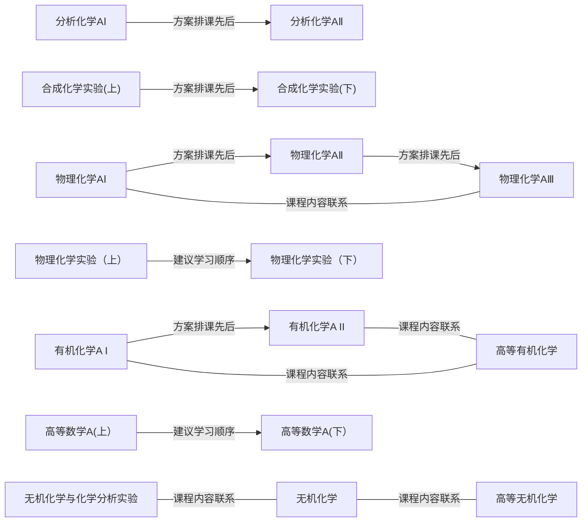

# 2025 能源化学专业本博融通培养方案（英才班）

化学系 · 能源化学 · 方案 97182 · 49 个不同课程或科研条目。

[官方 Word](../originals/plan-97182.docx) · [教务详情](https://fdjwgl.fudan.edu.cn/manager/bizType/2/major-program-search/info/97182?skipAuth=1) · [方案快照](../raw/plan-97182.json.gz) · [年级目录](../README.md)

## 修读导读

- **建议先学**　《分析化学AⅠ》（`CHEM20001`） → 《分析化学AⅡ》（`CHEM20002`）。题名列出连续册次或级别。可把测量对象、方法适用条件和误差整理在一起，读下一册时继续比较。方案分别列在第3、4学期。

- **可以对照着读**　《无机化学与化学分析实验》（`CHEM20021`）与《无机化学》（`CHEM30005`）。两门课的题名都涉及无机化学。选同一种无机物，把结构与性质的解释对应到可观察的现象。

- **查模块选课**　《碳基能源化学》（`CHEM30036`）、《普通化学》（`CHEM10001`）列在“必修课程”中。原表见 `/courseModules/7`。

## 课程关系图

图中展示部分关系。下表保留全部已建立的课程对，来源位置使用本方案 JSON Pointer。

## 先修与内容联系

| 类型 | 起点 | 终点 | 依据 | 原表定位 |
| --- | --- | --- | --- | --- |
| 建议学习顺序 | 分析化学AⅠ (CHEM20001) | 分析化学AⅡ (CHEM20002) | 同方案的课程题名具有连续分册或序号。  | `/courseModules/7/planCourses/1`、`/courseModules/7/planCourses/2` |
| 建议学习顺序 | 合成化学实验(上) (CHEM20004) | 合成化学实验(下) (CHEM30003) | 同方案的课程题名具有连续分册或序号。  | `/courseModules/7/planCourses/3`、`/courseModules/7/planCourses/4` |
| 建议学习顺序 | 物理化学AⅠ (CHEM20005) | 物理化学AⅡ (CHEM20006) | 同方案的课程题名具有连续分册或序号。  | `/courseModules/7/planCourses/5`、`/courseModules/7/planCourses/6` |
| 建议学习顺序 | 物理化学AⅡ (CHEM20006) | 物理化学AⅢ (CHEM30004) | 同方案的课程题名具有连续分册或序号。  | `/courseModules/7/planCourses/6`、`/courseModules/7/planCourses/7` |
| 建议学习顺序 | 有机化学A I (CHEM20013) | 有机化学A II (CHEM20014) | 同方案的课程题名具有连续分册或序号。  | `/courseModules/7/planCourses/10`、`/courseModules/7/planCourses/11` |
| 建议学习顺序 | 物理化学实验（上） (CHEM30031) | 物理化学实验（下） (CHEM30032) | 同方案的课程题名具有连续分册或序号。  | `/courseModules/7/planCourses/12`、`/courseModules/7/planCourses/13` |
| 建议学习顺序 | 高等数学A(上） (MATH10015) | 高等数学A(下） (MATH10016) | 同方案的课程题名具有连续分册或序号。  | `/courseModules/5/planCourses/3`、`/courseModules/5/planCourses/4` |
| 方案排课先后 | 分析化学AⅠ (CHEM20001) | 分析化学AⅡ (CHEM20002) | 同方案该课程全部明确数字学期均早于后者。  | `/courseModules/7/planCourses/1`、`/courseModules/7/planCourses/2` |
| 方案排课先后 | 合成化学实验(上) (CHEM20004) | 合成化学实验(下) (CHEM30003) | 同方案该课程全部明确数字学期均早于后者。  | `/courseModules/7/planCourses/3`、`/courseModules/7/planCourses/4` |
| 方案排课先后 | 物理化学AⅠ (CHEM20005) | 物理化学AⅡ (CHEM20006) | 同方案该课程全部明确数字学期均早于后者。  | `/courseModules/7/planCourses/5`、`/courseModules/7/planCourses/6` |
| 方案排课先后 | 物理化学AⅡ (CHEM20006) | 物理化学AⅢ (CHEM30004) | 同方案该课程全部明确数字学期均早于后者。  | `/courseModules/7/planCourses/6`、`/courseModules/7/planCourses/7` |
| 方案排课先后 | 有机化学A I (CHEM20013) | 有机化学A II (CHEM20014) | 同方案该课程全部明确数字学期均早于后者。  | `/courseModules/7/planCourses/10`、`/courseModules/7/planCourses/11` |
| 方案排课先后 | 物理化学实验（上） (CHEM30031) | 物理化学实验（下） (CHEM30032) | 同方案该课程全部明确数字学期均早于后者。  | `/courseModules/7/planCourses/12`、`/courseModules/7/planCourses/13` |
| 方案排课先后 | 高等数学A(上） (MATH10015) | 高等数学A(下） (MATH10016) | 同方案该课程全部明确数字学期均早于后者。  | `/courseModules/5/planCourses/3`、`/courseModules/5/planCourses/4` |
| 课程内容联系 | 人工智能在化学中的应用 (AIS310014) | 人工智能化学计算模拟 (AIS531005) | 本方案两门课程的题名均含“人工智能”，可据此对照这一主题。  | `/courseModules/9/planCourses/0`、`/courseModules/9/planCourses/1` |
| 课程内容联系 | 分析化学AⅠ (CHEM20001) | 分析化学AⅡ (CHEM20002) | 本方案两门课程的题名均含“分析化学”，可据此对照这一主题。  | `/courseModules/7/planCourses/1`、`/courseModules/7/planCourses/2` |
| 课程内容联系 | 物理化学AⅠ (CHEM20005) | 物理化学AⅡ (CHEM20006) | 本方案两门课程的题名均含“物理化学”，可据此对照这一主题。  | `/courseModules/7/planCourses/5`、`/courseModules/7/planCourses/6` |
| 课程内容联系 | 物理化学AⅠ (CHEM20005) | 物理化学AⅢ (CHEM30004) | 本方案两门课程的题名均含“物理化学”，可据此对照这一主题。  | `/courseModules/7/planCourses/5`、`/courseModules/7/planCourses/7` |
| 课程内容联系 | 物理化学AⅠ (CHEM20005) | 物理化学实验（上） (CHEM30031) | 本方案两门课程的题名均含“物理化学”，可据此对照这一主题。  | `/courseModules/7/planCourses/5`、`/courseModules/7/planCourses/12` |
| 课程内容联系 | 物理化学AⅠ (CHEM20005) | 物理化学实验（下） (CHEM30032) | 本方案两门课程的题名均含“物理化学”，可据此对照这一主题。  | `/courseModules/7/planCourses/5`、`/courseModules/7/planCourses/13` |
| 课程内容联系 | 有机化学A I (CHEM20013) | 高等有机化学 (CHEM50003) | 本方案两门课程的题名均含“有机化学”，可据此对照这一主题。  | `/courseModules/7/planCourses/10`、`/courseModules/8/planCourses/1` |
| 课程内容联系 | 有机化学A II (CHEM20014) | 高等有机化学 (CHEM50003) | 本方案两门课程的题名均含“有机化学”，可据此对照这一主题。  | `/courseModules/7/planCourses/11`、`/courseModules/8/planCourses/1` |
| 课程内容联系 | 无机化学与化学分析实验 (CHEM20021) | 无机化学 (CHEM30005) | 本方案两门课程的题名均含“无机化学”，可据此对照这一主题。  | `/courseModules/7/planCourses/15`、`/courseModules/7/planCourses/9` |
| 课程内容联系 | 无机化学 (CHEM30005) | 高等无机化学 (CHEM50002) | 本方案两门课程的题名均含“无机化学”，可据此对照这一主题。  | `/courseModules/7/planCourses/9`、`/courseModules/8/planCourses/0` |

本次未从可定位的明确表述中确认课程对课程预修。学期安排、系列分册与编辑建议均保留各自的依据。

## 按原方案模块阅读

同一模块展示原表中的课程归属。模块内课程之间的先后仍须逐项查阅。

- **本研贯通课程**　高等无机化学、高等有机化学、量子化学原理及应用、高等结构分析（原表模块 8）

## 课程表

同一课程在不同模块分别出现时，按原表逐行列出。季节字段保留原值。

| 课程 | 代码 | 学分 | 学期 | 模块 |
| --- | --- | ---: | --- | --- |
| 现代生物科学导论A | BIOL10001 | 3.0 | 第1学期 | 培养方案 / 专业培养课程 / 学科基础课程 |
| 普通化学实验I | CHEM10005 | 1.0 | 第1学期 | 培养方案 / 专业培养课程 / 学科基础课程 |
| 线性代数（理工类） | MATH10014 | 3.0 | 第1学期 | 培养方案 / 专业培养课程 / 学科基础课程 |
| 高等数学A(上） | MATH10015 | 5.0 | 第1学期 | 培养方案 / 专业培养课程 / 学科基础课程 |
| 高等数学A(下） | MATH10016 | 5.0 | 第2学期 | 培养方案 / 专业培养课程 / 学科基础课程 |
| 大学物理A：力学 | PHYS10006 | 4.0 | 第1学期 | 培养方案 / 专业培养课程 / 学科基础课程 |
| 大学物理A：热学 | PHYS10007 | 2.0 | 第2学期 | 培养方案 / 专业培养课程 / 学科基础课程 |
| 大学物理A：电磁学 | PHYS10008 | 4.0 | 第2学期 | 培养方案 / 专业培养课程 / 学科基础课程 |
| 普通化学 | CHEM10001 | 4.0 | 第1学期 | 培养方案 / 专业培养课程 / 专业核心教育课程 / 必修课程 |
| 分析化学AⅠ | CHEM20001 | 2.0 | 第3学期 | 培养方案 / 专业培养课程 / 专业核心教育课程 / 必修课程 |
| 分析化学AⅡ | CHEM20002 | 2.0 | 第4学期 | 培养方案 / 专业培养课程 / 专业核心教育课程 / 必修课程 |
| 合成化学实验(上) | CHEM20004 | 2.0 | 第4学期 | 培养方案 / 专业培养课程 / 专业核心教育课程 / 必修课程 |
| 合成化学实验(下) | CHEM30003 | 2.0 | 第5学期 | 培养方案 / 专业培养课程 / 专业核心教育课程 / 必修课程 |
| 物理化学AⅠ | CHEM20005 | 3.0 | 第3学期 | 培养方案 / 专业培养课程 / 专业核心教育课程 / 必修课程 |
| 物理化学AⅡ | CHEM20006 | 3.0 | 第4学期 | 培养方案 / 专业培养课程 / 专业核心教育课程 / 必修课程 |
| 物理化学AⅢ | CHEM30004 | 3.0 | 第5学期 | 培养方案 / 专业培养课程 / 专业核心教育课程 / 必修课程 |
| 谱学导论 | CHEM20007 | 3.0 | 第4学期 | 培养方案 / 专业培养课程 / 专业核心教育课程 / 必修课程 |
| 无机化学 | CHEM30005 | 3.0 | 第5学期、第6学期 | 培养方案 / 专业培养课程 / 专业核心教育课程 / 必修课程 |
| 有机化学A I | CHEM20013 | 4.0 | 第3学期 | 培养方案 / 专业培养课程 / 专业核心教育课程 / 必修课程 |
| 有机化学A II | CHEM20014 | 2.0 | 第4学期 | 培养方案 / 专业培养课程 / 专业核心教育课程 / 必修课程 |
| 物理化学实验（上） | CHEM30031 | 2.0 | 第5学期 | 培养方案 / 专业培养课程 / 专业核心教育课程 / 必修课程 |
| 物理化学实验（下） | CHEM30032 | 2.0 | 第6学期 | 培养方案 / 专业培养课程 / 专业核心教育课程 / 必修课程 |
| 仪器分析实验 | CHEM20020 | 2.0 | 第4学期 | 培养方案 / 专业培养课程 / 专业核心教育课程 / 必修课程 |
| 无机化学与化学分析实验 | CHEM20021 | 4.0 | 第3学期 | 培养方案 / 专业培养课程 / 专业核心教育课程 / 必修课程 |
| 化工基础 | CHEM30039 | 3.0 | 第5学期 | 培养方案 / 专业培养课程 / 专业核心教育课程 / 必修课程 |
| 化学反应工程 | CHEM30014 | 2.0 | SPRING | 培养方案 / 专业培养课程 / 专业核心教育课程 / 必修课程 |
| 高能化学电源 | CHEM30028 | 2.0 | SPRING | 培养方案 / 专业培养课程 / 专业核心教育课程 / 必修课程 |
| 碳基能源化学 | CHEM30036 | 2.0 | AUTUMN | 培养方案 / 专业培养课程 / 专业核心教育课程 / 必修课程 |
| 高等无机化学 | CHEM50002 | 3.0 | AUTUMN | 培养方案 / 专业培养课程 / 专业核心教育课程 / 本研贯通课程 |
| 高等有机化学 | CHEM50003 | 3.0 | AUTUMN | 培养方案 / 专业培养课程 / 专业核心教育课程 / 本研贯通课程 |
| 量子化学原理及应用 | CHEM50004 | 3.0 | AUTUMN | 培养方案 / 专业培养课程 / 专业核心教育课程 / 本研贯通课程 |
| 高等结构分析 | CHEM50005 | 3.0 | SPRING | 培养方案 / 专业培养课程 / 专业核心教育课程 / 本研贯通课程 |
| 人工智能在化学中的应用 | AIS310014 | 2.0 | AUTUMN | 培养方案 / 专业培养课程 / 专业核心教育课程 / 限定必修课程 |
| 人工智能化学计算模拟 | AIS531005 | 2.0 | SPRING | 培养方案 / 专业培养课程 / 专业核心教育课程 / 限定必修课程 |
| 其他 | 107 | 0.0 |  | 融合创新能力 |
| 复芏计划(FDUROP) | 102 | 0.0 |  | 融合创新能力 |
| 博士学位论文开题 | 1 | 0.0 |  | 融合创新能力 |
| 博士生资格考核 | 2 | 0.0 |  | 融合创新能力 |
| 博士论文中期考核 | 3 | 0.0 |  | 融合创新能力 |
| 博士学位论文预审 | 6 | 0.0 |  | 融合创新能力 |
| 助教助管 | 1062 | 1.0 |  | 融合创新能力 |
| 前沿讲座 | 1061 | 2.0 |  | 融合创新能力 |
| 切问近思 | CHEM20022 | 2.0 | SPRING、AUTUMN | 融合创新能力 |
| 化学前沿专题 | CHEM20023 | 2.0 | SPRING | 融合创新能力 |
| 综合化学实验I | CHEM40004 | 2.0 | AUTUMN | 融合创新能力 |
| 科研实践 | CHEM30038 | 2.0 | SPRING、AUTUMN | 融合创新能力 |
| 科学英语写作 | CHEM50009 | 1.0 | AUTUMN | 融合创新能力 |
| 毕业论文 | CHEM40001 | 2.0 | 第8学期 | 融合创新能力 |
| 化学实验室安全 | CHEM40008 | 1.0 | AUTUMN | 融合创新能力 |
