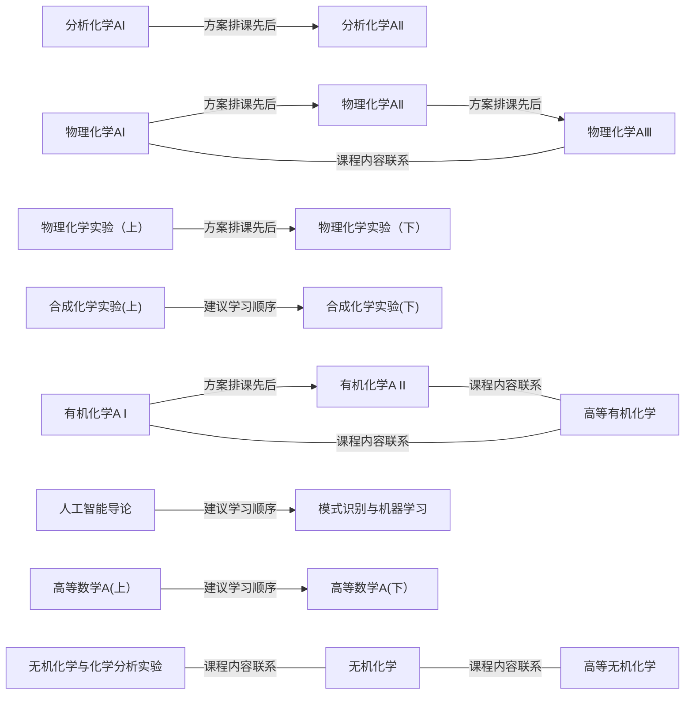

# 2025 化学-人工智能双学士学位项目培养方案（强基班适用）

化学系 · 化学-人工智能(双学士学位项目) · 方案 97202 · 469 个不同课程或科研条目。

[官方 Word](../originals/plan-97202.docx) · [教务详情](https://fdjwgl.fudan.edu.cn/manager/bizType/2/major-program-search/info/97202?skipAuth=1) · [方案快照](../raw/plan-97202.json.gz) · [年级目录](../README.md)

## 修读导读

- **建议先学**　《物理化学AⅠ》（`CHEM20005`） → 《物理化学AⅡ》（`CHEM20006`） → 《物理化学AⅢ》（`CHEM30004`）。题名列出连续册次或级别。可将前一册用到的结构、性质和变化条件做成索引，读后一册时回查。方案分别列在第3、4、5学期。

- **可以对照着读**　《无机化学与化学分析实验》（`CHEM20021`）与《无机化学》（`CHEM30005`）。两门课的题名都涉及无机化学。选同一种无机物，把结构与性质的解释对应到可观察的现象。

- **查模块选课**　《分析化学AⅠ》（`CHEM20001`）、《物理化学实验（上）》（`CHEM30031`）列在“必修课程”中。原表见 `/courseModules/21`。

## 课程关系图

图中展示部分关系。下表保留全部已建立的课程对，来源位置使用本方案 JSON Pointer。

## 先修与内容联系

| 类型 | 起点 | 终点 | 依据 | 原表定位 |
| --- | --- | --- | --- | --- |
| 建议学习顺序 | 人工智能导论 (AIE310005) | 模式识别与机器学习 (AIE410001) | 人工智能问题与模型类别可为学习模式识别作准备。  | `/courseModules/24/planCourses/5`、`/courseModules/24/planCourses/8` |
| 建议学习顺序 | 分析化学AⅠ (CHEM20001) | 分析化学AⅡ (CHEM20002) | 同方案的课程题名具有连续分册或序号。  | `/courseModules/21/planCourses/3`、`/courseModules/21/planCourses/4` |
| 建议学习顺序 | 合成化学实验(上) (CHEM20004) | 合成化学实验(下) (CHEM30003) | 同方案的课程题名具有连续分册或序号。  | `/courseModules/21/planCourses/12`、`/courseModules/21/planCourses/13` |
| 建议学习顺序 | 物理化学AⅠ (CHEM20005) | 物理化学AⅡ (CHEM20006) | 同方案的课程题名具有连续分册或序号。  | `/courseModules/21/planCourses/0`、`/courseModules/21/planCourses/1` |
| 建议学习顺序 | 物理化学AⅡ (CHEM20006) | 物理化学AⅢ (CHEM30004) | 同方案的课程题名具有连续分册或序号。  | `/courseModules/21/planCourses/1`、`/courseModules/21/planCourses/2` |
| 建议学习顺序 | 有机化学A I (CHEM20013) | 有机化学A II (CHEM20014) | 同方案的课程题名具有连续分册或序号。  | `/courseModules/21/planCourses/9`、`/courseModules/21/planCourses/10` |
| 建议学习顺序 | 物理化学实验（上） (CHEM30031) | 物理化学实验（下） (CHEM30032) | 同方案的课程题名具有连续分册或序号。  | `/courseModules/21/planCourses/5`、`/courseModules/21/planCourses/6` |
| 建议学习顺序 | 高等数学A(上） (MATH10015) | 高等数学A(下） (MATH10016) | 同方案的课程题名具有连续分册或序号。  | `/courseModules/17/planCourses/3`、`/courseModules/17/planCourses/4` |
| 方案排课先后 | 人工智能导论 (AIE310005) | 模式识别与机器学习 (AIE410001) | 同方案该课程全部明确数字学期均早于后者。  | `/courseModules/24/planCourses/5`、`/courseModules/24/planCourses/8` |
| 方案排课先后 | 分析化学AⅠ (CHEM20001) | 分析化学AⅡ (CHEM20002) | 同方案该课程全部明确数字学期均早于后者。  | `/courseModules/21/planCourses/3`、`/courseModules/21/planCourses/4` |
| 方案排课先后 | 合成化学实验(上) (CHEM20004) | 合成化学实验(下) (CHEM30003) | 同方案该课程全部明确数字学期均早于后者。  | `/courseModules/21/planCourses/12`、`/courseModules/21/planCourses/13` |
| 方案排课先后 | 物理化学AⅠ (CHEM20005) | 物理化学AⅡ (CHEM20006) | 同方案该课程全部明确数字学期均早于后者。  | `/courseModules/21/planCourses/0`、`/courseModules/21/planCourses/1` |
| 方案排课先后 | 物理化学AⅡ (CHEM20006) | 物理化学AⅢ (CHEM30004) | 同方案该课程全部明确数字学期均早于后者。  | `/courseModules/21/planCourses/1`、`/courseModules/21/planCourses/2` |
| 方案排课先后 | 有机化学A I (CHEM20013) | 有机化学A II (CHEM20014) | 同方案该课程全部明确数字学期均早于后者。  | `/courseModules/21/planCourses/9`、`/courseModules/21/planCourses/10` |
| 方案排课先后 | 物理化学实验（上） (CHEM30031) | 物理化学实验（下） (CHEM30032) | 同方案该课程全部明确数字学期均早于后者。  | `/courseModules/21/planCourses/5`、`/courseModules/21/planCourses/6` |
| 方案排课先后 | 高等数学A(上） (MATH10015) | 高等数学A(下） (MATH10016) | 同方案该课程全部明确数字学期均早于后者。  | `/courseModules/17/planCourses/3`、`/courseModules/17/planCourses/4` |
| 课程内容联系 | 计算机系统基础 (AIE210006) | 计算机组成与体系结构 (CS30052) | 处理器、存储与系统执行模型具有共同内容。  | `/courseModules/24/planCourses/3`、`/courseModules/29/planCourses/1` |
| 课程内容联系 | 人工智能导论 (AIE310005) | 人工智能安全 (AIE831001) | 本方案两门课程的题名均含“人工智能”，可据此对照这一主题。  | `/courseModules/24/planCourses/5`、`/courseModules/24/planCourses/7` |
| 课程内容联系 | 人工智能的编程基础 (AIE310006) | 人工智能安全 (AIE831001) | 本方案两门课程的题名均含“人工智能”，可据此对照这一主题。  | `/courseModules/24/planCourses/0`、`/courseModules/24/planCourses/7` |
| 课程内容联系 | 人工智能的软件基础 (AIE310008) | 人工智能安全 (AIE831001) | 本方案两门课程的题名均含“人工智能”，可据此对照这一主题。  | `/courseModules/24/planCourses/4`、`/courseModules/24/planCourses/7` |
| 课程内容联系 | 人工智能的数学基础 (AIE310009) | 模式识别与机器学习 (AIE410001) | 数学表达与学习模型的统计、优化工具可对照。  | `/courseModules/24/planCourses/2`、`/courseModules/24/planCourses/8` |
| 课程内容联系 | 人工智能的数学基础 (AIE310009) | 人工智能安全 (AIE831001) | 本方案两门课程的题名均含“人工智能”，可据此对照这一主题。  | `/courseModules/24/planCourses/2`、`/courseModules/24/planCourses/7` |
| 课程内容联系 | 模式识别与机器学习 (AIE410001) | 机器学习系统 (CS30058) | 本方案两门课程的题名均含“机器学习”，可据此对照这一主题。  | `/courseModules/24/planCourses/8`、`/courseModules/29/planCourses/5` |
| 课程内容联系 | 人工智能在分析化学中的应用 (AIT310024) | 分析化学AⅠ (CHEM20001) | 本方案两门课程的题名均含“分析化学”，可据此对照这一主题。  | `/courseModules/29/planCourses/7`、`/courseModules/21/planCourses/3` |
| 课程内容联系 | 分析化学AⅠ (CHEM20001) | 分析化学AⅡ (CHEM20002) | 本方案两门课程的题名均含“分析化学”，可据此对照这一主题。  | `/courseModules/21/planCourses/3`、`/courseModules/21/planCourses/4` |
| 课程内容联系 | 物理化学AⅠ (CHEM20005) | 物理化学AⅡ (CHEM20006) | 本方案两门课程的题名均含“物理化学”，可据此对照这一主题。  | `/courseModules/21/planCourses/0`、`/courseModules/21/planCourses/1` |
| 课程内容联系 | 物理化学AⅠ (CHEM20005) | 物理化学AⅢ (CHEM30004) | 本方案两门课程的题名均含“物理化学”，可据此对照这一主题。  | `/courseModules/21/planCourses/0`、`/courseModules/21/planCourses/2` |
| 课程内容联系 | 物理化学AⅠ (CHEM20005) | 物理化学实验（上） (CHEM30031) | 本方案两门课程的题名均含“物理化学”，可据此对照这一主题。  | `/courseModules/21/planCourses/0`、`/courseModules/21/planCourses/5` |
| 课程内容联系 | 物理化学AⅠ (CHEM20005) | 物理化学实验（下） (CHEM30032) | 本方案两门课程的题名均含“物理化学”，可据此对照这一主题。  | `/courseModules/21/planCourses/0`、`/courseModules/21/planCourses/6` |
| 课程内容联系 | 有机化学A I (CHEM20013) | 高等有机化学 (CHEM50003) | 本方案两门课程的题名均含“有机化学”，可据此对照这一主题。  | `/courseModules/21/planCourses/9`、`/courseModules/23/planCourses/1` |
| 课程内容联系 | 有机化学A II (CHEM20014) | 高等有机化学 (CHEM50003) | 本方案两门课程的题名均含“有机化学”，可据此对照这一主题。  | `/courseModules/21/planCourses/10`、`/courseModules/23/planCourses/1` |
| 课程内容联系 | 无机化学与化学分析实验 (CHEM20021) | 无机化学 (CHEM30005) | 本方案两门课程的题名均含“无机化学”，可据此对照这一主题。  | `/courseModules/21/planCourses/11`、`/courseModules/21/planCourses/8` |
| 课程内容联系 | 无机化学 (CHEM30005) | 高等无机化学 (CHEM50002) | 本方案两门课程的题名均含“无机化学”，可据此对照这一主题。  | `/courseModules/21/planCourses/8`、`/courseModules/23/planCourses/0` |

本次未从可定位的明确表述中确认课程对课程预修。学期安排、系列分册与编辑建议均保留各自的依据。

## 按原方案模块阅读

同一模块展示原表中的课程归属。模块内课程之间的先后仍须逐项查阅。

- **双学位融合必修课程**　人工智能在化学中的应用、人工智能化学计算模拟（原表模块 22）
- **本研贯通课程**　高等无机化学、高等有机化学、量子化学原理及应用、高等结构分析（原表模块 23）

## 课程表

同一课程在不同模块分别出现时，按原表逐行列出。季节字段保留原值。

| 课程 | 代码 | 学分 | 学期 | 模块 |
| --- | --- | ---: | --- | --- |
| 中国近现代史纲要 | GEIP20006 | 3.0 | SPRING、SUMMER、AUTUMN | 培养方案 / 通识教育课程 / 通识教育核心课程 / 思想政治理论课模块 / 思政A |
| 马克思主义基本原理 | GEIP40012 | 3.0 | SPRING、SUMMER、AUTUMN | 培养方案 / 通识教育课程 / 通识教育核心课程 / 思想政治理论课模块 / 思政A |
| 思想道德与法治 | GEIP20007 | 3.0 | SPRING、SUMMER、AUTUMN | 培养方案 / 通识教育课程 / 通识教育核心课程 / 思想政治理论课模块 / 思政A |
| 毛泽东思想和中国特色社会主义理论体系概论 | GEIP30001 | 3.0 | SPRING、SUMMER、AUTUMN | 培养方案 / 通识教育课程 / 通识教育核心课程 / 思想政治理论课模块 / 思政A |
| 习近平新时代中国特色社会主义思想概论 | GEIP30002 | 3.0 | SPRING、AUTUMN | 培养方案 / 通识教育课程 / 通识教育核心课程 / 思想政治理论课模块 / 思政A |
| 强国之路：形势、政策与使命Ⅰ | GESP10003 | 0.5 | 第1学期 | 培养方案 / 通识教育课程 / 通识教育核心课程 / 思想政治理论课模块 / 思政A |
| 强国之路：形势、政策与使命Ⅱ | GESP10004 | 0.5 | 第2学期 | 培养方案 / 通识教育课程 / 通识教育核心课程 / 思想政治理论课模块 / 思政A |
| 强国之路：形势、政策与使命Ⅲ | GESP20003 | 0.5 | 第3学期 | 培养方案 / 通识教育课程 / 通识教育核心课程 / 思想政治理论课模块 / 思政A |
| 强国之路：形势、政策与使命Ⅳ | GESP20004 | 0.5 | 第4学期 | 培养方案 / 通识教育课程 / 通识教育核心课程 / 思想政治理论课模块 / 思政A |
| 中国共产党历史 | GEIP20002 | 2.0 | SPRING、AUTUMN | 培养方案 / 通识教育课程 / 通识教育核心课程 / 思想政治理论课模块 / 思政B |
| 新中国史 | GEIP20003 | 2.0 | SPRING、AUTUMN | 培养方案 / 通识教育课程 / 通识教育核心课程 / 思想政治理论课模块 / 思政B |
| 改革开放史 | GEIP20004 | 2.0 | SPRING、AUTUMN | 培养方案 / 通识教育课程 / 通识教育核心课程 / 思想政治理论课模块 / 思政B |
| 社会主义发展史 | GEIP20005 | 2.0 | SPRING、AUTUMN | 培养方案 / 通识教育课程 / 通识教育核心课程 / 思想政治理论课模块 / 思政B |
| 《艺术即经验》导读 | GECC10019 | 2.0 | SPRING、AUTUMN | 培养方案 / 通识教育课程 / 通识教育核心课程 / 核心课程七大模块 |
| 文学与跨文化阅读 | GECC10028 | 2.0 | SPRING、AUTUMN | 培养方案 / 通识教育课程 / 通识教育核心课程 / 核心课程七大模块 |
| 经济与社会 | GECC10032 | 3.0 | SPRING、AUTUMN | 培养方案 / 通识教育课程 / 通识教育核心课程 / 核心课程七大模块 |
| 宜居地球与人类未来 | GECC10001 | 2.0 | SPRING、AUTUMN | 培养方案 / 通识教育课程 / 通识教育核心课程 / 核心课程七大模块 |
| 游戏与文化 | GECC10026 | 2.0 | SPRING、AUTUMN | 培养方案 / 通识教育课程 / 通识教育核心课程 / 核心课程七大模块 |
| 古典诗词导读 | GECC10004 | 2.0 | SPRING、AUTUMN | 培养方案 / 通识教育课程 / 通识教育核心课程 / 核心课程七大模块 |
| 笛卡尔《谈谈方法》导读 | GECC20009 | 2.0 | SPRING、AUTUMN | 培养方案 / 通识教育课程 / 通识教育核心课程 / 核心课程七大模块 |
| 莎士比亚作品撷英 | GECC10045 | 3.0 | SPRING、AUTUMN | 培养方案 / 通识教育课程 / 通识教育核心课程 / 核心课程七大模块 |
| 传播与社会 | GECC10089 | 3.0 | SPRING、AUTUMN | 培养方案 / 通识教育课程 / 通识教育核心课程 / 核心课程七大模块 |
| 生命进化论 | GECC20002 | 2.0 | SPRING、AUTUMN | 培养方案 / 通识教育课程 / 通识教育核心课程 / 核心课程七大模块 |
| 音乐理论与实践 | GECC10036 | 2.0 | SPRING、AUTUMN | 培养方案 / 通识教育课程 / 通识教育核心课程 / 核心课程七大模块 |
| 人类政治的哲学原理 | GECC10118 | 0.5 | SPRING、AUTUMN | 培养方案 / 通识教育课程 / 通识教育核心课程 / 核心课程七大模块 |
| 庄子导读 | GECC10005 | 2.0 | SPRING、AUTUMN | 培养方案 / 通识教育课程 / 通识教育核心课程 / 核心课程七大模块 |
| 康德《实践理性批判》精读 | GECC20013 | 2.0 | SPRING、AUTUMN | 培养方案 / 通识教育课程 / 通识教育核心课程 / 核心课程七大模块 |
| 从特洛伊到漫威世界：西方叙事传统的演变与发展 | GECC10046 | 2.0 | SPRING、AUTUMN | 培养方案 / 通识教育课程 / 通识教育核心课程 / 核心课程七大模块 |
| 人权与法 | GECC10090 | 2.0 | SPRING、AUTUMN | 培养方案 / 通识教育课程 / 通识教育核心课程 / 核心课程七大模块 |
| 微生物与人类健康 | GECC20003 | 2.0 | SPRING、AUTUMN | 培养方案 / 通识教育课程 / 通识教育核心课程 / 核心课程七大模块 |
| 中国戏曲·京剧 | GECC10037 | 2.0 | SPRING、AUTUMN | 培养方案 / 通识教育课程 / 通识教育核心课程 / 核心课程七大模块 |
| 国家治理的科学逻辑 | GECC10119 | 0.5 | SPRING、AUTUMN | 培养方案 / 通识教育课程 / 通识教育核心课程 / 核心课程七大模块 |
| 《周易》与中华审美文化 | GECC10006 | 2.0 | SPRING、AUTUMN | 培养方案 / 通识教育课程 / 通识教育核心课程 / 核心课程七大模块 |
| 《论法的精神》导读 | GECC20014 | 2.0 | SPRING、AUTUMN | 培养方案 / 通识教育课程 / 通识教育核心课程 / 核心课程七大模块 |
| 英国中世纪文学与文化 | GECC10048 | 2.0 | SPRING、AUTUMN | 培养方案 / 通识教育课程 / 通识教育核心课程 / 核心课程七大模块 |
| 法治理念与实践 | GECC10091 | 2.0 | SPRING、AUTUMN | 培养方案 / 通识教育课程 / 通识教育核心课程 / 核心课程七大模块 |
| 人类进化 | GECC20004 | 3.0 | SPRING、AUTUMN | 培养方案 / 通识教育课程 / 通识教育核心课程 / 核心课程七大模块 |
| 中国戏曲·昆曲 | GECC10038 | 2.0 | SPRING、AUTUMN | 培养方案 / 通识教育课程 / 通识教育核心课程 / 核心课程七大模块 |
| 动物考古与古代文明 | GECC10120 | 0.5 | SPRING、AUTUMN | 培养方案 / 通识教育课程 / 通识教育核心课程 / 核心课程七大模块 |
| 唐诗经典与中国文化传统 | GECC10007 | 2.0 | SPRING、AUTUMN | 培养方案 / 通识教育课程 / 通识教育核心课程 / 核心课程七大模块 |
| 《法哲学原理》导读 | GECC20015 | 2.0 | SPRING、AUTUMN | 培养方案 / 通识教育课程 / 通识教育核心课程 / 核心课程七大模块 |
| 卡夫卡与全球现代性 | GECC10049 | 3.0 | SPRING、AUTUMN | 培养方案 / 通识教育课程 / 通识教育核心课程 / 核心课程七大模块 |
| 法律与科技文明 | GECC10092 | 2.0 | SPRING、AUTUMN | 培养方案 / 通识教育课程 / 通识教育核心课程 / 核心课程七大模块 |
| 生态学：管理大自然的经济学 | GECC20005 | 3.0 | SPRING、AUTUMN | 培养方案 / 通识教育课程 / 通识教育核心课程 / 核心课程七大模块 |
| 陶艺与雕塑 | GECC10039 | 2.0 | SPRING、AUTUMN | 培养方案 / 通识教育课程 / 通识教育核心课程 / 核心课程七大模块 |
| 地球、城市与人类未来 | GECC10121 | 1.0 | SPRING、AUTUMN | 培养方案 / 通识教育课程 / 通识教育核心课程 / 核心课程七大模块 |
| 唐宋八大家古文 | GECC10008 | 2.0 | SPRING、AUTUMN | 培养方案 / 通识教育课程 / 通识教育核心课程 / 核心课程七大模块 |
| 《尼各马可伦理学》导读 | GECC20016 | 2.0 | SPRING、AUTUMN | 培养方案 / 通识教育课程 / 通识教育核心课程 / 核心课程七大模块 |
| 英国经典小说与19世纪社会 | GECC10050 | 2.0 | SPRING、AUTUMN | 培养方案 / 通识教育课程 / 通识教育核心课程 / 核心课程七大模块 |
| 全球化时代的法律冲突与对话 | GECC10093 | 2.0 | SPRING、AUTUMN | 培养方案 / 通识教育课程 / 通识教育核心课程 / 核心课程七大模块 |
| 生物技术与人类社会 | GECC20006 | 3.0 | SPRING、AUTUMN | 培养方案 / 通识教育课程 / 通识教育核心课程 / 核心课程七大模块 |
| 戏剧经典与表达·西方戏剧 | GECC10040 | 2.0 | SPRING、AUTUMN | 培养方案 / 通识教育课程 / 通识教育核心课程 / 核心课程七大模块 |
| 社会学视野下的关系和金钱 | GECC10122 | 1.0 | AUTUMN | 培养方案 / 通识教育课程 / 通识教育核心课程 / 核心课程七大模块 |
| 中国当代小说选读 | GECC10009 | 2.0 | SPRING、AUTUMN | 培养方案 / 通识教育课程 / 通识教育核心课程 / 核心课程七大模块 |
| 《逻辑哲学论》导读 | GECC20018 | 2.0 | SPRING、AUTUMN | 培养方案 / 通识教育课程 / 通识教育核心课程 / 核心课程七大模块 |
| 文艺复兴史 | GECC10052 | 2.0 | SPRING、AUTUMN | 培养方案 / 通识教育课程 / 通识教育核心课程 / 核心课程七大模块 |
| 法律与社会 | GECC20008 | 3.0 | SPRING、AUTUMN | 培养方案 / 通识教育课程 / 通识教育核心课程 / 核心课程七大模块 |
| 身边的基因科学 | GECC20007 | 3.0 | SPRING、AUTUMN | 培养方案 / 通识教育课程 / 通识教育核心课程 / 核心课程七大模块 |
| 达芬奇笔记与绘画实践 | GECC10041 | 3.0 | SPRING、AUTUMN | 培养方案 / 通识教育课程 / 通识教育核心课程 / 核心课程七大模块 |
| 智能纤维与可穿戴电子世界 | GECC10123 | 1.0 | AUTUMN | 培养方案 / 通识教育课程 / 通识教育核心课程 / 核心课程七大模块 |
| 中国新诗导读 | GECC10010 | 2.0 | SPRING、AUTUMN | 培养方案 / 通识教育课程 / 通识教育核心课程 / 核心课程七大模块 |
| 《查拉图斯特拉如是说》导读 | GECC20021 | 2.0 | SPRING、AUTUMN | 培养方案 / 通识教育课程 / 通识教育核心课程 / 核心课程七大模块 |
| 中西文化交流史 | GECC10054 | 2.0 | SPRING、AUTUMN | 培养方案 / 通识教育课程 / 通识教育核心课程 / 核心课程七大模块 |
| 政治与社会 | GECC10111 | 2.0 | SPRING、AUTUMN | 培养方案 / 通识教育课程 / 通识教育核心课程 / 核心课程七大模块 |
| 环境与人类 | GECC10033 | 2.0 | SPRING、AUTUMN | 培养方案 / 通识教育课程 / 通识教育核心课程 / 核心课程七大模块 |
| 西方古典建筑 | GECC10042 | 3.0 | SPRING、AUTUMN | 培养方案 / 通识教育课程 / 通识教育核心课程 / 核心课程七大模块 |
| 数学分析的理性与浪漫 | GECC10124 | 0.5 | AUTUMN | 培养方案 / 通识教育课程 / 通识教育核心课程 / 核心课程七大模块 |
| 鲁迅与中国现代文化 | GECC10011 | 2.0 | SPRING、AUTUMN | 培养方案 / 通识教育课程 / 通识教育核心课程 / 核心课程七大模块 |
| 《费尔巴哈论》研读 | GECC20022 | 2.0 | SPRING、AUTUMN | 培养方案 / 通识教育课程 / 通识教育核心课程 / 核心课程七大模块 |
| 《荷马史诗》导读 | GECC10055 | 2.0 | SPRING、AUTUMN | 培养方案 / 通识教育课程 / 通识教育核心课程 / 核心课程七大模块 |
| 社会科学经典导读 | GECC10114 | 2.0 | SPRING、AUTUMN | 培养方案 / 通识教育课程 / 通识教育核心课程 / 核心课程七大模块 |
| 环境灾害与启示 | GECC10034 | 2.0 | SPRING、AUTUMN | 培养方案 / 通识教育课程 / 通识教育核心课程 / 核心课程七大模块 |
| 诗意的音画世界 | GECC10043 | 3.0 | SPRING、AUTUMN | 培养方案 / 通识教育课程 / 通识教育核心课程 / 核心课程七大模块 |
| 科幻世界中的经济分析 | GECC10125 | 0.5 | AUTUMN | 培养方案 / 通识教育课程 / 通识教育核心课程 / 核心课程七大模块 |
| 《史记》导读 | GECC10012 | 2.0 | SPRING、AUTUMN | 培养方案 / 通识教育课程 / 通识教育核心课程 / 核心课程七大模块 |
| 西方道德哲学原著选读 | GECC20023 | 2.0 | SPRING、AUTUMN | 培养方案 / 通识教育课程 / 通识教育核心课程 / 核心课程七大模块 |
| 中国现代学科的形成 | GECC10056 | 2.0 | SPRING、AUTUMN | 培养方案 / 通识教育课程 / 通识教育核心课程 / 核心课程七大模块 |
| 社会科学研究方法 | GECC10115 | 3.0 | SPRING、AUTUMN | 培养方案 / 通识教育课程 / 通识教育核心课程 / 核心课程七大模块 |
| 生态文明：人与自然和谐共生 | GECC10035 | 2.0 | SPRING、AUTUMN | 培养方案 / 通识教育课程 / 通识教育核心课程 / 核心课程七大模块 |
| 走进电影世界 | GECC10044 | 3.0 | SPRING、AUTUMN | 培养方案 / 通识教育课程 / 通识教育核心课程 / 核心课程七大模块 |
| 中国文化之美的跨文化表达 | GECC20057 | 0.5 | AUTUMN | 培养方案 / 通识教育课程 / 通识教育核心课程 / 核心课程七大模块 |
| 宋词导读 | GECC10013 | 2.0 | SPRING、AUTUMN | 培养方案 / 通识教育课程 / 通识教育核心课程 / 核心课程七大模块 |
| 《第一哲学沉思集》导读 | GECC20024 | 2.0 | SPRING、AUTUMN | 培养方案 / 通识教育课程 / 通识教育核心课程 / 核心课程七大模块 |
| 基督教文明史 | GECC10057 | 2.0 | SPRING、AUTUMN | 培养方案 / 通识教育课程 / 通识教育核心课程 / 核心课程七大模块 |
| 文化与社会 | GECC10116 | 3.0 | SPRING、AUTUMN | 培养方案 / 通识教育课程 / 通识教育核心课程 / 核心课程七大模块 |
| 医学的社会文化史 | GECC10076 | 3.0 | SPRING、AUTUMN | 培养方案 / 通识教育课程 / 通识教育核心课程 / 核心课程七大模块 |
| 欧洲电影解析与实践 | GECC10047 | 3.0 | SPRING、AUTUMN | 培养方案 / 通识教育课程 / 通识教育核心课程 / 核心课程七大模块 |
| 诗经与传统文化 | GECC10014 | 2.0 | SPRING、AUTUMN | 培养方案 / 通识教育课程 / 通识教育核心课程 / 核心课程七大模块 |
| 休谟《人性论》导读 | GECC20025 | 2.0 | SPRING、AUTUMN | 培养方案 / 通识教育课程 / 通识教育核心课程 / 核心课程七大模块 |
| 欧洲文明的现代历程 | GECC10059 | 2.0 | SPRING、AUTUMN | 培养方案 / 通识教育课程 / 通识教育核心课程 / 核心课程七大模块 |
| 城市建筑媒介与跨学科传播 | JWCH110031 | 2.0 | SPRING、AUTUMN | 培养方案 / 通识教育课程 / 通识教育核心课程 / 核心课程七大模块 |
| 认识地球 | GECC10081 | 2.0 | SPRING、AUTUMN | 培养方案 / 通识教育课程 / 通识教育核心课程 / 核心课程七大模块 |
| 玺印赏析与篆刻实践 | GECC10079 | 2.0 | SPRING、AUTUMN | 培养方案 / 通识教育课程 / 通识教育核心课程 / 核心课程七大模块 |
| 《红楼梦》与人生 | GECC10015 | 2.0 | SPRING、AUTUMN | 培养方案 / 通识教育课程 / 通识教育核心课程 / 核心课程七大模块 |
| 《新教伦理与资本主义精神》导读 | GECC20026 | 2.0 | SPRING、AUTUMN | 培养方案 / 通识教育课程 / 通识教育核心课程 / 核心课程七大模块 |
| 历史上的中国与世界 | GECC10060 | 2.0 | SPRING、AUTUMN | 培养方案 / 通识教育课程 / 通识教育核心课程 / 核心课程七大模块 |
| 城市化与发展 | GECC10117 | 2.0 | SPRING、SUMMER | 培养方案 / 通识教育课程 / 通识教育核心课程 / 核心课程七大模块 |
| 病原生物与人类 | GECC20055 | 2.0 | SPRING、AUTUMN | 培养方案 / 通识教育课程 / 通识教育核心课程 / 核心课程七大模块 |
| 中国古代艺术史专题 | GECC10082 | 2.0 | SPRING、AUTUMN | 培养方案 / 通识教育课程 / 通识教育核心课程 / 核心课程七大模块 |
| 《三国志》导读 | GECC10016 | 2.0 | SPRING、AUTUMN | 培养方案 / 通识教育课程 / 通识教育核心课程 / 核心课程七大模块 |
| 艺术哲学与审美问题 | GECC20027 | 3.0 | SPRING、AUTUMN | 培养方案 / 通识教育课程 / 通识教育核心课程 / 核心课程七大模块 |
| 希腊悲剧 | GECC10061 | 2.0 | SPRING、AUTUMN | 培养方案 / 通识教育课程 / 通识教育核心课程 / 核心课程七大模块 |
| 货币、银行与经济 | GEIS30002 | 2.0 | SUMMER | 培养方案 / 通识教育课程 / 通识教育核心课程 / 核心课程七大模块 |
| 元宇宙与未来医学 | GECC20053 | 2.0 | SPRING、AUTUMN | 培养方案 / 通识教育课程 / 通识教育核心课程 / 核心课程七大模块 |
| 文物赏析与体验 | GECC10099 | 2.0 | SPRING、AUTUMN | 培养方案 / 通识教育课程 / 通识教育核心课程 / 核心课程七大模块 |
| 《文选》与中古社会 | GECC10017 | 2.0 | SPRING、AUTUMN | 培养方案 / 通识教育课程 / 通识教育核心课程 / 核心课程七大模块 |
| 科学哲学与认知问题 | GECC20028 | 2.0 | SPRING、AUTUMN | 培养方案 / 通识教育课程 / 通识教育核心课程 / 核心课程七大模块 |
| 性别与历史 | GECC10062 | 2.0 | SPRING、AUTUMN | 培养方案 / 通识教育课程 / 通识教育核心课程 / 核心课程七大模块 |
| 心理学与生活 | GEIS10028 | 2.0 | SUMMER | 培养方案 / 通识教育课程 / 通识教育核心课程 / 核心课程七大模块 |
| 医药伦理 | GECC10105 | 2.0 | SPRING、AUTUMN | 培养方案 / 通识教育课程 / 通识教育核心课程 / 核心课程七大模块 |
| 博物馆文化解读 | GECC10100 | 2.0 | SPRING、AUTUMN | 培养方案 / 通识教育课程 / 通识教育核心课程 / 核心课程七大模块 |
| 中国现代散文导读 | GECC10018 | 2.0 | SPRING、AUTUMN | 培养方案 / 通识教育课程 / 通识教育核心课程 / 核心课程七大模块 |
| 批判性思维与论证问题 | GECC20029 | 2.0 | SPRING、AUTUMN | 培养方案 / 通识教育课程 / 通识教育核心课程 / 核心课程七大模块 |
| 日本文明的历史变迁 | GECC10063 | 2.0 | SPRING、AUTUMN | 培养方案 / 通识教育课程 / 通识教育核心课程 / 核心课程七大模块 |
| 全球化与中国媒体和政治 | GEIS10013 | 2.0 | SUMMER | 培养方案 / 通识教育课程 / 通识教育核心课程 / 核心课程七大模块 |
| 药物·生命·社会 | GECC10106 | 2.0 | SPRING、AUTUMN | 培养方案 / 通识教育课程 / 通识教育核心课程 / 核心课程七大模块 |
| 考古与人类 | GECC10101 | 2.0 | SPRING、AUTUMN | 培养方案 / 通识教育课程 / 通识教育核心课程 / 核心课程七大模块 |
| 《尔雅》与中国古典语文 | GECC10020 | 2.0 | SPRING、AUTUMN | 培养方案 / 通识教育课程 / 通识教育核心课程 / 核心课程七大模块 |
| 形而上学与知识论问题 | GECC20030 | 2.0 | SPRING、AUTUMN | 培养方案 / 通识教育课程 / 通识教育核心课程 / 核心课程七大模块 |
| 印度宗教经典导读 | GECC10064 | 2.0 | SPRING、AUTUMN | 培养方案 / 通识教育课程 / 通识教育核心课程 / 核心课程七大模块 |
| 中国金融市场 | GEIS30020 | 2.0 | SUMMER | 培养方案 / 通识教育课程 / 通识教育核心课程 / 核心课程七大模块 |
| 环境与人群健康 | GECC10107 | 2.0 | SPRING、AUTUMN | 培养方案 / 通识教育课程 / 通识教育核心课程 / 核心课程七大模块 |
| 中国古代物质文化·读懂青铜器 | GECC10102 | 3.0 | SPRING、AUTUMN | 培养方案 / 通识教育课程 / 通识教育核心课程 / 核心课程七大模块 |
| 《谈艺录》导读 | GECC10021 | 2.0 | SPRING、AUTUMN | 培养方案 / 通识教育课程 / 通识教育核心课程 / 核心课程七大模块 |
| 《理想国》导读 | GECC20034 | 3.0 | SPRING、AUTUMN | 培养方案 / 通识教育课程 / 通识教育核心课程 / 核心课程七大模块 |
| 东亚文明史 | GECC10065 | 3.0 | SPRING、AUTUMN | 培养方案 / 通识教育课程 / 通识教育核心课程 / 核心课程七大模块 |
| 经济史 | GEIS30019 | 2.0 | SUMMER | 培养方案 / 通识教育课程 / 通识教育核心课程 / 核心课程七大模块 |
| 社会发展与健康 | GECC10108 | 2.0 | SPRING、AUTUMN | 培养方案 / 通识教育课程 / 通识教育核心课程 / 核心课程七大模块 |
| 中国古代物质文化·玉与瓷的技艺之美 | GECC10103 | 3.0 | SPRING、AUTUMN | 培养方案 / 通识教育课程 / 通识教育核心课程 / 核心课程七大模块 |
| 中国现代文学名著选讲 | GECC10022 | 3.0 | SPRING、AUTUMN | 培养方案 / 通识教育课程 / 通识教育核心课程 / 核心课程七大模块 |
| 卢梭论人类不平等的起源与基础 | GECC20037 | 3.0 | SPRING、AUTUMN | 培养方案 / 通识教育课程 / 通识教育核心课程 / 核心课程七大模块 |
| 古代近东的英雄与神祇 | GECC10066 | 2.0 | SPRING、AUTUMN | 培养方案 / 通识教育课程 / 通识教育核心课程 / 核心课程七大模块 |
| 发展经济学 | GEIS30005 | 2.0 | SUMMER | 培养方案 / 通识教育课程 / 通识教育核心课程 / 核心课程七大模块 |
| 改变世界的流行病 | GECC30001 | 2.0 | SPRING、AUTUMN | 培养方案 / 通识教育课程 / 通识教育核心课程 / 核心课程七大模块 |
| 中国古代物质文化·生活美学 | GECC10104 | 3.0 | SPRING、AUTUMN | 培养方案 / 通识教育课程 / 通识教育核心课程 / 核心课程七大模块 |
| 《西游记》导读 | GECC10023 | 2.0 | SPRING、AUTUMN | 培养方案 / 通识教育课程 / 通识教育核心课程 / 核心课程七大模块 |
| 《法华经》导读 | GECC20038 | 2.0 | SPRING、AUTUMN | 培养方案 / 通识教育课程 / 通识教育核心课程 / 核心课程七大模块 |
| 16-20世纪的欧洲殖民帝国 | GECC10067 | 2.0 | SPRING、AUTUMN | 培养方案 / 通识教育课程 / 通识教育核心课程 / 核心课程七大模块 |
| 中国法律文化 | GEIS10017 | 2.0 | SUMMER | 培养方案 / 通识教育课程 / 通识教育核心课程 / 核心课程七大模块 |
| 公共卫生应急与现代社会 | GECC10109 | 2.0 | SPRING、AUTUMN | 培养方案 / 通识教育课程 / 通识教育核心课程 / 核心课程七大模块 |
| 西方现代艺术：历史与理论 | GECC20035 | 2.0 | SPRING、AUTUMN | 培养方案 / 通识教育课程 / 通识教育核心课程 / 核心课程七大模块 |
| 陶渊明精读 | GECC10024 | 2.0 | SPRING、AUTUMN | 培养方案 / 通识教育课程 / 通识教育核心课程 / 核心课程七大模块 |
| 康德的哲学世界 | GECC20039 | 3.0 | SPRING、AUTUMN | 培养方案 / 通识教育课程 / 通识教育核心课程 / 核心课程七大模块 |
| 中世纪欧洲文明 | GECC10068 | 2.0 | SPRING、AUTUMN | 培养方案 / 通识教育课程 / 通识教育核心课程 / 核心课程七大模块 |
| 当代中国经济 | GEIS30003 | 2.0 | SUMMER | 培养方案 / 通识教育课程 / 通识教育核心课程 / 核心课程七大模块 |
| 生命科学史 | GECC20050 | 2.0 | SPRING、AUTUMN | 培养方案 / 通识教育课程 / 通识教育核心课程 / 核心课程七大模块 |
| 中国书法艺术 | GECC10110 | 2.0 | SPRING、AUTUMN | 培养方案 / 通识教育课程 / 通识教育核心课程 / 核心课程七大模块 |
| 现代散文经典选读 | GECC10025 | 3.0 | SPRING、AUTUMN | 培养方案 / 通识教育课程 / 通识教育核心课程 / 核心课程七大模块 |
| 哲学视野中的人工智能 | GECC20040 | 2.0 | SPRING、AUTUMN | 培养方案 / 通识教育课程 / 通识教育核心课程 / 核心课程七大模块 |
| 古埃及文明 | GECC10070 | 2.0 | SPRING、AUTUMN | 培养方案 / 通识教育课程 / 通识教育核心课程 / 核心课程七大模块 |
| 社会媒体和社会网络 | GEIS10014 | 2.0 | SUMMER | 培养方案 / 通识教育课程 / 通识教育核心课程 / 核心课程七大模块 |
| 可持续智能城镇化 | JWCH110026 | 1.0 | SPRING、AUTUMN | 培养方案 / 通识教育课程 / 通识教育核心课程 / 核心课程七大模块 |
| 影视剧艺术 | GEEC10099 | 2.0 | SPRING、AUTUMN | 培养方案 / 通识教育课程 / 通识教育核心课程 / 核心课程七大模块 |
| 汉语方言与中国文化 | GECC10027 | 2.0 | SPRING、AUTUMN | 培养方案 / 通识教育课程 / 通识教育核心课程 / 核心课程七大模块 |
| 霍布斯论“利维坦” | GECC20041 | 3.0 | SPRING、AUTUMN | 培养方案 / 通识教育课程 / 通识教育核心课程 / 核心课程七大模块 |
| 古希腊神话 | GECC10071 | 2.0 | SPRING、AUTUMN | 培养方案 / 通识教育课程 / 通识教育核心课程 / 核心课程七大模块 |
| 社会网络与中国社会 | GEIS10029 | 2.0 | SUMMER | 培养方案 / 通识教育课程 / 通识教育核心课程 / 核心课程七大模块 |
| 神经、认知与类脑智能 | AIB219005 | 3.0 | SPRING、AUTUMN | 培养方案 / 通识教育课程 / 通识教育核心课程 / 核心课程七大模块 |
| 当代电影美学 | GEEC10101 | 2.0 | SPRING、AUTUMN | 培养方案 / 通识教育课程 / 通识教育核心课程 / 核心课程七大模块 |
| 《说文解字》与汉字源流 | GECC10051 | 2.0 | SPRING、AUTUMN | 培养方案 / 通识教育课程 / 通识教育核心课程 / 核心课程七大模块 |
| 《共产党宣言》导读 | GECC20042 | 3.0 | SPRING、AUTUMN | 培养方案 / 通识教育课程 / 通识教育核心课程 / 核心课程七大模块 |
| 20世纪的中美关系与东亚世界 | GECC10073 | 2.0 | SPRING、AUTUMN | 培养方案 / 通识教育课程 / 通识教育核心课程 / 核心课程七大模块 |
| 一带一路和中国在发展中国家的影响 | GEIS10030 | 2.0 | SUMMER | 培养方案 / 通识教育课程 / 通识教育核心课程 / 核心课程七大模块 |
| 癌症：科学、人文与社会 | GECC20054 | 2.0 | SPRING、AUTUMN | 培养方案 / 通识教育课程 / 通识教育核心课程 / 核心课程七大模块 |
| 中外音乐审美 | GEEC10102 | 2.0 | SPRING、AUTUMN | 培养方案 / 通识教育课程 / 通识教育核心课程 / 核心课程七大模块 |
| 《十三经》导读 | GECC10058 | 2.0 | SPRING、AUTUMN | 培养方案 / 通识教育课程 / 通识教育核心课程 / 核心课程七大模块 |
| 托克维尔论美国的民主 | GECC10112 | 3.0 | SPRING、AUTUMN | 培养方案 / 通识教育课程 / 通识教育核心课程 / 核心课程七大模块 |
| 古代两河流域考古与艺术 | GECC10075 | 3.0 | SPRING、AUTUMN | 培养方案 / 通识教育课程 / 通识教育核心课程 / 核心课程七大模块 |
| 中国数字经济和人工智能的法律规制 | GEIS40002 | 2.0 | SUMMER | 培养方案 / 通识教育课程 / 通识教育核心课程 / 核心课程七大模块 |
| 文化探索之旅：神奇的中国传统医学 | GEIS30022 | 2.0 | SUMMER | 培养方案 / 通识教育课程 / 通识教育核心课程 / 核心课程七大模块 |
| 中西美术 | GEEC10103 | 2.0 | SPRING、AUTUMN | 培养方案 / 通识教育课程 / 通识教育核心课程 / 核心课程七大模块 |
| 《资治通鉴》导读 | GECC10069 | 3.0 | SPRING、AUTUMN | 培养方案 / 通识教育课程 / 通识教育核心课程 / 核心课程七大模块 |
| 亚里士多德《政治学》导读 | GECC20051 | 2.0 | SPRING、AUTUMN | 培养方案 / 通识教育课程 / 通识教育核心课程 / 核心课程七大模块 |
| 现代欧洲思想观念 | GECC10077 | 2.0 | SPRING、AUTUMN | 培养方案 / 通识教育课程 / 通识教育核心课程 / 核心课程七大模块 |
| 可再生能源：基本原理与实际应用 | GEIS10006 | 2.0 | SUMMER | 培养方案 / 通识教育课程 / 通识教育核心课程 / 核心课程七大模块 |
| 中国音乐史 | GEEC10108 | 2.0 | SPRING、AUTUMN | 培养方案 / 通识教育课程 / 通识教育核心课程 / 核心课程七大模块 |
| 《周易》的思维世界 | GECC10072 | 2.0 | SPRING、AUTUMN | 培养方案 / 通识教育课程 / 通识教育核心课程 / 核心课程七大模块 |
| 《功利主义》研读 | GECC20043 | 2.0 | SPRING、AUTUMN | 培养方案 / 通识教育课程 / 通识教育核心课程 / 核心课程七大模块 |
| 艺术与文明-公元1400年之前 | GECC10078 | 3.0 | SPRING、AUTUMN | 培养方案 / 通识教育课程 / 通识教育核心课程 / 核心课程七大模块 |
| 上海医疗服务的多样性 | GEIS40001 | 1.0 | SUMMER | 培养方案 / 通识教育课程 / 通识教育核心课程 / 核心课程七大模块 |
| 数码钢琴演奏（初级） | GEEC10109 | 2.0 | SPRING、AUTUMN | 培养方案 / 通识教育课程 / 通识教育核心课程 / 核心课程七大模块 |
| 《三国志》与三国史 | GECC10083 | 3.0 | SPRING、AUTUMN | 培养方案 / 通识教育课程 / 通识教育核心课程 / 核心课程七大模块 |
| 《共产党宣言》导读 | GECC20010 | 2.0 | SPRING、AUTUMN | 培养方案 / 通识教育课程 / 通识教育核心课程 / 核心课程七大模块 |
| 近现代中西文化交流 | GECC10084 | 2.0 | SPRING、AUTUMN | 培养方案 / 通识教育课程 / 通识教育核心课程 / 核心课程七大模块 |
| 文化与健康 | SOCI30042 | 2.0 | SUMMER | 培养方案 / 通识教育课程 / 通识教育核心课程 / 核心课程七大模块 |
| 数码钢琴演奏（中级） | GEEC20004 | 2.0 | SPRING、AUTUMN | 培养方案 / 通识教育课程 / 通识教育核心课程 / 核心课程七大模块 |
| 中国历史上的民族与国家 | GECC10087 | 2.0 | SPRING、AUTUMN | 培养方案 / 通识教育课程 / 通识教育核心课程 / 核心课程七大模块 |
| 现代非洲与世界 | GECC10085 | 2.0 | SPRING、AUTUMN | 培养方案 / 通识教育课程 / 通识教育核心课程 / 核心课程七大模块 |
| 常见疾病与健康促进 | GEXZ30001 | 3.0 | SPRING | 培养方案 / 通识教育课程 / 通识教育核心课程 / 核心课程七大模块 |
| 中外电影比较研究 | GEEC10110 | 2.0 | SPRING、AUTUMN | 培养方案 / 通识教育课程 / 通识教育核心课程 / 核心课程七大模块 |
| 《论语》导读 | GECC20011 | 2.0 | SPRING、AUTUMN | 培养方案 / 通识教育课程 / 通识教育核心课程 / 核心课程七大模块 |
| 雅典-斯巴达战争年代的古希腊文学 | GECC10086 | 2.0 | SPRING、AUTUMN | 培养方案 / 通识教育课程 / 通识教育核心课程 / 核心课程七大模块 |
| 合唱作品赏析与实践（初级） | GEEC10111 | 2.0 | SPRING、AUTUMN | 培养方案 / 通识教育课程 / 通识教育核心课程 / 核心课程七大模块 |
| 《荀子》导读 | GECC20012 | 2.0 | SPRING、AUTUMN | 培养方案 / 通识教育课程 / 通识教育核心课程 / 核心课程七大模块 |
| 《古兰经》与伊斯兰文明 | GECC20019 | 2.0 | SPRING、AUTUMN | 培养方案 / 通识教育课程 / 通识教育核心课程 / 核心课程七大模块 |
| 二胡演奏艺术及技法 | GEEC10112 | 2.0 | SPRING、AUTUMN | 培养方案 / 通识教育课程 / 通识教育核心课程 / 核心课程七大模块 |
| 《孟子》导读 | GECC20017 | 2.0 | SPRING、AUTUMN | 培养方案 / 通识教育课程 / 通识教育核心课程 / 核心课程七大模块 |
| 希伯来圣经 | GECC20031 | 2.0 | SPRING、AUTUMN | 培养方案 / 通识教育课程 / 通识教育核心课程 / 核心课程七大模块 |
| 世界民族音乐文化 | GEEC10113 | 2.0 | SPRING、AUTUMN | 培养方案 / 通识教育课程 / 通识教育核心课程 / 核心课程七大模块 |
| 《老子》导读 | GECC20020 | 2.0 | SPRING、AUTUMN | 培养方案 / 通识教育课程 / 通识教育核心课程 / 核心课程七大模块 |
| 启蒙运动 | GECC20032 | 2.0 | SPRING、AUTUMN | 培养方案 / 通识教育课程 / 通识教育核心课程 / 核心课程七大模块 |
| 美学与人生 | GEEC10114 | 2.0 | SPRING、AUTUMN | 培养方案 / 通识教育课程 / 通识教育核心课程 / 核心课程七大模块 |
| 《春秋》三传选读 | GECC20036 | 3.0 | SPRING、AUTUMN | 培养方案 / 通识教育课程 / 通识教育核心课程 / 核心课程七大模块 |
| 新约历史、文学与宗教 | GECC20033 | 2.0 | SPRING、AUTUMN | 培养方案 / 通识教育课程 / 通识教育核心课程 / 核心课程七大模块 |
| 中外建筑与环境艺术 | GEEC10115 | 2.0 | SPRING、AUTUMN | 培养方案 / 通识教育课程 / 通识教育核心课程 / 核心课程七大模块 |
| 中国古代思想 | GEIS10024 | 2.0 | SUMMER | 培养方案 / 通识教育课程 / 通识教育核心课程 / 核心课程七大模块 |
| 修昔底德战争史 | GECC10113 | 3.0 | SPRING、AUTUMN | 培养方案 / 通识教育课程 / 通识教育核心课程 / 核心课程七大模块 |
| 现代设计思维 | GEEC10116 | 2.0 | SPRING、AUTUMN | 培养方案 / 通识教育课程 / 通识教育核心课程 / 核心课程七大模块 |
| 欧洲公法发展与现代国家观念 | GECC20052 | 2.0 | SPRING、AUTUMN | 培养方案 / 通识教育课程 / 通识教育核心课程 / 核心课程七大模块 |
| 构成艺术与设计思维 | GEEC10117 | 2.0 | SPRING、AUTUMN | 培养方案 / 通识教育课程 / 通识教育核心课程 / 核心课程七大模块 |
| 古希腊文明研究 | GECC10053 | 2.0 | SPRING、AUTUMN | 培养方案 / 通识教育课程 / 通识教育核心课程 / 核心课程七大模块 |
| 数码艺术设计基础 | GEEC10118 | 2.0 | SPRING、AUTUMN | 培养方案 / 通识教育课程 / 通识教育核心课程 / 核心课程七大模块 |
| 美国政治与对外政策 | GEIS10027 | 2.0 | SUMMER | 培养方案 / 通识教育课程 / 通识教育核心课程 / 核心课程七大模块 |
| 新媒体艺术 | GEEC10119 | 2.0 | SPRING、AUTUMN | 培养方案 / 通识教育课程 / 通识教育核心课程 / 核心课程七大模块 |
| 中国、第三世界与冷战 | GEIS10008 | 2.0 | SUMMER | 培养方案 / 通识教育课程 / 通识教育核心课程 / 核心课程七大模块 |
| 数字动画艺术与设计 | GEEC10120 | 2.0 | SPRING、AUTUMN | 培养方案 / 通识教育课程 / 通识教育核心课程 / 核心课程七大模块 |
| 外国代表性舞蹈表演与赏析 | GEEC10121 | 2.0 | SPRING、AUTUMN | 培养方案 / 通识教育课程 / 通识教育核心课程 / 核心课程七大模块 |
| 建筑空间艺术之旅 | GEEC10122 | 2.0 | SPRING、AUTUMN | 培养方案 / 通识教育课程 / 通识教育核心课程 / 核心课程七大模块 |
| 视觉艺术流派解析 | GEEC10123 | 2.0 | SPRING、AUTUMN | 培养方案 / 通识教育课程 / 通识教育核心课程 / 核心课程七大模块 |
| 建筑艺术创意解读 | GEEC10124 | 2.0 | SPRING、AUTUMN | 培养方案 / 通识教育课程 / 通识教育核心课程 / 核心课程七大模块 |
| 音乐美学与实践 | GEEC10125 | 2.0 | SPRING、AUTUMN | 培养方案 / 通识教育课程 / 通识教育核心课程 / 核心课程七大模块 |
| 影片精读：方法与实践 | GEEC10126 | 2.0 | SPRING、AUTUMN | 培养方案 / 通识教育课程 / 通识教育核心课程 / 核心课程七大模块 |
| 中国民族民间舞表演与赏析 | GEEC10127 | 2.0 | SPRING、AUTUMN | 培养方案 / 通识教育课程 / 通识教育核心课程 / 核心课程七大模块 |
| 素描 | GEEC10129 | 2.0 | SPRING、AUTUMN | 培养方案 / 通识教育课程 / 通识教育核心课程 / 核心课程七大模块 |
| 色彩 | GEEC10130 | 2.0 | SPRING、AUTUMN | 培养方案 / 通识教育课程 / 通识教育核心课程 / 核心课程七大模块 |
| 写生 | GEEC10131 | 2.0 | SPRING、AUTUMN | 培养方案 / 通识教育课程 / 通识教育核心课程 / 核心课程七大模块 |
| 微电影与微时代 | GEEC10132 | 2.0 | SPRING、AUTUMN | 培养方案 / 通识教育课程 / 通识教育核心课程 / 核心课程七大模块 |
| 微影人的自我修养 | GEEC10133 | 2.0 | SPRING、AUTUMN | 培养方案 / 通识教育课程 / 通识教育核心课程 / 核心课程七大模块 |
| 中国传统建筑文化 | GEEC10134 | 2.0 | SPRING、AUTUMN | 培养方案 / 通识教育课程 / 通识教育核心课程 / 核心课程七大模块 |
| 合唱与指挥 | GEEC10135 | 2.0 | SPRING、AUTUMN | 培养方案 / 通识教育课程 / 通识教育核心课程 / 核心课程七大模块 |
| 戏剧表演 | GEEC10136 | 2.0 | SPRING、AUTUMN | 培养方案 / 通识教育课程 / 通识教育核心课程 / 核心课程七大模块 |
| 古琴艺术导赏与演奏入门 | GEEC10137 | 2.0 | SPRING、AUTUMN | 培养方案 / 通识教育课程 / 通识教育核心课程 / 核心课程七大模块 |
| 虚拟空间设计与表现 | GEEC10138 | 2.0 | SPRING、AUTUMN | 培养方案 / 通识教育课程 / 通识教育核心课程 / 核心课程七大模块 |
| 数字影像艺术 | GEEC10139 | 2.0 | SPRING、AUTUMN | 培养方案 / 通识教育课程 / 通识教育核心课程 / 核心课程七大模块 |
| 中国民族器乐概论 | GEEC10140 | 2.0 | SPRING、AUTUMN | 培养方案 / 通识教育课程 / 通识教育核心课程 / 核心课程七大模块 |
| 合唱作品赏析与实践（中级） | GEEC20005 | 2.0 | SPRING、AUTUMN | 培养方案 / 通识教育课程 / 通识教育核心课程 / 核心课程七大模块 |
| 声乐（美声唱法） | GEEC10141 | 2.0 | SPRING、AUTUMN | 培养方案 / 通识教育课程 / 通识教育核心课程 / 核心课程七大模块 |
| 后人类艺术观察 | GEEC10142 | 2.0 | SPRING、AUTUMN | 培养方案 / 通识教育课程 / 通识教育核心课程 / 核心课程七大模块 |
| 声乐（民族唱法） | GEEC10143 | 2.0 | SPRING、AUTUMN | 培养方案 / 通识教育课程 / 通识教育核心课程 / 核心课程七大模块 |
| 普拉提器械初级 | GEEC10144 | 2.0 | SPRING、AUTUMN | 培养方案 / 通识教育课程 / 通识教育核心课程 / 核心课程七大模块 |
| 校园歌曲赏析和创作 | GEEC10100 | 2.0 | SPRING、AUTUMN | 培养方案 / 通识教育课程 / 通识教育核心课程 / 核心课程七大模块 |
| 艺术与创造力（陶艺） | GEXZ10009 | 3.0 | SPRING、AUTUMN | 培养方案 / 通识教育课程 / 通识教育核心课程 / 核心课程七大模块 |
| 古村落的保护与开发 | GEXZ10010 | 3.0 | SUMMER | 培养方案 / 通识教育课程 / 通识教育核心课程 / 核心课程七大模块 |
| 原本性音乐教育与社区服务 | GEXZ10011 | 3.0 | SUMMER | 培养方案 / 通识教育课程 / 通识教育核心课程 / 核心课程七大模块 |
| 油画风景写生 | GEXZ10012 | 3.0 | SUMMER | 培养方案 / 通识教育课程 / 通识教育核心课程 / 核心课程七大模块 |
| 多声部声乐实践 | GEXZ10013 | 3.0 | SPRING、AUTUMN | 培养方案 / 通识教育课程 / 通识教育核心课程 / 核心课程七大模块 |
| 植物标本的艺术创作 | GEXZ10014 | 3.0 | SUMMER | 培养方案 / 通识教育课程 / 通识教育核心课程 / 核心课程七大模块 |
| 虚拟现实艺术与在地创新 | GEXZ10016 | 3.0 | SPRING、AUTUMN | 培养方案 / 通识教育课程 / 通识教育核心课程 / 核心课程七大模块 |
| 丝绸之路与古陶瓷外销 | GEXZ10017 | 3.0 | SUMMER | 培养方案 / 通识教育课程 / 通识教育核心课程 / 核心课程七大模块 |
| 视觉艺术现场研究 | GEXZ10015 | 3.0 | SPRING、AUTUMN | 培养方案 / 通识教育课程 / 通识教育核心课程 / 核心课程七大模块 |
| 时尚与跨界设计 | JWCH110024 | 2.0 | SPRING、AUTUMN | 培养方案 / 通识教育课程 / 通识教育核心课程 / 核心课程七大模块 |
| 星期音乐会 | JWCH110025 | 2.0 | SPRING、AUTUMN | 培养方案 / 通识教育课程 / 通识教育核心课程 / 核心课程七大模块 |
| 中国传统绘画工笔技法 | JWCH110027 | 2.0 | SPRING、AUTUMN | 培养方案 / 通识教育课程 / 通识教育核心课程 / 核心课程七大模块 |
| 传承与创造:砖木雕的“技”与“艺” | JWCH110028 | 3.0 | SPRING、AUTUMN | 培养方案 / 通识教育课程 / 通识教育核心课程 / 核心课程七大模块 |
| 城市色彩 | JWCH110029 | 2.0 | SPRING、AUTUMN | 培养方案 / 通识教育课程 / 通识教育核心课程 / 核心课程七大模块 |
| 阅读当代中国建筑 | JWCH110030 | 2.0 | SPRING、AUTUMN | 培养方案 / 通识教育课程 / 通识教育核心课程 / 核心课程七大模块 |
| 中国玉石及玉文化鉴赏 | JWCH110032 | 2.0 | SPRING、AUTUMN | 培养方案 / 通识教育课程 / 通识教育核心课程 / 核心课程七大模块 |
| 木刻版画 | JWCH110033 | 3.0 | SPRING、AUTUMN | 培养方案 / 通识教育课程 / 通识教育核心课程 / 核心课程七大模块 |
| 当代艺术评论 | JWCH110034 | 2.0 | SPRING、AUTUMN | 培养方案 / 通识教育课程 / 通识教育核心课程 / 核心课程七大模块 |
| 文化遗产概览 | JWCH110035 | 2.0 | SPRING、AUTUMN | 培养方案 / 通识教育课程 / 通识教育核心课程 / 核心课程七大模块 |
| 设计、生活与创新 | JWCH110036 | 2.0 | SPRING、AUTUMN | 培养方案 / 通识教育课程 / 通识教育核心课程 / 核心课程七大模块 |
| 工匠文化 | JWCH110037 | 2.0 | SPRING、AUTUMN | 培养方案 / 通识教育课程 / 通识教育核心课程 / 核心课程七大模块 |
| 植物文化与古典园林空间 | JWCH110038 | 2.0 | SPRING、AUTUMN | 培养方案 / 通识教育课程 / 通识教育核心课程 / 核心课程七大模块 |
| 中国古典审美理想 | GECC20045 | 2.0 | SPRING、SUMMER、AUTUMN | 培养方案 / 通识教育课程 / 通识教育核心课程 / 核心课程七大模块 |
| 声乐疗愈 | GEEC10002 | 2.0 | SPRING、AUTUMN | 培养方案 / 通识教育课程 / 通识教育核心课程 / 核心课程七大模块 |
| 未来叙事与创新表达 | GEEC20001 | 2.0 | SPRING、AUTUMN | 培养方案 / 通识教育课程 / 通识教育核心课程 / 核心课程七大模块 |
| 戏剧导演 | GEEC10001 | 2.0 | SPRING、AUTUMN | 培养方案 / 通识教育课程 / 通识教育核心课程 / 核心课程七大模块 |
| 文明互鉴视域下的合作艺术 | GEEC10439 | 3.0 |  | 培养方案 / 通识教育课程 / 通识教育核心课程 / 核心课程七大模块 |
| 中国古典音乐与人文精神 | GEEC10440 | 2.0 |  | 培养方案 / 通识教育课程 / 通识教育核心课程 / 核心课程七大模块 |
| 大学生国家安全教育 | GESS10001 | 1.0 | SPRING、AUTUMN | 培养方案 / 通识教育课程 / 通识教育核心课程 / 国家安全教育 |
| 木兰拳 | GEPE10007 | 1.0 | AUTUMN | 培养方案 / 通识教育课程 / 通识教育专项教育课程 / 体育课程 |
| 木兰扇 | GEPE10008 | 1.0 | SPRING | 培养方案 / 通识教育课程 / 通识教育专项教育课程 / 体育课程 |
| 十六式太极拳 | GEPE10009 | 1.0 | AUTUMN | 培养方案 / 通识教育课程 / 通识教育专项教育课程 / 体育课程 |
| 陈式太极拳 | GEPE10010 | 1.0 | SPRING | 培养方案 / 通识教育课程 / 通识教育专项教育课程 / 体育课程 |
| 长拳二段 | GEPE10011 | 1.0 | AUTUMN | 培养方案 / 通识教育课程 / 通识教育专项教育课程 / 体育课程 |
| 长拳三段 | GEPE10012 | 1.0 | SPRING | 培养方案 / 通识教育课程 / 通识教育专项教育课程 / 体育课程 |
| 段位剑术二段 | GEPE10013 | 1.0 | AUTUMN | 培养方案 / 通识教育课程 / 通识教育专项教育课程 / 体育课程 |
| 段位剑术三段 | GEPE10014 | 1.0 | SPRING | 培养方案 / 通识教育课程 / 通识教育专项教育课程 / 体育课程 |
| 太极推手（一） | GEPE10015 | 1.0 | AUTUMN | 培养方案 / 通识教育课程 / 通识教育专项教育课程 / 体育课程 |
| 太极推手（二） | GEPE10016 | 1.0 | SPRING | 培养方案 / 通识教育课程 / 通识教育专项教育课程 / 体育课程 |
| 咏春拳（一） | GEPE10017 | 1.0 | AUTUMN | 培养方案 / 通识教育课程 / 通识教育专项教育课程 / 体育课程 |
| 咏春拳（二） | GEPE10018 | 1.0 | SPRING | 培养方案 / 通识教育课程 / 通识教育专项教育课程 / 体育课程 |
| 高尔夫（一） | GEPE10019 | 1.0 | AUTUMN | 培养方案 / 通识教育课程 / 通识教育专项教育课程 / 体育课程 |
| 高尔夫（二） | GEPE10020 | 1.0 | SPRING | 培养方案 / 通识教育课程 / 通识教育专项教育课程 / 体育课程 |
| 篮球（一） | GEPE10021 | 1.0 | AUTUMN | 培养方案 / 通识教育课程 / 通识教育专项教育课程 / 体育课程 |
| 篮球（二） | GEPE10022 | 1.0 | SPRING | 培养方案 / 通识教育课程 / 通识教育专项教育课程 / 体育课程 |
| 排球（一） | GEPE10023 | 1.0 | AUTUMN | 培养方案 / 通识教育课程 / 通识教育专项教育课程 / 体育课程 |
| 排球（二） | GEPE10024 | 1.0 | SPRING | 培养方案 / 通识教育课程 / 通识教育专项教育课程 / 体育课程 |
| 足球（一） | GEPE10025 | 1.0 | AUTUMN | 培养方案 / 通识教育课程 / 通识教育专项教育课程 / 体育课程 |
| 足球（二） | GEPE10026 | 1.0 | SPRING | 培养方案 / 通识教育课程 / 通识教育专项教育课程 / 体育课程 |
| 乒乓球（一） | GEPE10027 | 1.0 | AUTUMN | 培养方案 / 通识教育课程 / 通识教育专项教育课程 / 体育课程 |
| 乒乓球（二） | GEPE10028 | 1.0 | SPRING | 培养方案 / 通识教育课程 / 通识教育专项教育课程 / 体育课程 |
| 羽毛球（一） | GEPE10029 | 1.0 | AUTUMN | 培养方案 / 通识教育课程 / 通识教育专项教育课程 / 体育课程 |
| 羽毛球（二） | GEPE10030 | 1.0 | SPRING | 培养方案 / 通识教育课程 / 通识教育专项教育课程 / 体育课程 |
| 网球（一） | GEPE10031 | 1.0 | AUTUMN | 培养方案 / 通识教育课程 / 通识教育专项教育课程 / 体育课程 |
| 网球（二） | GEPE10032 | 1.0 | SPRING | 培养方案 / 通识教育课程 / 通识教育专项教育课程 / 体育课程 |
| 棒球（一） | GEPE10033 | 1.0 | AUTUMN | 培养方案 / 通识教育课程 / 通识教育专项教育课程 / 体育课程 |
| 棒球（二） | GEPE10034 | 1.0 | SPRING | 培养方案 / 通识教育课程 / 通识教育专项教育课程 / 体育课程 |
| 垒球（一） | GEPE10035 | 1.0 | AUTUMN | 培养方案 / 通识教育课程 / 通识教育专项教育课程 / 体育课程 |
| 垒球（二） | GEPE10036 | 1.0 | SPRING | 培养方案 / 通识教育课程 / 通识教育专项教育课程 / 体育课程 |
| 板球（一） | GEPE10037 | 1.0 | AUTUMN | 培养方案 / 通识教育课程 / 通识教育专项教育课程 / 体育课程 |
| 板球（二） | GEPE10038 | 1.0 | SPRING | 培养方案 / 通识教育课程 / 通识教育专项教育课程 / 体育课程 |
| 体育舞蹈（一） | GEPE10039 | 1.0 | AUTUMN | 培养方案 / 通识教育课程 / 通识教育专项教育课程 / 体育课程 |
| 体育舞蹈（二） | GEPE10040 | 1.0 | SPRING | 培养方案 / 通识教育课程 / 通识教育专项教育课程 / 体育课程 |
| 击剑（一） | GEPE10041 | 1.0 | AUTUMN | 培养方案 / 通识教育课程 / 通识教育专项教育课程 / 体育课程 |
| 击剑（二） | GEPE10042 | 1.0 | SPRING | 培养方案 / 通识教育课程 / 通识教育专项教育课程 / 体育课程 |
| 综合体育（一） | GEPE10043 | 1.0 | AUTUMN | 培养方案 / 通识教育课程 / 通识教育专项教育课程 / 体育课程 |
| 综合体育（二） | GEPE10044 | 1.0 | SPRING | 培养方案 / 通识教育课程 / 通识教育专项教育课程 / 体育课程 |
| 艺术体操（一） | GEPE10045 | 1.0 | AUTUMN | 培养方案 / 通识教育课程 / 通识教育专项教育课程 / 体育课程 |
| 艺术体操（二） | GEPE10046 | 1.0 | SPRING | 培养方案 / 通识教育课程 / 通识教育专项教育课程 / 体育课程 |
| 形体健美（一） | GEPE10047 | 1.0 | AUTUMN | 培养方案 / 通识教育课程 / 通识教育专项教育课程 / 体育课程 |
| 形体健美（二） | GEPE10048 | 1.0 | SPRING | 培养方案 / 通识教育课程 / 通识教育专项教育课程 / 体育课程 |
| 健美操（一） | GEPE10049 | 1.0 | AUTUMN | 培养方案 / 通识教育课程 / 通识教育专项教育课程 / 体育课程 |
| 健美操（二） | GEPE10050 | 1.0 | SPRING | 培养方案 / 通识教育课程 / 通识教育专项教育课程 / 体育课程 |
| 健美（一） | GEPE10051 | 1.0 | AUTUMN | 培养方案 / 通识教育课程 / 通识教育专项教育课程 / 体育课程 |
| 健美（二） | GEPE10052 | 1.0 | SPRING | 培养方案 / 通识教育课程 / 通识教育专项教育课程 / 体育课程 |
| 游泳（一） | GEPE10053 | 1.0 | AUTUMN | 培养方案 / 通识教育课程 / 通识教育专项教育课程 / 体育课程 |
| 游泳（二） | GEPE10054 | 1.0 | SPRING | 培养方案 / 通识教育课程 / 通识教育专项教育课程 / 体育课程 |
| 传统体育养生-八段锦 | GEPE10055 | 1.0 | SPRING | 培养方案 / 通识教育课程 / 通识教育专项教育课程 / 体育课程 |
| 传统体育养生-易筋经 | GEPE10056 | 1.0 | AUTUMN | 培养方案 / 通识教育课程 / 通识教育专项教育课程 / 体育课程 |
| 传统体育养生-五禽戏 | GEPE10057 | 1.0 | SPRING | 培养方案 / 通识教育课程 / 通识教育专项教育课程 / 体育课程 |
| 传统体育养生-六字诀 | GEPE10058 | 1.0 | AUTUMN | 培养方案 / 通识教育课程 / 通识教育专项教育课程 / 体育课程 |
| 手球（一） | GEPE10059 | 1.0 | AUTUMN | 培养方案 / 通识教育课程 / 通识教育专项教育课程 / 体育课程 |
| 手球（二） | GEPE10060 | 1.0 | SPRING | 培养方案 / 通识教育课程 / 通识教育专项教育课程 / 体育课程 |
| 气排球（一） | GEPE10061 | 1.0 | AUTUMN | 培养方案 / 通识教育课程 / 通识教育专项教育课程 / 体育课程 |
| 气排球（二） | GEPE10062 | 1.0 | SPRING | 培养方案 / 通识教育课程 / 通识教育专项教育课程 / 体育课程 |
| 有氧塑身（一） | GEPE10063 | 1.0 | AUTUMN | 培养方案 / 通识教育课程 / 通识教育专项教育课程 / 体育课程 |
| 有氧塑身（二） | GEPE10064 | 1.0 | SPRING | 培养方案 / 通识教育课程 / 通识教育专项教育课程 / 体育课程 |
| 游泳救生（一） | GEPE10065 | 1.0 | AUTUMN | 培养方案 / 通识教育课程 / 通识教育专项教育课程 / 体育课程 |
| 游泳救生（二） | GEPE10066 | 1.0 | SPRING | 培养方案 / 通识教育课程 / 通识教育专项教育课程 / 体育课程 |
| 龙狮运动（一） | GEPE10067 | 1.0 | AUTUMN | 培养方案 / 通识教育课程 / 通识教育专项教育课程 / 体育课程 |
| 龙狮运动（二） | GEPE10068 | 1.0 | SPRING | 培养方案 / 通识教育课程 / 通识教育专项教育课程 / 体育课程 |
| 射艺（一） | GEPE10069 | 1.0 | AUTUMN | 培养方案 / 通识教育课程 / 通识教育专项教育课程 / 体育课程 |
| 射艺（二） | GEPE10070 | 1.0 | SPRING | 培养方案 / 通识教育课程 / 通识教育专项教育课程 / 体育课程 |
| 导引养生（一） | GEPE10071 | 1.0 | AUTUMN | 培养方案 / 通识教育课程 / 通识教育专项教育课程 / 体育课程 |
| 导引养生（二） | GEPE10072 | 1.0 | SPRING | 培养方案 / 通识教育课程 / 通识教育专项教育课程 / 体育课程 |
| 防身术（一） | GEPE10073 | 1.0 | AUTUMN | 培养方案 / 通识教育课程 / 通识教育专项教育课程 / 体育课程 |
| 防身术（二） | GEPE10074 | 1.0 | SPRING | 培养方案 / 通识教育课程 / 通识教育专项教育课程 / 体育课程 |
| 篮球（提高一） | GEPE20003 | 1.0 | AUTUMN | 培养方案 / 通识教育课程 / 通识教育专项教育课程 / 体育课程 |
| 篮球（提高二） | GEPE20004 | 1.0 | SPRING | 培养方案 / 通识教育课程 / 通识教育专项教育课程 / 体育课程 |
| 排球（提高一） | GEPE20005 | 1.0 | AUTUMN | 培养方案 / 通识教育课程 / 通识教育专项教育课程 / 体育课程 |
| 排球（提高二） | GEPE20006 | 1.0 | SPRING | 培养方案 / 通识教育课程 / 通识教育专项教育课程 / 体育课程 |
| 足球（提高一） | GEPE20007 | 1.0 | AUTUMN | 培养方案 / 通识教育课程 / 通识教育专项教育课程 / 体育课程 |
| 足球（提高二） | GEPE20008 | 1.0 | SPRING | 培养方案 / 通识教育课程 / 通识教育专项教育课程 / 体育课程 |
| 网球（提高一） | GEPE20009 | 1.0 | AUTUMN | 培养方案 / 通识教育课程 / 通识教育专项教育课程 / 体育课程 |
| 网球（提高二） | GEPE20010 | 1.0 | SPRING | 培养方案 / 通识教育课程 / 通识教育专项教育课程 / 体育课程 |
| 羽毛球（提高一） | GEPE20011 | 1.0 | AUTUMN | 培养方案 / 通识教育课程 / 通识教育专项教育课程 / 体育课程 |
| 羽毛球（提高二） | GEPE20012 | 1.0 | SPRING | 培养方案 / 通识教育课程 / 通识教育专项教育课程 / 体育课程 |
| 乒乓球（提高一） | GEPE20013 | 1.0 | AUTUMN | 培养方案 / 通识教育课程 / 通识教育专项教育课程 / 体育课程 |
| 乒乓球（提高二） | GEPE20014 | 1.0 | SPRING | 培养方案 / 通识教育课程 / 通识教育专项教育课程 / 体育课程 |
| 健美操（提高一） | GEPE20015 | 1.0 | AUTUMN | 培养方案 / 通识教育课程 / 通识教育专项教育课程 / 体育课程 |
| 健美操（提高二） | GEPE20016 | 1.0 | SPRING | 培养方案 / 通识教育课程 / 通识教育专项教育课程 / 体育课程 |
| 旱地冰球（一） | GEPE10075 | 1.0 | AUTUMN | 培养方案 / 通识教育课程 / 通识教育专项教育课程 / 体育课程 |
| 旱地冰球（二） | GEPE10076 | 1.0 | SPRING | 培养方案 / 通识教育课程 / 通识教育专项教育课程 / 体育课程 |
| 健康体适能（一） | GEPE10077 | 1.0 | AUTUMN | 培养方案 / 通识教育课程 / 通识教育专项教育课程 / 体育课程 |
| 健康体适能（二） | GEPE10078 | 1.0 | SPRING | 培养方案 / 通识教育课程 / 通识教育专项教育课程 / 体育课程 |
| 瑜伽（一） | GEPE10079 | 1.0 | AUTUMN | 培养方案 / 通识教育课程 / 通识教育专项教育课程 / 体育课程 |
| 瑜伽（二） | GEPE10080 | 1.0 | SPRING | 培养方案 / 通识教育课程 / 通识教育专项教育课程 / 体育课程 |
| 极限飞盘（一） | GEPE10081 | 1.0 | AUTUMN | 培养方案 / 通识教育课程 / 通识教育专项教育课程 / 体育课程 |
| 极限飞盘（二） | GEPE10082 | 1.0 | SPRING | 培养方案 / 通识教育课程 / 通识教育专项教育课程 / 体育课程 |
| 武术兵道（一） | GEPE10083 | 1.0 | AUTUMN | 培养方案 / 通识教育课程 / 通识教育专项教育课程 / 体育课程 |
| 武术兵道（二） | GEPE10084 | 1.0 | SPRING | 培养方案 / 通识教育课程 / 通识教育专项教育课程 / 体育课程 |
| 毽球（一） | GEPE10085 | 1.0 | AUTUMN | 培养方案 / 通识教育课程 / 通识教育专项教育课程 / 体育课程 |
| 毽球（二） | GEPE10086 | 1.0 | SPRING | 培养方案 / 通识教育课程 / 通识教育专项教育课程 / 体育课程 |
| 高级体育训练（一） | GEPE40001 | 1.0 | AUTUMN | 培养方案 / 通识教育课程 / 通识教育专项教育课程 / 体育课程 |
| 高级体育训练（二） | GEPE40002 | 1.0 | SPRING | 培养方案 / 通识教育课程 / 通识教育专项教育课程 / 体育课程 |
| 高级体育训练（三） | GEPE40003 | 1.0 | AUTUMN | 培养方案 / 通识教育课程 / 通识教育专项教育课程 / 体育课程 |
| 高级体育训练（四） | GEPE40004 | 1.0 | SPRING | 培养方案 / 通识教育课程 / 通识教育专项教育课程 / 体育课程 |
| 花样跳绳（一） | GEPE10003 | 1.0 | AUTUMN | 培养方案 / 通识教育课程 / 通识教育专项教育课程 / 体育课程 |
| 花样跳绳（二） | GEPE10004 | 1.0 | SPRING | 培养方案 / 通识教育课程 / 通识教育专项教育课程 / 体育课程 |
| 花样跳绳-提高（一） | GEPE20001 | 1.0 | AUTUMN | 培养方案 / 通识教育课程 / 通识教育专项教育课程 / 体育课程 |
| 花样跳绳-提高（二） | GEPE20002 | 1.0 | SPRING | 培养方案 / 通识教育课程 / 通识教育专项教育课程 / 体育课程 |
| 跆拳道（一） | GEPE10005 | 1.0 | AUTUMN | 培养方案 / 通识教育课程 / 通识教育专项教育课程 / 体育课程 |
| 跆拳道（二） | GEPE10006 | 1.0 | SPRING | 培养方案 / 通识教育课程 / 通识教育专项教育课程 / 体育课程 |
| 射击（一） | GEPE10001 | 1.0 | AUTUMN | 培养方案 / 通识教育课程 / 通识教育专项教育课程 / 体育课程 |
| 射击（二） | GEPE10002 | 1.0 | SPRING | 培养方案 / 通识教育课程 / 通识教育专项教育课程 / 体育课程 |
| 中国传统舞蹈（一） | GEPE10087 | 1.0 |  | 培养方案 / 通识教育课程 / 通识教育专项教育课程 / 体育课程 |
| 中国传统舞蹈（二） | GEPE10088 | 1.0 |  | 培养方案 / 通识教育课程 / 通识教育专项教育课程 / 体育课程 |
| 中国传统舞蹈（提高一） | GEPE10089 | 1.0 |  | 培养方案 / 通识教育课程 / 通识教育专项教育课程 / 体育课程 |
| 中国传统舞蹈（提高二） | GEPE10090 | 1.0 |  | 培养方案 / 通识教育课程 / 通识教育专项教育课程 / 体育课程 |
| 匹克球（一） | GEPE10091 | 1.0 |  | 培养方案 / 通识教育课程 / 通识教育专项教育课程 / 体育课程 |
| 匹克球（二） | GEPE10092 | 1.0 |  | 培养方案 / 通识教育课程 / 通识教育专项教育课程 / 体育课程 |
| 武术短兵（一） | GEPE10093 | 1.0 |  | 培养方案 / 通识教育课程 / 通识教育专项教育课程 / 体育课程 |
| 武术短兵（二） | GEPE10094 | 1.0 |  | 培养方案 / 通识教育课程 / 通识教育专项教育课程 / 体育课程 |
| 中国传统舞蹈（提高一） | GEPE20017 | 1.0 |  | 培养方案 / 通识教育课程 / 通识教育专项教育课程 / 体育课程 |
| 中国传统舞蹈（提高二） | GEPE20018 | 1.0 |  | 培养方案 / 通识教育课程 / 通识教育专项教育课程 / 体育课程 |
| 军事理论 | GEND10001 | 2.0 | SPRING、AUTUMN | 培养方案 / 通识教育课程 / 通识教育专项教育课程 / 军事课程 |
| 军事技能 | GEND10002 | 2.0 | SUMMER | 培养方案 / 通识教育课程 / 通识教育专项教育课程 / 军事课程 |
| 心理健康与大学生活 | GEMH10013 | 1.0 | AUTUMN | 培养方案 / 通识教育课程 / 通识教育专项教育课程 / 心理健康教育课程 |
| 国学涵养与心理成长 | GEMH10016 | 1.0 | AUTUMN | 培养方案 / 通识教育课程 / 通识教育专项教育课程 / 心理健康教育课程 |
| 静心冥想与心理健康 | GEMH10017 | 1.0 | SPRING | 培养方案 / 通识教育课程 / 通识教育专项教育课程 / 心理健康教育课程 |
| 健康行为心理 | GEMH10005 | 1.0 | SPRING、AUTUMN | 培养方案 / 通识教育课程 / 通识教育专项教育课程 / 心理健康教育课程 |
| 领导力与自我管理 | GEMH10011 | 1.0 | SPRING、AUTUMN | 培养方案 / 通识教育课程 / 通识教育专项教育课程 / 心理健康教育课程 |
| 大学生心理健康与发展 | GEMH10014 | 2.0 | SPRING、AUTUMN | 培养方案 / 通识教育课程 / 通识教育专项教育课程 / 心理健康教育课程 |
| 咨询心理学与心智成长 | GEMH10015 | 2.0 | SPRING、AUTUMN | 培养方案 / 通识教育课程 / 通识教育专项教育课程 / 心理健康教育课程 |
| 幸福心理学 | GEMH10008 | 2.0 | SPRING、AUTUMN | 培养方案 / 通识教育课程 / 通识教育专项教育课程 / 心理健康教育课程 |
| 两性心理学 | GEMH10009 | 2.0 | SPRING | 培养方案 / 通识教育课程 / 通识教育专项教育课程 / 心理健康教育课程 |
| 从公共卫生视角看心理健康 | GEMH20001 | 2.0 | SPRING、AUTUMN | 培养方案 / 通识教育课程 / 通识教育专项教育课程 / 心理健康教育课程 |
| 沟通心理学 | GEMH10020 | 2.0 | AUTUMN | 培养方案 / 通识教育课程 / 通识教育专项教育课程 / 心理健康教育课程 |
| 大学生心理健康导论 | GEMH10010 | 2.0 | SPRING、AUTUMN | 培养方案 / 通识教育课程 / 通识教育专项教育课程 / 心理健康教育课程 |
| 朋辈心理辅导理论与实践 | GEMH10018 | 1.0 | SPRING | 培养方案 / 通识教育课程 / 通识教育专项教育课程 / 心理健康教育课程 |
| 儿童发展和社会适应 | GEMH10006 | 2.0 | SPRING、AUTUMN | 培养方案 / 通识教育课程 / 通识教育专项教育课程 / 心理健康教育课程 |
| 新生命教育与心理健康 | GEMH10001 | 2.0 | SPRING、AUTUMN | 培养方案 / 通识教育课程 / 通识教育专项教育课程 / 心理健康教育课程 |
| 媒介心理学 | GEMH10002 | 2.0 | AUTUMN | 培养方案 / 通识教育课程 / 通识教育专项教育课程 / 心理健康教育课程 |
| 自我与认同 | GEMH10004 | 1.0 | SPRING | 培养方案 / 通识教育课程 / 通识教育专项教育课程 / 心理健康教育课程 |
| 积极心理成长的理论与实践 | GEMH10003 | 2.0 | AUTUMN | 培养方案 / 通识教育课程 / 通识教育专项教育课程 / 心理健康教育课程 |
| 高等化学导论 | CHEM70050 | 4.0 |  | 培养方案 / 专业培养课程 |
| 化工产业进展专题 | CHEM80001 | 1.0 |  | 培养方案 / 专业培养课程 |
| 工程伦理学 | CHEM50025 | 2.0 |  | 培养方案 / 专业培养课程 |
| 现代生物科学导论A | BIOL10001 | 3.0 | 第1学期 | 培养方案 / 专业培养课程 / 学科基础课程 / A组 |
| 普通化学实验I | CHEM10005 | 1.0 | 第1学期 | 培养方案 / 专业培养课程 / 学科基础课程 / A组 |
| 线性代数（理工类） | MATH10014 | 3.0 | 第1学期 | 培养方案 / 专业培养课程 / 学科基础课程 / A组 |
| 高等数学A(上） | MATH10015 | 5.0 | 第1学期 | 培养方案 / 专业培养课程 / 学科基础课程 / A组 |
| 高等数学A(下） | MATH10016 | 5.0 | 第2学期 | 培养方案 / 专业培养课程 / 学科基础课程 / A组 |
| 大学物理A：力学 | PHYS10006 | 4.0 | 第1学期 | 培养方案 / 专业培养课程 / 学科基础课程 / A组 |
| 大学物理A：热学 | PHYS10007 | 2.0 | 第2学期 | 培养方案 / 专业培养课程 / 学科基础课程 / A组 |
| 大学物理A：电磁学 | PHYS10008 | 4.0 | 第2学期 | 培养方案 / 专业培养课程 / 学科基础课程 / A组 |
| 程序设计 | CS10004 | 4.0 | 第1学期 | 培养方案 / 专业培养课程 / 学科基础课程 / B组 |
| 物理化学AⅠ | CHEM20005 | 3.0 | 第3学期 | 培养方案 / 专业培养课程 / 专业核心教育课程 / A组 / 必修课程 |
| 物理化学AⅡ | CHEM20006 | 3.0 | 第4学期 | 培养方案 / 专业培养课程 / 专业核心教育课程 / A组 / 必修课程 |
| 物理化学AⅢ | CHEM30004 | 3.0 | 第5学期 | 培养方案 / 专业培养课程 / 专业核心教育课程 / A组 / 必修课程 |
| 分析化学AⅠ | CHEM20001 | 2.0 | 第3学期 | 培养方案 / 专业培养课程 / 专业核心教育课程 / A组 / 必修课程 |
| 分析化学AⅡ | CHEM20002 | 2.0 | 第4学期 | 培养方案 / 专业培养课程 / 专业核心教育课程 / A组 / 必修课程 |
| 物理化学实验（上） | CHEM30031 | 2.0 | 第5学期 | 培养方案 / 专业培养课程 / 专业核心教育课程 / A组 / 必修课程 |
| 物理化学实验（下） | CHEM30032 | 2.0 | 第6学期 | 培养方案 / 专业培养课程 / 专业核心教育课程 / A组 / 必修课程 |
| 仪器分析实验 | CHEM20020 | 2.0 | 第4学期 | 培养方案 / 专业培养课程 / 专业核心教育课程 / A组 / 必修课程 |
| 无机化学 | CHEM30005 | 3.0 | 第5学期、第6学期 | 培养方案 / 专业培养课程 / 专业核心教育课程 / A组 / 必修课程 |
| 有机化学A I | CHEM20013 | 4.0 | 第3学期 | 培养方案 / 专业培养课程 / 专业核心教育课程 / A组 / 必修课程 |
| 有机化学A II | CHEM20014 | 2.0 | 第4学期 | 培养方案 / 专业培养课程 / 专业核心教育课程 / A组 / 必修课程 |
| 无机化学与化学分析实验 | CHEM20021 | 4.0 | 第3学期 | 培养方案 / 专业培养课程 / 专业核心教育课程 / A组 / 必修课程 |
| 合成化学实验(上) | CHEM20004 | 2.0 | 第4学期 | 培养方案 / 专业培养课程 / 专业核心教育课程 / A组 / 必修课程 |
| 合成化学实验(下) | CHEM30003 | 2.0 | 第5学期 | 培养方案 / 专业培养课程 / 专业核心教育课程 / A组 / 必修课程 |
| 谱学导论 | CHEM20007 | 3.0 | 第4学期 | 培养方案 / 专业培养课程 / 专业核心教育课程 / A组 / 必修课程 |
| 化工基础 | CHEM30039 | 3.0 | 第5学期 | 培养方案 / 专业培养课程 / 专业核心教育课程 / A组 / 必修课程 |
| 化学生物学基础 | CHEM30035 | 3.0 | 第6学期 | 培养方案 / 专业培养课程 / 专业核心教育课程 / A组 / 必修课程 |
| 普通化学 | CHEM10001 | 4.0 | 第1学期 | 培养方案 / 专业培养课程 / 专业核心教育课程 / A组 / 必修课程 |
| 人工智能化学计算模拟 | AIS531005 | 2.0 | SPRING | 培养方案 / 专业培养课程 / 专业核心教育课程 / A组 / 双学位融合必修课程 |
| 人工智能在化学中的应用 | AIS310014 | 2.0 | AUTUMN | 培养方案 / 专业培养课程 / 专业核心教育课程 / A组 / 双学位融合必修课程 |
| 高等无机化学 | CHEM50002 | 3.0 | AUTUMN | 培养方案 / 专业培养课程 / 专业核心教育课程 / A组 / 本研贯通课程 |
| 高等有机化学 | CHEM50003 | 3.0 | AUTUMN | 培养方案 / 专业培养课程 / 专业核心教育课程 / A组 / 本研贯通课程 |
| 量子化学原理及应用 | CHEM50004 | 3.0 | AUTUMN | 培养方案 / 专业培养课程 / 专业核心教育课程 / A组 / 本研贯通课程 |
| 高等结构分析 | CHEM50005 | 3.0 | SPRING | 培养方案 / 专业培养课程 / 专业核心教育课程 / A组 / 本研贯通课程 |
| 人工智能的编程基础 | AIE310006 | 2.0 | 第2学期 | 培养方案 / 专业培养课程 / 专业核心教育课程 / B组 |
| 数据结构 | AIE310007 | 4.0 | 第3学期 | 培养方案 / 专业培养课程 / 专业核心教育课程 / B组 |
| 人工智能的数学基础 | AIE310009 | 3.0 | 第3学期 | 培养方案 / 专业培养课程 / 专业核心教育课程 / B组 |
| 计算机系统基础 | AIE210006 | 3.0 | 第3学期 | 培养方案 / 专业培养课程 / 专业核心教育课程 / B组 |
| 人工智能的软件基础 | AIE310008 | 3.0 | 第4学期 | 培养方案 / 专业培养课程 / 专业核心教育课程 / B组 |
| 人工智能导论 | AIE310005 | 3.0 | 第4学期 | 培养方案 / 专业培养课程 / 专业核心教育课程 / B组 |
| 人工智能的伦理与治理 | PHIL50006 | 2.0 | 第4学期、第6学期 | 培养方案 / 专业培养课程 / 专业核心教育课程 / B组 |
| 人工智能安全 | AIE831001 | 3.0 | 第5学期 | 培养方案 / 专业培养课程 / 专业核心教育课程 / B组 |
| 模式识别与机器学习 | AIE410001 | 3.0 | 第5学期 | 培养方案 / 专业培养课程 / 专业核心教育课程 / B组 |
| 自然语言处理与大语言模型 | AIE410002 | 3.0 | 第6学期 | 培养方案 / 专业培养课程 / 专业核心教育课程 / B组 |
| 计算机视觉 | AIE310004 | 3.0 | 第7学期 | 培养方案 / 专业培养课程 / 专业核心教育课程 / B组 |
| 人工智能前沿探索实践 | AIE531001 | 3.0 | 第7学期 | 培养方案 / 专业培养课程 / 专业核心教育课程 / B组 |
| 集合与图论 | CS30043 | 3.0 | AUTUMN | 培养方案 / 专业进阶课程 / 专业进阶模块II |
| 计算机组成与体系结构 | CS30052 | 4.0 | SPRING | 培养方案 / 专业进阶课程 / 专业进阶模块II |
| 数据库引论 | CS20010 | 3.0 | SPRING | 培养方案 / 专业进阶课程 / 专业进阶模块II |
| 计算机网络 | CS30036 | 3.0 | AUTUMN | 培养方案 / 专业进阶课程 / 专业进阶模块II |
| 软件工程 | CS30018 | 3.0 | SPRING | 培养方案 / 专业进阶课程 / 专业进阶模块II |
| 机器学习系统 | CS30058 | 3.0 | SPRING | 培养方案 / 专业进阶课程 / 专业进阶模块II |
| 计算机图形学A | CS30019 | 3.0 | SPRING | 培养方案 / 专业进阶课程 / 专业进阶模块II |
| 人工智能在分析化学中的应用 | AIT310024 | 2.0 | AUTUMN | 培养方案 / 专业进阶课程 / 专业进阶模块II |
| AI在生物分子结构中的研究及应用 | AIS410014 | 2.0 | AUTUMN | 培养方案 / 专业进阶课程 / 专业进阶模块II |
| 毕业论文 | CHEM40001 | 2.0 | 第8学期 | 融合创新能力 |
| 复芏计划(FDUROP) | 102 | 0.0 |  | 融合创新能力 |
| 切问近思 | CHEM20022 | 2.0 | SPRING、AUTUMN | 融合创新能力 |
| 化学前沿专题 | CHEM20023 | 2.0 | SPRING | 融合创新能力 |
| 综合化学实验I | CHEM40004 | 2.0 | AUTUMN | 融合创新能力 |
| 科研实践 | CHEM30038 | 2.0 | SPRING、AUTUMN | 融合创新能力 |
