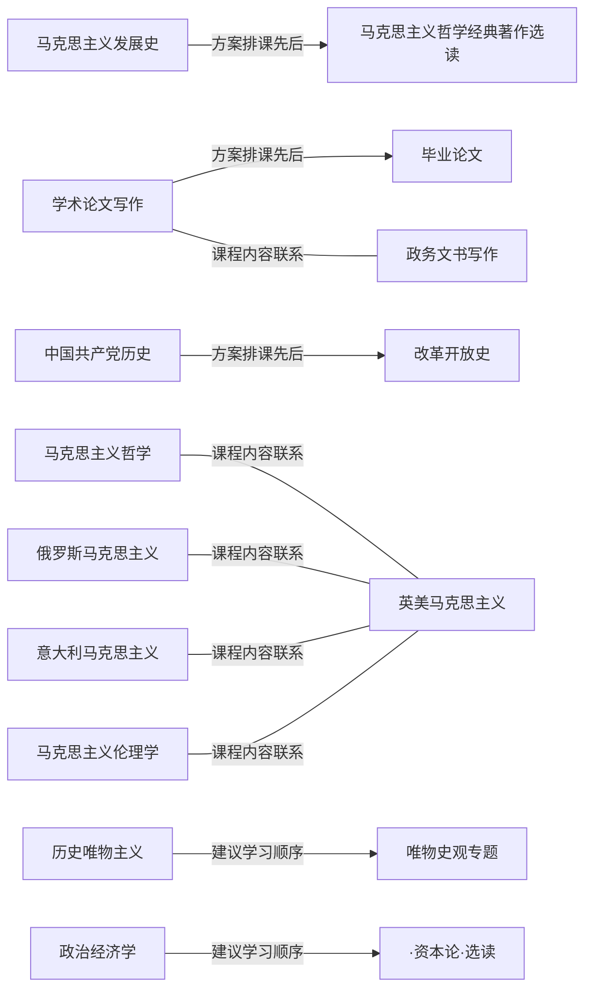

# 2023望道班2+X培养方案

马克思主义学院 · 马克思主义理论 · 方案 65505 · 83 个不同课程或科研条目。

[官方 Word](../originals/plan-65505.docx) · [教务详情](https://fdjwgl.fudan.edu.cn/manager/bizType/2/major-program-search/info/65505?skipAuth=1) · [方案快照](../raw/plan-65505.json.gz) · [年级目录](../README.md)

## 修读导读

- **建议先学**　《马克思主义发展史》（`TMAX30006`） → 《马克思主义哲学经典著作选读》（`TMAX30002`）。思想发展的历史脉络有助于理解经典著作的问题背景。方案分别列在第2、3学期。

- **可以对照着读**　《学术论文写作》（`TMAX30010`）与《政务文书写作》（`TMAX70004`）。两门课的题名都涉及写作。选同一材料分别拟提纲，比较两种写作的读者、证据和段落安排。

- **查模块选课**　《马克思主义理论专业外语》（`TMAX40003`）、《《共产党宣言》精讲》（`TMAX30001`）列在“专业核心教育课程”中。原表见 `/courseModules/5`。

## 课程关系图

图中展示部分关系。下表保留全部已建立的课程对，来源位置使用本方案 JSON Pointer。

## 先修与内容联系

| 类型 | 起点 | 终点 | 依据 | 原表定位 |
| --- | --- | --- | --- | --- |
| 建议学习顺序 | 政治经济学 (ECON20006) | 《资本论》选读 (TMAX70006) | 价值、资本与生产关系等基本概念有助于研读原著。  | `/courseModules/6/planCourses/4`、`/courseModules/11/planCourses/16` |
| 建议学习顺序 | 中国共产党历史 (TMAX10001) | 改革开放史 (TMAX20005) | 整体历史脉络有助于理解特定时期的改革进程。  | `/courseModules/5/planCourses/9`、`/courseModules/5/planCourses/12` |
| 建议学习顺序 | 历史唯物主义 (TMAX20004) | 唯物史观专题 (TMAX70005) | 先掌握基础概念，有助于围绕唯物史观开展专题讨论。  | `/courseModules/5/planCourses/6`、`/courseModules/11/planCourses/14` |
| 建议学习顺序 | 马克思主义发展史 (TMAX30006) | 马克思主义哲学经典著作选读 (TMAX30002) | 思想发展的历史脉络有助于理解经典著作的问题背景。  | `/courseModules/5/planCourses/8`、`/courseModules/5/planCourses/1` |
| 建议学习顺序 | 学术论文写作 (TMAX30010) | 毕业论文 (TMAX40005) | 论题、材料组织和论证训练可用于毕业论文写作。  | `/courseModules/5/planCourses/18`、`/courseModules/5/planCourses/20` |
| 方案排课先后 | 中国共产党历史 (TMAX10001) | 改革开放史 (TMAX20005) | 同方案该课程全部明确数字学期均早于后者。  | `/courseModules/5/planCourses/9`、`/courseModules/5/planCourses/12` |
| 方案排课先后 | 马克思主义发展史 (TMAX30006) | 马克思主义哲学经典著作选读 (TMAX30002) | 同方案该课程全部明确数字学期均早于后者。  | `/courseModules/5/planCourses/8`、`/courseModules/5/planCourses/1` |
| 方案排课先后 | 学术论文写作 (TMAX30010) | 毕业论文 (TMAX40005) | 同方案该课程全部明确数字学期均早于后者。  | `/courseModules/5/planCourses/18`、`/courseModules/5/planCourses/20` |
| 课程内容联系 | 当代中国政治制度 (POLI10009) | 中国政治制度史 (TMAX30012) | 本方案两门课程的题名均含“政治制度”，可据此对照这一主题。  | `/courseModules/6/planCourses/13`、`/courseModules/9/planCourses/22` |
| 课程内容联系 | 俄罗斯马克思主义 (PTSS130040) | 英美马克思主义 (TMAX50015) | 本方案两门课程的题名均含“马克思主义”，可据此对照这一主题。  | `/courseModules/11/planCourses/2`、`/courseModules/11/planCourses/3` |
| 课程内容联系 | 意大利马克思主义 (PTSS130042) | 英美马克思主义 (TMAX50015) | 本方案两门课程的题名均含“马克思主义”，可据此对照这一主题。  | `/courseModules/11/planCourses/4`、`/courseModules/11/planCourses/3` |
| 课程内容联系 | 马克思主义哲学 (TMAX10003) | 英美马克思主义 (TMAX50015) | 本方案两门课程的题名均含“马克思主义”，可据此对照这一主题。  | `/courseModules/11/planCourses/18`、`/courseModules/11/planCourses/3` |
| 课程内容联系 | 马克思主义伦理学 (TMAX20008) | 英美马克思主义 (TMAX50015) | 本方案两门课程的题名均含“马克思主义”，可据此对照这一主题。  | `/courseModules/9/planCourses/5`、`/courseModules/11/planCourses/3` |
| 课程内容联系 | 学术论文写作 (TMAX30010) | 政务文书写作 (TMAX70004) | 本方案两门课程的题名均含“写作”，可据此对照这一主题。  | `/courseModules/5/planCourses/18`、`/courseModules/9/planCourses/17` |

本次未从可定位的明确表述中确认课程对课程预修。学期安排、系列分册与编辑建议均保留各自的依据。

## 按原方案模块阅读

同一模块展示原表中的课程归属。模块内课程之间的先后仍须逐项查阅。

- **当代中国马克思主义**　数智赋能政党建设、中华优秀传统文化、马克思主义伦理学、思想政治教育学原理、中国共产党建设理论与实践、党建理论与实践前沿、中国政治制度史、中国政党制度、习近平生态文明思想概论、互联网党建、中国共产党与中国政治发展、中国特色社会主义现代化建设、比较思想政治教育、马克思主义中国化历史进程、政党政治原理、中国共产党与城市治理现代化、当代中国马克思主义美学、中国特色社会主义政治经济学等26项（原表模块 9）
- **国外马克思主义**　马克思主义哲学导论、俄罗斯马克思主义、意大利马克思主义、拉丁美洲马克思主义、马克思主义哲学、国外马克思主义概论、西方政治思想史、英美马克思主义、海外中共学、国外马克思主义与当代中国马克思主义比较、国外马克思主义经济理论、国外生态马克思主义、国外社会主义思潮、西方马克思主义原著选读、马克思主义法律思想史、当代西方左翼与社会运动、当代西方左翼与社会运动、国外生态马克思主义等22项（原表模块 11）

## 课程表

同一课程在不同模块分别出现时，按原表逐行列出。季节字段保留原值。

| 课程 | 代码 | 学分 | 学期 | 模块 |
| --- | --- | ---: | --- | --- |
| 《共产党宣言》精讲 | TMAX30001 | 2.0 | 第4学期 | 培养方案 / 专业培养课程 / 专业核心教育课程 |
| 马克思主义哲学经典著作选读 | TMAX30002 | 3.0 | 第3学期 | 培养方案 / 专业培养课程 / 专业核心教育课程 |
| 马克思主义政治经济学经典著作选读 | TMAX20002 | 3.0 | 第4学期 | 培养方案 / 专业培养课程 / 专业核心教育课程 |
| 科学社会主义经典著作选读 | TMAX20003 | 3.0 | 第2学期 | 培养方案 / 专业培养课程 / 专业核心教育课程 |
| 毛泽东著作选读 | TMAX30003 | 3.0 | 第3学期 | 培养方案 / 专业培养课程 / 专业核心教育课程 |
| 当代中国马克思主义经典著作选读 | TMAX30004 | 3.0 | 第5学期 | 培养方案 / 专业培养课程 / 专业核心教育课程 |
| 历史唯物主义 | TMAX20004 | 2.0 | 第3学期 | 培养方案 / 专业培养课程 / 专业核心教育课程 |
| 唯物辩证法 | TMAX30005 | 2.0 | AUTUMN | 培养方案 / 专业培养课程 / 专业核心教育课程 |
| 马克思主义发展史 | TMAX30006 | 3.0 | 第2学期 | 培养方案 / 专业培养课程 / 专业核心教育课程 |
| 中国共产党历史 | TMAX10001 | 3.0 | 第4学期 | 培养方案 / 专业培养课程 / 专业核心教育课程 |
| 马克思主义政党学说史 | TMAX40002 | 2.0 | 第5学期 | 培养方案 / 专业培养课程 / 专业核心教育课程 |
| 当代社会思潮 | TMAX10002 | 2.0 | 第4学期 | 培养方案 / 专业培养课程 / 专业核心教育课程 |
| 改革开放史 | TMAX20005 | 2.0 | 第6学期 | 培养方案 / 专业培养课程 / 专业核心教育课程 |
| 马克思主义理论专业外语 | TMAX40003 | 3.0 | 第4学期 | 培养方案 / 专业培养课程 / 专业核心教育课程 |
| 新中国史（实践课程） | TMAX20007 | 3.0 | 第2学期 | 培养方案 / 专业培养课程 / 专业核心教育课程 |
| 专业实习（挂职锻炼） | TMAX70002 | 3.0 | 第7学期 | 培养方案 / 专业培养课程 / 专业核心教育课程 |
| 习近平新时代中国特色社会主义思想专题研究 | TMAX30008 | 2.0 | 第5学期 | 培养方案 / 专业培养课程 / 专业核心教育课程 |
| 中国近现代思想通论 | TMAX40004 | 2.0 | 第1学期 | 培养方案 / 专业培养课程 / 专业核心教育课程 |
| 学术论文写作 | TMAX30010 | 2.0 | 第5学期 | 培养方案 / 专业培养课程 / 专业核心教育课程 |
| 当代资本主义前沿问题研究 | TMAX30011 | 2.0 | 第6学期 | 培养方案 / 专业培养课程 / 专业核心教育课程 |
| 毕业论文 | TMAX40005 | 4.0 | 第8学期 | 培养方案 / 专业培养课程 / 专业核心教育课程 |
| 高等数学D | MATH10008 | 4.0 | SPRING、AUTUMN | 培养方案 / 专业培养课程 / 大类基础课程 |
| 哲学导论 | PHIL10002 | 3.0 | SPRING、AUTUMN | 培养方案 / 专业培养课程 / 大类基础课程 |
| 政治学原理 | POLI10007 | 3.0 | SPRING、AUTUMN | 培养方案 / 专业培养课程 / 大类基础课程 |
| 社会学导论 | SOCI20001 | 3.0 | SPRING、AUTUMN | 培养方案 / 专业培养课程 / 大类基础课程 |
| 政治经济学 | ECON20006 | 3.0 | SPRING、AUTUMN | 培养方案 / 专业培养课程 / 大类基础课程 |
| 社会研究方法A | SOCI20002 | 3.0 | SPRING、AUTUMN | 培养方案 / 专业培养课程 / 大类基础课程 |
| 社会研究方法B | MSE30029 | 3.0 | SPRING、AUTUMN | 培养方案 / 专业培养课程 / 大类基础课程 |
| 国际关系导论 | POLI10008 | 3.0 | SPRING、AUTUMN | 培养方案 / 专业培养课程 / 大类基础课程 |
| 社会工作导论 | SWK20002 | 3.0 | SPRING、AUTUMN | 培养方案 / 专业培养课程 / 大类基础课程 |
| 心理学导论 | PSYC20001 | 3.0 | SPRING、AUTUMN | 培养方案 / 专业培养课程 / 大类基础课程 |
| 管理学导论 | BA10004 | 3.0 | SPRING、AUTUMN | 培养方案 / 专业培养课程 / 大类基础课程 |
| 宪法 | LAW10005 | 3.0 | SPRING、AUTUMN | 培养方案 / 专业培养课程 / 大类基础课程 |
| 公共行政学 | MANA10002 | 3.0 | SPRING、AUTUMN | 培养方案 / 专业培养课程 / 大类基础课程 |
| 当代中国政治制度 | POLI10009 | 3.0 | SPRING、AUTUMN | 培养方案 / 专业培养课程 / 大类基础课程 |
| 数智赋能政党建设 | AIT310022 | 3.0 | SPRING、AUTUMN | 培养方案 / 专业进阶模块I / 当代中国马克思主义 |
| 中华优秀传统文化 | GEEC20071 | 2.0 | SPRING、AUTUMN | 培养方案 / 专业进阶模块I / 当代中国马克思主义 |
| 党建理论与实践前沿 | TMAX30009 | 3.0 | SPRING、AUTUMN | 培养方案 / 专业进阶模块I / 当代中国马克思主义 |
| 中国政党制度 | TMAX50004 | 2.0 | SPRING、AUTUMN | 培养方案 / 专业进阶模块I / 当代中国马克思主义 |
| 习近平生态文明思想概论 | TMAX50005 | 2.0 | SPRING、AUTUMN | 培养方案 / 专业进阶模块I / 当代中国马克思主义 |
| 马克思主义伦理学 | TMAX20008 | 2.0 | SPRING、AUTUMN | 培养方案 / 专业进阶模块I / 当代中国马克思主义 |
| 互联网党建 | TMAX50006 | 2.0 | SPRING、AUTUMN | 培养方案 / 专业进阶模块I / 当代中国马克思主义 |
| 中国共产党与中国政治发展 | TMAX50007 | 3.0 | SPRING、AUTUMN | 培养方案 / 专业进阶模块I / 当代中国马克思主义 |
| 中国特色社会主义现代化建设 | TMAX50008 | 2.0 | SPRING、AUTUMN | 培养方案 / 专业进阶模块I / 当代中国马克思主义 |
| 比较思想政治教育 | TMAX50009 | 2.0 | SPRING、AUTUMN | 培养方案 / 专业进阶模块I / 当代中国马克思主义 |
| 马克思主义中国化历史进程 | TMAX50011 | 2.0 | SPRING、AUTUMN | 培养方案 / 专业进阶模块I / 当代中国马克思主义 |
| 中国共产党与文化建设 | TMAX60001 | 2.0 | SPRING、AUTUMN | 培养方案 / 专业进阶模块I / 当代中国马克思主义 |
| 现代科技与社会发展 | TMAX60002 | 2.0 | SPRING、AUTUMN | 培养方案 / 专业进阶模块I / 当代中国马克思主义 |
| 政党政治原理 | TMAX50012 | 2.0 | SPRING、AUTUMN | 培养方案 / 专业进阶模块I / 当代中国马克思主义 |
| 中国共产党与城市治理现代化 | TMAX50013 | 2.0 | SPRING、AUTUMN | 培养方案 / 专业进阶模块I / 当代中国马克思主义 |
| 当代中国马克思主义美学 | TMAX50014 | 2.0 | SPRING、AUTUMN | 培养方案 / 专业进阶模块I / 当代中国马克思主义 |
| 中国特色社会主义政治经济学 | TMAX50022 | 2.0 | SPRING、AUTUMN | 培养方案 / 专业进阶模块I / 当代中国马克思主义 |
| 政务文书写作 | TMAX70004 | 2.0 | SPRING、AUTUMN | 培养方案 / 专业进阶模块I / 当代中国马克思主义 |
| 马克思主义中国化历史进程与基本经验 | TMAX50023 | 2.0 | SPRING、AUTUMN | 培养方案 / 专业进阶模块I / 当代中国马克思主义 |
| 中国特色社会主义市场经济概论 | TMAX50024 | 2.0 | SPRING、AUTUMN | 培养方案 / 专业进阶模块I / 当代中国马克思主义 |
| 中国共产党与中国政治发展 | TMAX50025 | 2.0 | SPRING、AUTUMN | 培养方案 / 专业进阶模块I / 当代中国马克思主义 |
| 党建理论与实践前沿 | TMAX50026 | 2.0 | SPRING、AUTUMN | 培养方案 / 专业进阶模块I / 当代中国马克思主义 |
| 中国政治制度史 | TMAX30012 | 2.0 | SPRING、AUTUMN | 培养方案 / 专业进阶模块I / 当代中国马克思主义 |
| 思想政治教育学原理 | TMAX20009 | 2.0 | SPRING、AUTUMN | 培养方案 / 专业进阶模块I / 当代中国马克思主义 |
| 中国共产党建设理论与实践 | TMAX20012 | 3.0 | SPRING、AUTUMN | 培养方案 / 专业进阶模块I / 当代中国马克思主义 |
| “马克思主义与人工智能”前沿专题 | TMAX60008 | 2.0 | SPRING、AUTUMN | 培养方案 / 专业进阶模块I / 当代中国马克思主义 |
| 当代西方左翼与社会运动 | TMAX60003 | 3.0 | SPRING、AUTUMN | 培养方案 / 专业进阶模块II / 国外马克思主义 |
| 当代西方左翼与社会运动 | TMAX60004 | 2.0 | SPRING、AUTUMN | 培养方案 / 专业进阶模块II / 国外马克思主义 |
| 俄罗斯马克思主义 | PTSS130040 | 2.0 | SPRING、AUTUMN | 培养方案 / 专业进阶模块II / 国外马克思主义 |
| 英美马克思主义 | TMAX50015 | 2.0 | SPRING、AUTUMN | 培养方案 / 专业进阶模块II / 国外马克思主义 |
| 意大利马克思主义 | PTSS130042 | 2.0 | SPRING、AUTUMN | 培养方案 / 专业进阶模块II / 国外马克思主义 |
| 拉丁美洲马克思主义 | PTSS130043 | 2.0 | SPRING、AUTUMN | 培养方案 / 专业进阶模块II / 国外马克思主义 |
| 海外中共学 | TMAX50016 | 2.0 | SPRING、AUTUMN | 培养方案 / 专业进阶模块II / 国外马克思主义 |
| 国外马克思主义与当代中国马克思主义比较 | TMAX50017 | 2.0 | SPRING、AUTUMN | 培养方案 / 专业进阶模块II / 国外马克思主义 |
| 国外马克思主义经济理论 | TMAX50018 | 2.0 | SPRING、AUTUMN | 培养方案 / 专业进阶模块II / 国外马克思主义 |
| 国外生态马克思主义 | TMAX50019 | 3.0 | SPRING、AUTUMN | 培养方案 / 专业进阶模块II / 国外马克思主义 |
| 国外社会主义思潮 | TMAX50020 | 2.0 | SPRING、AUTUMN | 培养方案 / 专业进阶模块II / 国外马克思主义 |
| 西方马克思主义原著选读 | TMAX50021 | 2.0 | SPRING、AUTUMN | 培养方案 / 专业进阶模块II / 国外马克思主义 |
| 康德哲学 | TMAX60006 | 2.0 | SPRING、AUTUMN | 培养方案 / 专业进阶模块II / 国外马克思主义 |
| 世界社会主义运动史专题 | TMAX60007 | 2.0 | SPRING、AUTUMN | 培养方案 / 专业进阶模块II / 国外马克思主义 |
| 唯物史观专题 | TMAX70005 | 2.0 | SPRING、AUTUMN | 培养方案 / 专业进阶模块II / 国外马克思主义 |
| 马克思主义法律思想史 | TMAX50027 | 2.0 | SPRING、AUTUMN | 培养方案 / 专业进阶模块II / 国外马克思主义 |
| 《资本论》选读 | TMAX70006 | 3.0 | SPRING、AUTUMN | 培养方案 / 专业进阶模块II / 国外马克思主义 |
| 西方政治思想史 | TMAX30013 | 2.0 | SPRING、AUTUMN | 培养方案 / 专业进阶模块II / 国外马克思主义 |
| 马克思主义哲学 | TMAX10003 | 3.0 | SPRING、AUTUMN | 培养方案 / 专业进阶模块II / 国外马克思主义 |
| 国外马克思主义概论 | TMAX20010 | 2.0 | SPRING、AUTUMN | 培养方案 / 专业进阶模块II / 国外马克思主义 |
| 国外生态马克思主义 | TMAX60005 | 2.0 | SPRING、AUTUMN | 培养方案 / 专业进阶模块II / 国外马克思主义 |
| 马克思主义哲学导论 | PHIL20003 | 2.0 | SPRING、AUTUMN | 培养方案 / 专业进阶模块II / 国外马克思主义 |
