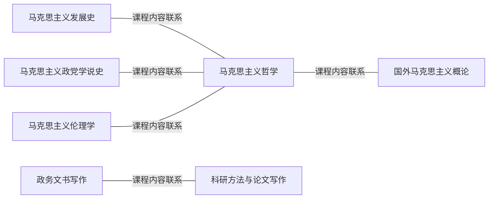

# 马克思主义理论专业“2+X”教学培养方案

2024 年汇编印刷页 544–546。原表记录 54 个可配对的课程代码。

[本节原页](plan-544.pdf#page=1) · [逐行数据](plan-544.json) · [院系目录](README.md)

## 课程导读

想了解理论与经典阅读的课程安排，可以在原表中找到《马克思主义哲学经典著作选读》（`PTSS130003`）、《马克思主义哲学》（`PTSS130073`）、《科学社会主义》（`PTSS130075`）。 [原书 PDF 第 558 页](plan-544.pdf#page=1)

图中连接《马克思主义发展史》（`PTSS130010`）和《马克思主义哲学》（`PTSS130073`），两门课都从课程题名标出的“马克思主义”切入，可沿这一主题对照阅读。 [原书 PDF 第 558 页](plan-544.pdf#page=1)

## 课程关系图

图中展示最多 20 条关系。下表列出本节全部关系。建议学习顺序供规划课程使用，正式选课资格以教务规定为准。

| 课程 | 关联课程 | 关系 | 依据 |
| --- | --- | --- | --- |
| 马克思主义发展史（PTSS130010） | 马克思主义哲学（PTSS130073） | 课程内容联系 | 本方案两门课程的题名均含“马克思主义”，可据此对照这一主题。 |
| 马克思主义政党学说史（PTSS130013） | 马克思主义哲学（PTSS130073） | 课程内容联系 | 本方案两门课程的题名均含“马克思主义”，可据此对照这一主题。 |
| 马克思主义伦理学（PTSS130027） | 马克思主义哲学（PTSS130073） | 课程内容联系 | 本方案两门课程的题名均含“马克思主义”，可据此对照这一主题。 |
| 政务文书写作（PTSS130056） | 科研方法与论文写作（PTSS130080） | 课程内容联系 | 本方案两门课程的题名均含“写作”，可据此对照这一主题。 |
| 马克思主义哲学（PTSS130073） | 国外马克思主义概论（PTSS130074） | 课程内容联系 | 本方案两门课程的题名均含“马克思主义”，可据此对照这一主题。 |

## 课程

| 课程代码 | 名称 | 开课学期原文 | 来源（PDF 页） |
| --- | --- | --- | --- |
| AIT310022 | 数智赋能政党建设 | 春，秋 | 560 |
| PTSS110081 | 中华优秀传统文化 | 春，秋 | 560 |
| PTSS130002 | 《共产党宣言》精讲 | 5 | 558 |
| PTSS130003 | 马克思主义哲学经典著作选读 | 4 | 558 |
| PTSS130004 | 马克思主义政治经济学经典著作选读 | 5 | 559 |
| PTSS130007 | 当代中国马克思主义经典著作选读 | 5 | 559 |
| PTSS130010 | 马克思主义发展史 | 4 | 558 |
| PTSS130011 | 中国共产党历史 | 2 | 558 |
| PTSS130013 | 马克思主义政党学说史 | 春，秋 | 560 |
| PTSS130014 | 当代社会思潮 | 春，秋 | 559 |
| PTSS130015 | 改革开放史 | 6 | 559 |
| PTSS130017 | 马克思主义理论专业外语 | 6 | 559 |
| PTSS130018 | 新中国史（实践课程） | 2 | 558 |
| PTSS130019 | 专业实习（挂职锻炼） | 7 | 559 |
| PTSS130021 | 毕业论文 | 8 | 559 |
| PTSS130025 | 中国政党制度 | 春，秋 | 560 |
| PTSS130026 | 习近平生态文明思想概论 | 春，秋 | 559 |
| PTSS130027 | 马克思主义伦理学 | 2 | 558 |
| PTSS130028 | 互联网党建 | 春，秋 | 560 |
| PTSS130030 | 中国特色社会主义现代化建设 | 春，秋 | 559 |
| PTSS130031 | 比较思想政治教育 | 春，秋 | 559 |
| PTSS130034 | 中国共产党与文化建设 | 春，秋 | 560 |
| PTSS130035 | 现代科技与社会发展 | 春，秋 | 560 |
| PTSS130037 | 中国共产党与城市治理现代化 | 春，秋 | 560 |
| PTSS130038 | 当代中国马克思主义美学 | 春，秋 | 559 |
| PTSS130044 | 海外中共学 | 春，秋 | 560 |
| PTSS130045 | 国外马克思主义与当代中国马克思主义比较 | 春，秋 | 559 |
| PTSS130046 | 国外马克思主义经济理论 | 春，秋 | 559 |
| PTSS130048 | 国外社会主义思潮 | 春，秋 | 559 |
| PTSS130050 | 中国特色社会主义政治经济学 | 春，秋 | 559 |
| PTSS130052 | 中国近现代思想通论 | 春，秋 | 559 |
| PTSS130054 | 当代资本主义前沿问题研究 | 6 | 559 |
| PTSS130056 | 政务文书写作 | 春，秋 | 560 |
| PTSS130058 | 康德哲学 | 春，秋 | 560 |
| PTSS130059 | 世界社会主义运动史专题 | 春，秋 | 559 |
| PTSS130063 | 马克思主义中国化历史进程与基本经验 | 春，秋 | 559 |
| PTSS130064 | 中国特色社会主义市场经济概论 | 春，秋 | 559 |
| PTSS130065 | 中国共产党与中国政治发展 | 春，秋 | 560 |
| PTSS130066 | 党建理论与实践前沿 | 春，秋 | 560 |
| PTSS130067 | 唯物史观专题 | 春，秋 | 559 |
| PTSS130068 | 马克思主义法律思想史 | 春，秋 | 559 |
| PTSS130069 | 《资本论》选读 | 春，秋 | 559 |
| PTSS130070 | 中国政治制度史 | 春，秋 | 560 |
| PTSS130072 | 思想政治教育学原理 | 3 | 558 |
| PTSS130073 | 马克思主义哲学 | 1 | 558 |
| PTSS130074 | 国外马克思主义概论 | 4 | 558 |
| PTSS130075 | 科学社会主义 | 2 | 558 |
| PTSS130076 | 中国近现代史 | 1 | 558 |
| PTSS130077 | 毛泽东思想 | 3 | 558 |
| PTSS130078 | 中国共产党建设理论与实践 | 3 | 558 |
| PTSS130079 | 习近平新时代中国特色社会主义思想 | 3 | 558 |
| PTSS130080 | 科研方法与论文写作 | 4 | 558 |
| PTSS30049 | 西方马克思主义原著选读 | 春，秋 | 559 |
| PTSS30055 | 当代西方左翼与社会运动 | 春，秋 | 559 |
