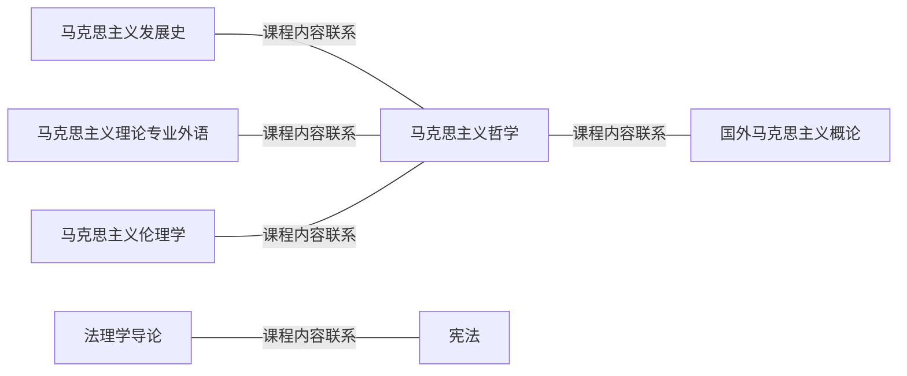

# 马克思主义理论专业“2+X”修读建议

2024 年汇编印刷页 547–548。原表记录 39 个可配对的课程代码。

[本节原页](plan-544.pdf#page=4) · [逐行数据](plan-544.json) · [院系目录](README.md)

## 课程导读

想了解理论与经典阅读的课程安排，可以在原表中找到《马克思主义哲学经典著作选读》（`PTSS130003`）、《马克思主义哲学》（`PTSS130073`）、《科学社会主义》（`PTSS130075`）。 [原书 PDF 第 562 页](plan-544.pdf#page=5)

图中连接《马克思主义发展史》（`PTSS130010`）和《马克思主义哲学》（`PTSS130073`），两门课都从课程题名标出的“马克思主义”切入，可沿这一主题对照阅读。 [原书 PDF 第 562 页](plan-544.pdf#page=5)

## 课程关系图

图中展示最多 20 条关系。下表列出本节全部关系。建议学习顺序供规划课程使用，正式选课资格以教务规定为准。

| 课程 | 关联课程 | 关系 | 依据 |
| --- | --- | --- | --- |
| 马克思主义发展史（PTSS130010） | 马克思主义哲学（PTSS130073） | 课程内容联系 | 本方案两门课程的题名均含“马克思主义”，可据此对照这一主题。 |
| 马克思主义理论专业外语（PTSS130017） | 马克思主义哲学（PTSS130073） | 课程内容联系 | 本方案两门课程的题名均含“马克思主义”，可据此对照这一主题。 |
| 马克思主义伦理学（PTSS130027） | 马克思主义哲学（PTSS130073） | 课程内容联系 | 本方案两门课程的题名均含“马克思主义”，可据此对照这一主题。 |
| 马克思主义哲学（PTSS130073） | 国外马克思主义概论（PTSS130074） | 课程内容联系 | 本方案两门课程的题名均含“马克思主义”，可据此对照这一主题。 |
| 法理学导论（SOSC120003） | 宪法（SOSC120015） | 课程内容联系 | 两课均涉及权利与公共权力的规范依据。 |

## 课程

| 课程代码 | 名称 | 开课学期原文 | 来源（PDF 页） |
| --- | --- | --- | --- |
| CHIN120012 | 中国文学经典 |  | 561 |
| HIST120001 | 史学原典导读 |  | 561 |
| HIST120002 | 世界文明史通论 |  | 561 |
| HIST120012 | 中国古代文明 |  | 561 |
| PHIL120012 | 哲学导论 |  | 561 |
| PTSS130002 | 《共产党宣言》精讲 |  | 562 |
| PTSS130003 | 马克思主义哲学经典著作选读 |  | 562 |
| PTSS130004 | 马克思主义政治经济学经典著作选读 |  | 562 |
| PTSS130007 | 当代中国马克思主义经典著作选读 |  | 562 |
| PTSS130010 | 马克思主义发展史 |  | 562 |
| PTSS130011 | 中国共产党历史 |  | 562 |
| PTSS130015 | 改革开放史 |  | 562 |
| PTSS130017 | 马克思主义理论专业外语 |  | 562 |
| PTSS130018 | 新中国史（实践课程） |  | 562 |
| PTSS130019 | 专业实习（挂职锻炼） |  | 562 |
| PTSS130021 | 毕业论文 |  | 562 |
| PTSS130027 | 马克思主义伦理学 |  | 562 |
| PTSS130054 | 当代资本主义前沿问题研究 |  | 562 |
| PTSS130071 | 西方政治思想史 |  | 561 |
| PTSS130072 | 思想政治教育学原理 |  | 562 |
| PTSS130073 | 马克思主义哲学 |  | 562 |
| PTSS130074 | 国外马克思主义概论 |  | 562 |
| PTSS130075 | 科学社会主义 |  | 562 |
| PTSS130076 | 中国近现代史 |  | 562 |
| PTSS130077 | 毛泽东思想 |  | 562 |
| PTSS130078 | 中国共产党建设理论与实践 |  | 562 |
| PTSS130079 | 习近平新时代中国特色社会主义思想 |  | 562 |
| PTSS130080 | 科研方法与论文写作 |  | 562 |
| SOSC120001 | 政治学原理 |  | 561 |
| SOSC120002 | 社会学导论 |  | 561 |
| SOSC120003 | 法理学导论 |  | 561 |
| SOSC120008 | 政治经济学 |  | 561 |
| SOSC120009 | 社会研究方法A |  | 561 |
| SOSC120010 | 社会研究方法B |  | 561 |
| SOSC120011 | 国际关系导论 |  | 561 |
| SOSC120013 | 心理学导论 |  | 561 |
| SOSC120015 | 宪法 |  | 561 |
| SOSC120018 | 公共行政学 |  | 561 |
| SOSC120019 | 当代中国政治制度 |  | 561 |
