# 马院课程关系图谱

本图谱以[马院课程名单](../马院课程名单.json)中的148个课程名称为节点，依据2025秋、2026春可读官方大纲的课程简介、教学目标和教学内容匹配主题词。关联表示内容涉及同一主题，**不是先修限制**。每门课最多展示5个主题，证据为某一教学班的大纲，不代表所有班型或未来学期。

现有大纲摘要没有可靠的结构化先修字段，先修状态统一标为“未核实”，不能据此判断没有先修要求。没有可读大纲或未匹配主题的课程保留在 JSON 中。

覆盖：148个课程名称；106个课程匹配到至少一个主题；275条课程—主题关联。

[机器可读图谱](课程关系图谱.json)（包含节点、关联、原文摘录、课号、教学班、学期和来源），[官方大纲摘要](../final-report-20261028/官方培养方案/官方大纲结构化摘要.json)。

```mermaid
graph LR
  T0["人工智能与技术"]
  C0_0["“马克思主义与人工智能”前沿专题"] --- T0
  C0_1["中国特色社会主义市场经济概论"] --- T0
  T1["科学技术与社会"]
  C1_0["“马克思主义与人工智能”前沿专题"] --- T1
  C1_1["国外马克思主义概论"] --- T1
  T2["马克思主义经典著作"]
  C2_0["“马克思主义与人工智能”前沿专题"] --- T2
  C2_1["专业外语"] --- T2
  T3["政治经济学"]
  C3_0["“马克思主义与人工智能”前沿专题"] --- T3
  C3_1["《资本论》第一卷精讲"] --- T3
  T4["世界政治与国际关系"]
  C4_0["“马克思主义与人工智能”前沿专题"] --- T4
  C4_1["中国特色社会主义市场经济概论"] --- T4
  T5["中国特色社会主义"]
  C5_0["《资本论》第一卷精讲"] --- T5
  C5_1["专业外语"] --- T5
  T6["科学社会主义"]
  C6_0["《资本论》第一卷精讲"] --- T6
  C6_1["中共党史论纲"] --- T6
  T7["文化与意识形态"]
  C7_0["专业外语"] --- T7
  C7_1["中国共产党建设理论与实践"] --- T7
  T8["中国共产党历史"]
  C8_0["中共党史专题研究"] --- T8
  C8_1["中共党史人物生平与思想研究"] --- T8
  T9["马克思主义哲学"]
  C9_0["中共党史论纲"] --- T9
  C9_1["中国共产党建设理论与实践"] --- T9
  T10["改革开放史"]
  C10_0["中国共产党与中国政治发展"] --- T10
  C10_1["中国特色社会主义市场经济概论"] --- T10
  T11["中国近现代史"]
  C11_0["中国共产党与中国政治发展"] --- T11
  C11_1["中国近现代历史文献选读"] --- T11
  T12["生态与环境"]
  C12_0["中国共产党与城市治理现代化"] --- T12
  C12_1["中国式现代化概论"] --- T12
  T13["中华人民共和国史"]
  C13_0["中国共产党历史"] --- T13
  C13_1["中国近现代史主题主线研究"] --- T13
  T14["思想政治教育"]
  C14_0["中国古代德育思想"] --- T14
  C14_1["中国近现代史纲要"] --- T14
  T15["法律与法治"]
  C15_0["习近平新时代中国特色社会主义思想概论"] --- T15
  C15_1["习近平著作选读"] --- T15
  T16["马克思主义发展史"]
  C16_0["历史唯物主义前沿问题研究"] --- T16
  C16_1["唯物史观研究"] --- T16
  T17["社会研究方法"]
  C17_0["历史唯物主义前沿问题研究"] --- T17
  C17_1["社会科学研究方法与论文写作"] --- T17
  T18["伦理与道德"]
  C18_0["应用伦理学"] --- T18
  C18_1["思想政治教育原著导读"] --- T18
```

上图为每个主题最多两个示例；下表列出全部匹配结果。链接指向本分支的大纲快照，解压后可查看。

## 马克思主义哲学

| 课程 | 匹配词 | 证据来源 |
| --- | --- | --- |
| 中共党史论纲 | 历史唯物主义 | [2025秋 · 1006579](../raw-official/syllabi-20261027/1006579.html.gz) |
| 中国共产党建设理论与实践 | 马克思主义哲学 | [2025秋 · 1004821](../raw-official/syllabi-20261027/1004821.html.gz) |
| 中国特色现代化道路的研究 | 辩证唯物主义 | [2026春 · 1031587](../raw-official/syllabi-20261027/1031587.html.gz) |
| 中国特色社会主义政治经济学研究 | 马克思主义哲学 | [2026春 · 1031609](../raw-official/syllabi-20261027/1031609.html.gz) |
| 历史唯物主义前沿问题研究 | 历史唯物主义 | [2025秋 · 1014230](../raw-official/syllabi-20261027/1014230.html.gz) |
| 唯物史观研究 | 历史唯物主义 | [2025秋 · 1006581](../raw-official/syllabi-20261027/1006581.html.gz) |
| 国外生态马克思主义研究 | 历史唯物主义 | [2026春 · 1031612](../raw-official/syllabi-20261027/1031612.html.gz) |
| 国外马克思主义与当代中国马克思主义比较之专题研究 | 历史唯物主义 | [2026春 · 1031613](../raw-official/syllabi-20261027/1031613.html.gz) |
| 国外马克思主义概论 | 辩证法 | [2026春 · 1029161](../raw-official/syllabi-20261027/1029161.html.gz) |
| 延安时期历史人物研究 | 历史唯物主义 | [2026春 · 1031594](../raw-official/syllabi-20261027/1031594.html.gz) |
| 当代中外马克思主义比较研究 | 历史唯物主义 | [2026春 · 1031598](../raw-official/syllabi-20261027/1031598.html.gz) |
| 当代俄罗斯马克思主义研究 | 辩证法 | [2026春 · 1031611](../raw-official/syllabi-20261027/1031611.html.gz) |
| 思想道德与法治 | 辩证唯物主义 | [2025秋 · 1002842](../raw-official/syllabi-20261027/1002842.html.gz) |
| 改革开放史 | 辩证唯物主义 | [2025秋 · 1003419](../raw-official/syllabi-20261027/1003419.html.gz) |
| 自然辩证法 | 辩证法 | [2025秋 · 1014204](../raw-official/syllabi-20261027/1014204.html.gz) |
| 西方马克思主义与历史唯物主义 | 历史唯物主义 | [2026春 · 1031606](../raw-official/syllabi-20261027/1031606.html.gz) |
| 马克思主义前史专题研究 | 辩证唯物主义 | [2026春 · 1031593](../raw-official/syllabi-20261027/1031593.html.gz) |
| 马克思主义发展史专题研究 | 辩证法 | [2025秋 · 1006569](../raw-official/syllabi-20261027/1006569.html.gz) |
| 马克思主义哲学经典著作选读 | 马克思主义哲学 | [2026春 · 1029162](../raw-official/syllabi-20261027/1029162.html.gz) |
| 马克思主义基本原理 | 马克思主义哲学 | [2025秋 · 1002878](../raw-official/syllabi-20261027/1002878.html.gz) |
| 马克思主义基础理论研究 | 辩证法 | [2026春 · 1032449](../raw-official/syllabi-20261027/1032449.html.gz) |
| 马克思主义政治经济学 | 历史唯物主义 | [2026春 · 1029165](../raw-official/syllabi-20261027/1029165.html.gz) |
| 马克思主义方法论研究 | 马克思主义哲学 | [2026春 · 1031601](../raw-official/syllabi-20261027/1031601.html.gz) |
| 马克思恩格斯思想发展史 | 辩证法 | [2026春 · 1032455](../raw-official/syllabi-20261027/1032455.html.gz) |

## 政治经济学

| 课程 | 匹配词 | 证据来源 |
| --- | --- | --- |
| “马克思主义与人工智能”前沿专题 | 政治经济学 | [2026春 · 1030608](../raw-official/syllabi-20261027/1030608.html.gz) |
| 《资本论》第一卷精讲 | 资本论 | [2025秋 · 1006580](../raw-official/syllabi-20261027/1006580.html.gz) |
| 专业外语 | 资本论 | [2025秋 · 1006559](../raw-official/syllabi-20261027/1006559.html.gz) |
| 中国共产党建设理论与实践 | 政治经济学 | [2025秋 · 1004821](../raw-official/syllabi-20261027/1004821.html.gz) |
| 中国特色社会主义市场经济概论 | 政治经济学 | [2025秋 · 1004812](../raw-official/syllabi-20261027/1004812.html.gz) |
| 中国特色社会主义政治经济学 | 政治经济学 | [2025秋 · 1004817](../raw-official/syllabi-20261027/1004817.html.gz) |
| 中国特色社会主义政治经济学研究 | 政治经济学 | [2026春 · 1031609](../raw-official/syllabi-20261027/1031609.html.gz) |
| 唯物史观研究 | 生产关系 | [2025秋 · 1006581](../raw-official/syllabi-20261027/1006581.html.gz) |
| 国外马克思主义概论 | 政治经济学 | [2026春 · 1029161](../raw-official/syllabi-20261027/1029161.html.gz) |
| 国外马克思主义经济理论 | 政治经济学 | [2026春 · 1030432](../raw-official/syllabi-20261027/1030432.html.gz) |
| 延安时期历史人物研究 | 生产关系 | [2026春 · 1031594](../raw-official/syllabi-20261027/1031594.html.gz) |
| 当代中国马克思主义概论 | 政治经济学 | [2026春 · 1031607](../raw-official/syllabi-20261027/1031607.html.gz) |
| 当代资本主义前沿问题研究 | 政治经济学 | [2026春 · 1029160](../raw-official/syllabi-20261027/1029160.html.gz) |
| 政治经济学理论研究 | 政治经济学 | [2025秋 · 1006567](../raw-official/syllabi-20261027/1006567.html.gz) |
| 社会与政治经济学批判史专题 | 政治经济学 | [2025秋 · 1006583](../raw-official/syllabi-20261027/1006583.html.gz) |
| 马克思主义前史专题研究 | 政治经济学 | [2026春 · 1031593](../raw-official/syllabi-20261027/1031593.html.gz) |
| 马克思主义发展史 | 政治经济学 | [2026春 · 1029163](../raw-official/syllabi-20261027/1029163.html.gz) |
| 马克思主义发展史专题研究 | 政治经济学 | [2025秋 · 1006569](../raw-official/syllabi-20261027/1006569.html.gz) |
| 马克思主义基本原理 | 政治经济学 | [2025秋 · 1002850](../raw-official/syllabi-20261027/1002850.html.gz) |
| 马克思主义思想渊源 | 政治经济学 | [2025秋 · 1006582](../raw-official/syllabi-20261027/1006582.html.gz) |
| 马克思主义政治经济学 | 政治经济学 | [2026春 · 1029165](../raw-official/syllabi-20261027/1029165.html.gz) |
| 马克思主义政治经济学史的研究 | 政治经济学 | [2025秋 · 1006577](../raw-official/syllabi-20261027/1006577.html.gz) |
| 马克思主义经典文献导读 | 剩余价值 | [2025秋 · 1006568](../raw-official/syllabi-20261027/1006568.html.gz) |
| 马克思恩格斯思想发展史 | 政治经济学 | [2026春 · 1032455](../raw-official/syllabi-20261027/1032455.html.gz) |

## 科学社会主义

| 课程 | 匹配词 | 证据来源 |
| --- | --- | --- |
| 《资本论》第一卷精讲 | 社会主义理论 | [2025秋 · 1006580](../raw-official/syllabi-20261027/1006580.html.gz) |
| 中共党史论纲 | 社会主义理论 | [2025秋 · 1006579](../raw-official/syllabi-20261027/1006579.html.gz) |
| 中国共产党历史 | 社会主义理论 | [2025秋 · 1004814](../raw-official/syllabi-20261027/1004814.html.gz) |
| 中国共产党建设理论与实践 | 科学社会主义 | [2025秋 · 1004821](../raw-official/syllabi-20261027/1004821.html.gz) |
| 中国特色社会主义政治经济学 | 社会主义理论 | [2025秋 · 1004817](../raw-official/syllabi-20261027/1004817.html.gz) |
| 中国特色社会主义政治经济学研究 | 科学社会主义 | [2026春 · 1031609](../raw-official/syllabi-20261027/1031609.html.gz) |
| 党建理论与实践前沿 | 社会主义运动 | [2026春 · 1030490](../raw-official/syllabi-20261027/1030490.html.gz) |
| 国外社会主义思潮 | 社会主义理论 | [2025秋 · 1004819](../raw-official/syllabi-20261027/1004819.html.gz) |
| 国外马克思主义与当代中国马克思主义比较之专题研究 | 社会主义理论 | [2026春 · 1031613](../raw-official/syllabi-20261027/1031613.html.gz) |
| 当代中国马克思主义概论 | 科学社会主义 | [2026春 · 1031607](../raw-official/syllabi-20261027/1031607.html.gz) |
| 当代中外马克思主义比较研究 | 社会主义理论 | [2026春 · 1031598](../raw-official/syllabi-20261027/1031598.html.gz) |
| 当代资本主义前沿问题研究 | 社会主义运动 | [2026春 · 1029160](../raw-official/syllabi-20261027/1029160.html.gz) |
| 新中国史 | 社会主义理论 | [2025秋 · 1003389](../raw-official/syllabi-20261027/1003389.html.gz) |
| 新中国史（实践课程） | 社会主义理论 | [2026春 · 1029166](../raw-official/syllabi-20261027/1029166.html.gz) |
| 新时代中国特色社会主义理论与实践 | 社会主义理论 | [2025秋 · 1006418](../raw-official/syllabi-20261027/1006418.html.gz) |
| 毛泽东思想和中国特色社会主义理论体系概论 | 社会主义理论 | [2025秋 · 1002856](../raw-official/syllabi-20261027/1002856.html.gz) |
| 社会主义思想史 | 科学社会主义 | [2025秋 · 1006573](../raw-official/syllabi-20261027/1006573.html.gz) |
| 科学社会主义 | 科学社会主义 | [2026春 · 1029168](../raw-official/syllabi-20261027/1029168.html.gz) |
| 科学社会主义经典文献精读 | 科学社会主义 | [2025秋 · 1013927](../raw-official/syllabi-20261027/1013927.html.gz) |
| 马克思主义发展史 | 科学社会主义 | [2026春 · 1029163](../raw-official/syllabi-20261027/1029163.html.gz) |
| 马克思主义发展史专题研究 | 科学社会主义 | [2025秋 · 1006569](../raw-official/syllabi-20261027/1006569.html.gz) |
| 马克思主义基本原理 | 科学社会主义 | [2025秋 · 1002850](../raw-official/syllabi-20261027/1002850.html.gz) |
| 马克思主义基础理论研究 | 科学社会主义 | [2026春 · 1032449](../raw-official/syllabi-20261027/1032449.html.gz) |
| 马克思主义经典文献导读 | 科学社会主义 | [2025秋 · 1006568](../raw-official/syllabi-20261027/1006568.html.gz) |
| 马克思恩格斯思想发展史 | 科学社会主义 | [2026春 · 1032455](../raw-official/syllabi-20261027/1032455.html.gz) |

## 马克思主义经典著作

| 课程 | 匹配词 | 证据来源 |
| --- | --- | --- |
| “马克思主义与人工智能”前沿专题 | 马克思恩格斯 | [2026春 · 1030608](../raw-official/syllabi-20261027/1030608.html.gz) |
| 专业外语 | 经典著作 | [2025秋 · 1006559](../raw-official/syllabi-20261027/1006559.html.gz) |
| 中国共产党与中国政治发展 | 马克思恩格斯 | [2026春 · 1032448](../raw-official/syllabi-20261027/1032448.html.gz) |
| 中国共产党与城市治理现代化 | 马克思恩格斯 | [2026春 · 1029178](../raw-official/syllabi-20261027/1029178.html.gz) |
| 中国共产党与统一战线研究 | 马克思恩格斯 | [2026春 · 1032451](../raw-official/syllabi-20261027/1032451.html.gz) |
| 中国古代德育思想 | 经典著作 | [2025秋 · 1006562](../raw-official/syllabi-20261027/1006562.html.gz) |
| 中国特色现代化道路的研究 | 马克思恩格斯 | [2026春 · 1031587](../raw-official/syllabi-20261027/1031587.html.gz) |
| 习近平著作选读 | 经典著作 | [2026春 · 1033870](../raw-official/syllabi-20261027/1033870.html.gz) |
| 党的建设经典文献选读 | 经典著作 | [2025秋 · 1013928](../raw-official/syllabi-20261027/1013928.html.gz) |
| 历史唯物主义前沿问题研究 | 马克思恩格斯 | [2025秋 · 1014230](../raw-official/syllabi-20261027/1014230.html.gz) |
| 唯物史观与中国现代化研究 | 马克思恩格斯 | [2026春 · 1031602](../raw-official/syllabi-20261027/1031602.html.gz) |
| 新时代中国特色社会主义理论与实践 | 马克思、恩格斯 | [2025秋 · 1006430](../raw-official/syllabi-20261027/1006430.html.gz) |
| 社会主义思想史 | 马克思、恩格斯 | [2025秋 · 1006573](../raw-official/syllabi-20261027/1006573.html.gz) |
| 科学社会主义 | 经典著作 | [2026春 · 1029168](../raw-official/syllabi-20261027/1029168.html.gz) |
| 科学社会主义经典文献精读 | 马克思、恩格斯 | [2025秋 · 1013927](../raw-official/syllabi-20261027/1013927.html.gz) |
| 马克思主义发展史 | 经典著作 | [2026春 · 1029163](../raw-official/syllabi-20261027/1029163.html.gz) |
| 马克思主义思想渊源 | 马克思恩格斯 | [2025秋 · 1006582](../raw-official/syllabi-20261027/1006582.html.gz) |
| 马克思主义政党学说史 | 马克思恩格斯 | [2025秋 · 1004809](../raw-official/syllabi-20261027/1004809.html.gz) |
| 马克思主义政党理论研究 | 马克思恩格斯 | [2025秋 · 1006565](../raw-official/syllabi-20261027/1006565.html.gz) |
| 马克思主义政治经济学史的研究 | 马克思、恩格斯 | [2025秋 · 1006577](../raw-official/syllabi-20261027/1006577.html.gz) |
| 马克思主义经典文献导读 | 马克思、恩格斯 | [2025秋 · 1006568](../raw-official/syllabi-20261027/1006568.html.gz) |
| 马克思恩格斯思想发展史 | 马克思恩格斯 | [2026春 · 1032455](../raw-official/syllabi-20261027/1032455.html.gz) |

## 马克思主义发展史

| 课程 | 匹配词 | 证据来源 |
| --- | --- | --- |
| 历史唯物主义前沿问题研究 | 马克思主义发展史 | [2025秋 · 1014230](../raw-official/syllabi-20261027/1014230.html.gz) |
| 唯物史观研究 | 马克思主义发展史 | [2025秋 · 1006581](../raw-official/syllabi-20261027/1006581.html.gz) |
| 国外马克思主义概论 | 马克思主义发展 | [2026春 · 1029161](../raw-official/syllabi-20261027/1029161.html.gz) |
| 当代俄罗斯马克思主义研究 | 马克思主义发展 | [2026春 · 1031611](../raw-official/syllabi-20261027/1031611.html.gz) |
| 苏联时期的马克思主义研究 | 马克思主义发展 | [2025秋 · 1006575](../raw-official/syllabi-20261027/1006575.html.gz) |
| 马克思主义发展史 | 马克思主义发展 | [2026春 · 1029163](../raw-official/syllabi-20261027/1029163.html.gz) |
| 马克思主义发展史专题研究 | 马克思主义发展 | [2025秋 · 1006569](../raw-official/syllabi-20261027/1006569.html.gz) |
| 马克思主义基础理论研究 | 马克思主义发展史 | [2026春 · 1032449](../raw-official/syllabi-20261027/1032449.html.gz) |
| 马克思主义时代化专题研究 | 马克思主义发展 | [2025秋 · 1013929](../raw-official/syllabi-20261027/1013929.html.gz) |

## 中国近现代史

| 课程 | 匹配词 | 证据来源 |
| --- | --- | --- |
| 中国共产党与中国政治发展 | 中国近代史 | [2026春 · 1032448](../raw-official/syllabi-20261027/1032448.html.gz) |
| 中国近现代历史文献选读 | 近现代中国 | [2025秋 · 1006561](../raw-official/syllabi-20261027/1006561.html.gz) |
| 中国近现代史 | 中国近现代史 | [2025秋 · 1004816](../raw-official/syllabi-20261027/1004816.html.gz) |
| 中国近现代史专题研究 | 中国近现代史 | [2026春 · 1031608](../raw-official/syllabi-20261027/1031608.html.gz) |
| 中国近现代史主题主线研究 | 中国近现代史 | [2026春 · 1031595](../raw-official/syllabi-20261027/1031595.html.gz) |
| 中国近现代史纲要 | 中国近现代史 | [2025秋 · 1003393](../raw-official/syllabi-20261027/1003393.html.gz) |
| 中国近现代思想文化 | 近代中国 | [2025秋 · 1006571](../raw-official/syllabi-20261027/1006571.html.gz) |
| 中国近现代档案史料与研究方法 | 中国近现代史 | [2026春 · 1031597](../raw-official/syllabi-20261027/1031597.html.gz) |
| 国共关系史研究 | 中国近现代史 | [2026春 · 1032447](../raw-official/syllabi-20261027/1032447.html.gz) |
| 延安时期历史人物研究 | 中国近现代史 | [2026春 · 1031594](../raw-official/syllabi-20261027/1031594.html.gz) |
| 延安时期历史文化研究 | 中国近现代史 | [2025秋 · 1006576](../raw-official/syllabi-20261027/1006576.html.gz) |
| 毛泽东思想和中国特色社会主义理论体系概论 | 近代中国 | [2025秋 · 1002856](../raw-official/syllabi-20261027/1002856.html.gz) |

## 中国共产党历史

| 课程 | 匹配词 | 证据来源 |
| --- | --- | --- |
| 中共党史专题研究 | 党史 | [2025秋 · 1006564](../raw-official/syllabi-20261027/1006564.html.gz) |
| 中共党史人物生平与思想研究 | 中共党史 | [2025秋 · 1006566](../raw-official/syllabi-20261027/1006566.html.gz) |
| 中共党史文献研究 | 中共党史 | [2026春 · 1031586](../raw-official/syllabi-20261027/1031586.html.gz) |
| 中共党史论纲 | 党史 | [2025秋 · 1006579](../raw-official/syllabi-20261027/1006579.html.gz) |
| 中国共产党与中国政治发展 | 中共党史 | [2026春 · 1032448](../raw-official/syllabi-20261027/1032448.html.gz) |
| 中国共产党与统一战线研究 | 中国共产党历史 | [2026春 · 1032451](../raw-official/syllabi-20261027/1032451.html.gz) |
| 中国共产党历史 | 党史 | [2025秋 · 1003397](../raw-official/syllabi-20261027/1003397.html.gz) |
| 中国近现代史主题主线研究 | 党的历史 | [2026春 · 1031595](../raw-official/syllabi-20261027/1031595.html.gz) |
| 中国近现代史纲要 | 党史 | [2025秋 · 1003410](../raw-official/syllabi-20261027/1003410.html.gz) |
| 中国近现代档案史料与研究方法 | 中共党史 | [2026春 · 1031597](../raw-official/syllabi-20261027/1031597.html.gz) |
| 党史党建史料和方法 | 党史 | [2026春 · 1031584](../raw-official/syllabi-20261027/1031584.html.gz) |
| 党建理论与实践前沿 | 党的历史 | [2026春 · 1030490](../raw-official/syllabi-20261027/1030490.html.gz) |
| 党的建设理论和实践专题 | 中共党史 | [2025秋 · 1006584](../raw-official/syllabi-20261027/1006584.html.gz) |
| 党的建设论纲 | 党史 | [2025秋 · 1013926](../raw-official/syllabi-20261027/1013926.html.gz) |
| 共产国际与中国革命 | 中国共产党历史 | [2025秋 · 1013921](../raw-official/syllabi-20261027/1013921.html.gz) |
| 社会主义思想史 | 党史 | [2025秋 · 1006573](../raw-official/syllabi-20261027/1006573.html.gz) |
| 马克思主义政党学说史 | 党史 | [2025秋 · 1004809](../raw-official/syllabi-20261027/1004809.html.gz) |
| 马克思主义政党理论研究 | 党史 | [2025秋 · 1006565](../raw-official/syllabi-20261027/1006565.html.gz) |

## 中华人民共和国史

| 课程 | 匹配词 | 证据来源 |
| --- | --- | --- |
| 中国共产党历史 | 新中国成立 | [2025秋 · 1004814](../raw-official/syllabi-20261027/1004814.html.gz) |
| 中国近现代史主题主线研究 | 新中国成立 | [2026春 · 1031595](../raw-official/syllabi-20261027/1031595.html.gz) |
| 延安时期历史人物研究 | 新中国成立 | [2026春 · 1031594](../raw-official/syllabi-20261027/1031594.html.gz) |
| 政务文书写作 | 新中国成立 | [2026春 · 1030607](../raw-official/syllabi-20261027/1030607.html.gz) |
| 新中国史 | 新中国史 | [2025秋 · 1003389](../raw-official/syllabi-20261027/1003389.html.gz) |
| 新中国史（实践课程） | 新中国史 | [2026春 · 1029166](../raw-official/syllabi-20261027/1029166.html.gz) |

## 改革开放史

| 课程 | 匹配词 | 证据来源 |
| --- | --- | --- |
| 中国共产党与中国政治发展 | 改革开放以来 | [2026春 · 1032448](../raw-official/syllabi-20261027/1032448.html.gz) |
| 中国特色社会主义市场经济概论 | 改革开放以来 | [2025秋 · 1004812](../raw-official/syllabi-20261027/1004812.html.gz) |
| 中国近现代史纲要 | 改革开放史 | [2025秋 · 1003410](../raw-official/syllabi-20261027/1003410.html.gz) |
| 改革开放史 | 改革开放的历史 | [2025秋 · 1003405](../raw-official/syllabi-20261027/1003405.html.gz) |

## 中国特色社会主义

| 课程 | 匹配词 | 证据来源 |
| --- | --- | --- |
| 《资本论》第一卷精讲 | 中国特色社会主义 | [2025秋 · 1006580](../raw-official/syllabi-20261027/1006580.html.gz) |
| 专业外语 | 马克思主义中国化 | [2025秋 · 1006559](../raw-official/syllabi-20261027/1006559.html.gz) |
| 中共党史论纲 | 中国特色社会主义 | [2025秋 · 1006579](../raw-official/syllabi-20261027/1006579.html.gz) |
| 中国共产党与统一战线研究 | 中国特色社会主义 | [2026春 · 1032451](../raw-official/syllabi-20261027/1032451.html.gz) |
| 中国共产党历史 | 中国特色社会主义 | [2025秋 · 1003397](../raw-official/syllabi-20261027/1003397.html.gz) |
| 中国共产党建设理论与实践 | 中国特色社会主义 | [2025秋 · 1004821](../raw-official/syllabi-20261027/1004821.html.gz) |
| 中国特色现代化道路的研究 | 中国特色社会主义 | [2026春 · 1031587](../raw-official/syllabi-20261027/1031587.html.gz) |
| 中国特色社会主义市场经济概论 | 中国特色社会主义 | [2025秋 · 1004812](../raw-official/syllabi-20261027/1004812.html.gz) |
| 中国特色社会主义政治经济学 | 中国特色社会主义 | [2025秋 · 1004817](../raw-official/syllabi-20261027/1004817.html.gz) |
| 中国特色社会主义政治经济学研究 | 中国特色社会主义 | [2026春 · 1031609](../raw-official/syllabi-20261027/1031609.html.gz) |
| 中国现代化问题研究 | 中国特色社会主义 | [2026春 · 1032453](../raw-official/syllabi-20261027/1032453.html.gz) |
| 中国近现代史 | 中国特色社会主义 | [2025秋 · 1004816](../raw-official/syllabi-20261027/1004816.html.gz) |
| 中国近现代史主题主线研究 | 中国特色社会主义 | [2026春 · 1031595](../raw-official/syllabi-20261027/1031595.html.gz) |
| 中国近现代史纲要 | 中国特色社会主义 | [2025秋 · 1003393](../raw-official/syllabi-20261027/1003393.html.gz) |
| 中外政党政治比较专题研究 | 中国特色社会主义 | [2025秋 · 1006574](../raw-official/syllabi-20261027/1006574.html.gz) |
| 习近平新时代中国特色社会主义思想概论 | 中国特色社会主义 | [2025秋 · 1002814](../raw-official/syllabi-20261027/1002814.html.gz) |
| 习近平著作选读 | 中国特色社会主义 | [2026春 · 1033870](../raw-official/syllabi-20261027/1033870.html.gz) |
| 唯物史观与中国现代化研究 | 中国特色社会主义 | [2026春 · 1031602](../raw-official/syllabi-20261027/1031602.html.gz) |
| 国外生态马克思主义研究 | 中国特色社会主义 | [2026春 · 1031612](../raw-official/syllabi-20261027/1031612.html.gz) |
| 国外社会主义思潮 | 中国特色社会主义 | [2025秋 · 1004819](../raw-official/syllabi-20261027/1004819.html.gz) |
| 国外马克思主义与当代中国马克思主义比较之专题研究 | 中国特色社会主义 | [2026春 · 1031613](../raw-official/syllabi-20261027/1031613.html.gz) |
| 延安时期历史文化研究 | 中国特色社会主义 | [2025秋 · 1006576](../raw-official/syllabi-20261027/1006576.html.gz) |
| 当代中国马克思主义概论 | 中国特色社会主义 | [2026春 · 1031607](../raw-official/syllabi-20261027/1031607.html.gz) |
| 当代中外马克思主义比较研究 | 中国特色社会主义 | [2026春 · 1031598](../raw-official/syllabi-20261027/1031598.html.gz) |
| 当代俄罗斯马克思主义研究 | 马克思主义中国化 | [2026春 · 1031611](../raw-official/syllabi-20261027/1031611.html.gz) |
| 当代资本主义前沿问题研究 | 中国特色社会主义 | [2026春 · 1029160](../raw-official/syllabi-20261027/1029160.html.gz) |
| 思想政治教育学原理 | 中国特色社会主义 | [2025秋 · 1004826](../raw-official/syllabi-20261027/1004826.html.gz) |
| 思想政治教育的理论和方法 | 中国化时代化 | [2025秋 · 1006578](../raw-official/syllabi-20261027/1006578.html.gz) |
| 思想道德与法治 | 中国特色社会主义 | [2025秋 · 1002827](../raw-official/syllabi-20261027/1002827.html.gz) |
| 改革开放史 | 中国特色社会主义 | [2025秋 · 1003419](../raw-official/syllabi-20261027/1003419.html.gz) |
| 政治经济学理论研究 | 中国特色社会主义 | [2025秋 · 1006567](../raw-official/syllabi-20261027/1006567.html.gz) |
| 新中国史 | 中国特色社会主义 | [2025秋 · 1003389](../raw-official/syllabi-20261027/1003389.html.gz) |
| 新中国史（实践课程） | 中国特色社会主义 | [2026春 · 1029166](../raw-official/syllabi-20261027/1029166.html.gz) |
| 新时代中国特色社会主义理论与实践 | 中国特色社会主义 | [2025秋 · 1006418](../raw-official/syllabi-20261027/1006418.html.gz) |
| 毛泽东思想 | 中国特色社会主义 | [2025秋 · 1004818](../raw-official/syllabi-20261027/1004818.html.gz) |
| 毛泽东思想和中国特色社会主义理论体系概论 | 中国特色社会主义 | [2025秋 · 1002856](../raw-official/syllabi-20261027/1002856.html.gz) |
| 法学理论专题研究 | 中国特色社会主义 | [2025秋 · 1006560](../raw-official/syllabi-20261027/1006560.html.gz) |
| 海外中国共产党研究 | 中国特色社会主义 | [2026春 · 1031589](../raw-official/syllabi-20261027/1031589.html.gz) |
| 社会主义发展史 | 中国特色社会主义 | [2026春 · 1028640](../raw-official/syllabi-20261027/1028640.html.gz) |
| 科学社会主义 | 中国特色社会主义 | [2026春 · 1029168](../raw-official/syllabi-20261027/1029168.html.gz) |
| 苏联时期的马克思主义研究 | 中国特色社会主义 | [2025秋 · 1006575](../raw-official/syllabi-20261027/1006575.html.gz) |
| 马克思主义中国化概论 | 马克思主义中国化 | [2026春 · 1031596](../raw-official/syllabi-20261027/1031596.html.gz) |
| 马克思主义伦理学 | 中国特色社会主义 | [2026春 · 1029167](../raw-official/syllabi-20261027/1029167.html.gz) |
| 马克思主义基本原理 | 中国特色社会主义 | [2025秋 · 1002878](../raw-official/syllabi-20261027/1002878.html.gz) |
| 马克思主义政治经济学史的研究 | 中国特色社会主义 | [2025秋 · 1006577](../raw-official/syllabi-20261027/1006577.html.gz) |

## 思想政治教育

| 课程 | 匹配词 | 证据来源 |
| --- | --- | --- |
| 中国古代德育思想 | 思想政治教育 | [2025秋 · 1006562](../raw-official/syllabi-20261027/1006562.html.gz) |
| 中国近现代史纲要 | 思想政治理论课 | [2025秋 · 1003403](../raw-official/syllabi-20261027/1003403.html.gz) |
| 中国马克思主义与当代 | 思想政治理论课 | [2025秋 · 1006441](../raw-official/syllabi-20261027/1006441.html.gz) |
| 思想政治教育原著导读 | 思想政治教育 | [2026春 · 1031605](../raw-official/syllabi-20261027/1031605.html.gz) |
| 思想政治教育学前沿问题研究 | 思想政治教育 | [2026春 · 1031591](../raw-official/syllabi-20261027/1031591.html.gz) |
| 思想政治教育学原理 | 思想政治教育 | [2025秋 · 1004826](../raw-official/syllabi-20261027/1004826.html.gz) |
| 思想政治教育学研究 | 思想政治教育 | [2026春 · 1032454](../raw-official/syllabi-20261027/1032454.html.gz) |
| 思想政治教育的理论和方法 | 思想政治教育 | [2025秋 · 1006578](../raw-official/syllabi-20261027/1006578.html.gz) |
| 思想道德与法治 | 思想政治理论课 | [2025秋 · 1002827](../raw-official/syllabi-20261027/1002827.html.gz) |
| 比较思想政治教育 | 思想政治教育 | [2026春 · 1030489](../raw-official/syllabi-20261027/1030489.html.gz) |
| 比较思想政治教育研究专题 | 思想政治教育 | [2025秋 · 1013924](../raw-official/syllabi-20261027/1013924.html.gz) |
| 现代德育理论和传播 | 思想政治教育 | [2026春 · 1031600](../raw-official/syllabi-20261027/1031600.html.gz) |
| 自然辩证法 | 思想政治理论课 | [2025秋 · 1014204](../raw-official/syllabi-20261027/1014204.html.gz) |
| 马克思主义与社会科学方法论 | 思想政治理论课 | [2025秋 · 1006435](../raw-official/syllabi-20261027/1006435.html.gz) |
| 马克思主义基本原理 | 思想政治理论课 | [2025秋 · 1002850](../raw-official/syllabi-20261027/1002850.html.gz) |

## 伦理与道德

| 课程 | 匹配词 | 证据来源 |
| --- | --- | --- |
| 应用伦理学 | 伦理学 | [2025秋 · 1003414](../raw-official/syllabi-20261027/1003414.html.gz) |
| 思想政治教育原著导读 | 道德教育 | [2026春 · 1031605](../raw-official/syllabi-20261027/1031605.html.gz) |
| 思想政治教育学原理 | 道德观 | [2025秋 · 1004826](../raw-official/syllabi-20261027/1004826.html.gz) |
| 思想道德与法治 | 道德观 | [2025秋 · 1002827](../raw-official/syllabi-20261027/1002827.html.gz) |
| 现代德育理论和传播 | 道德教育 | [2026春 · 1031600](../raw-official/syllabi-20261027/1031600.html.gz) |
| 生命科学史 | 伦理问题 | [2025秋 · 1003421](../raw-official/syllabi-20261027/1003421.html.gz) |
| 马克思主义伦理学 | 伦理学 | [2026春 · 1029167](../raw-official/syllabi-20261027/1029167.html.gz) |
| 马克思主义哲学经典著作选读 | 伦理学 | [2026春 · 1029162](../raw-official/syllabi-20261027/1029162.html.gz) |

## 社会研究方法

| 课程 | 匹配词 | 证据来源 |
| --- | --- | --- |
| 历史唯物主义前沿问题研究 | 实证研究 | [2025秋 · 1014230](../raw-official/syllabi-20261027/1014230.html.gz) |
| 社会科学研究方法与论文写作 | 社会科学研究方法 | [2025秋 · 1013922](../raw-official/syllabi-20261027/1013922.html.gz) |
| 马克思主义与社会科学方法论 | 社会科学研究方法 | [2025秋 · 1006435](../raw-official/syllabi-20261027/1006435.html.gz) |
| 马克思主义方法论研究 | 实证研究 | [2026春 · 1031601](../raw-official/syllabi-20261027/1031601.html.gz) |

## 人工智能与技术

| 课程 | 匹配词 | 证据来源 |
| --- | --- | --- |
| “马克思主义与人工智能”前沿专题 | 人工智能 | [2026春 · 1030608](../raw-official/syllabi-20261027/1030608.html.gz) |
| 中国特色社会主义市场经济概论 | 数字时代 | [2025秋 · 1004812](../raw-official/syllabi-20261027/1004812.html.gz) |
| 应用伦理学 | 人工智能 | [2025秋 · 1003414](../raw-official/syllabi-20261027/1003414.html.gz) |
| 当代资本主义前沿问题研究 | 人工智能 | [2026春 · 1029160](../raw-official/syllabi-20261027/1029160.html.gz) |
| 数字资本主义研究 | 人工智能 | [2026春 · 1031599](../raw-official/syllabi-20261027/1031599.html.gz) |
| 数智赋能政党建设 | 人工智能 | [2026春 · 1031644](../raw-official/syllabi-20261027/1031644.html.gz) |
| 马克思主义政治经济学 | 人工智能 | [2026春 · 1029165](../raw-official/syllabi-20261027/1029165.html.gz) |

## 科学技术与社会

| 课程 | 匹配词 | 证据来源 |
| --- | --- | --- |
| “马克思主义与人工智能”前沿专题 | 科学技术哲学 | [2026春 · 1030608](../raw-official/syllabi-20261027/1030608.html.gz) |
| 国外马克思主义概论 | 自然辩证法 | [2026春 · 1029161](../raw-official/syllabi-20261027/1029161.html.gz) |
| 应用伦理学 | 科技伦理 | [2025秋 · 1003414](../raw-official/syllabi-20261027/1003414.html.gz) |
| 自然辩证法 | 自然辩证法 | [2025秋 · 1014204](../raw-official/syllabi-20261027/1014204.html.gz) |
| 马克思主义哲学经典著作选读 | 自然辩证法 | [2026春 · 1029162](../raw-official/syllabi-20261027/1029162.html.gz) |
| 马克思恩格斯思想发展史 | 自然辩证法 | [2026春 · 1032455](../raw-official/syllabi-20261027/1032455.html.gz) |

## 世界政治与国际关系

| 课程 | 匹配词 | 证据来源 |
| --- | --- | --- |
| “马克思主义与人工智能”前沿专题 | 国际关系 | [2026春 · 1030608](../raw-official/syllabi-20261027/1030608.html.gz) |
| 中国特色社会主义市场经济概论 | 国际政治 | [2025秋 · 1004812](../raw-official/syllabi-20261027/1004812.html.gz) |
| 中国马克思主义与当代 | 世界政治 | [2025秋 · 1006441](../raw-official/syllabi-20261027/1006441.html.gz) |
| 国家治理现代化专题研究 | 全球治理 | [2026春 · 1031610](../raw-official/syllabi-20261027/1031610.html.gz) |
| 海外中国共产党研究 | 国际关系 | [2026春 · 1031589](../raw-official/syllabi-20261027/1031589.html.gz) |

## 法律与法治

| 课程 | 匹配词 | 证据来源 |
| --- | --- | --- |
| 习近平新时代中国特色社会主义思想概论 | 法治 | [2025秋 · 1002814](../raw-official/syllabi-20261027/1002814.html.gz) |
| 习近平著作选读 | 法治 | [2026春 · 1033870](../raw-official/syllabi-20261027/1033870.html.gz) |
| 思想政治教育原著导读 | 法治 | [2026春 · 1031605](../raw-official/syllabi-20261027/1031605.html.gz) |
| 思想政治教育学原理 | 法治 | [2025秋 · 1004826](../raw-official/syllabi-20261027/1004826.html.gz) |
| 思想道德与法治 | 法治 | [2025秋 · 1002827](../raw-official/syllabi-20261027/1002827.html.gz) |
| 改革开放史 | 法治 | [2025秋 · 1003419](../raw-official/syllabi-20261027/1003419.html.gz) |
| 政务文书写作 | 法治 | [2026春 · 1030607](../raw-official/syllabi-20261027/1030607.html.gz) |
| 欧洲公法发展与现代国家观念 | 宪法 | [2025秋 · 1005710](../raw-official/syllabi-20261027/1005710.html.gz) |
| 法学理论专题研究 | 法治 | [2025秋 · 1006560](../raw-official/syllabi-20261027/1006560.html.gz) |
| 社会主义发展史 | 法治 | [2026春 · 1028640](../raw-official/syllabi-20261027/1028640.html.gz) |
| 马克思主义伦理学 | 法治 | [2026春 · 1029167](../raw-official/syllabi-20261027/1029167.html.gz) |

## 生态与环境

| 课程 | 匹配词 | 证据来源 |
| --- | --- | --- |
| 中国共产党与城市治理现代化 | 生态文明 | [2026春 · 1029178](../raw-official/syllabi-20261027/1029178.html.gz) |
| 中国式现代化概论 | 生态文明 | [2026春 · 1029176](../raw-official/syllabi-20261027/1029176.html.gz) |
| 中国马克思主义与当代 | 生态环境 | [2025秋 · 1006441](../raw-official/syllabi-20261027/1006441.html.gz) |
| 习近平新时代中国特色社会主义思想概论 | 生态文明 | [2025秋 · 1002814](../raw-official/syllabi-20261027/1002814.html.gz) |
| 习近平著作选读 | 生态文明 | [2026春 · 1033870](../raw-official/syllabi-20261027/1033870.html.gz) |
| 国外生态马克思主义研究 | 生态文明 | [2026春 · 1031612](../raw-official/syllabi-20261027/1031612.html.gz) |
| 应用伦理学 | 生态文明 | [2025秋 · 1003414](../raw-official/syllabi-20261027/1003414.html.gz) |
| 新中国史 | 生态文明 | [2025秋 · 1003389](../raw-official/syllabi-20261027/1003389.html.gz) |
| 新时代中国特色社会主义理论与实践 | 生态文明 | [2026春 · 1030389](../raw-official/syllabi-20261027/1030389.html.gz) |
| 社会主义发展史 | 生态文明 | [2026春 · 1028640](../raw-official/syllabi-20261027/1028640.html.gz) |

## 文化与意识形态

| 课程 | 匹配词 | 证据来源 |
| --- | --- | --- |
| 专业外语 | 文化理论 | [2025秋 · 1006559](../raw-official/syllabi-20261027/1006559.html.gz) |
| 中国共产党建设理论与实践 | 意识形态 | [2025秋 · 1004821](../raw-official/syllabi-20261027/1004821.html.gz) |
| 中国式现代化概论 | 文化建设 | [2026春 · 1029176](../raw-official/syllabi-20261027/1029176.html.gz) |
| 中国特色社会主义政治经济学研究 | 意识形态 | [2026春 · 1031609](../raw-official/syllabi-20261027/1031609.html.gz) |
| 中外政党政治比较专题研究 | 意识形态 | [2025秋 · 1006574](../raw-official/syllabi-20261027/1006574.html.gz) |
| 唯物史观研究 | 意识形态 | [2025秋 · 1006581](../raw-official/syllabi-20261027/1006581.html.gz) |
| 当代中国马克思主义专题 | 意识形态 | [2025秋 · 1013923](../raw-official/syllabi-20261027/1013923.html.gz) |
| 当代社会思潮评述 | 意识形态 | [2026春 · 1031603](../raw-official/syllabi-20261027/1031603.html.gz) |
| 思想政治教育的理论和方法 | 意识形态 | [2025秋 · 1006578](../raw-official/syllabi-20261027/1006578.html.gz) |
| 数智赋能政党建设 | 意识形态 | [2026春 · 1031644](../raw-official/syllabi-20261027/1031644.html.gz) |
| 新时代中国特色社会主义理论与实践 | 文化建设 | [2026春 · 1030389](../raw-official/syllabi-20261027/1030389.html.gz) |
| 比较思想政治教育 | 意识形态 | [2026春 · 1030489](../raw-official/syllabi-20261027/1030489.html.gz) |
| 社会主义思想史 | 意识形态 | [2025秋 · 1006573](../raw-official/syllabi-20261027/1006573.html.gz) |
| 苏联社会主义及其政治演变 | 意识形态 | [2026春 · 1031590](../raw-official/syllabi-20261027/1031590.html.gz) |
| 马克思主义发展史 | 意识形态 | [2026春 · 1029163](../raw-official/syllabi-20261027/1029163.html.gz) |
| 马克思主义发展史专题研究 | 意识形态 | [2025秋 · 1006569](../raw-official/syllabi-20261027/1006569.html.gz) |
| 马克思主义哲学经典著作选读 | 意识形态 | [2026春 · 1029162](../raw-official/syllabi-20261027/1029162.html.gz) |
| 马克思主义政党学说史 | 意识形态 | [2026春 · 1031585](../raw-official/syllabi-20261027/1031585.html.gz) |
| 马克思主义时代化专题研究 | 意识形态 | [2025秋 · 1013929](../raw-official/syllabi-20261027/1013929.html.gz) |
| 马克思主义经典文献导读 | 意识形态 | [2025秋 · 1006568](../raw-official/syllabi-20261027/1006568.html.gz) |

## 暂无主题匹配的课程

这些课程可能缺少可读大纲，也可能仅因本次主题词未覆盖其内容；应继续核对，不应理解为孤立或没有先修要求。

《共产党宣言》精讲、《资本论》选读、专业实习（挂职锻炼）、世界政党治理与政党发展前沿问题研究、世界社会主义运动史专题、中华优秀传统文化、中华民国史、中国共产党与文化建设、中国共产党历史与理论、中国共产党思想史研究专题、中国共产党的城市工作理论与实践、中国政党制度、中国政治制度史、中国近现代思想通论、习近平新时代中国特色社会主义思想专题研究、习近平新时代中国特色社会主义思想研究、习近平生态文明思想概论、互联网党建、党内法规与政党治理、唯物史观专题、国外马克思主义与当代中国马克思主义比较、国外马克思主义与当代思潮、大学生思想文化素养、学术论文写作、康德哲学、强国之路：形势、政策与使命Ⅱ、强国之路：形势、政策与使命Ⅲ、当代中国马克思主义经典著作选读、当代中国马克思主义美学、当代社会思潮、当代西方左翼与社会运动、毕业论文、海外中共学、现代科技与社会发展、科研方法与论文写作、西方政治思想史、西方马克思主义原著选读、课题组讨论、马克思主义中国化历史进程与基本经验、马克思主义哲学、马克思主义法律思想史、马克思主义理论专业外语
