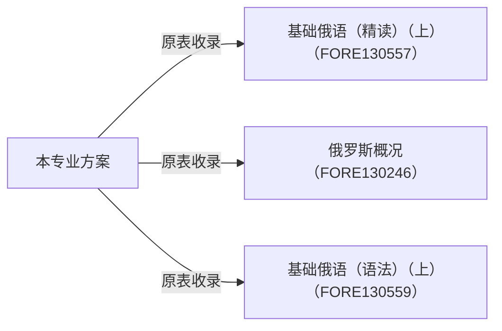

# 俄语专业“2+X”教学培养方案

2023 年度汇编，方案正文印刷页 223–225。本页附上原书 PDF 第 235–241 页，其中含本专业紧随正文的各版修读建议。逐行数据覆盖可可靠对应课号和名称的原表记录。[方案原页](original-pages.pdf) · [完整原版](https://jwc.fudan.edu.cn/_upload/article/files/83/6c/8a3c080c4f8991024f4b59ad4f1b/64d23c13-0465-4619-bd18-9e491594f850.pdf#page=235) · [逐行数据与来源](record.json)

## 课程导读

想了解俄语学习的课程安排，可以在原表中找到《基础俄语（精读）（上）》（`FORE130557`）、《俄罗斯概况》（`FORE130246`）、《基础俄语（语法）（上）》（`FORE130559`）。 [原书 PDF 第 235 页](original-pages.pdf#page=1) · [原书 PDF 第 236 页](original-pages.pdf#page=2)

原表把 `FORE130557` 列在第 1 学期，把 `FORE130246` 列在第 3 学期。图中箭头表示本节原表收录该课，图上各课之间没有先修连线。

| 课号 | 课程名称 | 开课学期原文 | PDF 页 |
|---|---|---|---|
| FORE130028 | 实习调查 | 6 | 236 |
| FORE130029 | 毕业论文 | 8 | 236 |
| FORE130097 | 高级俄语（下） | 6 | 236 |
| FORE130099 | 俄语视听说II（上） | 3 | 236 |
| FORE130107 | 翻译理论与技巧（俄语） | 6 | 236 |
| FORE130109 | 俄语报刊 | 5 | 236 |
| FORE130237 | 俄语词汇学 | 春秋 | 236 |
| FORE130238 | 俄语语法学 | 6 | 236 |
| FORE130239 | 外贸俄语 | 5 | 236 |
| FORE130240 | 俄罗斯诗歌 | 春秋 | 236 |
| FORE130243 | 俄语修辞学 | 春秋 | 237 |
| FORE130244 | 俄语影视 | 春秋 | 236 |
| FORE130246 | 俄罗斯概况 | 3 | 236 |
| FORE130311 | 俄语视听说Ⅰ | 2 | 236 |
| FORE130322 | 学术前沿专题 | 春秋 | 237 |
| FORE130402 | 俄语视听说II（下） | 4 | 236 |
| FORE130403 | 俄罗斯文学作品选读（上） | 6 | 236 |
| FORE130404 | 俄罗斯文学作品选读（下） | 7 | 236 |
| FORE130405 | 俄语会话（上） | 1 | 235 |
| FORE130406 | 俄语会话（下） | 2 | 235 |
| FORE130407 | 俄罗斯文化 | 4 | 236 |
| FORE130408 | 俄罗斯小说 | 春秋 | 237 |
| FORE130409 | 俄语语言学概论 | 春秋 | 237 |
| FORE130410 | 俄罗斯当代作家及作品 | 春秋 | 237 |
| FORE130411 | 俄罗斯戏剧 | 春秋 | 237 |
| FORE130412 | 俄语高级写作 | 7 | 236 |
| FORE130468 | 俄罗斯文学史 | 2 | 236 |
| FORE130544 | 俄语写作 | 春秋 | 236 |
| FORE130545 | 俄语言语礼节 | 春秋 | 236 |
| FORE130546 | 当代俄罗斯 | 春秋 | 236 |
| FORE130547 | 俄国历史 | 春秋 | 237 |
| FORE130550 | 高级俄语（上） | 5 | 236 |
| FORE130557 | 基础俄语（精读）（上） | 1 | 235 |
| FORE130558 | 基础俄语（精读）（下） | 2 | 235 |
| FORE130559 | 基础俄语（语法）（上） | 1 | 235 |
| FORE130560 | 基础俄语（语法）（下） | 2 | 235 |
| FORE130561 | 中级俄语（精读）（上） | 3 | 235 |
| FORE130562 | 中级俄语（精读）（下） | 4 | 235 |
| FORE130563 | 中级俄语（语法）（上） | 3 | 235 |
| FORE130564 | 中级俄语（语法）（下） | 4 | 235 |

可定位的课程对暂无明确先修记录，原课程表及备注见上方 PDF。
