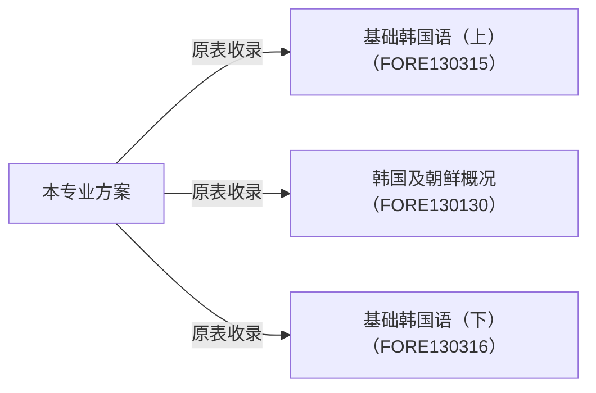

# 朝鲜语专业“2+X”教学培养方案

2023 年度汇编，方案正文印刷页 251–253。本页附上原书 PDF 第 263–269 页，其中含本专业紧随正文的各版修读建议。逐行数据覆盖可可靠对应课号和名称的原表记录。[方案原页](original-pages.pdf) · [完整原版](https://jwc.fudan.edu.cn/_upload/article/files/83/6c/8a3c080c4f8991024f4b59ad4f1b/64d23c13-0465-4619-bd18-9e491594f850.pdf#page=263) · [逐行数据与来源](record.json)

## 课程导读

想了解朝鲜语与韩国语的课程安排，可以在原表中找到《基础韩国语（上）》（`FORE130315`）、《韩国及朝鲜概况》（`FORE130130`）、《基础韩国语（下）》（`FORE130316`）。 [原书 PDF 第 263 页](original-pages.pdf#page=1) · [原书 PDF 第 264 页](original-pages.pdf#page=2)

原表把 `FORE130315` 列在第 1 学期，把 `FORE130130` 列在第 3 学期。图中箭头表示本节原表收录该课，图上各课之间没有先修连线。

| 课号 | 课程名称 | 开课学期原文 | PDF 页 |
|---|---|---|---|
| FORE130028 | 实习调查 | 6 | 264 |
| FORE130029 | 毕业论文 | 8 | 264 |
| FORE130112 | 中级韩国语（上） | 3 | 263 |
| FORE130113 | 中级韩国语（下） | 4 | 263 |
| FORE130115 | 高级韩国语（下） | 6 | 263 |
| FORE130116 | 韩国语视听说I（上） | 2 | 263 |
| FORE130117 | 韩国语视听说I（下） | 3 | 263 |
| FORE130118 | 韩国语视听说II（上） | 4 | 263 |
| FORE130119 | 韩国语视听说II（下） | 5 | 264 |
| FORE130125 | 翻译理论与技巧韩国语（上） | 5 | 263 |
| FORE130126 | 翻译理论与技巧韩国语（下） | 6 | 264 |
| FORE130129 | 韩语报刊选读 | 6 | 264 |
| FORE130130 | 韩国及朝鲜概况 | 3 | 264 |
| FORE130247 | 韩语词汇学 | 4 | 264 |
| FORE130248 | 韩语修辞学 | 春秋 | 264 |
| FORE130249 | 韩国文学史 | 春秋 | 264 |
| FORE130250 | 经济贸易韩国语 | 春秋 | 264 |
| FORE130251 | 韩国文学名著赏析 | 春秋 | 264 |
| FORE130253 | 科技韩国语 | 春秋 | 264 |
| FORE130254 | 口译 | 春秋 | 264 |
| FORE130255 | 韩语语法学 | 5 | 264 |
| FORE130315 | 基础韩国语（上） | 1 | 263 |
| FORE130316 | 基础韩国语（下） | 2 | 263 |
| FORE130446 | 韩国语写作 | 5 | 264 |
| FORE130447 | 高级韩国语（上） | 5 | 263 |
| FORE130448 | 韩国社会与文化 | 春秋 | 264 |
| FORE130449 | 韩国文学选读 | 5 | 264 |
| FORE130450 | 韩国语通论 | 春秋 | 264 |
| FORE130451 | 韩国影视 | 春秋 | 264 |

可定位的课程对暂无明确先修记录，原课程表及备注见上方 PDF。
