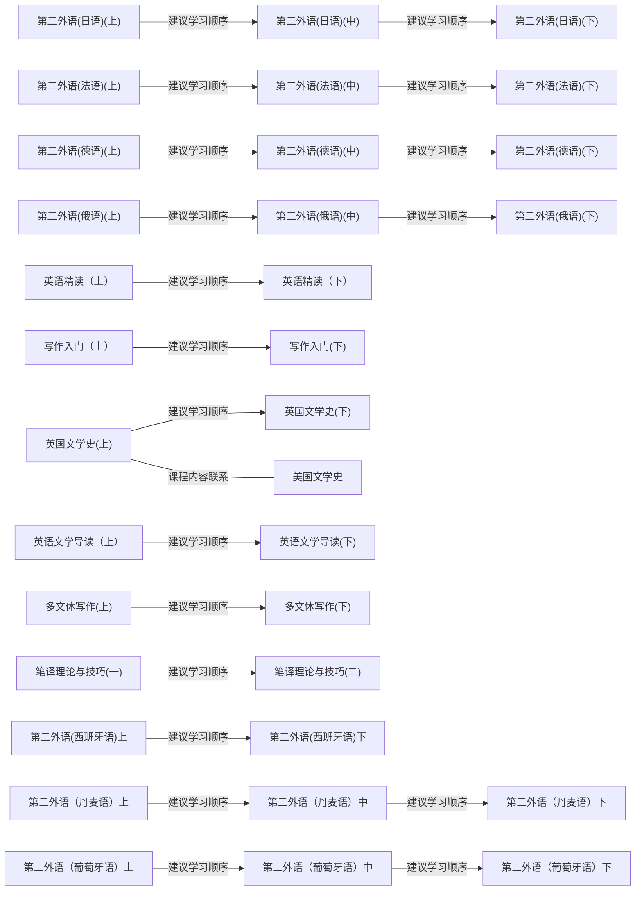

# 英语专业“2+X”教学培养方案

2024 年汇编印刷页 212–216。原表记录 105 个可配对的课程代码。

[本节原页](plan-212.pdf#page=1) · [逐行数据](plan-212.json) · [院系目录](README.md)

## 课程导读

想了解英语学习的课程安排，可以在原表中找到《英语演讲》（`FORE130345`）、《英语文学导读（上）》（`FORE130348`）、《英国文学史(上)》（`FORE130021`）。 [原书 PDF 第 226 页](plan-212.pdf#page=1)

《英国文学史(上)》（`FORE130021`）和《英国文学史(下)》（`FORE130022`）是同一系列，图中的箭头按题名标出的分册顺序排列。原表分别排在第 3 学期和第 4 学期。 [原书 PDF 第 226 页](plan-212.pdf#page=1) · [原书 PDF 第 227 页](plan-212.pdf#page=2)

## 课程关系图

图中展示最多 20 条关系。下表列出本节全部关系。建议学习顺序供规划课程使用，正式选课资格以教务规定为准。

| 课程 | 关联课程 | 关系 | 依据 |
| --- | --- | --- | --- |
| 英国文学史(上)（FORE130021） | 英国文学史(下)（FORE130022） | 建议学习顺序 | 同节课程题名标明连续分册或序号。 |
| 第二外语(日语)(上)（FORE130180） | 第二外语(日语)(中)（FORE130181） | 建议学习顺序 | 同节课程题名标明连续分册或序号。 |
| 第二外语(日语)(中)（FORE130181） | 第二外语(日语)(下)（FORE130182） | 建议学习顺序 | 同节课程题名标明连续分册或序号。 |
| 第二外语(法语)(上)（FORE130183） | 第二外语(法语)(中)（FORE130184） | 建议学习顺序 | 同节课程题名标明连续分册或序号。 |
| 第二外语(法语)(中)（FORE130184） | 第二外语(法语)(下)（FORE130185） | 建议学习顺序 | 同节课程题名标明连续分册或序号。 |
| 第二外语(德语)(上)（FORE130186） | 第二外语(德语)(中)（FORE130187） | 建议学习顺序 | 同节课程题名标明连续分册或序号。 |
| 第二外语(德语)(中)（FORE130187） | 第二外语(德语)(下)（FORE130188） | 建议学习顺序 | 同节课程题名标明连续分册或序号。 |
| 第二外语(俄语)(上)（FORE130189） | 第二外语(俄语)(中)（FORE130190） | 建议学习顺序 | 同节课程题名标明连续分册或序号。 |
| 第二外语(俄语)(中)（FORE130190） | 第二外语(俄语)(下)（FORE130191） | 建议学习顺序 | 同节课程题名标明连续分册或序号。 |
| 英语精读（上）（FORE130346） | 英语精读（下）（FORE130350） | 建议学习顺序 | 同节课程题名标明连续分册或序号。 |
| 写作入门（上）（FORE130347） | 写作入门(下)（FORE130351） | 建议学习顺序 | 同节课程题名标明连续分册或序号。 |
| 英语文学导读（上）（FORE130348） | 英语文学导读(下)（FORE130352） | 建议学习顺序 | 同节课程题名标明连续分册或序号。 |
| 多文体写作(上)（FORE130353） | 多文体写作(下)（FORE130355） | 建议学习顺序 | 同节课程题名标明连续分册或序号。 |
| 笔译理论与技巧(一)（FORE130359） | 笔译理论与技巧(二)（FORE130361） | 建议学习顺序 | 同节课程题名标明连续分册或序号。 |
| 第二外语(西班牙语)上（FORE130398） | 第二外语(西班牙语)下（FORE130399） | 建议学习顺序 | 同节课程题名标明连续分册或序号。 |
| 第二外语（丹麦语）上（FORE130511） | 第二外语（丹麦语）中（FORE130512） | 建议学习顺序 | 同节课程题名标明连续分册或序号。 |
| 第二外语（丹麦语）中（FORE130512） | 第二外语（丹麦语）下（FORE130513） | 建议学习顺序 | 同节课程题名标明连续分册或序号。 |
| 第二外语（葡萄牙语）上（FORE130514） | 第二外语（葡萄牙语）中（FORE130515） | 建议学习顺序 | 同节课程题名标明连续分册或序号。 |
| 第二外语（葡萄牙语）中（FORE130515） | 第二外语（葡萄牙语）下（FORE130516） | 建议学习顺序 | 同节课程题名标明连续分册或序号。 |
| 英国文学史(上)（FORE130021） | 美国文学史（FORE130023） | 课程内容联系 | 本方案两门课程的题名均含“文学史”，可据此对照这一主题。 |
| 英国文学史(下)（FORE130022） | 美国文学史（FORE130023） | 课程内容联系 | 本方案两门课程的题名均含“文学史”，可据此对照这一主题。 |
| 美国现代主义诗歌（FORE130197） | 英语诗歌赏析（FORE130518） | 课程内容联系 | 本方案两门课程的题名均含“诗歌”，可据此对照这一主题。 |
| 英美短篇小说（FORE130205） | 英美小说面面观（FORE130334） | 课程内容联系 | 本方案两门课程的题名均含“小说”，可据此对照这一主题。 |
| 英美短篇小说（FORE130205） | 英语小说的崛起（FORE130368） | 课程内容联系 | 本方案两门课程的题名均含“小说”，可据此对照这一主题。 |
| 商务口译（FORE130323） | 联合国会议口译专题（FORE130324） | 课程内容联系 | 本方案两门课程的题名均含“口译”，可据此对照这一主题。 |
| 商务口译（FORE130323） | 口译理论与实践（FORE130363） | 课程内容联系 | 本方案两门课程的题名均含“口译”，可据此对照这一主题。 |
| 写作入门（上）（FORE130347） | 学术写作（FORE130551） | 课程内容联系 | 本方案两门课程的题名均含“写作”，可据此对照这一主题。 |
| 英语文学导读（上）（FORE130348） | 英语文学导读(下)（FORE130352） | 课程内容联系 | 本方案两门课程的题名均含“英语文学”，可据此对照这一主题。 |
| 写作入门(下)（FORE130351） | 学术写作（FORE130551） | 课程内容联系 | 本方案两门课程的题名均含“写作”，可据此对照这一主题。 |
| 多文体写作(上)（FORE130353） | 学术写作（FORE130551） | 课程内容联系 | 本方案两门课程的题名均含“写作”，可据此对照这一主题。 |
| 笔译理论与技巧(一)（FORE130359） | 笔译理论与技巧(二)（FORE130361） | 课程内容联系 | 本方案两门课程的题名均含“笔译”，可据此对照这一主题。 |
| 论文写作（FORE130362） | 学术写作（FORE130551） | 课程内容联系 | 本方案两门课程的题名均含“写作”，可据此对照这一主题。 |
| 英语戏剧表演（FORE130364） | 英美戏剧（FORE130470） | 课程内容联系 | 本方案两门课程的题名均含“戏剧”，可据此对照这一主题。 |
| 文学经典翻译（FORE130382） | 文化与翻译（FORE130385） | 课程内容联系 | 本方案两门课程的题名均含“翻译”，可据此对照这一主题。 |
| 实用文本翻译（FORE130383） | 文化与翻译（FORE130385） | 课程内容联系 | 本方案两门课程的题名均含“翻译”，可据此对照这一主题。 |
| 英国文学史(上)（FORE130021） | 英国文学史(下)（FORE130022） | 方案排课先后 | 本节原表所列全部明确学期均早于后者。 |
| 第二外语(日语)(上)（FORE130180） | 第二外语(日语)(中)（FORE130181） | 方案排课先后 | 本节原表所列全部明确学期均早于后者。 |
| 第二外语(日语)(中)（FORE130181） | 第二外语(日语)(下)（FORE130182） | 方案排课先后 | 本节原表所列全部明确学期均早于后者。 |
| 第二外语(法语)(上)（FORE130183） | 第二外语(法语)(中)（FORE130184） | 方案排课先后 | 本节原表所列全部明确学期均早于后者。 |
| 第二外语(法语)(中)（FORE130184） | 第二外语(法语)(下)（FORE130185） | 方案排课先后 | 本节原表所列全部明确学期均早于后者。 |
| 第二外语(德语)(上)（FORE130186） | 第二外语(德语)(中)（FORE130187） | 方案排课先后 | 本节原表所列全部明确学期均早于后者。 |
| 第二外语(德语)(中)（FORE130187） | 第二外语(德语)(下)（FORE130188） | 方案排课先后 | 本节原表所列全部明确学期均早于后者。 |
| 第二外语(俄语)(上)（FORE130189） | 第二外语(俄语)(中)（FORE130190） | 方案排课先后 | 本节原表所列全部明确学期均早于后者。 |
| 第二外语(俄语)(中)（FORE130190） | 第二外语(俄语)(下)（FORE130191） | 方案排课先后 | 本节原表所列全部明确学期均早于后者。 |
| 英语精读（上）（FORE130346） | 英语精读（下）（FORE130350） | 方案排课先后 | 本节原表所列全部明确学期均早于后者。 |
| 写作入门（上）（FORE130347） | 写作入门(下)（FORE130351） | 方案排课先后 | 本节原表所列全部明确学期均早于后者。 |
| 英语文学导读（上）（FORE130348） | 英语文学导读(下)（FORE130352） | 方案排课先后 | 本节原表所列全部明确学期均早于后者。 |
| 多文体写作(上)（FORE130353） | 多文体写作(下)（FORE130355） | 方案排课先后 | 本节原表所列全部明确学期均早于后者。 |
| 笔译理论与技巧(一)（FORE130359） | 笔译理论与技巧(二)（FORE130361） | 方案排课先后 | 本节原表所列全部明确学期均早于后者。 |
| 第二外语(西班牙语)上（FORE130398） | 第二外语(西班牙语)下（FORE130399） | 方案排课先后 | 本节原表所列全部明确学期均早于后者。 |
| 第二外语（丹麦语）上（FORE130511） | 第二外语（丹麦语）中（FORE130512） | 方案排课先后 | 本节原表所列全部明确学期均早于后者。 |
| 第二外语（丹麦语）中（FORE130512） | 第二外语（丹麦语）下（FORE130513） | 方案排课先后 | 本节原表所列全部明确学期均早于后者。 |
| 第二外语（葡萄牙语）上（FORE130514） | 第二外语（葡萄牙语）中（FORE130515） | 方案排课先后 | 本节原表所列全部明确学期均早于后者。 |
| 第二外语（葡萄牙语）中（FORE130515） | 第二外语（葡萄牙语）下（FORE130516） | 方案排课先后 | 本节原表所列全部明确学期均早于后者。 |

## 课程

| 课程代码 | 名称 | 开课学期原文 | 来源（PDF 页） |
| --- | --- | --- | --- |
| AIS531002 | AI赋能的语言分析和语言习得 | 春，秋 | 229 |
| AIT531017 | 智能写作评估系统的设计与应用 | 春，秋 | 229 |
| FORE130021 | 英国文学史(上) | 3 | 226 |
| FORE130022 | 英国文学史(下) | 4 | 227 |
| FORE130023 | 美国文学史 | 4 | 227 |
| FORE130028 | 实习调查 | 6 | 227 |
| FORE130029 | 毕业论文 | 8 | 227 |
| FORE130180 | 第二外语(日语)(上) | 5 | 227 |
| FORE130181 | 第二外语(日语)(中) | 6 | 227 |
| FORE130182 | 第二外语(日语)(下) | 7 | 227 |
| FORE130183 | 第二外语(法语)(上) | 5 | 227 |
| FORE130184 | 第二外语(法语)(中) | 6 | 227 |
| FORE130185 | 第二外语(法语)(下) | 7 | 227 |
| FORE130186 | 第二外语(德语)(上) | 5 | 227 |
| FORE130187 | 第二外语(德语)(中) | 6 | 227 |
| FORE130188 | 第二外语(德语)(下) | 7 | 227 |
| FORE130189 | 第二外语(俄语)(上) | 5 | 227 |
| FORE130190 | 第二外语(俄语)(中) | 6 | 227 |
| FORE130191 | 第二外语(俄语)(下) | 7 | 227 |
| FORE130192 | 英美文学专题 | 5 | 228 |
| FORE130194 | 英语文体学 | 春，秋 | 229 |
| FORE130197 | 美国现代主义诗歌 | 6 | 228 |
| FORE130198 | 比较文学 | 6 | 228 |
| FORE130201 | 英美电影文学 | 7 | 228 |
| FORE130203 | 莎士比亚选读 | 6 | 228 |
| FORE130204 | 《圣经》与英国文学 | 6 | 228 |
| FORE130205 | 英美短篇小说 | 4 | 228 |
| FORE130207 | 中国文化思想 | 4 | 229 |
| FORE130208 | 英语词汇学 | 春，秋 | 229 |
| FORE130272 | 文学研究方法论 | 5 | 227 |
| FORE130323 | 商务口译 | 春，秋 | 229 |
| FORE130324 | 联合国会议口译专题 | 春，秋 | 229 |
| FORE130334 | 英美小说面面观 | 3 | 228 |
| FORE130335 | 英语词典学导论 | 3 | 229 |
| FORE130336 | 应用语言学导论 | 4 | 227 |
| FORE130337 | 英美经典文论选读 | 春，秋 | 228 |
| FORE130345 | 英语演讲 | 1 | 226 |
| FORE130346 | 英语精读（上） | 1 | 226 |
| FORE130347 | 写作入门（上） | 1 | 226 |
| FORE130348 | 英语文学导读（上） | 1 | 226 |
| FORE130349 | 英语辩论 | 春，秋 | 229 |
| FORE130350 | 英语精读（下） | 2 | 226 |
| FORE130351 | 写作入门(下) | 2 | 226 |
| FORE130352 | 英语文学导读(下) | 2 | 226 |
| FORE130353 | 多文体写作(上) | 3 | 226 |
| FORE130355 | 多文体写作(下) | 4 | 227 |
| FORE130358 | 跨文化交际 | 4 | 227 |
| FORE130359 | 笔译理论与技巧(一) | 5 | 227 |
| FORE130361 | 笔译理论与技巧(二) | 6 | 227 |
| FORE130362 | 论文写作 | 7 | 227 |
| FORE130363 | 口译理论与实践 | 7 | 227 |
| FORE130364 | 英语戏剧表演 | 春，秋 | 228 |
| FORE130365 | 英美散文 | 6 | 228 |
| FORE130368 | 英语小说的崛起 | 春，秋 | 228 |
| FORE130369 | 维多利亚时期的文学 | 春，秋 | 228 |
| FORE130370 | 女性主义文学 | 春，秋 | 228 |
| FORE130372 | 英美现代主义文学经典 | 春，秋 | 228 |
| FORE130373 | 英语语音学 | 3 | 229 |
| FORE130374 | 英语语言史 | 春，秋 | 226 |
| FORE130375 | 语言与逻辑 | 4 | 229 |
| FORE130376 | 语言与意义：语义学基础 | 春，秋 | 229 |
| FORE130377 | 语言与教育 | 5 | 227 |
| FORE130378 | 英语句法学导论 | 6 | 229 |
| FORE130379 | 语言与社会 | 4 | 229 |
| FORE130380 | 语言心理学 | 7 | 229 |
| FORE130381 | 语言学学术前沿专题 | 7 | 229 |
| FORE130382 | 文学经典翻译 | 春，秋 | 229 |
| FORE130383 | 实用文本翻译 | 春，秋 | 229 |
| FORE130384 | 媒体英语 | 春，秋 | 229 |
| FORE130385 | 文化与翻译 | 春，秋 | 229 |
| FORE130386 | 流行文化的批判性阅读 | 3 | 229 |
| FORE130387 | 英美电影与文化 | 4 | 229 |
| FORE130388 | 英语文化专题 | 4 | 229 |
| FORE130389 | 人文传统：史前至文艺复兴 | 5 | 229 |
| FORE130390 | 人文传统：科学革命至现代 | 6 | 229 |
| FORE130391 | 西方文明专题 | 春，秋 | 229 |
| FORE130392 | 比较文化研究 | 春，秋 | 229 |
| FORE130393 | 全球化与中国文化 | 春，秋 | 229 |
| FORE130394 | 美国族裔文化 | 春，秋 | 230 |
| FORE130395 | 英国社会与文化 | 春，秋 | 230 |
| FORE130396 | 现代文化危机 | 春，秋 | 230 |
| FORE130397 | 跨语言语法比较 | 4 | 229 |
| FORE130398 | 第二外语(西班牙语)上 | 3 | 227 |
| FORE130399 | 第二外语(西班牙语)下 | 4 | 227 |
| FORE130470 | 英美戏剧 | 春，秋 | 228 |
| FORE130471 | 英国中世纪文学导读 | 春，秋 | 228 |
| FORE130474 | 美国文学中的自然与环境 | 春，秋 | 228 |
| FORE130511 | 第二外语（丹麦语）上 | 5 | 227 |
| FORE130512 | 第二外语（丹麦语）中 | 6 | 227 |
| FORE130513 | 第二外语（丹麦语）下 | 7 | 227 |
| FORE130514 | 第二外语（葡萄牙语）上 | 5 | 228 |
| FORE130515 | 第二外语（葡萄牙语）中 | 6 | 228 |
| FORE130516 | 第二外语（葡萄牙语）下 | 7 | 228 |
| FORE130517 | 17世纪英国文学 | 春，秋 | 228 |
| FORE130518 | 英语诗歌赏析 | 春，秋 | 228 |
| FORE130519 | 语言学概论 | 春，秋 | 226 |
| FORE130527 | 18世纪美国文学 | 春，秋 | 228 |
| FORE130528 | 18世纪英国文学 | 春，秋 | 228 |
| FORE130529 | 19世纪美国文学 | 春，秋 | 228 |
| FORE130530 | 话语分析 | 6 | 229 |
| FORE130531 | 英语语用学 | 7 | 229 |
| FORE130551 | 学术写作 | 6 | 227 |
| FORE130576 | 英国儿童文学 | 春，秋 | 229 |
| FORE130585 | 英国性、传统与艺术 | 6 | 230 |
| FORE130586 | 英美科幻文学导论 | 春，秋 | 229 |
