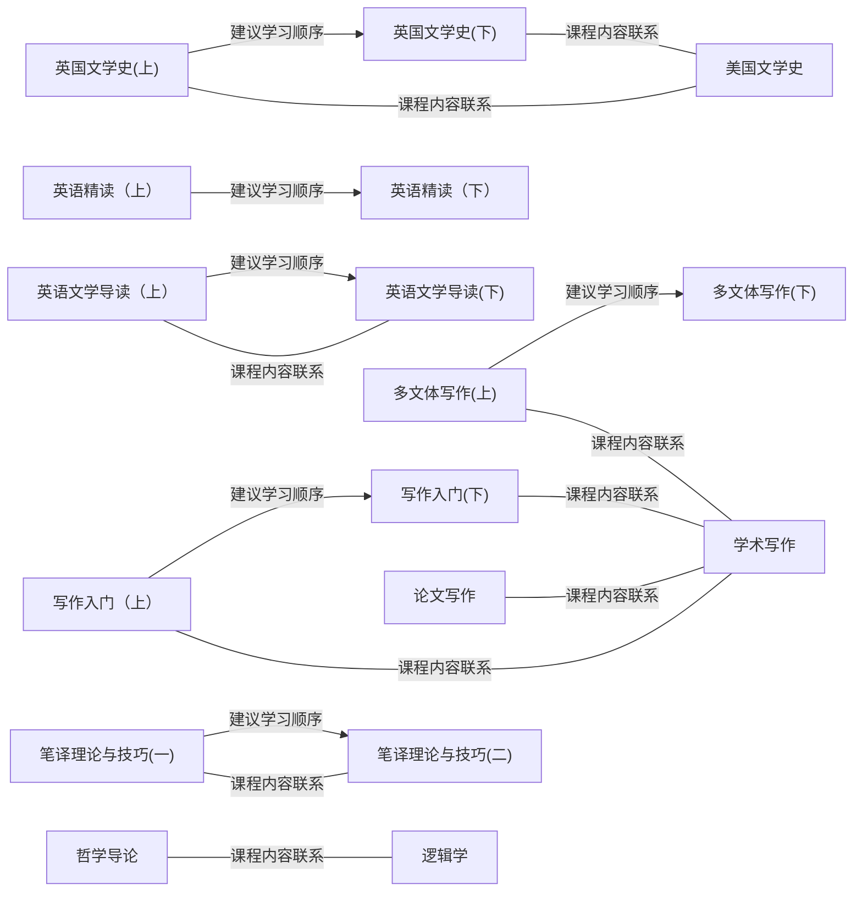

# 英语专业“2+X”修读建议

2024 年汇编印刷页 217–218。原表记录 34 个可配对的课程代码。

[本节原页](plan-212.pdf#page=6) · [逐行数据](plan-212.json) · [院系目录](README.md)

## 课程关系图

图中展示最多 20 条关系。下表列出本节全部关系。建议学习顺序供规划课程使用，正式选课资格以教务规定为准。

| 课程 | 关联课程 | 关系 | 依据 |
| --- | --- | --- | --- |
| 英国文学史(上)（FORE130021） | 英国文学史(下)（FORE130022） | 建议学习顺序 | 同节课程题名标明连续分册或序号。 |
| 英语精读（上）（FORE130346） | 英语精读（下）（FORE130350） | 建议学习顺序 | 同节课程题名标明连续分册或序号。 |
| 写作入门（上）（FORE130347） | 写作入门(下)（FORE130351） | 建议学习顺序 | 同节课程题名标明连续分册或序号。 |
| 英语文学导读（上）（FORE130348） | 英语文学导读(下)（FORE130352） | 建议学习顺序 | 同节课程题名标明连续分册或序号。 |
| 多文体写作(上)（FORE130353） | 多文体写作(下)（FORE130355） | 建议学习顺序 | 同节课程题名标明连续分册或序号。 |
| 笔译理论与技巧(一)（FORE130359） | 笔译理论与技巧(二)（FORE130361） | 建议学习顺序 | 同节课程题名标明连续分册或序号。 |
| 英国文学史(上)（FORE130021） | 美国文学史（FORE130023） | 课程内容联系 | 本方案两门课程的题名均含“文学史”，可据此对照这一主题。 |
| 英国文学史(下)（FORE130022） | 美国文学史（FORE130023） | 课程内容联系 | 本方案两门课程的题名均含“文学史”，可据此对照这一主题。 |
| 写作入门（上）（FORE130347） | 学术写作（FORE130551） | 课程内容联系 | 本方案两门课程的题名均含“写作”，可据此对照这一主题。 |
| 英语文学导读（上）（FORE130348） | 英语文学导读(下)（FORE130352） | 课程内容联系 | 本方案两门课程的题名均含“英语文学”，可据此对照这一主题。 |
| 写作入门(下)（FORE130351） | 学术写作（FORE130551） | 课程内容联系 | 本方案两门课程的题名均含“写作”，可据此对照这一主题。 |
| 多文体写作(上)（FORE130353） | 学术写作（FORE130551） | 课程内容联系 | 本方案两门课程的题名均含“写作”，可据此对照这一主题。 |
| 笔译理论与技巧(一)（FORE130359） | 笔译理论与技巧(二)（FORE130361） | 课程内容联系 | 本方案两门课程的题名均含“笔译”，可据此对照这一主题。 |
| 论文写作（FORE130362） | 学术写作（FORE130551） | 课程内容联系 | 本方案两门课程的题名均含“写作”，可据此对照这一主题。 |
| 哲学导论（PHIL120012） | 逻辑学（PHIL120013） | 课程内容联系 | 论证与概念分析是哲学讨论的共同方法。 |

## 课程

| 课程代码 | 名称 | 开课学期原文 | 来源（PDF 页） |
| --- | --- | --- | --- |
| CHIN120012 | 中国文学经典 |  | 231 |
| FORE130021 | 英国文学史(上) |  | 231 |
| FORE130022 | 英国文学史(下) |  | 231 |
| FORE130023 | 美国文学史 |  | 231 |
| FORE130028 | 实习调查 |  | 232 |
| FORE130029 | 毕业论文 |  | 232 |
| FORE130272 | 文学研究方法论 |  | 232 |
| FORE130336 | 应用语言学导论 |  | 231 |
| FORE130345 | 英语演讲 |  | 231 |
| FORE130346 | 英语精读（上） |  | 231 |
| FORE130347 | 写作入门（上） |  | 231 |
| FORE130348 | 英语文学导读（上） |  | 231 |
| FORE130350 | 英语精读（下） |  | 231 |
| FORE130351 | 写作入门(下) |  | 231 |
| FORE130352 | 英语文学导读(下) |  | 231 |
| FORE130353 | 多文体写作(上) |  | 231 |
| FORE130355 | 多文体写作(下) |  | 231 |
| FORE130358 | 跨文化交际 |  | 232 |
| FORE130359 | 笔译理论与技巧(一) |  | 232 |
| FORE130361 | 笔译理论与技巧(二) |  | 232 |
| FORE130362 | 论文写作 |  | 232 |
| FORE130363 | 口译理论与实践 |  | 232 |
| FORE130374 | 英语语言史 |  | 231 |
| FORE130377 | 语言与教育 |  | 231 |
| FORE130519 | 语言学概论 |  | 231 |
| FORE130551 | 学术写作 |  | 232 |
| HIST120012 | 中国古代文明 |  | 231 |
| PHIL120012 | 哲学导论 |  | 231 |
| PHIL120013 | 逻辑学 |  | 231 |
| PTSS110082 | 毛泽东思想和中国特色社会主义理论体系概论 |  | 231 |
| PTSS110087 | 马克思主义基本原理 |  | 231 |
| PTSS110088 | 中国近现代史纲要 |  | 231 |
| PTSS110089 | 思想道德与法治 |  | 231 |
| PTSS110090 | 习近平新时代中国特色社会主义思想概论 |  | 231 |
