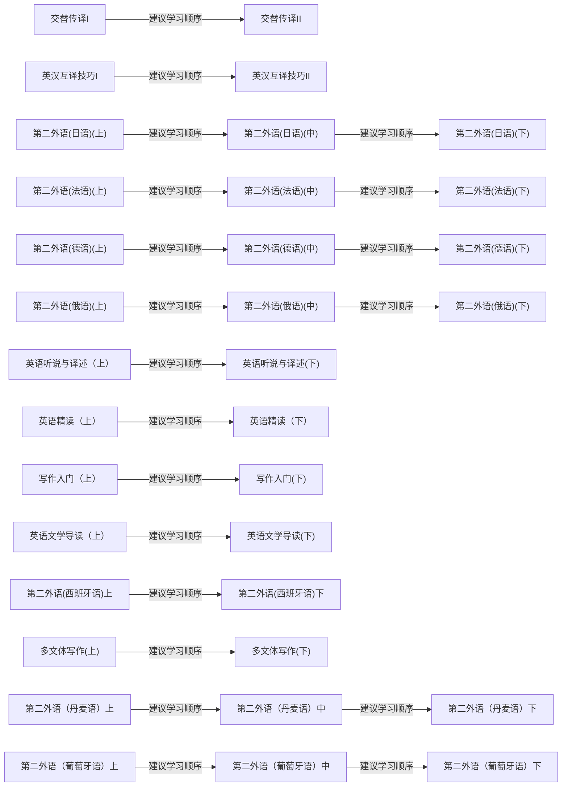

# 翻译专业“2+X”教学培养方案

2024 年汇编印刷页 221–224。原表记录 68 个可配对的课程代码。

[本节原页](plan-221.pdf#page=1) · [逐行数据](plan-221.json) · [院系目录](README.md)

## 课程导读

想了解翻译训练的课程安排，可以在原表中找到《翻译与思辨》（`FORE130133`）、《笔译实务》（`FORE130461`）、《商务口译》（`FORE130323`）。 [原书 PDF 第 236 页](plan-221.pdf#page=2) · [原书 PDF 第 237 页](plan-221.pdf#page=3)

《交替传译I》（`FORE130141`）和《交替传译II》（`FORE130142`）是同一系列，图中的箭头按题名标出的分册顺序排列。原表分别排在第 5 学期和第 6 学期。 [原书 PDF 第 236 页](plan-221.pdf#page=2)

## 课程关系图

图中展示最多 20 条关系。下表列出本节全部关系。建议学习顺序供规划课程使用，正式选课资格以教务规定为准。

| 课程 | 关联课程 | 关系 | 依据 |
| --- | --- | --- | --- |
| 交替传译I（FORE130141） | 交替传译II（FORE130142） | 建议学习顺序 | 同节课程题名标明连续分册或序号。 |
| 英汉互译技巧I（FORE130144） | 英汉互译技巧II（FORE130145） | 建议学习顺序 | 同节课程题名标明连续分册或序号。 |
| 第二外语(日语)(上)（FORE130180） | 第二外语(日语)(中)（FORE130181） | 建议学习顺序 | 同节课程题名标明连续分册或序号。 |
| 第二外语(日语)(中)（FORE130181） | 第二外语(日语)(下)（FORE130182） | 建议学习顺序 | 同节课程题名标明连续分册或序号。 |
| 第二外语(法语)(上)（FORE130183） | 第二外语(法语)(中)（FORE130184） | 建议学习顺序 | 同节课程题名标明连续分册或序号。 |
| 第二外语(法语)(中)（FORE130184） | 第二外语(法语)(下)（FORE130185） | 建议学习顺序 | 同节课程题名标明连续分册或序号。 |
| 第二外语(德语)(上)（FORE130186） | 第二外语(德语)(中)（FORE130187） | 建议学习顺序 | 同节课程题名标明连续分册或序号。 |
| 第二外语(德语)(中)（FORE130187） | 第二外语(德语)(下)（FORE130188） | 建议学习顺序 | 同节课程题名标明连续分册或序号。 |
| 第二外语(俄语)(上)（FORE130189） | 第二外语(俄语)(中)（FORE130190） | 建议学习顺序 | 同节课程题名标明连续分册或序号。 |
| 第二外语(俄语)(中)（FORE130190） | 第二外语(俄语)(下)（FORE130191） | 建议学习顺序 | 同节课程题名标明连续分册或序号。 |
| 英语听说与译述（上）（FORE130286） | 英语听说与译述(下)（FORE130138） | 建议学习顺序 | 同节课程题名标明连续分册或序号。 |
| 英语精读（上）（FORE130346） | 英语精读（下）（FORE130350） | 建议学习顺序 | 同节课程题名标明连续分册或序号。 |
| 写作入门（上）（FORE130347） | 写作入门(下)（FORE130351） | 建议学习顺序 | 同节课程题名标明连续分册或序号。 |
| 英语文学导读（上）（FORE130348） | 英语文学导读(下)（FORE130352） | 建议学习顺序 | 同节课程题名标明连续分册或序号。 |
| 第二外语(西班牙语)上（FORE130398） | 第二外语(西班牙语)下（FORE130399） | 建议学习顺序 | 同节课程题名标明连续分册或序号。 |
| 多文体写作(上)（FORE130454） | 多文体写作(下)（FORE130456） | 建议学习顺序 | 同节课程题名标明连续分册或序号。 |
| 第二外语（丹麦语）上（FORE130511） | 第二外语（丹麦语）中（FORE130512） | 建议学习顺序 | 同节课程题名标明连续分册或序号。 |
| 第二外语（丹麦语）中（FORE130512） | 第二外语（丹麦语）下（FORE130513） | 建议学习顺序 | 同节课程题名标明连续分册或序号。 |
| 第二外语（葡萄牙语）上（FORE130514） | 第二外语（葡萄牙语）中（FORE130515） | 建议学习顺序 | 同节课程题名标明连续分册或序号。 |
| 第二外语（葡萄牙语）中（FORE130515） | 第二外语（葡萄牙语）下（FORE130516） | 建议学习顺序 | 同节课程题名标明连续分册或序号。 |
| 翻译与思辨（FORE130133） | 科技翻译（FORE130260） | 课程内容联系 | 本方案两门课程的题名均含“翻译”，可据此对照这一主题。 |
| 翻译专题（FORE130258） | 科技翻译（FORE130260） | 课程内容联系 | 本方案两门课程的题名均含“翻译”，可据此对照这一主题。 |
| 科技翻译（FORE130260） | 实用文体翻译（FORE130464） | 课程内容联系 | 本方案两门课程的题名均含“翻译”，可据此对照这一主题。 |
| 科技翻译（FORE130260） | 本地化翻译（FORE130534） | 课程内容联系 | 本方案两门课程的题名均含“翻译”，可据此对照这一主题。 |
| 商务口译（FORE130323） | 联合国会议口译专题（FORE130324） | 课程内容联系 | 本方案两门课程的题名均含“口译”，可据此对照这一主题。 |
| 商务口译（FORE130323） | 口译工作坊（FORE130343） | 课程内容联系 | 本方案两门课程的题名均含“口译”，可据此对照这一主题。 |
| 商务口译（FORE130323） | 口译职业与伦理（FORE130535） | 课程内容联系 | 本方案两门课程的题名均含“口译”，可据此对照这一主题。 |
| 写作入门（上）（FORE130347） | 英语学术写作（FORE130458） | 课程内容联系 | 本方案两门课程的题名均含“写作”，可据此对照这一主题。 |
| 英语文学导读（上）（FORE130348） | 英语文学导读(下)（FORE130352） | 课程内容联系 | 本方案两门课程的题名均含“英语文学”，可据此对照这一主题。 |
| 写作入门(下)（FORE130351） | 英语学术写作（FORE130458） | 课程内容联系 | 本方案两门课程的题名均含“写作”，可据此对照这一主题。 |
| 多文体写作(上)（FORE130454） | 英语学术写作（FORE130458） | 课程内容联系 | 本方案两门课程的题名均含“写作”，可据此对照这一主题。 |
| 多文体写作(下)（FORE130456） | 英语学术写作（FORE130458） | 课程内容联系 | 本方案两门课程的题名均含“写作”，可据此对照这一主题。 |
| 交替传译I（FORE130141） | 交替传译II（FORE130142） | 方案排课先后 | 本节原表所列全部明确学期均早于后者。 |
| 英汉互译技巧I（FORE130144） | 英汉互译技巧II（FORE130145） | 方案排课先后 | 本节原表所列全部明确学期均早于后者。 |
| 第二外语(日语)(上)（FORE130180） | 第二外语(日语)(中)（FORE130181） | 方案排课先后 | 本节原表所列全部明确学期均早于后者。 |
| 第二外语(日语)(中)（FORE130181） | 第二外语(日语)(下)（FORE130182） | 方案排课先后 | 本节原表所列全部明确学期均早于后者。 |
| 第二外语(法语)(上)（FORE130183） | 第二外语(法语)(中)（FORE130184） | 方案排课先后 | 本节原表所列全部明确学期均早于后者。 |
| 第二外语(法语)(中)（FORE130184） | 第二外语(法语)(下)（FORE130185） | 方案排课先后 | 本节原表所列全部明确学期均早于后者。 |
| 第二外语(德语)(上)（FORE130186） | 第二外语(德语)(中)（FORE130187） | 方案排课先后 | 本节原表所列全部明确学期均早于后者。 |
| 第二外语(德语)(中)（FORE130187） | 第二外语(德语)(下)（FORE130188） | 方案排课先后 | 本节原表所列全部明确学期均早于后者。 |
| 第二外语(俄语)(上)（FORE130189） | 第二外语(俄语)(中)（FORE130190） | 方案排课先后 | 本节原表所列全部明确学期均早于后者。 |
| 第二外语(俄语)(中)（FORE130190） | 第二外语(俄语)(下)（FORE130191） | 方案排课先后 | 本节原表所列全部明确学期均早于后者。 |
| 英语听说与译述（上）（FORE130286） | 英语听说与译述(下)（FORE130138） | 方案排课先后 | 本节原表所列全部明确学期均早于后者。 |
| 英语精读（上）（FORE130346） | 英语精读（下）（FORE130350） | 方案排课先后 | 本节原表所列全部明确学期均早于后者。 |
| 写作入门（上）（FORE130347） | 写作入门(下)（FORE130351） | 方案排课先后 | 本节原表所列全部明确学期均早于后者。 |
| 英语文学导读（上）（FORE130348） | 英语文学导读(下)（FORE130352） | 方案排课先后 | 本节原表所列全部明确学期均早于后者。 |
| 第二外语(西班牙语)上（FORE130398） | 第二外语(西班牙语)下（FORE130399） | 方案排课先后 | 本节原表所列全部明确学期均早于后者。 |
| 多文体写作(上)（FORE130454） | 多文体写作(下)（FORE130456） | 方案排课先后 | 本节原表所列全部明确学期均早于后者。 |
| 第二外语（丹麦语）上（FORE130511） | 第二外语（丹麦语）中（FORE130512） | 方案排课先后 | 本节原表所列全部明确学期均早于后者。 |
| 第二外语（丹麦语）中（FORE130512） | 第二外语（丹麦语）下（FORE130513） | 方案排课先后 | 本节原表所列全部明确学期均早于后者。 |
| 第二外语（葡萄牙语）上（FORE130514） | 第二外语（葡萄牙语）中（FORE130515） | 方案排课先后 | 本节原表所列全部明确学期均早于后者。 |
| 第二外语（葡萄牙语）中（FORE130515） | 第二外语（葡萄牙语）下（FORE130516） | 方案排课先后 | 本节原表所列全部明确学期均早于后者。 |

## 课程

| 课程代码 | 名称 | 开课学期原文 | 来源（PDF 页） |
| --- | --- | --- | --- |
| FORE130028 | 实习调查 | 6 | 236 |
| FORE130029 | 毕业论文 | 8 | 236 |
| FORE130133 | 翻译与思辨 | 6 | 236 |
| FORE130138 | 英语听说与译述(下) | 4 | 236 |
| FORE130141 | 交替传译I | 5 | 236 |
| FORE130142 | 交替传译II | 6 | 236 |
| FORE130144 | 英汉互译技巧I | 4 | 236 |
| FORE130145 | 英汉互译技巧II | 5 | 236 |
| FORE130151 | 翻译理论与策略 | 7 | 236 |
| FORE130180 | 第二外语(日语)(上) | 5 | 236 |
| FORE130181 | 第二外语(日语)(中) | 6 | 236 |
| FORE130182 | 第二外语(日语)(下) | 7 | 236 |
| FORE130183 | 第二外语(法语)(上) | 5 | 236 |
| FORE130184 | 第二外语(法语)(中) | 6 | 236 |
| FORE130185 | 第二外语(法语)(下) | 7 | 236 |
| FORE130186 | 第二外语(德语)(上) | 5 | 236 |
| FORE130187 | 第二外语(德语)(中) | 6 | 236 |
| FORE130188 | 第二外语(德语)(下) | 7 | 236 |
| FORE130189 | 第二外语(俄语)(上) | 5 | 236 |
| FORE130190 | 第二外语(俄语)(中) | 6 | 236 |
| FORE130191 | 第二外语(俄语)(下) | 7 | 236 |
| FORE130201 | 英美电影文学 | 5 | 237 |
| FORE130203 | 莎士比亚选读 | 7 | 237 |
| FORE130208 | 英语词汇学 | 7 | 237 |
| FORE130256 | 译作比较与评判 | 春，秋 | 237 |
| FORE130258 | 翻译专题 | 8 | 237 |
| FORE130259 | 英汉语对比 | 5 | 237 |
| FORE130260 | 科技翻译 | 5 | 237 |
| FORE130274 | 典籍英译 | 7 | 237 |
| FORE130286 | 英语听说与译述（上） | 3 | 236 |
| FORE130323 | 商务口译 | 春，秋 | 237 |
| FORE130324 | 联合国会议口译专题 | 8 | 237 |
| FORE130341 | 听说沙龙 | 5 | 237 |
| FORE130343 | 口译工作坊 | 6 | 237 |
| FORE130345 | 英语演讲 | 1 | 235 |
| FORE130346 | 英语精读（上） | 1 | 235 |
| FORE130347 | 写作入门（上） | 1 | 235 |
| FORE130348 | 英语文学导读（上） | 1 | 235 |
| FORE130349 | 英语辩论 | 2 | 237 |
| FORE130350 | 英语精读（下） | 2 | 235 |
| FORE130351 | 写作入门(下) | 2 | 235 |
| FORE130352 | 英语文学导读(下) | 2 | 235 |
| FORE130358 | 跨文化交际 | 7 | 237 |
| FORE130384 | 媒体英语 | 春，秋 | 237 |
| FORE130398 | 第二外语(西班牙语)上 | 3 | 236 |
| FORE130399 | 第二外语(西班牙语)下 | 4 | 236 |
| FORE130452 | 英语读译 | 3 | 235 |
| FORE130453 | 古汉语选读 | 3 | 236 |
| FORE130454 | 多文体写作(上) | 3 | 235 |
| FORE130456 | 多文体写作(下) | 4 | 236 |
| FORE130457 | 中西文化比较 | 5 | 237 |
| FORE130458 | 英语学术写作 | 7 | 236 |
| FORE130460 | 视译基础 | 5 | 237 |
| FORE130461 | 笔译实务 | 6 | 236 |
| FORE130462 | 同声传译基础 | 7 | 236 |
| FORE130464 | 实用文体翻译 | 6 | 237 |
| FORE130511 | 第二外语（丹麦语）上 | 5 | 236 |
| FORE130512 | 第二外语（丹麦语）中 | 6 | 236 |
| FORE130513 | 第二外语（丹麦语）下 | 7 | 236 |
| FORE130514 | 第二外语（葡萄牙语）上 | 5 | 237 |
| FORE130515 | 第二外语（葡萄牙语）中 | 6 | 237 |
| FORE130516 | 第二外语（葡萄牙语）下 | 7 | 237 |
| FORE130532 | 多文体阅读 | 4 | 236 |
| FORE130533 | 翻译技术基础 | 6 | 237 |
| FORE130534 | 本地化翻译 | 7 | 237 |
| FORE130535 | 口译职业与伦理 | 8 | 237 |
| FORE130554 | 英美影视剧字幕翻译 | 春，秋 | 237 |
| FORE130592 | 《红楼梦》译本研读 | 春，秋 | 237 |
