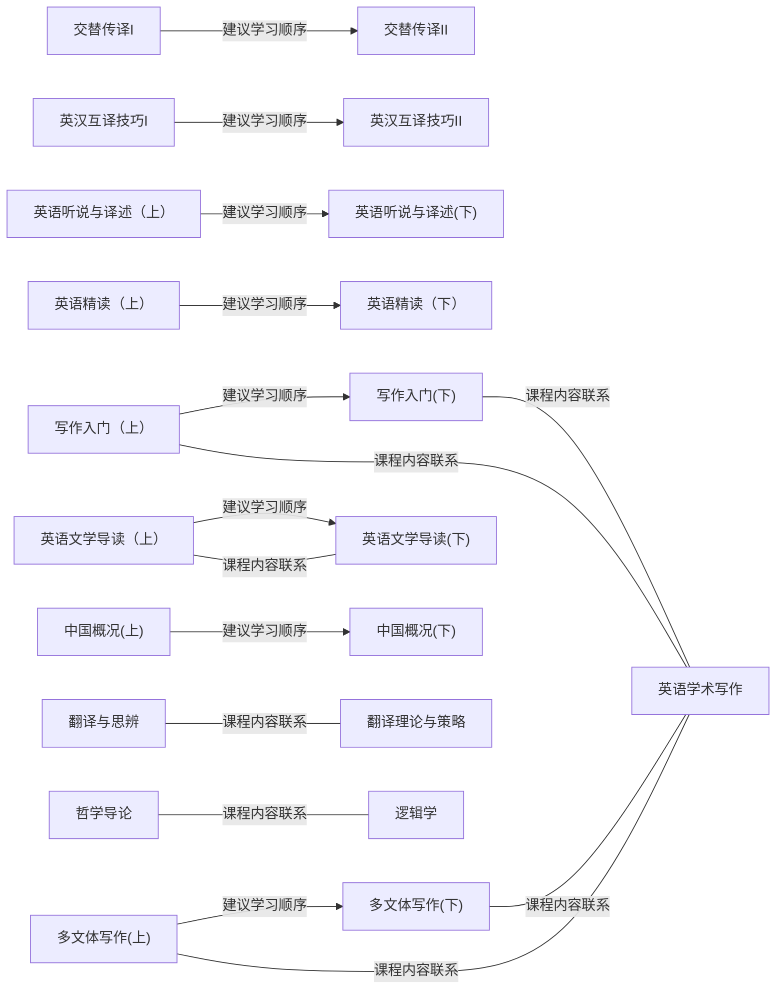

# 翻译专业“2+X”修读建议（留学生适用）

2024 年汇编印刷页 227–228。原表记录 31 个可配对的课程代码。

[本节原页](plan-221.pdf#page=7) · [逐行数据](plan-221.json) · [院系目录](README.md)

## 课程关系图

图中展示最多 20 条关系。下表列出本节全部关系。建议学习顺序供规划课程使用，正式选课资格以教务规定为准。

| 课程 | 关联课程 | 关系 | 依据 |
| --- | --- | --- | --- |
| 交替传译I（FORE130141） | 交替传译II（FORE130142） | 建议学习顺序 | 同节课程题名标明连续分册或序号。 |
| 英汉互译技巧I（FORE130144） | 英汉互译技巧II（FORE130145） | 建议学习顺序 | 同节课程题名标明连续分册或序号。 |
| 英语听说与译述（上）（FORE130286） | 英语听说与译述(下)（FORE130138） | 建议学习顺序 | 同节课程题名标明连续分册或序号。 |
| 英语精读（上）（FORE130346） | 英语精读（下）（FORE130350） | 建议学习顺序 | 同节课程题名标明连续分册或序号。 |
| 写作入门（上）（FORE130347） | 写作入门(下)（FORE130351） | 建议学习顺序 | 同节课程题名标明连续分册或序号。 |
| 英语文学导读（上）（FORE130348） | 英语文学导读(下)（FORE130352） | 建议学习顺序 | 同节课程题名标明连续分册或序号。 |
| 多文体写作(上)（FORE130454） | 多文体写作(下)（FORE130456） | 建议学习顺序 | 同节课程题名标明连续分册或序号。 |
| 中国概况(上)（ICES110012） | 中国概况(下)（ICES110013） | 建议学习顺序 | 同节课程题名标明连续分册或序号。 |
| 翻译与思辨（FORE130133） | 翻译理论与策略（FORE130151） | 课程内容联系 | 本方案两门课程的题名均含“翻译”，可据此对照这一主题。 |
| 写作入门（上）（FORE130347） | 英语学术写作（FORE130458） | 课程内容联系 | 本方案两门课程的题名均含“写作”，可据此对照这一主题。 |
| 英语文学导读（上）（FORE130348） | 英语文学导读(下)（FORE130352） | 课程内容联系 | 本方案两门课程的题名均含“英语文学”，可据此对照这一主题。 |
| 写作入门(下)（FORE130351） | 英语学术写作（FORE130458） | 课程内容联系 | 本方案两门课程的题名均含“写作”，可据此对照这一主题。 |
| 多文体写作(上)（FORE130454） | 英语学术写作（FORE130458） | 课程内容联系 | 本方案两门课程的题名均含“写作”，可据此对照这一主题。 |
| 多文体写作(下)（FORE130456） | 英语学术写作（FORE130458） | 课程内容联系 | 本方案两门课程的题名均含“写作”，可据此对照这一主题。 |
| 哲学导论（PHIL120012） | 逻辑学（PHIL120013） | 课程内容联系 | 论证与概念分析是哲学讨论的共同方法。 |

## 课程

| 课程代码 | 名称 | 开课学期原文 | 来源（PDF 页） |
| --- | --- | --- | --- |
| CHIN120012 | 中国文学经典 |  | 241 |
| FORE130028 | 实习调查 |  | 241 |
| FORE130029 | 毕业论文 |  | 241 |
| FORE130133 | 翻译与思辨 |  | 241 |
| FORE130138 | 英语听说与译述(下) |  | 241 |
| FORE130141 | 交替传译I |  | 241 |
| FORE130142 | 交替传译II |  | 241 |
| FORE130144 | 英汉互译技巧I |  | 241 |
| FORE130145 | 英汉互译技巧II |  | 241 |
| FORE130151 | 翻译理论与策略 |  | 241 |
| FORE130286 | 英语听说与译述（上） |  | 241 |
| FORE130345 | 英语演讲 |  | 241 |
| FORE130346 | 英语精读（上） |  | 241 |
| FORE130347 | 写作入门（上） |  | 241 |
| FORE130348 | 英语文学导读（上） |  | 241 |
| FORE130350 | 英语精读（下） |  | 241 |
| FORE130351 | 写作入门(下) |  | 241 |
| FORE130352 | 英语文学导读(下) |  | 241 |
| FORE130452 | 英语读译 |  | 241 |
| FORE130453 | 古汉语选读 |  | 241 |
| FORE130454 | 多文体写作(上) |  | 241 |
| FORE130456 | 多文体写作(下) |  | 241 |
| FORE130458 | 英语学术写作 |  | 241 |
| FORE130461 | 笔译实务 |  | 241 |
| FORE130462 | 同声传译基础 |  | 241 |
| FORE130532 | 多文体阅读 |  | 241 |
| HIST120012 | 中国古代文明 |  | 241 |
| ICES110012 | 中国概况(上) |  | 241 |
| ICES110013 | 中国概况(下) |  | 241 |
| PHIL120012 | 哲学导论 |  | 241 |
| PHIL120013 | 逻辑学 |  | 241 |
