# 俄语专业“2+X”教学培养方案

2024 年汇编印刷页 229–231。原表记录 36 个可配对的课程代码。

[本节原页](plan-229.pdf#page=1) · [逐行数据](plan-229.json) · [院系目录](README.md)

## 课程导读

想了解俄语学习的课程安排，可以在原表中找到《基础俄语（精读）（上）》（`FORE130557`）、《俄罗斯概况》（`FORE130246`）、《基础俄语（语法）（上）》（`FORE130559`）。 [原书 PDF 第 243 页](plan-229.pdf#page=1) · [原书 PDF 第 244 页](plan-229.pdf#page=2)

图中连接《俄语语法学》（`FORE130238`）和《基础俄语（语法）（上）》（`FORE130559`），两门课都从课程题名标出的“语法”切入，可沿这一主题对照阅读。 [原书 PDF 第 243 页](plan-229.pdf#page=1) · [原书 PDF 第 244 页](plan-229.pdf#page=2)

## 课程关系图

图中展示最多 20 条关系。下表列出本节全部关系。建议学习顺序供规划课程使用，正式选课资格以教务规定为准。

```mermaid
flowchart LR
 nFORE130099["俄语视听说II(上)"] --> |建议学习顺序|nFORE130402["俄语视听说II(下)"]
 nFORE130403["俄罗斯文学作品选读（上）"] --> |建议学习顺序|nFORE130404["俄罗斯文学作品选读（下）"]
 nFORE130405["俄语会话（上）"] --> |建议学习顺序|nFORE130406["俄语会话（下）"]
 nFORE130550["高级俄语（上）"] --> |建议学习顺序|nFORE130097["高级俄语（下）"]
 nFORE130557["基础俄语（精读）（上）"] --> |建议学习顺序|nFORE130558["基础俄语（精读）（下）"]
 nFORE130559["基础俄语（语法）（上）"] --> |建议学习顺序|nFORE130560["基础俄语（语法）（下）"]
 nFORE130561["中级俄语（精读）（上）"] --> |建议学习顺序|nFORE130562["中级俄语（精读）（下）"]
 nFORE130563["中级俄语（语法）（上）"] --> |建议学习顺序|nFORE130564["中级俄语（语法）（下）"]
 nFORE130238["俄语语法学"] --- |课程内容联系|nFORE130559["基础俄语（语法）（上）"]
 nFORE130238["俄语语法学"] --- |课程内容联系|nFORE130560["基础俄语（语法）（下）"]
 nFORE130238["俄语语法学"] --- |课程内容联系|nFORE130563["中级俄语（语法）（上）"]
 nFORE130238["俄语语法学"] --- |课程内容联系|nFORE130564["中级俄语（语法）（下）"]
 nFORE130412["俄语高级写作"] --- |课程内容联系|nFORE130544["俄语写作"]
 nFORE130099["俄语视听说II(上)"] --> |方案排课先后|nFORE130402["俄语视听说II(下)"]
 nFORE130403["俄罗斯文学作品选读（上）"] --> |方案排课先后|nFORE130404["俄罗斯文学作品选读（下）"]
 nFORE130405["俄语会话（上）"] --> |方案排课先后|nFORE130406["俄语会话（下）"]
 nFORE130550["高级俄语（上）"] --> |方案排课先后|nFORE130097["高级俄语（下）"]
 nFORE130557["基础俄语（精读）（上）"] --> |方案排课先后|nFORE130558["基础俄语（精读）（下）"]
 nFORE130559["基础俄语（语法）（上）"] --> |方案排课先后|nFORE130560["基础俄语（语法）（下）"]
 nFORE130561["中级俄语（精读）（上）"] --> |方案排课先后|nFORE130562["中级俄语（精读）（下）"]
```

| 课程 | 关联课程 | 关系 | 依据 |
| --- | --- | --- | --- |
| 俄语视听说II(上)（FORE130099） | 俄语视听说II(下)（FORE130402） | 建议学习顺序 | 同节课程题名标明连续分册或序号。 |
| 俄罗斯文学作品选读（上）（FORE130403） | 俄罗斯文学作品选读（下）（FORE130404） | 建议学习顺序 | 同节课程题名标明连续分册或序号。 |
| 俄语会话（上）（FORE130405） | 俄语会话（下）（FORE130406） | 建议学习顺序 | 同节课程题名标明连续分册或序号。 |
| 高级俄语（上）（FORE130550） | 高级俄语（下）（FORE130097） | 建议学习顺序 | 同节课程题名标明连续分册或序号。 |
| 基础俄语（精读）（上）（FORE130557） | 基础俄语（精读）（下）（FORE130558） | 建议学习顺序 | 同节课程题名标明连续分册或序号。 |
| 基础俄语（语法）（上）（FORE130559） | 基础俄语（语法）（下）（FORE130560） | 建议学习顺序 | 同节课程题名标明连续分册或序号。 |
| 中级俄语（精读）（上）（FORE130561） | 中级俄语（精读）（下）（FORE130562） | 建议学习顺序 | 同节课程题名标明连续分册或序号。 |
| 中级俄语（语法）（上）（FORE130563） | 中级俄语（语法）（下）（FORE130564） | 建议学习顺序 | 同节课程题名标明连续分册或序号。 |
| 俄语语法学（FORE130238） | 基础俄语（语法）（上）（FORE130559） | 课程内容联系 | 本方案两门课程的题名均含“语法”，可据此对照这一主题。 |
| 俄语语法学（FORE130238） | 基础俄语（语法）（下）（FORE130560） | 课程内容联系 | 本方案两门课程的题名均含“语法”，可据此对照这一主题。 |
| 俄语语法学（FORE130238） | 中级俄语（语法）（上）（FORE130563） | 课程内容联系 | 本方案两门课程的题名均含“语法”，可据此对照这一主题。 |
| 俄语语法学（FORE130238） | 中级俄语（语法）（下）（FORE130564） | 课程内容联系 | 本方案两门课程的题名均含“语法”，可据此对照这一主题。 |
| 俄语高级写作（FORE130412） | 俄语写作（FORE130544） | 课程内容联系 | 本方案两门课程的题名均含“写作”，可据此对照这一主题。 |
| 俄语视听说II(上)（FORE130099） | 俄语视听说II(下)（FORE130402） | 方案排课先后 | 本节原表所列全部明确学期均早于后者。 |
| 俄罗斯文学作品选读（上）（FORE130403） | 俄罗斯文学作品选读（下）（FORE130404） | 方案排课先后 | 本节原表所列全部明确学期均早于后者。 |
| 俄语会话（上）（FORE130405） | 俄语会话（下）（FORE130406） | 方案排课先后 | 本节原表所列全部明确学期均早于后者。 |
| 高级俄语（上）（FORE130550） | 高级俄语（下）（FORE130097） | 方案排课先后 | 本节原表所列全部明确学期均早于后者。 |
| 基础俄语（精读）（上）（FORE130557） | 基础俄语（精读）（下）（FORE130558） | 方案排课先后 | 本节原表所列全部明确学期均早于后者。 |
| 基础俄语（语法）（上）（FORE130559） | 基础俄语（语法）（下）（FORE130560） | 方案排课先后 | 本节原表所列全部明确学期均早于后者。 |
| 中级俄语（精读）（上）（FORE130561） | 中级俄语（精读）（下）（FORE130562） | 方案排课先后 | 本节原表所列全部明确学期均早于后者。 |
| 中级俄语（语法）（上）（FORE130563） | 中级俄语（语法）（下）（FORE130564） | 方案排课先后 | 本节原表所列全部明确学期均早于后者。 |

## 课程

| 课程代码 | 名称 | 开课学期原文 | 来源（PDF 页） |
| --- | --- | --- | --- |
| FORE130028 | 实习调查 | 6 | 244 |
| FORE130029 | 毕业论文 | 8 | 244 |
| FORE130097 | 高级俄语（下） | 6 | 244 |
| FORE130099 | 俄语视听说II(上) | 3 | 244 |
| FORE130107 | 翻译理论与技巧(俄语) | 6 | 244 |
| FORE130109 | 俄语报刊 | 5 | 244 |
| FORE130237 | 俄语词汇学 | 春，秋 | 244 |
| FORE130238 | 俄语语法学 | 6 | 244 |
| FORE130239 | 外贸俄语 | 5 | 244 |
| FORE130240 | 俄罗斯诗歌 | 春，秋 | 244 |
| FORE130243 | 俄语修辞学 | 春，秋 | 244 |
| FORE130244 | 俄语影视 | 春，秋 | 244 |
| FORE130246 | 俄罗斯概况 | 3 | 244 |
| FORE130311 | 俄语视听说Ⅰ | 2 | 244 |
| FORE130402 | 俄语视听说II(下) | 4 | 244 |
| FORE130403 | 俄罗斯文学作品选读（上） | 6 | 244 |
| FORE130404 | 俄罗斯文学作品选读（下） | 7 | 244 |
| FORE130405 | 俄语会话（上） | 1 | 243 |
| FORE130406 | 俄语会话（下） | 2 | 243 |
| FORE130407 | 俄罗斯文化 | 4 | 244 |
| FORE130408 | 俄罗斯小说 | 春，秋 | 244 |
| FORE130412 | 俄语高级写作 | 7 | 244 |
| FORE130468 | 俄罗斯文学史 | 2 | 244 |
| FORE130544 | 俄语写作 | 春，秋 | 244 |
| FORE130545 | 俄语言语礼节 | 春，秋 | 244 |
| FORE130546 | 当代俄罗斯 | 春，秋 | 244 |
| FORE130547 | 俄国历史 | 春，秋 | 244 |
| FORE130550 | 高级俄语（上） | 5 | 244 |
| FORE130557 | 基础俄语（精读）（上） | 1 | 243 |
| FORE130558 | 基础俄语（精读）（下） | 2 | 243 |
| FORE130559 | 基础俄语（语法）（上） | 1 | 243 |
| FORE130560 | 基础俄语（语法）（下） | 2 | 243 |
| FORE130561 | 中级俄语（精读）（上） | 3 | 243 |
| FORE130562 | 中级俄语（精读）（下） | 4 | 243 |
| FORE130563 | 中级俄语（语法）（上） | 3 | 243 |
| FORE130564 | 中级俄语（语法）（下） | 4 | 243 |
