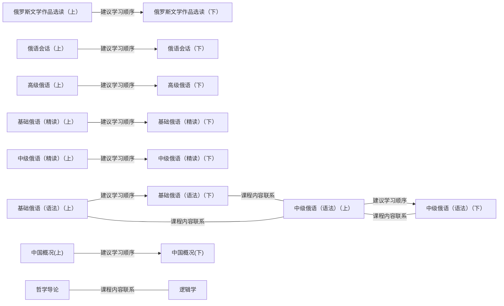

# 俄语专业“2+X”修读建议（留学生适用）

2024 年汇编印刷页 234–235。原表记录 25 个可配对的课程代码。

[本节原页](plan-229.pdf#page=6) · [逐行数据](plan-229.json) · [院系目录](README.md)

## 课程导读

想了解俄语学习的课程安排，可以在原表中找到《基础俄语（精读）（上）》（`FORE130557`）、《俄罗斯概况》（`FORE130246`）、《基础俄语（语法）（上）》（`FORE130559`）。 [原书 PDF 第 248 页](plan-229.pdf#page=6)

图中连接《基础俄语（语法）（上）》（`FORE130559`）和《中级俄语（语法）（上）》（`FORE130563`），两门课都从课程题名标出的“语法”切入，可沿这一主题对照阅读。 [原书 PDF 第 248 页](plan-229.pdf#page=6)

## 课程关系图

图中展示最多 20 条关系。下表列出本节全部关系。建议学习顺序供规划课程使用，正式选课资格以教务规定为准。

| 课程 | 关联课程 | 关系 | 依据 |
| --- | --- | --- | --- |
| 俄罗斯文学作品选读（上）（FORE130403） | 俄罗斯文学作品选读（下）（FORE130404） | 建议学习顺序 | 同节课程题名标明连续分册或序号。 |
| 俄语会话（上）（FORE130405） | 俄语会话（下）（FORE130406） | 建议学习顺序 | 同节课程题名标明连续分册或序号。 |
| 高级俄语（上）（FORE130550） | 高级俄语（下）（FORE130097） | 建议学习顺序 | 同节课程题名标明连续分册或序号。 |
| 基础俄语（精读）（上）（FORE130557） | 基础俄语（精读）（下）（FORE130558） | 建议学习顺序 | 同节课程题名标明连续分册或序号。 |
| 基础俄语（语法）（上）（FORE130559） | 基础俄语（语法）（下）（FORE130560） | 建议学习顺序 | 同节课程题名标明连续分册或序号。 |
| 中级俄语（精读）（上）（FORE130561） | 中级俄语（精读）（下）（FORE130562） | 建议学习顺序 | 同节课程题名标明连续分册或序号。 |
| 中级俄语（语法）（上）（FORE130563） | 中级俄语（语法）（下）（FORE130564） | 建议学习顺序 | 同节课程题名标明连续分册或序号。 |
| 中国概况(上)（ICES110012） | 中国概况(下)（ICES110013） | 建议学习顺序 | 同节课程题名标明连续分册或序号。 |
| 基础俄语（语法）（上）（FORE130559） | 中级俄语（语法）（上）（FORE130563） | 课程内容联系 | 本方案两门课程的题名均含“语法”，可据此对照这一主题。 |
| 基础俄语（语法）（下）（FORE130560） | 中级俄语（语法）（上）（FORE130563） | 课程内容联系 | 本方案两门课程的题名均含“语法”，可据此对照这一主题。 |
| 中级俄语（语法）（上）（FORE130563） | 中级俄语（语法）（下）（FORE130564） | 课程内容联系 | 本方案两门课程的题名均含“语法”，可据此对照这一主题。 |
| 哲学导论（PHIL120012） | 逻辑学（PHIL120013） | 课程内容联系 | 论证与概念分析是哲学讨论的共同方法。 |

## 课程

| 课程代码 | 名称 | 开课学期原文 | 来源（PDF 页） |
| --- | --- | --- | --- |
| CHIN120012 | 中国文学经典 |  | 248 |
| FORE130028 | 实习调查 |  | 248 |
| FORE130029 | 毕业论文 |  | 248 |
| FORE130097 | 高级俄语（下） |  | 248 |
| FORE130107 | 翻译理论与技巧（俄语） |  | 248 |
| FORE130246 | 俄罗斯概况 |  | 248 |
| FORE130403 | 俄罗斯文学作品选读（上） |  | 248 |
| FORE130404 | 俄罗斯文学作品选读（下） |  | 248 |
| FORE130405 | 俄语会话（上） |  | 248 |
| FORE130406 | 俄语会话（下） |  | 248 |
| FORE130412 | 俄语高级写作 |  | 248 |
| FORE130550 | 高级俄语（上） |  | 248 |
| FORE130557 | 基础俄语（精读）（上） |  | 248 |
| FORE130558 | 基础俄语（精读）（下） |  | 248 |
| FORE130559 | 基础俄语（语法）（上） |  | 248 |
| FORE130560 | 基础俄语（语法）（下） |  | 248 |
| FORE130561 | 中级俄语（精读）（上） |  | 248 |
| FORE130562 | 中级俄语（精读）（下） |  | 248 |
| FORE130563 | 中级俄语（语法）（上） |  | 248 |
| FORE130564 | 中级俄语（语法）（下） |  | 248 |
| HIST120012 | 中国古代文明 |  | 248 |
| ICES110012 | 中国概况(上) |  | 248 |
| ICES110013 | 中国概况(下) |  | 248 |
| PHIL120012 | 哲学导论 |  | 248 |
| PHIL120013 | 逻辑学 |  | 248 |
