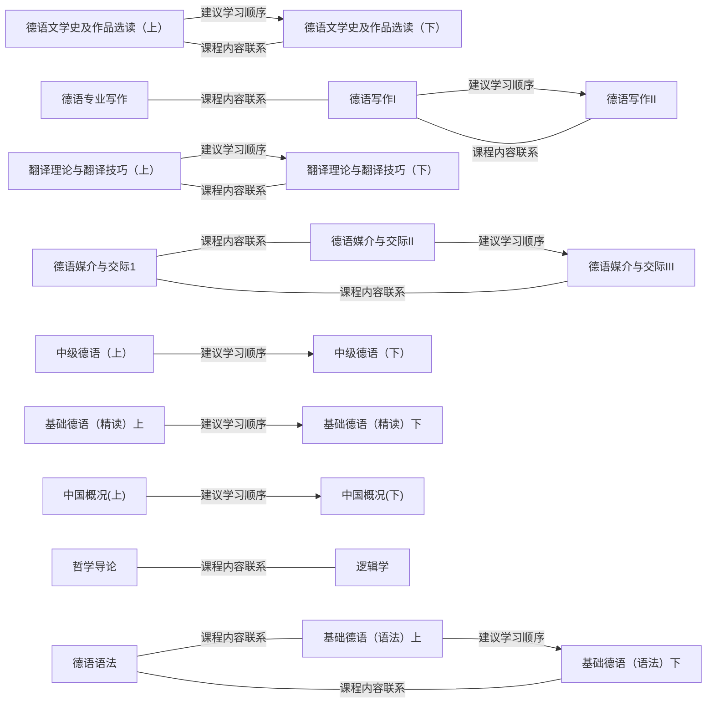

# 德语专业“2+X”修读建议（留学生适用）

2024 年汇编印刷页 241–242。原表记录 26 个可配对的课程代码。

[本节原页](plan-236.pdf#page=6) · [逐行数据](plan-236.json) · [院系目录](README.md)

## 课程关系图

图中展示最多 20 条关系。下表列出本节全部关系。建议学习顺序供规划课程使用，正式选课资格以教务规定为准。

| 课程 | 关联课程 | 关系 | 依据 |
| --- | --- | --- | --- |
| 德语文学史及作品选读（上）（FORE130050） | 德语文学史及作品选读（下）（FORE130051） | 建议学习顺序 | 同节课程题名标明连续分册或序号。 |
| 德语媒介与交际II（FORE130414） | 德语媒介与交际III（FORE130415） | 建议学习顺序 | 同节课程题名标明连续分册或序号。 |
| 德语写作I（FORE130416） | 德语写作II（FORE130418） | 建议学习顺序 | 同节课程题名标明连续分册或序号。 |
| 翻译理论与翻译技巧（上）（FORE130537） | 翻译理论与翻译技巧（下）（FORE130538） | 建议学习顺序 | 同节课程题名标明连续分册或序号。 |
| 中级德语（上）（FORE130573） | 中级德语（下）（FORE130574） | 建议学习顺序 | 同节课程题名标明连续分册或序号。 |
| 基础德语（语法）上（FORE130577） | 基础德语（语法）下（FORE130578） | 建议学习顺序 | 同节课程题名标明连续分册或序号。 |
| 基础德语（精读）上（FORE130579） | 基础德语（精读）下（FORE130580） | 建议学习顺序 | 同节课程题名标明连续分册或序号。 |
| 中国概况(上)（ICES110012） | 中国概况(下)（ICES110013） | 建议学习顺序 | 同节课程题名标明连续分册或序号。 |
| 德语文学史及作品选读（上）（FORE130050） | 德语文学史及作品选读（下）（FORE130051） | 课程内容联系 | 本方案两门课程的题名均含“文学史”，可据此对照这一主题。 |
| 德语专业写作（FORE130338） | 德语写作I（FORE130416） | 课程内容联系 | 本方案两门课程的题名均含“写作”，可据此对照这一主题。 |
| 德语媒介与交际1（FORE130413） | 德语媒介与交际II（FORE130414） | 课程内容联系 | 本方案两门课程的题名均含“媒介”，可据此对照这一主题。 |
| 德语媒介与交际1（FORE130413） | 德语媒介与交际III（FORE130415） | 课程内容联系 | 本方案两门课程的题名均含“媒介”，可据此对照这一主题。 |
| 德语写作I（FORE130416） | 德语写作II（FORE130418） | 课程内容联系 | 本方案两门课程的题名均含“写作”，可据此对照这一主题。 |
| 德语语法（FORE130522） | 基础德语（语法）上（FORE130577） | 课程内容联系 | 本方案两门课程的题名均含“语法”，可据此对照这一主题。 |
| 德语语法（FORE130522） | 基础德语（语法）下（FORE130578） | 课程内容联系 | 本方案两门课程的题名均含“语法”，可据此对照这一主题。 |
| 翻译理论与翻译技巧（上）（FORE130537） | 翻译理论与翻译技巧（下）（FORE130538） | 课程内容联系 | 本方案两门课程的题名均含“翻译”，可据此对照这一主题。 |
| 哲学导论（PHIL120012） | 逻辑学（PHIL120013） | 课程内容联系 | 论证与概念分析是哲学讨论的共同方法。 |

## 课程

| 课程代码 | 名称 | 开课学期原文 | 来源（PDF 页） |
| --- | --- | --- | --- |
| CHIN120012 | 中国文学经典 |  | 255 |
| FORE130028 | 实习调查 |  | 255 |
| FORE130029 | 毕业论文 |  | 256 |
| FORE130050 | 德语文学史及作品选读（上） |  | 255 |
| FORE130051 | 德语文学史及作品选读（下） |  | 255 |
| FORE130338 | 德语专业写作 |  | 255 |
| FORE130413 | 德语媒介与交际1 |  | 255 |
| FORE130414 | 德语媒介与交际II |  | 255 |
| FORE130415 | 德语媒介与交际III |  | 255 |
| FORE130416 | 德语写作I |  | 255 |
| FORE130418 | 德语写作II |  | 255 |
| FORE130419 | 日耳曼学研究 |  | 255 |
| FORE130522 | 德语语法 |  | 255 |
| FORE130537 | 翻译理论与翻译技巧（上） |  | 255 |
| FORE130538 | 翻译理论与翻译技巧（下） |  | 255 |
| FORE130573 | 中级德语（上） |  | 255 |
| FORE130574 | 中级德语（下） |  | 255 |
| FORE130577 | 基础德语（语法）上 |  | 255 |
| FORE130578 | 基础德语（语法）下 |  | 255 |
| FORE130579 | 基础德语（精读）上 |  | 255 |
| FORE130580 | 基础德语（精读）下 |  | 255 |
| HIST120012 | 中国古代文明 |  | 255 |
| ICES110012 | 中国概况(上) |  | 255 |
| ICES110013 | 中国概况(下) |  | 255 |
| PHIL120012 | 哲学导论 |  | 255 |
| PHIL120013 | 逻辑学 |  | 255 |
