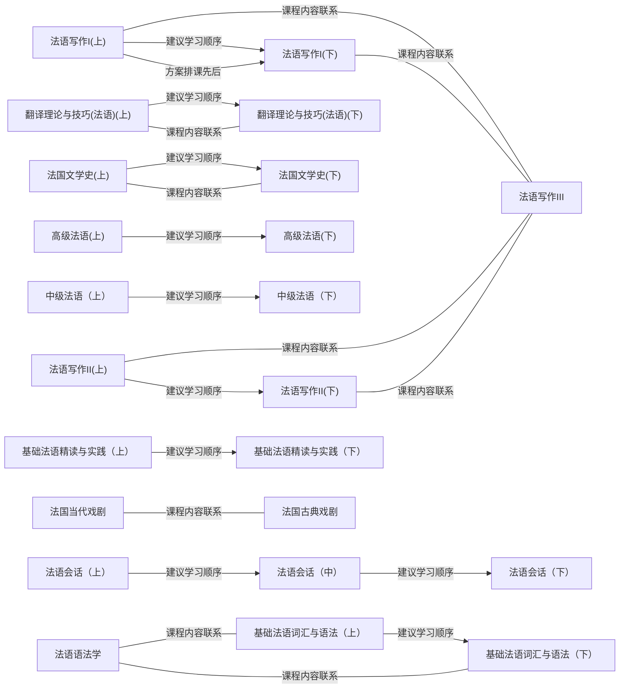

# 法语专业“2+X”教学培养方案

2024 年汇编印刷页 243–245。原表记录 38 个可配对的课程代码。

[本节原页](plan-243.pdf#page=1) · [逐行数据](plan-243.json) · [院系目录](README.md)

## 课程导读

想了解法语学习的课程安排，可以在原表中找到《基础法语词汇与语法（上）》（`FORE130581`）、《法国文学史(上)》（`FORE130068`）、《基础法语精读与实践（上）》（`FORE130583`）。 [原书 PDF 第 257 页](plan-243.pdf#page=1)

图中连接《法语写作I(上)》（`FORE130059`）和《法语写作III》（`FORE130063`），两门课都从课程题名标出的“写作”切入，可沿这一主题对照阅读。 [原书 PDF 第 257 页](plan-243.pdf#page=1) · [原书 PDF 第 258 页](plan-243.pdf#page=2)

## 课程关系图

图中展示最多 20 条关系。下表列出本节全部关系。建议学习顺序供规划课程使用，正式选课资格以教务规定为准。

| 课程 | 关联课程 | 关系 | 依据 |
| --- | --- | --- | --- |
| 法语写作I(上)（FORE130059） | 法语写作I(下)（FORE130060） | 建议学习顺序 | 同节课程题名标明连续分册或序号。 |
| 法语写作II(上)（FORE130061） | 法语写作II(下)（FORE130062） | 建议学习顺序 | 同节课程题名标明连续分册或序号。 |
| 翻译理论与技巧(法语)(上)（FORE130064） | 翻译理论与技巧(法语)(下)（FORE130065） | 建议学习顺序 | 同节课程题名标明连续分册或序号。 |
| 法国文学史(上)（FORE130068） | 法国文学史(下)（FORE130069） | 建议学习顺序 | 同节课程题名标明连续分册或序号。 |
| 高级法语(上)（FORE130327） | 高级法语(下)（FORE130328） | 建议学习顺序 | 同节课程题名标明连续分册或序号。 |
| 中级法语（上）（FORE130423） | 中级法语（下）（FORE130540） | 建议学习顺序 | 同节课程题名标明连续分册或序号。 |
| 法语会话（上）（FORE130426） | 法语会话（中）（FORE130541） | 建议学习顺序 | 同节课程题名标明连续分册或序号。 |
| 法语会话（中）（FORE130541） | 法语会话（下）（FORE130427） | 建议学习顺序 | 同节课程题名标明连续分册或序号。 |
| 基础法语词汇与语法（上）（FORE130581） | 基础法语词汇与语法（下）（FORE130582） | 建议学习顺序 | 同节课程题名标明连续分册或序号。 |
| 基础法语精读与实践（上）（FORE130583） | 基础法语精读与实践（下）（FORE130584） | 建议学习顺序 | 同节课程题名标明连续分册或序号。 |
| 法语写作I(上)（FORE130059） | 法语写作III（FORE130063） | 课程内容联系 | 本方案两门课程的题名均含“写作”，可据此对照这一主题。 |
| 法语写作I(下)（FORE130060） | 法语写作III（FORE130063） | 课程内容联系 | 本方案两门课程的题名均含“写作”，可据此对照这一主题。 |
| 法语写作II(上)（FORE130061） | 法语写作III（FORE130063） | 课程内容联系 | 本方案两门课程的题名均含“写作”，可据此对照这一主题。 |
| 法语写作II(下)（FORE130062） | 法语写作III（FORE130063） | 课程内容联系 | 本方案两门课程的题名均含“写作”，可据此对照这一主题。 |
| 翻译理论与技巧(法语)(上)（FORE130064） | 翻译理论与技巧(法语)(下)（FORE130065） | 课程内容联系 | 本方案两门课程的题名均含“翻译”，可据此对照这一主题。 |
| 法国文学史(上)（FORE130068） | 法国文学史(下)（FORE130069） | 课程内容联系 | 本方案两门课程的题名均含“文学史”，可据此对照这一主题。 |
| 法语语法学（FORE130219） | 基础法语词汇与语法（上）（FORE130581） | 课程内容联系 | 本方案两门课程的题名均含“语法”，可据此对照这一主题。 |
| 法语语法学（FORE130219） | 基础法语词汇与语法（下）（FORE130582） | 课程内容联系 | 本方案两门课程的题名均含“语法”，可据此对照这一主题。 |
| 法国当代戏剧（FORE130425） | 法国古典戏剧（FORE130428） | 课程内容联系 | 本方案两门课程的题名均含“戏剧”，可据此对照这一主题。 |
| 法语写作I(上)（FORE130059） | 法语写作I(下)（FORE130060） | 方案排课先后 | 本节原表所列全部明确学期均早于后者。 |
| 法语写作II(上)（FORE130061） | 法语写作II(下)（FORE130062） | 方案排课先后 | 本节原表所列全部明确学期均早于后者。 |
| 翻译理论与技巧(法语)(上)（FORE130064） | 翻译理论与技巧(法语)(下)（FORE130065） | 方案排课先后 | 本节原表所列全部明确学期均早于后者。 |
| 法国文学史(上)（FORE130068） | 法国文学史(下)（FORE130069） | 方案排课先后 | 本节原表所列全部明确学期均早于后者。 |
| 高级法语(上)（FORE130327） | 高级法语(下)（FORE130328） | 方案排课先后 | 本节原表所列全部明确学期均早于后者。 |
| 中级法语（上）（FORE130423） | 中级法语（下）（FORE130540） | 方案排课先后 | 本节原表所列全部明确学期均早于后者。 |
| 基础法语词汇与语法（上）（FORE130581） | 基础法语词汇与语法（下）（FORE130582） | 方案排课先后 | 本节原表所列全部明确学期均早于后者。 |
| 基础法语精读与实践（上）（FORE130583） | 基础法语精读与实践（下）（FORE130584） | 方案排课先后 | 本节原表所列全部明确学期均早于后者。 |

## 课程

| 课程代码 | 名称 | 开课学期原文 | 来源（PDF 页） |
| --- | --- | --- | --- |
| FORE130028 | 实习调查 | 6 | 258 |
| FORE130029 | 毕业论文 | 8 | 258 |
| FORE130059 | 法语写作I(上) | 3 | 257 |
| FORE130060 | 法语写作I(下) | 4 | 258 |
| FORE130061 | 法语写作II(上) | 5 | 258 |
| FORE130062 | 法语写作II(下) | 6 | 258 |
| FORE130063 | 法语写作III | 7 | 258 |
| FORE130064 | 翻译理论与技巧(法语)(上) | 5 | 258 |
| FORE130065 | 翻译理论与技巧(法语)(下) | 6 | 258 |
| FORE130066 | 法语报刊 | 春，秋 | 258 |
| FORE130067 | 法国概况 | 5 | 258 |
| FORE130068 | 法国文学史(上) | 3 | 257 |
| FORE130069 | 法国文学史(下) | 4 | 257 |
| FORE130219 | 法语语法学 | 春，秋 | 258 |
| FORE130220 | 法语影视 | 春，秋 | 258 |
| FORE130222 | 法国现代短篇小说 | 春，秋 | 258 |
| FORE130225 | 法国文化 | 春，秋 | 258 |
| FORE130226 | 法语散文选读 | 春，秋 | 258 |
| FORE130227 | 中法文化比较 | 春，秋 | 258 |
| FORE130322 | 学术前沿专题 | 春，秋 | 258 |
| FORE130327 | 高级法语(上) | 5 | 258 |
| FORE130328 | 高级法语(下) | 6 | 258 |
| FORE130423 | 中级法语（上） | 3 | 257 |
| FORE130425 | 法国当代戏剧 | 春，秋 | 258 |
| FORE130426 | 法语会话（上） | 春，秋 | 258 |
| FORE130427 | 法语会话（下） | 春，秋 | 258 |
| FORE130428 | 法国古典戏剧 | 春，秋 | 258 |
| FORE130429 | 法国现当代文艺思潮 | 春，秋 | 258 |
| FORE130431 | 法语初级视听 | 1 | 257 |
| FORE130525 | 中法文学关系 | 春，秋 | 258 |
| FORE130540 | 中级法语（下） | 4 | 257 |
| FORE130541 | 法语会话（中） | 春，秋 | 258 |
| FORE130542 | 法国喜剧语言赏析 | 春，秋 | 258 |
| FORE130543 | 法国文学精选•精评•精译 | 春，秋 | 259 |
| FORE130581 | 基础法语词汇与语法（上） | 1 | 257 |
| FORE130582 | 基础法语词汇与语法（下） | 2 | 257 |
| FORE130583 | 基础法语精读与实践（上） | 1 | 257 |
| FORE130584 | 基础法语精读与实践（下） | 2 | 257 |
