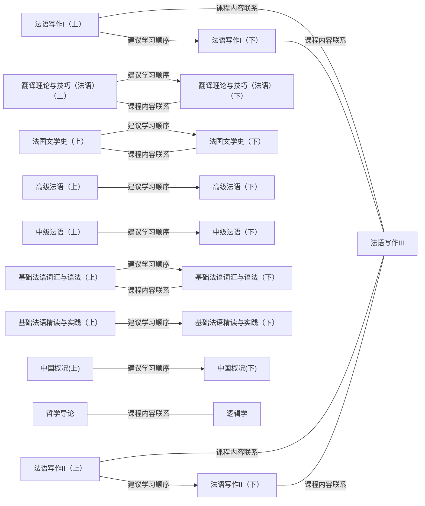

# 法语专业“2+X”修读建议（留学生适用）

2024 年汇编印刷页 248–249。原表记录 27 个可配对的课程代码。

[本节原页](plan-243.pdf#page=6) · [逐行数据](plan-243.json) · [院系目录](README.md)

## 课程关系图

图中展示最多 20 条关系。下表列出本节全部关系。建议学习顺序供规划课程使用，正式选课资格以教务规定为准。

| 课程 | 关联课程 | 关系 | 依据 |
| --- | --- | --- | --- |
| 法语写作I（上）（FORE130059） | 法语写作I（下）（FORE130060） | 建议学习顺序 | 同节课程题名标明连续分册或序号。 |
| 法语写作II（上）（FORE130061） | 法语写作II（下）（FORE130062） | 建议学习顺序 | 同节课程题名标明连续分册或序号。 |
| 翻译理论与技巧（法语）（上）（FORE130064） | 翻译理论与技巧（法语）（下）（FORE130065） | 建议学习顺序 | 同节课程题名标明连续分册或序号。 |
| 法国文学史（上）（FORE130068） | 法国文学史（下）（FORE130069） | 建议学习顺序 | 同节课程题名标明连续分册或序号。 |
| 高级法语（上）（FORE130327） | 高级法语（下）（FORE130328） | 建议学习顺序 | 同节课程题名标明连续分册或序号。 |
| 中级法语（上）（FORE130423） | 中级法语（下）（FORE130540） | 建议学习顺序 | 同节课程题名标明连续分册或序号。 |
| 基础法语词汇与语法（上）（FORE130581） | 基础法语词汇与语法（下）（FORE130582） | 建议学习顺序 | 同节课程题名标明连续分册或序号。 |
| 基础法语精读与实践（上）（FORE130583） | 基础法语精读与实践（下）（FORE130584） | 建议学习顺序 | 同节课程题名标明连续分册或序号。 |
| 中国概况(上)（ICES110012） | 中国概况(下)（ICES110013） | 建议学习顺序 | 同节课程题名标明连续分册或序号。 |
| 法语写作I（上）（FORE130059） | 法语写作III（FORE130063） | 课程内容联系 | 本方案两门课程的题名均含“写作”，可据此对照这一主题。 |
| 法语写作I（下）（FORE130060） | 法语写作III（FORE130063） | 课程内容联系 | 本方案两门课程的题名均含“写作”，可据此对照这一主题。 |
| 法语写作II（上）（FORE130061） | 法语写作III（FORE130063） | 课程内容联系 | 本方案两门课程的题名均含“写作”，可据此对照这一主题。 |
| 法语写作II（下）（FORE130062） | 法语写作III（FORE130063） | 课程内容联系 | 本方案两门课程的题名均含“写作”，可据此对照这一主题。 |
| 翻译理论与技巧（法语）（上）（FORE130064） | 翻译理论与技巧（法语）（下）（FORE130065） | 课程内容联系 | 本方案两门课程的题名均含“翻译”，可据此对照这一主题。 |
| 法国文学史（上）（FORE130068） | 法国文学史（下）（FORE130069） | 课程内容联系 | 本方案两门课程的题名均含“文学史”，可据此对照这一主题。 |
| 基础法语词汇与语法（上）（FORE130581） | 基础法语词汇与语法（下）（FORE130582） | 课程内容联系 | 本方案两门课程的题名均含“语法”，可据此对照这一主题。 |
| 哲学导论（PHIL120012） | 逻辑学（PHIL120013） | 课程内容联系 | 论证与概念分析是哲学讨论的共同方法。 |

## 课程

| 课程代码 | 名称 | 开课学期原文 | 来源（PDF 页） |
| --- | --- | --- | --- |
| CHIN120012 | 中国文学经典 |  | 262 |
| FORE130028 | 实习调查 |  | 263 |
| FORE130029 | 毕业论文 |  | 263 |
| FORE130059 | 法语写作I（上） |  | 262 |
| FORE130060 | 法语写作I（下） |  | 262 |
| FORE130061 | 法语写作II（上） |  | 262 |
| FORE130062 | 法语写作II（下） |  | 262 |
| FORE130063 | 法语写作III |  | 263 |
| FORE130064 | 翻译理论与技巧（法语）（上） |  | 262 |
| FORE130065 | 翻译理论与技巧（法语）（下） |  | 262 |
| FORE130067 | 法国概况 |  | 262 |
| FORE130068 | 法国文学史（上） |  | 262 |
| FORE130069 | 法国文学史（下） |  | 262 |
| FORE130327 | 高级法语（上） |  | 262 |
| FORE130328 | 高级法语（下） |  | 263 |
| FORE130423 | 中级法语（上） |  | 262 |
| FORE130431 | 法语初级视听 |  | 262 |
| FORE130540 | 中级法语（下） |  | 262 |
| FORE130581 | 基础法语词汇与语法（上） |  | 262 |
| FORE130582 | 基础法语词汇与语法（下） |  | 262 |
| FORE130583 | 基础法语精读与实践（上） |  | 262 |
| FORE130584 | 基础法语精读与实践（下） |  | 262 |
| HIST120012 | 中国古代文明 |  | 262 |
| ICES110012 | 中国概况(上) |  | 262 |
| ICES110013 | 中国概况(下) |  | 262 |
| PHIL120012 | 哲学导论 |  | 262 |
| PHIL120013 | 逻辑学 |  | 262 |
