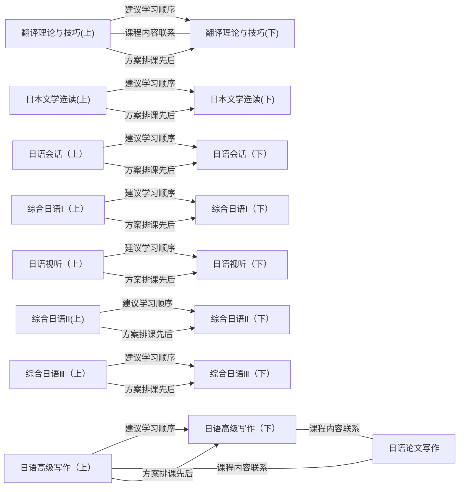

# 日语专业“2+X”教学培养方案

2024 年汇编印刷页 250–252。原表记录 30 个可配对的课程代码。

[本节原页](plan-250.pdf#page=1) · [逐行数据](plan-250.json) · [院系目录](README.md)

## 课程关系图

图中展示最多 20 条关系。下表列出本节全部关系。建议学习顺序供规划课程使用，正式选课资格以教务规定为准。

| 课程 | 关联课程 | 关系 | 依据 |
| --- | --- | --- | --- |
| 翻译理论与技巧(上)（FORE130082） | 翻译理论与技巧(下)（FORE130083） | 建议学习顺序 | 同节课程题名标明连续分册或序号。 |
| 日本文学选读(上)（FORE130087） | 日本文学选读(下)（FORE130088） | 建议学习顺序 | 同节课程题名标明连续分册或序号。 |
| 日语会话（上）（FORE130293） | 日语会话（下）（FORE130294） | 建议学习顺序 | 同节课程题名标明连续分册或序号。 |
| 综合日语Ⅰ（上）（FORE130432） | 综合日语Ⅰ（下）（FORE130433） | 建议学习顺序 | 同节课程题名标明连续分册或序号。 |
| 日语视听（上）（FORE130434） | 日语视听（下）（FORE130436） | 建议学习顺序 | 同节课程题名标明连续分册或序号。 |
| 综合日语II(上)（FORE130435） | 综合日语Ⅱ（下）（FORE130437） | 建议学习顺序 | 同节课程题名标明连续分册或序号。 |
| 日语高级写作（上）（FORE130440） | 日语高级写作（下）（FORE130441） | 建议学习顺序 | 同节课程题名标明连续分册或序号。 |
| 综合日语Ⅲ（上）（FORE130571） | 综合日语Ⅲ（下）（FORE130572） | 建议学习顺序 | 同节课程题名标明连续分册或序号。 |
| 翻译理论与技巧(上)（FORE130082） | 翻译理论与技巧(下)（FORE130083） | 课程内容联系 | 本方案两门课程的题名均含“翻译”，可据此对照这一主题。 |
| 日语高级写作（上）（FORE130440） | 日语论文写作（FORE130505） | 课程内容联系 | 本方案两门课程的题名均含“写作”，可据此对照这一主题。 |
| 日语高级写作（下）（FORE130441） | 日语论文写作（FORE130505） | 课程内容联系 | 本方案两门课程的题名均含“写作”，可据此对照这一主题。 |
| 翻译理论与技巧(上)（FORE130082） | 翻译理论与技巧(下)（FORE130083） | 方案排课先后 | 本节原表所列全部明确学期均早于后者。 |
| 日本文学选读(上)（FORE130087） | 日本文学选读(下)（FORE130088） | 方案排课先后 | 本节原表所列全部明确学期均早于后者。 |
| 日语会话（上）（FORE130293） | 日语会话（下）（FORE130294） | 方案排课先后 | 本节原表所列全部明确学期均早于后者。 |
| 综合日语Ⅰ（上）（FORE130432） | 综合日语Ⅰ（下）（FORE130433） | 方案排课先后 | 本节原表所列全部明确学期均早于后者。 |
| 日语视听（上）（FORE130434） | 日语视听（下）（FORE130436） | 方案排课先后 | 本节原表所列全部明确学期均早于后者。 |
| 综合日语II(上)（FORE130435） | 综合日语Ⅱ（下）（FORE130437） | 方案排课先后 | 本节原表所列全部明确学期均早于后者。 |
| 日语高级写作（上）（FORE130440） | 日语高级写作（下）（FORE130441） | 方案排课先后 | 本节原表所列全部明确学期均早于后者。 |
| 综合日语Ⅲ（上）（FORE130571） | 综合日语Ⅲ（下）（FORE130572） | 方案排课先后 | 本节原表所列全部明确学期均早于后者。 |

## 课程

| 课程代码 | 名称 | 开课学期原文 | 来源（PDF 页） |
| --- | --- | --- | --- |
| FORE130028 | 实习调查 | 6 | 265 |
| FORE130029 | 毕业论文 | 8 | 265 |
| FORE130082 | 翻译理论与技巧(上) | 5 | 265 |
| FORE130083 | 翻译理论与技巧(下) | 6 | 265 |
| FORE130086 | 日本报刊选读 | 春，秋 | 265 |
| FORE130087 | 日本文学选读(上) | 6 | 265 |
| FORE130088 | 日本文学选读(下) | 7 | 265 |
| FORE130090 | 日本概况 | 春，秋 | 265 |
| FORE130228 | 日语词汇学 | 春，秋 | 265 |
| FORE130231 | 日本文语文法 | 春，秋 | 265 |
| FORE130232 | 日本古典文学选读 | 春，秋 | 265 |
| FORE130236 | 日本文化史 | 春，秋 | 265 |
| FORE130270 | 日本社会与文化 | 春，秋 | 265 |
| FORE130278 | 日语语音学 | 春，秋 | 265 |
| FORE130293 | 日语会话（上） | 2 | 264 |
| FORE130294 | 日语会话（下） | 3 | 264 |
| FORE130432 | 综合日语Ⅰ（上） | 1 | 264 |
| FORE130433 | 综合日语Ⅰ（下） | 2 | 264 |
| FORE130434 | 日语视听（上） | 2 | 264 |
| FORE130435 | 综合日语II(上) | 3 | 264 |
| FORE130436 | 日语视听（下） | 3 | 264 |
| FORE130437 | 综合日语Ⅱ（下） | 4 | 264 |
| FORE130440 | 日语高级写作（上） | 6 | 265 |
| FORE130441 | 日语高级写作（下） | 7 | 265 |
| FORE130442 | 日语语法学 | 春，秋 | 265 |
| FORE130444 | 日本文学史 | 春，秋 | 265 |
| FORE130505 | 日语论文写作 | 7 | 265 |
| FORE130552 | 日语语言文学十五讲 | 春，秋 | 265 |
| FORE130571 | 综合日语Ⅲ（上） | 5 | 264 |
| FORE130572 | 综合日语Ⅲ（下） | 6 | 264 |
