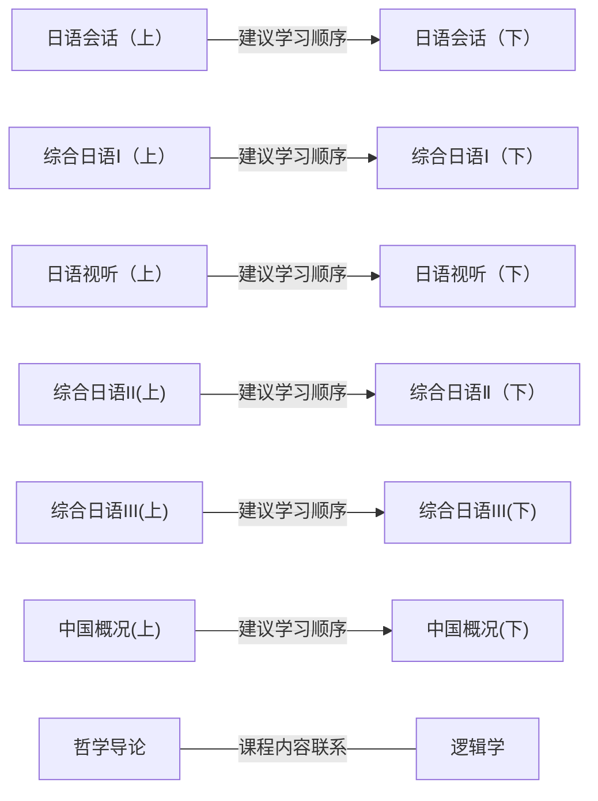

# 日语专业“2+X”修读建议（留学生适用）

2024 年汇编印刷页 255–256。原表记录 21 个可配对的课程代码。

[本节原页](plan-250.pdf#page=6) · [逐行数据](plan-250.json) · [院系目录](README.md)

## 课程导读

想了解日语学习的课程安排，可以在原表中找到《综合日语Ⅰ（上）》（`FORE130432`）、《日本文学选读(上)》（`FORE130087`）、《综合日语Ⅰ（下）》（`FORE130433`）。 [原书 PDF 第 269 页](plan-250.pdf#page=6)

《日语会话（上）》（`FORE130293`）和《日语会话（下）》（`FORE130294`）是同一系列，图中的箭头按题名标出的分册顺序排列。 [原书 PDF 第 269 页](plan-250.pdf#page=6)

## 课程关系图

图中展示最多 20 条关系。下表列出本节全部关系。建议学习顺序供规划课程使用，正式选课资格以教务规定为准。

| 课程 | 关联课程 | 关系 | 依据 |
| --- | --- | --- | --- |
| 日语会话（上）（FORE130293） | 日语会话（下）（FORE130294） | 建议学习顺序 | 同节课程题名标明连续分册或序号。 |
| 综合日语Ⅰ（上）（FORE130432） | 综合日语Ⅰ（下）（FORE130433） | 建议学习顺序 | 同节课程题名标明连续分册或序号。 |
| 日语视听（上）（FORE130434） | 日语视听（下）（FORE130436） | 建议学习顺序 | 同节课程题名标明连续分册或序号。 |
| 综合日语II(上)（FORE130435） | 综合日语Ⅱ（下）（FORE130437） | 建议学习顺序 | 同节课程题名标明连续分册或序号。 |
| 综合日语III(上)（FORE130571） | 综合日语III(下)（FORE130572） | 建议学习顺序 | 同节课程题名标明连续分册或序号。 |
| 中国概况(上)（ICES110012） | 中国概况(下)（ICES110013） | 建议学习顺序 | 同节课程题名标明连续分册或序号。 |
| 哲学导论（PHIL120012） | 逻辑学（PHIL120013） | 课程内容联系 | 论证与概念分析是哲学讨论的共同方法。 |

## 课程

| 课程代码 | 名称 | 开课学期原文 | 来源（PDF 页） |
| --- | --- | --- | --- |
| CHIN120012 | 中国文学经典 |  | 269 |
| FORE130028 | 实习调查 |  | 269 |
| FORE130029 | 毕业论文 |  | 269 |
| FORE130082 | 翻译理论与技巧(上) |  | 269 |
| FORE130087 | 日本文学选读(上) |  | 269 |
| FORE130293 | 日语会话（上） |  | 269 |
| FORE130294 | 日语会话（下） |  | 269 |
| FORE130432 | 综合日语Ⅰ（上） |  | 269 |
| FORE130433 | 综合日语Ⅰ（下） |  | 269 |
| FORE130434 | 日语视听（上） |  | 269 |
| FORE130435 | 综合日语II(上) |  | 269 |
| FORE130436 | 日语视听（下） |  | 269 |
| FORE130437 | 综合日语Ⅱ（下） |  | 269 |
| FORE130440 | 日语高级写作（上） |  | 269 |
| FORE130571 | 综合日语III(上) |  | 269 |
| FORE130572 | 综合日语III(下) |  | 269 |
| HIST120012 | 中国古代文明 |  | 269 |
| ICES110012 | 中国概况(上) |  | 269 |
| ICES110013 | 中国概况(下) |  | 269 |
| PHIL120012 | 哲学导论 |  | 269 |
| PHIL120013 | 逻辑学 |  | 269 |
