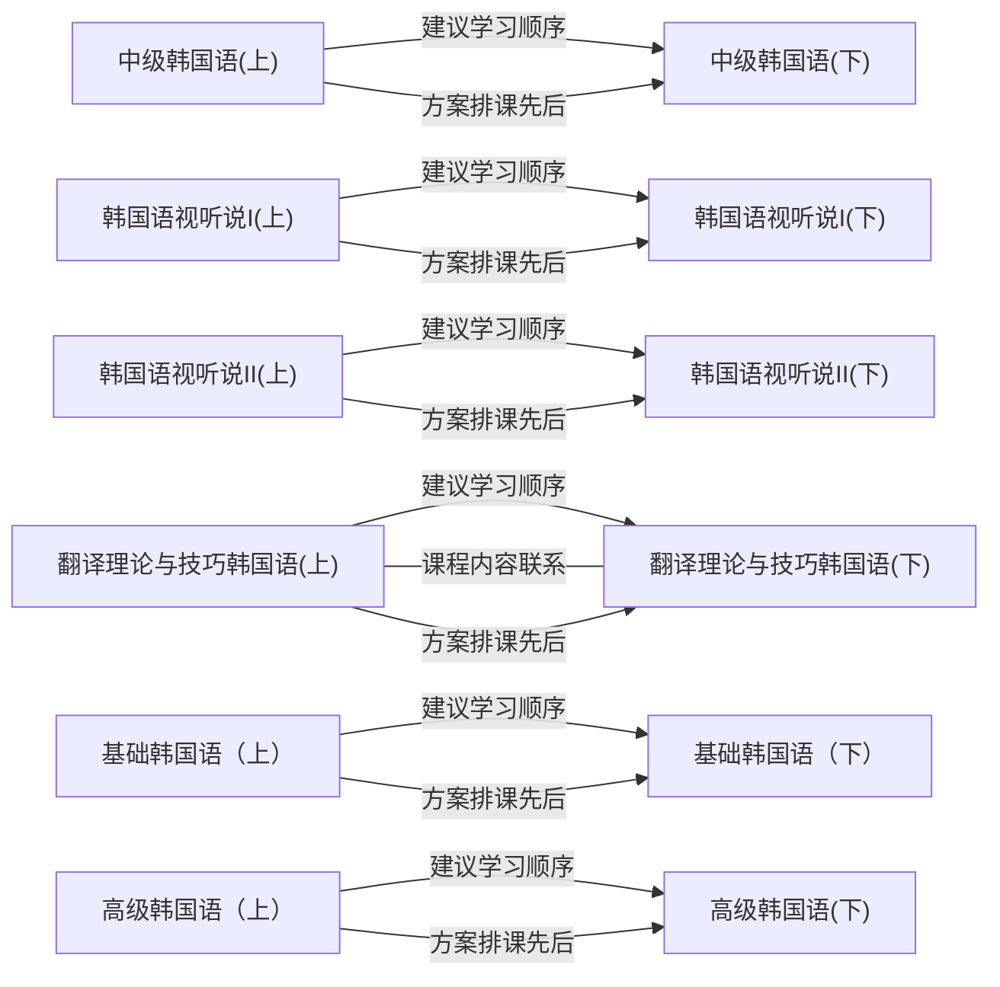

# 朝鲜语专业“2+X”教学培养方案

2024 年汇编印刷页 257–259。原表记录 28 个可配对的课程代码。

[本节原页](plan-257.pdf#page=1) · [逐行数据](plan-257.json) · [院系目录](README.md)

## 课程导读

想了解朝鲜语与韩国语的课程安排，可以在原表中找到《基础韩国语（上）》（`FORE130315`）、《韩国及朝鲜概况》（`FORE130130`）、《基础韩国语（下）》（`FORE130316`）。 [原书 PDF 第 271 页](plan-257.pdf#page=1) · [原书 PDF 第 272 页](plan-257.pdf#page=2)

图中连接《翻译理论与技巧韩国语(上)》（`FORE130125`）和《翻译理论与技巧韩国语(下)》（`FORE130126`），两门课都从课程题名标出的“翻译”切入，可沿这一主题对照阅读。 [原书 PDF 第 271 页](plan-257.pdf#page=1) · [原书 PDF 第 272 页](plan-257.pdf#page=2)

## 课程关系图

图中展示最多 20 条关系。下表列出本节全部关系。建议学习顺序供规划课程使用，正式选课资格以教务规定为准。

| 课程 | 关联课程 | 关系 | 依据 |
| --- | --- | --- | --- |
| 中级韩国语(上)（FORE130112） | 中级韩国语(下)（FORE130113） | 建议学习顺序 | 同节课程题名标明连续分册或序号。 |
| 韩国语视听说I(上)（FORE130116） | 韩国语视听说I(下)（FORE130117） | 建议学习顺序 | 同节课程题名标明连续分册或序号。 |
| 韩国语视听说II(上)（FORE130118） | 韩国语视听说II(下)（FORE130119） | 建议学习顺序 | 同节课程题名标明连续分册或序号。 |
| 翻译理论与技巧韩国语(上)（FORE130125） | 翻译理论与技巧韩国语(下)（FORE130126） | 建议学习顺序 | 同节课程题名标明连续分册或序号。 |
| 基础韩国语（上）（FORE130315） | 基础韩国语（下）（FORE130316） | 建议学习顺序 | 同节课程题名标明连续分册或序号。 |
| 高级韩国语（上）（FORE130447） | 高级韩国语(下)（FORE130115） | 建议学习顺序 | 同节课程题名标明连续分册或序号。 |
| 翻译理论与技巧韩国语(上)（FORE130125） | 翻译理论与技巧韩国语(下)（FORE130126） | 课程内容联系 | 本方案两门课程的题名均含“翻译”，可据此对照这一主题。 |
| 中级韩国语(上)（FORE130112） | 中级韩国语(下)（FORE130113） | 方案排课先后 | 本节原表所列全部明确学期均早于后者。 |
| 韩国语视听说I(上)（FORE130116） | 韩国语视听说I(下)（FORE130117） | 方案排课先后 | 本节原表所列全部明确学期均早于后者。 |
| 韩国语视听说II(上)（FORE130118） | 韩国语视听说II(下)（FORE130119） | 方案排课先后 | 本节原表所列全部明确学期均早于后者。 |
| 翻译理论与技巧韩国语(上)（FORE130125） | 翻译理论与技巧韩国语(下)（FORE130126） | 方案排课先后 | 本节原表所列全部明确学期均早于后者。 |
| 基础韩国语（上）（FORE130315） | 基础韩国语（下）（FORE130316） | 方案排课先后 | 本节原表所列全部明确学期均早于后者。 |
| 高级韩国语（上）（FORE130447） | 高级韩国语(下)（FORE130115） | 方案排课先后 | 本节原表所列全部明确学期均早于后者。 |

## 课程

| 课程代码 | 名称 | 开课学期原文 | 来源（PDF 页） |
| --- | --- | --- | --- |
| FORE130028 | 实习调查 | 6 | 272 |
| FORE130029 | 毕业论文 | 8 | 272 |
| FORE130112 | 中级韩国语(上) | 3 | 271 |
| FORE130113 | 中级韩国语(下) | 4 | 271 |
| FORE130115 | 高级韩国语(下) | 6 | 272 |
| FORE130116 | 韩国语视听说I(上) | 2 | 271 |
| FORE130117 | 韩国语视听说I(下) | 3 | 271 |
| FORE130118 | 韩国语视听说II(上) | 4 | 271 |
| FORE130119 | 韩国语视听说II(下) | 5 | 272 |
| FORE130125 | 翻译理论与技巧韩国语(上) | 5 | 271 |
| FORE130126 | 翻译理论与技巧韩国语(下) | 6 | 272 |
| FORE130129 | 韩语报刊选读 | 7 | 272 |
| FORE130130 | 韩国及朝鲜概况 | 3 | 272 |
| FORE130247 | 韩语词汇学 | 4 | 272 |
| FORE130249 | 韩国文学史 | 春，秋 | 272 |
| FORE130250 | 经济贸易韩国语 | 春，秋 | 272 |
| FORE130251 | 韩国文学名著赏析 | 春，秋 | 272 |
| FORE130253 | 科技韩国语 | 春，秋 | 272 |
| FORE130254 | 口译 | 7 | 272 |
| FORE130255 | 韩语语法学 | 5 | 272 |
| FORE130315 | 基础韩国语（上） | 1 | 271 |
| FORE130316 | 基础韩国语（下） | 2 | 271 |
| FORE130446 | 韩国语写作 | 5 | 271 |
| FORE130447 | 高级韩国语（上） | 5 | 271 |
| FORE130448 | 韩国社会与文化 | 春，秋 | 272 |
| FORE130449 | 韩国文学选读 | 5 | 272 |
| FORE130450 | 韩国语通论 | 春，秋 | 272 |
| FORE130451 | 韩国影视 | 春，秋 | 272 |
