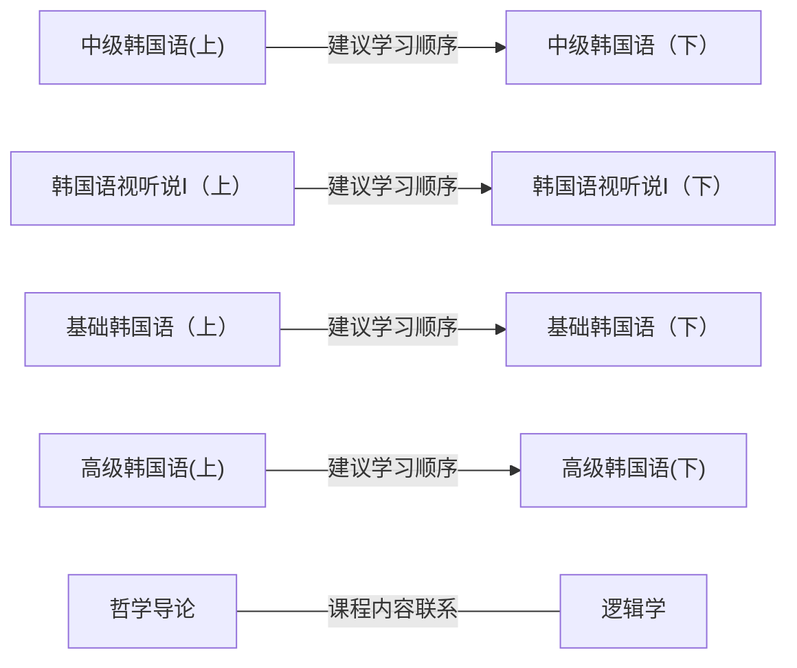

# 朝鲜语专业“2+X”修读建议

2024 年汇编印刷页 260–261。原表记录 22 个可配对的课程代码。

[本节原页](plan-257.pdf#page=4) · [逐行数据](plan-257.json) · [院系目录](README.md)

## 课程关系图

图中展示最多 20 条关系。下表列出本节全部关系。建议学习顺序供规划课程使用，正式选课资格以教务规定为准。

| 课程 | 关联课程 | 关系 | 依据 |
| --- | --- | --- | --- |
| 中级韩国语(上)（FORE130112） | 中级韩国语（下）（FORE130113） | 建议学习顺序 | 同节课程题名标明连续分册或序号。 |
| 韩国语视听说Ⅰ（上）（FORE130116） | 韩国语视听说Ⅰ（下）（FORE130117） | 建议学习顺序 | 同节课程题名标明连续分册或序号。 |
| 基础韩国语（上）（FORE130315） | 基础韩国语（下）（FORE130316） | 建议学习顺序 | 同节课程题名标明连续分册或序号。 |
| 高级韩国语(上)（FORE130447） | 高级韩国语(下)（FORE130115） | 建议学习顺序 | 同节课程题名标明连续分册或序号。 |
| 哲学导论（PHIL120012） | 逻辑学（PHIL120013） | 课程内容联系 | 论证与概念分析是哲学讨论的共同方法。 |

## 课程

| 课程代码 | 名称 | 开课学期原文 | 来源（PDF 页） |
| --- | --- | --- | --- |
| CHIN120012 | 中国文学经典 |  | 274 |
| FORE130028 | 实习调查 |  | 275 |
| FORE130029 | 毕业论文 |  | 275 |
| FORE130112 | 中级韩国语(上) |  | 274 |
| FORE130113 | 中级韩国语（下） |  | 274 |
| FORE130115 | 高级韩国语(下) |  | 274 |
| FORE130116 | 韩国语视听说Ⅰ（上） |  | 274 |
| FORE130117 | 韩国语视听说Ⅰ（下） |  | 274 |
| FORE130118 | 韩国语视听说Ⅱ（上） |  | 274 |
| FORE130125 | 翻译理论与技巧韩国语(上) |  | 275 |
| FORE130315 | 基础韩国语（上） |  | 274 |
| FORE130316 | 基础韩国语（下） |  | 274 |
| FORE130446 | 韩国语写作 |  | 274 |
| FORE130447 | 高级韩国语(上) |  | 274 |
| HIST120012 | 中国古代文明 |  | 274 |
| PHIL120012 | 哲学导论 |  | 274 |
| PHIL120013 | 逻辑学 |  | 274 |
| PTSS110082 | 毛泽东思想和中国特色社会主义理论体系概论 |  | 274 |
| PTSS110087 | 马克思主义基本原理 |  | 274 |
| PTSS110088 | 中国近现代史纲要 |  | 274 |
| PTSS110089 | 思想道德与法治 |  | 274 |
| PTSS110090 | 习近平新时代中国特色社会主义思想概论 |  | 274 |
