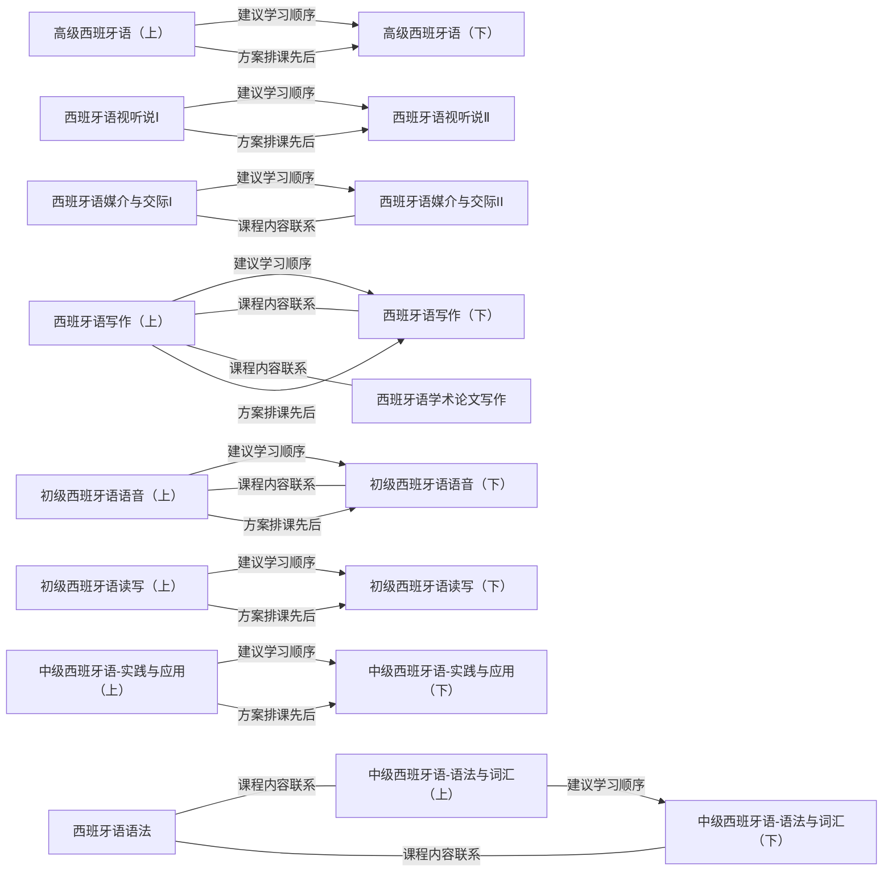

# 西班牙语专业“2+X”教学培养方案

2024 年汇编印刷页 264–266。原表记录 35 个可配对的课程代码。

[本节原页](plan-264.pdf#page=1) · [逐行数据](plan-264.json) · [院系目录](README.md)

## 课程导读

想了解西班牙语学习的课程安排，可以在原表中找到《初级西班牙语读写（上）》（`FORE130565`）、《初级西班牙语语音（上）》（`FORE130555`）、《初级西班牙语读写（下）》（`FORE130566`）。 [原书 PDF 第 278 页](plan-264.pdf#page=1)

图中连接《西班牙语写作（上）》（`FORE130486`）和《西班牙语写作（下）》（`FORE130487`），两门课都从课程题名标出的“写作”切入，可沿这一主题对照阅读。 [原书 PDF 第 279 页](plan-264.pdf#page=2)

## 课程关系图

图中展示最多 20 条关系。下表列出本节全部关系。建议学习顺序供规划课程使用，正式选课资格以教务规定为准。

| 课程 | 关联课程 | 关系 | 依据 |
| --- | --- | --- | --- |
| 高级西班牙语（上）（FORE130479） | 高级西班牙语（下）（FORE130480） | 建议学习顺序 | 同节课程题名标明连续分册或序号。 |
| 西班牙语视听说Ⅰ（FORE130481） | 西班牙语视听说Ⅱ（FORE130482） | 建议学习顺序 | 同节课程题名标明连续分册或序号。 |
| 西班牙语写作（上）（FORE130486） | 西班牙语写作（下）（FORE130487） | 建议学习顺序 | 同节课程题名标明连续分册或序号。 |
| 西班牙语媒介与交际I（FORE130509） | 西班牙语媒介与交际II（FORE130510） | 建议学习顺序 | 同节课程题名标明连续分册或序号。 |
| 初级西班牙语语音（上）（FORE130555） | 初级西班牙语语音（下）（FORE130556） | 建议学习顺序 | 同节课程题名标明连续分册或序号。 |
| 初级西班牙语读写（上）（FORE130565） | 初级西班牙语读写（下）（FORE130566） | 建议学习顺序 | 同节课程题名标明连续分册或序号。 |
| 中级西班牙语-实践与应用（上）（FORE130567） | 中级西班牙语-实践与应用（下）（FORE130568） | 建议学习顺序 | 同节课程题名标明连续分册或序号。 |
| 中级西班牙语-语法与词汇（上）（FORE130569） | 中级西班牙语-语法与词汇（下）（FORE130570） | 建议学习顺序 | 同节课程题名标明连续分册或序号。 |
| 西班牙语写作（上）（FORE130486） | 西班牙语写作（下）（FORE130487） | 课程内容联系 | 本方案两门课程的题名均含“写作”，可据此对照这一主题。 |
| 西班牙语写作（上）（FORE130486） | 西班牙语学术论文写作（FORE130489） | 课程内容联系 | 本方案两门课程的题名均含“写作”，可据此对照这一主题。 |
| 西班牙语语法（FORE130492） | 中级西班牙语-语法与词汇（上）（FORE130569） | 课程内容联系 | 本方案两门课程的题名均含“语法”，可据此对照这一主题。 |
| 西班牙语语法（FORE130492） | 中级西班牙语-语法与词汇（下）（FORE130570） | 课程内容联系 | 本方案两门课程的题名均含“语法”，可据此对照这一主题。 |
| 西班牙语媒介与交际I（FORE130509） | 西班牙语媒介与交际II（FORE130510） | 课程内容联系 | 本方案两门课程的题名均含“媒介”，可据此对照这一主题。 |
| 初级西班牙语语音（上）（FORE130555） | 初级西班牙语语音（下）（FORE130556） | 课程内容联系 | 本方案两门课程的题名均含“语音”，可据此对照这一主题。 |
| 高级西班牙语（上）（FORE130479） | 高级西班牙语（下）（FORE130480） | 方案排课先后 | 本节原表所列全部明确学期均早于后者。 |
| 西班牙语视听说Ⅰ（FORE130481） | 西班牙语视听说Ⅱ（FORE130482） | 方案排课先后 | 本节原表所列全部明确学期均早于后者。 |
| 西班牙语写作（上）（FORE130486） | 西班牙语写作（下）（FORE130487） | 方案排课先后 | 本节原表所列全部明确学期均早于后者。 |
| 初级西班牙语语音（上）（FORE130555） | 初级西班牙语语音（下）（FORE130556） | 方案排课先后 | 本节原表所列全部明确学期均早于后者。 |
| 初级西班牙语读写（上）（FORE130565） | 初级西班牙语读写（下）（FORE130566） | 方案排课先后 | 本节原表所列全部明确学期均早于后者。 |
| 中级西班牙语-实践与应用（上）（FORE130567） | 中级西班牙语-实践与应用（下）（FORE130568） | 方案排课先后 | 本节原表所列全部明确学期均早于后者。 |
| 中级西班牙语-语法与词汇（上）（FORE130569） | 中级西班牙语-语法与词汇（下）（FORE130570） | 方案排课先后 | 本节原表所列全部明确学期均早于后者。 |

## 课程

| 课程代码 | 名称 | 开课学期原文 | 来源（PDF 页） |
| --- | --- | --- | --- |
| FORE130028 | 实习调查 | 6 | 279 |
| FORE130029 | 毕业论文 | 8 | 279 |
| FORE130322 | 学术前沿专题 | 春，秋 | 279 |
| FORE130479 | 高级西班牙语（上） | 5 | 278 |
| FORE130480 | 高级西班牙语（下） | 6 | 279 |
| FORE130481 | 西班牙语视听说Ⅰ | 2 | 279 |
| FORE130482 | 西班牙语视听说Ⅱ | 3 | 279 |
| FORE130483 | 西班牙语阅读 | 春，秋 | 279 |
| FORE130484 | 西班牙文学及作品导读 | 春，秋 | 279 |
| FORE130485 | 拉丁美洲文学及作品导读 | 春，秋 | 279 |
| FORE130486 | 西班牙语写作（上） | 5 | 279 |
| FORE130487 | 西班牙语写作（下） | 6 | 279 |
| FORE130488 | 西班牙语翻译理论与实践 | 春，秋 | 279 |
| FORE130489 | 西班牙语学术论文写作 | 7 | 279 |
| FORE130490 | 西班牙历史与文化 | 春，秋 | 279 |
| FORE130491 | 拉丁美洲历史文化与艺术 | 春，秋 | 279 |
| FORE130492 | 西班牙语语法 | 春，秋 | 279 |
| FORE130493 | 西班牙语语言学导论 | 春，秋 | 279 |
| FORE130494 | 经贸西班牙语 | 春，秋 | 279 |
| FORE130495 | 西班牙语口译 | 春，秋 | 279 |
| FORE130496 | 西班牙语世界文化研究 | 春，秋 | 279 |
| FORE130497 | 中西跨文化交际 | 春，秋 | 279 |
| FORE130498 | 西班牙思想史 | 春，秋 | 279 |
| FORE130499 | 西班牙语报刊选读 | 春，秋 | 279 |
| FORE130500 | 西班牙语电影 | 春，秋 | 279 |
| FORE130509 | 西班牙语媒介与交际I | 春，秋 | 279 |
| FORE130510 | 西班牙语媒介与交际II | 春，秋 | 279 |
| FORE130555 | 初级西班牙语语音（上） | 1 | 278 |
| FORE130556 | 初级西班牙语语音（下） | 2 | 278 |
| FORE130565 | 初级西班牙语读写（上） | 1 | 278 |
| FORE130566 | 初级西班牙语读写（下） | 2 | 278 |
| FORE130567 | 中级西班牙语-实践与应用（上） | 3 | 278 |
| FORE130568 | 中级西班牙语-实践与应用（下） | 4 | 278 |
| FORE130569 | 中级西班牙语-语法与词汇（上） | 3 | 278 |
| FORE130570 | 中级西班牙语-语法与词汇（下） | 4 | 278 |
