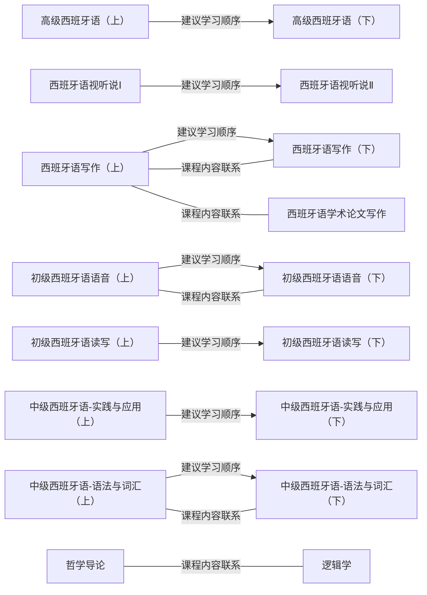

# 西班牙语专业“2+X”修读建议

2024 年汇编印刷页 267–268。原表记录 28 个可配对的课程代码。

[本节原页](plan-264.pdf#page=4) · [逐行数据](plan-264.json) · [院系目录](README.md)

## 课程导读

想了解西班牙语学习的课程安排，可以在原表中找到《初级西班牙语读写（上）》（`FORE130565`）、《初级西班牙语语音（上）》（`FORE130555`）、《初级西班牙语读写（下）》（`FORE130566`）。 [原书 PDF 第 281 页](plan-264.pdf#page=4)

图中连接《西班牙语写作（上）》（`FORE130486`）和《西班牙语写作（下）》（`FORE130487`），两门课都从课程题名标出的“写作”切入，可沿这一主题对照阅读。 [原书 PDF 第 282 页](plan-264.pdf#page=5)

## 课程关系图

图中展示最多 20 条关系。下表列出本节全部关系。建议学习顺序供规划课程使用，正式选课资格以教务规定为准。

| 课程 | 关联课程 | 关系 | 依据 |
| --- | --- | --- | --- |
| 高级西班牙语（上）（FORE130479） | 高级西班牙语（下）（FORE130480） | 建议学习顺序 | 同节课程题名标明连续分册或序号。 |
| 西班牙语视听说Ⅰ（FORE130481） | 西班牙语视听说Ⅱ（FORE130482） | 建议学习顺序 | 同节课程题名标明连续分册或序号。 |
| 西班牙语写作（上）（FORE130486） | 西班牙语写作（下）（FORE130487） | 建议学习顺序 | 同节课程题名标明连续分册或序号。 |
| 初级西班牙语语音（上）（FORE130555） | 初级西班牙语语音（下）（FORE130556） | 建议学习顺序 | 同节课程题名标明连续分册或序号。 |
| 初级西班牙语读写（上）（FORE130565） | 初级西班牙语读写（下）（FORE130566） | 建议学习顺序 | 同节课程题名标明连续分册或序号。 |
| 中级西班牙语-实践与应用（上）（FORE130567） | 中级西班牙语-实践与应用（下）（FORE130568） | 建议学习顺序 | 同节课程题名标明连续分册或序号。 |
| 中级西班牙语-语法与词汇（上）（FORE130569） | 中级西班牙语-语法与词汇（下）（FORE130570） | 建议学习顺序 | 同节课程题名标明连续分册或序号。 |
| 西班牙语写作（上）（FORE130486） | 西班牙语写作（下）（FORE130487） | 课程内容联系 | 本方案两门课程的题名均含“写作”，可据此对照这一主题。 |
| 西班牙语写作（上）（FORE130486） | 西班牙语学术论文写作（FORE130489） | 课程内容联系 | 本方案两门课程的题名均含“写作”，可据此对照这一主题。 |
| 初级西班牙语语音（上）（FORE130555） | 初级西班牙语语音（下）（FORE130556） | 课程内容联系 | 本方案两门课程的题名均含“语音”，可据此对照这一主题。 |
| 中级西班牙语-语法与词汇（上）（FORE130569） | 中级西班牙语-语法与词汇（下）（FORE130570） | 课程内容联系 | 本方案两门课程的题名均含“语法”，可据此对照这一主题。 |
| 哲学导论（PHIL120012） | 逻辑学（PHIL120013） | 课程内容联系 | 论证与概念分析是哲学讨论的共同方法。 |

## 课程

| 课程代码 | 名称 | 开课学期原文 | 来源（PDF 页） |
| --- | --- | --- | --- |
| CHIN120012 | 中国文学经典 |  | 281 |
| FORE130028 | 实习调查 |  | 282 |
| FORE130029 | 毕业论文 |  | 282 |
| FORE130322 | 学术前沿专题 |  | 282 |
| FORE130479 | 高级西班牙语（上） |  | 282 |
| FORE130480 | 高级西班牙语（下） |  | 282 |
| FORE130481 | 西班牙语视听说Ⅰ |  | 282 |
| FORE130482 | 西班牙语视听说Ⅱ |  | 282 |
| FORE130486 | 西班牙语写作（上） |  | 282 |
| FORE130487 | 西班牙语写作（下） |  | 282 |
| FORE130489 | 西班牙语学术论文写作 |  | 282 |
| FORE130491 | 拉丁美洲历史文化与艺术 |  | 282 |
| FORE130555 | 初级西班牙语语音（上） |  | 281 |
| FORE130556 | 初级西班牙语语音（下） |  | 281 |
| FORE130565 | 初级西班牙语读写（上） |  | 281 |
| FORE130566 | 初级西班牙语读写（下） |  | 281 |
| FORE130567 | 中级西班牙语-实践与应用（上） |  | 281 |
| FORE130568 | 中级西班牙语-实践与应用（下） |  | 281 |
| FORE130569 | 中级西班牙语-语法与词汇（上） |  | 281 |
| FORE130570 | 中级西班牙语-语法与词汇（下） |  | 282 |
| HIST120012 | 中国古代文明 |  | 281 |
| PHIL120012 | 哲学导论 |  | 281 |
| PHIL120013 | 逻辑学 |  | 281 |
| PTSS110082 | 毛泽东思想和中国特色社会主义理论体系概论 |  | 281 |
| PTSS110087 | 马克思主义基本原理 |  | 281 |
| PTSS110088 | 中国近现代史纲要 |  | 281 |
| PTSS110089 | 思想道德与法治 |  | 281 |
| PTSS110090 | 习近平新时代中国特色社会主义思想概论 |  | 281 |
