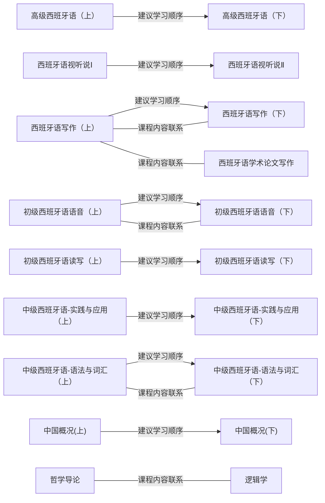

# 西班牙语专业“2+X”修读建议（留学生适用）

2024 年汇编印刷页 269–270。原表记录 25 个可配对的课程代码。

[本节原页](plan-264.pdf#page=6) · [逐行数据](plan-264.json) · [院系目录](README.md)

## 课程关系图

图中展示最多 20 条关系。下表列出本节全部关系。建议学习顺序供规划课程使用，正式选课资格以教务规定为准。

| 课程 | 关联课程 | 关系 | 依据 |
| --- | --- | --- | --- |
| 高级西班牙语（上）（FORE130479） | 高级西班牙语（下）（FORE130480） | 建议学习顺序 | 同节课程题名标明连续分册或序号。 |
| 西班牙语视听说Ⅰ（FORE130481） | 西班牙语视听说Ⅱ（FORE130482） | 建议学习顺序 | 同节课程题名标明连续分册或序号。 |
| 西班牙语写作（上）（FORE130486） | 西班牙语写作（下）（FORE130487） | 建议学习顺序 | 同节课程题名标明连续分册或序号。 |
| 初级西班牙语语音（上）（FORE130555） | 初级西班牙语语音（下）（FORE130556） | 建议学习顺序 | 同节课程题名标明连续分册或序号。 |
| 初级西班牙语读写（上）（FORE130565） | 初级西班牙语读写（下）（FORE130566） | 建议学习顺序 | 同节课程题名标明连续分册或序号。 |
| 中级西班牙语-实践与应用（上）（FORE130567） | 中级西班牙语-实践与应用（下）（FORE130568） | 建议学习顺序 | 同节课程题名标明连续分册或序号。 |
| 中级西班牙语-语法与词汇（上）（FORE130569） | 中级西班牙语-语法与词汇（下）（FORE130570） | 建议学习顺序 | 同节课程题名标明连续分册或序号。 |
| 中国概况(上)（ICES110012） | 中国概况(下)（ICES110013） | 建议学习顺序 | 同节课程题名标明连续分册或序号。 |
| 西班牙语写作（上）（FORE130486） | 西班牙语写作（下）（FORE130487） | 课程内容联系 | 本方案两门课程的题名均含“写作”，可据此对照这一主题。 |
| 西班牙语写作（上）（FORE130486） | 西班牙语学术论文写作（FORE130489） | 课程内容联系 | 本方案两门课程的题名均含“写作”，可据此对照这一主题。 |
| 初级西班牙语语音（上）（FORE130555） | 初级西班牙语语音（下）（FORE130556） | 课程内容联系 | 本方案两门课程的题名均含“语音”，可据此对照这一主题。 |
| 中级西班牙语-语法与词汇（上）（FORE130569） | 中级西班牙语-语法与词汇（下）（FORE130570） | 课程内容联系 | 本方案两门课程的题名均含“语法”，可据此对照这一主题。 |
| 哲学导论（PHIL120012） | 逻辑学（PHIL120013） | 课程内容联系 | 论证与概念分析是哲学讨论的共同方法。 |

## 课程

| 课程代码 | 名称 | 开课学期原文 | 来源（PDF 页） |
| --- | --- | --- | --- |
| CHIN120012 | 中国文学经典 |  | 283 |
| FORE130028 | 实习调查 |  | 283 |
| FORE130029 | 毕业论文 |  | 284 |
| FORE130322 | 学术前沿专题 |  | 283 |
| FORE130479 | 高级西班牙语（上） |  | 283 |
| FORE130480 | 高级西班牙语（下） |  | 283 |
| FORE130481 | 西班牙语视听说Ⅰ |  | 283 |
| FORE130482 | 西班牙语视听说Ⅱ |  | 283 |
| FORE130486 | 西班牙语写作（上） |  | 283 |
| FORE130487 | 西班牙语写作（下） |  | 283 |
| FORE130489 | 西班牙语学术论文写作 |  | 283 |
| FORE130491 | 拉丁美洲历史文化与艺术 |  | 283 |
| FORE130555 | 初级西班牙语语音（上） |  | 283 |
| FORE130556 | 初级西班牙语语音（下） |  | 283 |
| FORE130565 | 初级西班牙语读写（上） |  | 283 |
| FORE130566 | 初级西班牙语读写（下） |  | 283 |
| FORE130567 | 中级西班牙语-实践与应用（上） |  | 283 |
| FORE130568 | 中级西班牙语-实践与应用（下） |  | 283 |
| FORE130569 | 中级西班牙语-语法与词汇（上） |  | 283 |
| FORE130570 | 中级西班牙语-语法与词汇（下） |  | 283 |
| HIST120012 | 中国古代文明 |  | 283 |
| ICES110012 | 中国概况(上) |  | 283 |
| ICES110013 | 中国概况(下) |  | 283 |
| PHIL120012 | 哲学导论 |  | 283 |
| PHIL120013 | 逻辑学 |  | 283 |
