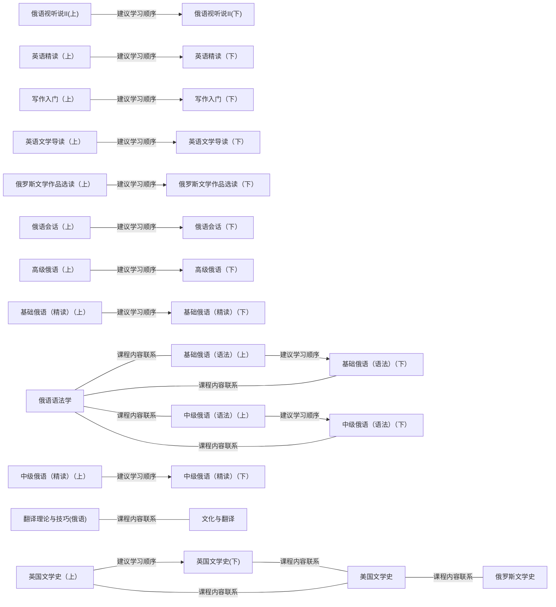

# 俄语（俄语-英语复语试验班）专业“2+X”教学培养方案

2024 年汇编印刷页 271–274。原表记录 66 个可配对的课程代码。

[本节原页](plan-271.pdf#page=1) · [逐行数据](plan-271.json) · [院系目录](README.md)

## 课程关系图

图中展示最多 20 条关系。下表列出本节全部关系。建议学习顺序供规划课程使用，正式选课资格以教务规定为准。

| 课程 | 关联课程 | 关系 | 依据 |
| --- | --- | --- | --- |
| 英国文学史（上）（FORE130021） | 英国文学史(下)（FORE130022） | 建议学习顺序 | 同节课程题名标明连续分册或序号。 |
| 俄语视听说II(上)（FORE130099） | 俄语视听说II(下)（FORE130402） | 建议学习顺序 | 同节课程题名标明连续分册或序号。 |
| 英语精读（上）（FORE130346） | 英语精读（下）（FORE130350） | 建议学习顺序 | 同节课程题名标明连续分册或序号。 |
| 写作入门（上）（FORE130347） | 写作入门（下）（FORE130351） | 建议学习顺序 | 同节课程题名标明连续分册或序号。 |
| 英语文学导读（上）（FORE130348） | 英语文学导读（下）（FORE130352） | 建议学习顺序 | 同节课程题名标明连续分册或序号。 |
| 俄罗斯文学作品选读（上）（FORE130403） | 俄罗斯文学作品选读（下）（FORE130404） | 建议学习顺序 | 同节课程题名标明连续分册或序号。 |
| 俄语会话（上）（FORE130405） | 俄语会话（下）（FORE130406） | 建议学习顺序 | 同节课程题名标明连续分册或序号。 |
| 高级俄语（上）（FORE130550） | 高级俄语（下）（FORE130097） | 建议学习顺序 | 同节课程题名标明连续分册或序号。 |
| 基础俄语（精读）（上）（FORE130557） | 基础俄语（精读）（下）（FORE130558） | 建议学习顺序 | 同节课程题名标明连续分册或序号。 |
| 基础俄语（语法）（上）（FORE130559） | 基础俄语（语法）（下）（FORE130560） | 建议学习顺序 | 同节课程题名标明连续分册或序号。 |
| 中级俄语（精读）（上）（FORE130561） | 中级俄语（精读）（下）（FORE130562） | 建议学习顺序 | 同节课程题名标明连续分册或序号。 |
| 中级俄语（语法）（上）（FORE130563） | 中级俄语（语法）（下）（FORE130564） | 建议学习顺序 | 同节课程题名标明连续分册或序号。 |
| 英国文学史（上）（FORE130021） | 美国文学史（FORE130023） | 课程内容联系 | 本方案两门课程的题名均含“文学史”，可据此对照这一主题。 |
| 英国文学史(下)（FORE130022） | 美国文学史（FORE130023） | 课程内容联系 | 本方案两门课程的题名均含“文学史”，可据此对照这一主题。 |
| 美国文学史（FORE130023） | 俄罗斯文学史（FORE130468） | 课程内容联系 | 本方案两门课程的题名均含“文学史”，可据此对照这一主题。 |
| 翻译理论与技巧(俄语)（FORE130107） | 文化与翻译（FORE130385） | 课程内容联系 | 本方案两门课程的题名均含“翻译”，可据此对照这一主题。 |
| 俄语语法学（FORE130238） | 基础俄语（语法）（上）（FORE130559） | 课程内容联系 | 本方案两门课程的题名均含“语法”，可据此对照这一主题。 |
| 俄语语法学（FORE130238） | 基础俄语（语法）（下）（FORE130560） | 课程内容联系 | 本方案两门课程的题名均含“语法”，可据此对照这一主题。 |
| 俄语语法学（FORE130238） | 中级俄语（语法）（上）（FORE130563） | 课程内容联系 | 本方案两门课程的题名均含“语法”，可据此对照这一主题。 |
| 俄语语法学（FORE130238） | 中级俄语（语法）（下）（FORE130564） | 课程内容联系 | 本方案两门课程的题名均含“语法”，可据此对照这一主题。 |
| 英美小说面面观（FORE130334） | 俄罗斯小说（FORE130408） | 课程内容联系 | 本方案两门课程的题名均含“小说”，可据此对照这一主题。 |
| 写作入门（上）（FORE130347） | 俄语写作（FORE130544） | 课程内容联系 | 本方案两门课程的题名均含“写作”，可据此对照这一主题。 |
| 英语文学导读（上）（FORE130348） | 英语文学导读（下）（FORE130352） | 课程内容联系 | 本方案两门课程的题名均含“英语文学”，可据此对照这一主题。 |
| 写作入门（下）（FORE130351） | 俄语写作（FORE130544） | 课程内容联系 | 本方案两门课程的题名均含“写作”，可据此对照这一主题。 |
| 文学经典翻译（FORE130382） | 文化与翻译（FORE130385） | 课程内容联系 | 本方案两门课程的题名均含“翻译”，可据此对照这一主题。 |
| 俄语高级写作（FORE130412） | 俄语写作（FORE130544） | 课程内容联系 | 本方案两门课程的题名均含“写作”，可据此对照这一主题。 |
| 英国文学史（上）（FORE130021） | 英国文学史(下)（FORE130022） | 方案排课先后 | 本节原表所列全部明确学期均早于后者。 |
| 俄语视听说II(上)（FORE130099） | 俄语视听说II(下)（FORE130402） | 方案排课先后 | 本节原表所列全部明确学期均早于后者。 |
| 英语精读（上）（FORE130346） | 英语精读（下）（FORE130350） | 方案排课先后 | 本节原表所列全部明确学期均早于后者。 |
| 写作入门（上）（FORE130347） | 写作入门（下）（FORE130351） | 方案排课先后 | 本节原表所列全部明确学期均早于后者。 |
| 英语文学导读（上）（FORE130348） | 英语文学导读（下）（FORE130352） | 方案排课先后 | 本节原表所列全部明确学期均早于后者。 |
| 俄罗斯文学作品选读（上）（FORE130403） | 俄罗斯文学作品选读（下）（FORE130404） | 方案排课先后 | 本节原表所列全部明确学期均早于后者。 |
| 俄语会话（上）（FORE130405） | 俄语会话（下）（FORE130406） | 方案排课先后 | 本节原表所列全部明确学期均早于后者。 |
| 高级俄语（上）（FORE130550） | 高级俄语（下）（FORE130097） | 方案排课先后 | 本节原表所列全部明确学期均早于后者。 |
| 基础俄语（精读）（上）（FORE130557） | 基础俄语（精读）（下）（FORE130558） | 方案排课先后 | 本节原表所列全部明确学期均早于后者。 |
| 基础俄语（语法）（上）（FORE130559） | 基础俄语（语法）（下）（FORE130560） | 方案排课先后 | 本节原表所列全部明确学期均早于后者。 |
| 中级俄语（精读）（上）（FORE130561） | 中级俄语（精读）（下）（FORE130562） | 方案排课先后 | 本节原表所列全部明确学期均早于后者。 |
| 中级俄语（语法）（上）（FORE130563） | 中级俄语（语法）（下）（FORE130564） | 方案排课先后 | 本节原表所列全部明确学期均早于后者。 |

## 课程

| 课程代码 | 名称 | 开课学期原文 | 来源（PDF 页） |
| --- | --- | --- | --- |
| FORE130021 | 英国文学史（上） | 3 | 287 |
| FORE130022 | 英国文学史(下) | 4 | 287 |
| FORE130023 | 美国文学史 | 4 | 287 |
| FORE130028 | 实习调查 | 6 | 286 |
| FORE130029 | 毕业论文 | 8 | 286 |
| FORE130097 | 高级俄语（下） | 6 | 286 |
| FORE130099 | 俄语视听说II(上) | 3 | 286 |
| FORE130107 | 翻译理论与技巧(俄语) | 6 | 286 |
| FORE130109 | 俄语报刊 | 5 | 286 |
| FORE130194 | 英语文体学 | 5 | 287 |
| FORE130198 | 比较文学 | 6 | 287 |
| FORE130201 | 英美电影文学 | 7 | 287 |
| FORE130203 | 莎士比亚选读 | 6 | 287 |
| FORE130208 | 英语词汇学 | 3 | 287 |
| FORE130237 | 俄语词汇学 | 春，秋 | 287 |
| FORE130238 | 俄语语法学 | 6 | 286 |
| FORE130239 | 外贸俄语 | 5 | 287 |
| FORE130240 | 俄罗斯诗歌 | 春，秋 | 287 |
| FORE130243 | 俄语修辞学 | 春，秋 | 287 |
| FORE130244 | 俄语影视 | 春，秋 | 287 |
| FORE130246 | 俄罗斯概况 | 3 | 286 |
| FORE130272 | 文学研究方法论 | 5 | 287 |
| FORE130311 | 俄语视听说Ⅰ | 2 | 286 |
| FORE130323 | 商务口译 | 春，秋 | 287 |
| FORE130334 | 英美小说面面观 | 3 | 287 |
| FORE130336 | 应用语言学导论 | 5 | 287 |
| FORE130345 | 英语演讲 | 5 | 286 |
| FORE130346 | 英语精读（上） | 3 | 286 |
| FORE130347 | 写作入门（上） | 3 | 286 |
| FORE130348 | 英语文学导读（上） | 3 | 287 |
| FORE130349 | 英语辩论 | 春，秋 | 287 |
| FORE130350 | 英语精读（下） | 4 | 286 |
| FORE130351 | 写作入门（下） | 4 | 286 |
| FORE130352 | 英语文学导读（下） | 4 | 287 |
| FORE130374 | 英语语言史 | 3 | 286 |
| FORE130382 | 文学经典翻译 | 春，秋 | 287 |
| FORE130384 | 媒体英语 | 春，秋 | 287 |
| FORE130385 | 文化与翻译 | 春，秋 | 287 |
| FORE130386 | 流行文化的批判性阅读 | 5 | 287 |
| FORE130387 | 英美电影与文化 | 4 | 287 |
| FORE130393 | 全球化与中国文化 | 春，秋 | 286 |
| FORE130402 | 俄语视听说II(下) | 4 | 286 |
| FORE130403 | 俄罗斯文学作品选读（上） | 6 | 286 |
| FORE130404 | 俄罗斯文学作品选读（下） | 7 | 286 |
| FORE130405 | 俄语会话（上） | 1 | 285 |
| FORE130406 | 俄语会话（下） | 2 | 285 |
| FORE130407 | 俄罗斯文化 | 4 | 286 |
| FORE130408 | 俄罗斯小说 | 春，秋 | 287 |
| FORE130412 | 俄语高级写作 | 7 | 286 |
| FORE130468 | 俄罗斯文学史 | 2 | 285 |
| FORE130471 | 英国中世纪文学导读 | 春，秋 | 287 |
| FORE130519 | 语言学概论 | 春，秋 | 287 |
| FORE130527 | 18世纪美国文学 | 春，秋 | 287 |
| FORE130544 | 俄语写作 | 春，秋 | 286 |
| FORE130545 | 俄语言语礼节 | 春，秋 | 286 |
| FORE130546 | 当代俄罗斯 | 春，秋 | 286 |
| FORE130547 | 俄国历史 | 春，秋 | 287 |
| FORE130550 | 高级俄语（上） | 5 | 286 |
| FORE130557 | 基础俄语（精读）（上） | 1 | 285 |
| FORE130558 | 基础俄语（精读）（下） | 2 | 285 |
| FORE130559 | 基础俄语（语法）（上） | 1 | 285 |
| FORE130560 | 基础俄语（语法）（下） | 2 | 285 |
| FORE130561 | 中级俄语（精读）（上） | 3 | 285 |
| FORE130562 | 中级俄语（精读）（下） | 4 | 286 |
| FORE130563 | 中级俄语（语法）（上） | 3 | 285 |
| FORE130564 | 中级俄语（语法）（下） | 4 | 286 |
