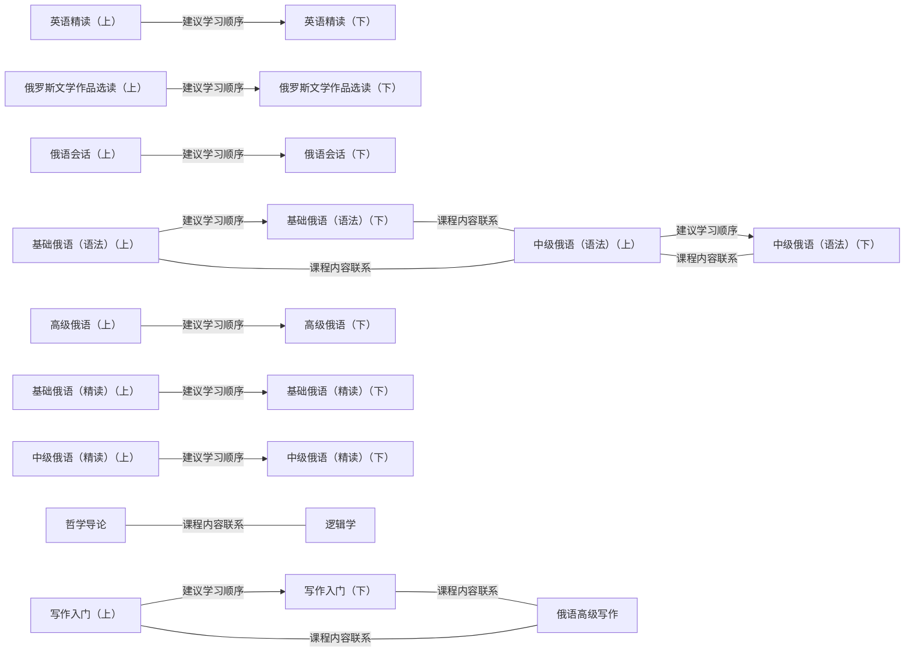

# 俄语（俄语-英语复语试验班）专业“2+X”修读建议

2024 年汇编印刷页 275–276。原表记录 35 个可配对的课程代码。

[本节原页](plan-271.pdf#page=5) · [逐行数据](plan-271.json) · [院系目录](README.md)

## 课程关系图

图中展示最多 20 条关系。下表列出本节全部关系。建议学习顺序供规划课程使用，正式选课资格以教务规定为准。

| 课程 | 关联课程 | 关系 | 依据 |
| --- | --- | --- | --- |
| 英语精读（上）（FORE130346） | 英语精读（下）（FORE130350） | 建议学习顺序 | 同节课程题名标明连续分册或序号。 |
| 写作入门（上）（FORE130347） | 写作入门（下）（FORE130351） | 建议学习顺序 | 同节课程题名标明连续分册或序号。 |
| 俄罗斯文学作品选读（上）（FORE130403） | 俄罗斯文学作品选读（下）（FORE130404） | 建议学习顺序 | 同节课程题名标明连续分册或序号。 |
| 俄语会话（上）（FORE130405） | 俄语会话（下）（FORE130406） | 建议学习顺序 | 同节课程题名标明连续分册或序号。 |
| 高级俄语（上）（FORE130550） | 高级俄语（下）（FORE130097） | 建议学习顺序 | 同节课程题名标明连续分册或序号。 |
| 基础俄语（精读）（上）（FORE130557） | 基础俄语（精读）（下）（FORE130558） | 建议学习顺序 | 同节课程题名标明连续分册或序号。 |
| 基础俄语（语法）（上）（FORE130559） | 基础俄语（语法）（下）（FORE130560） | 建议学习顺序 | 同节课程题名标明连续分册或序号。 |
| 中级俄语（精读）（上）（FORE130561） | 中级俄语（精读）（下）（FORE130562） | 建议学习顺序 | 同节课程题名标明连续分册或序号。 |
| 中级俄语（语法）（上）（FORE130563） | 中级俄语（语法）（下）（FORE130564） | 建议学习顺序 | 同节课程题名标明连续分册或序号。 |
| 写作入门（上）（FORE130347） | 俄语高级写作（FORE130412） | 课程内容联系 | 本方案两门课程的题名均含“写作”，可据此对照这一主题。 |
| 写作入门（下）（FORE130351） | 俄语高级写作（FORE130412） | 课程内容联系 | 本方案两门课程的题名均含“写作”，可据此对照这一主题。 |
| 基础俄语（语法）（上）（FORE130559） | 中级俄语（语法）（上）（FORE130563） | 课程内容联系 | 本方案两门课程的题名均含“语法”，可据此对照这一主题。 |
| 基础俄语（语法）（下）（FORE130560） | 中级俄语（语法）（上）（FORE130563） | 课程内容联系 | 本方案两门课程的题名均含“语法”，可据此对照这一主题。 |
| 中级俄语（语法）（上）（FORE130563） | 中级俄语（语法）（下）（FORE130564） | 课程内容联系 | 本方案两门课程的题名均含“语法”，可据此对照这一主题。 |
| 哲学导论（PHIL120012） | 逻辑学（PHIL120013） | 课程内容联系 | 论证与概念分析是哲学讨论的共同方法。 |

## 课程

| 课程代码 | 名称 | 开课学期原文 | 来源（PDF 页） |
| --- | --- | --- | --- |
| CHIN120012 | 中国文学经典 |  | 289 |
| FORE130028 | 实习调查 |  | 290 |
| FORE130029 | 毕业论文 |  | 290 |
| FORE130097 | 高级俄语（下） |  | 289 |
| FORE130107 | 翻译理论与技巧(俄语) |  | 289 |
| FORE130345 | 英语演讲 |  | 290 |
| FORE130346 | 英语精读（上） |  | 290 |
| FORE130347 | 写作入门（上） |  | 290 |
| FORE130350 | 英语精读（下） |  | 290 |
| FORE130351 | 写作入门（下） |  | 290 |
| FORE130374 | 英语语言史 |  | 290 |
| FORE130393 | 全球化与中国文化 |  | 290 |
| FORE130403 | 俄罗斯文学作品选读（上） |  | 289 |
| FORE130404 | 俄罗斯文学作品选读（下） |  | 290 |
| FORE130405 | 俄语会话（上） |  | 289 |
| FORE130406 | 俄语会话（下） |  | 289 |
| FORE130412 | 俄语高级写作 |  | 290 |
| FORE130468 | 俄罗斯文学史 |  | 289 |
| FORE130550 | 高级俄语（上） |  | 289 |
| FORE130557 | 基础俄语（精读）（上） |  | 289 |
| FORE130558 | 基础俄语（精读）（下） |  | 289 |
| FORE130559 | 基础俄语（语法）（上） |  | 289 |
| FORE130560 | 基础俄语（语法）（下） |  | 289 |
| FORE130561 | 中级俄语（精读）（上） |  | 289 |
| FORE130562 | 中级俄语（精读）（下） |  | 289 |
| FORE130563 | 中级俄语（语法）（上） |  | 289 |
| FORE130564 | 中级俄语（语法）（下） |  | 289 |
| HIST120012 | 中国古代文明 |  | 289 |
| PHIL120012 | 哲学导论 |  | 289 |
| PHIL120013 | 逻辑学 |  | 289 |
| PTSS110082 | 毛泽东思想和中国特色社会主义理论体系概论 |  | 289 |
| PTSS110087 | 马克思主义基本原理 |  | 289 |
| PTSS110088 | 中国近现代史纲要 |  | 289 |
| PTSS110089 | 思想道德与法治 |  | 289 |
| PTSS110090 | 习近平新时代中国特色社会主义思想概论 |  | 289 |
