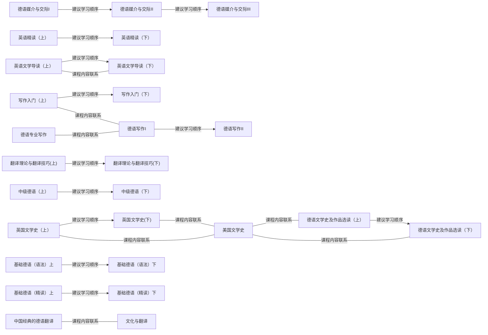

# 德语（德语-英语复语试验班）专业“2+X”教学培养方案

2024 年汇编印刷页 277–280。原表记录 65 个可配对的课程代码。

[本节原页](plan-277.pdf#page=1) · [逐行数据](plan-277.json) · [院系目录](README.md)

## 课程导读

想了解德语与英语的课程安排，可以在原表中找到《基础德语（精读）上》（`FORE130579`）、《英语精读（上）》（`FORE130346`）、《德国阐释哲学发展史概览》（`FORE130332`）。 [原书 PDF 第 291 页](plan-277.pdf#page=1) · [原书 PDF 第 292 页](plan-277.pdf#page=2)

图中连接《德语专业写作》（`FORE130338`）和《德语写作I》（`FORE130416`），两门课都从课程题名标出的“写作”切入，可沿这一主题对照阅读。 [原书 PDF 第 291 页](plan-277.pdf#page=1) · [原书 PDF 第 292 页](plan-277.pdf#page=2)

## 课程关系图

图中展示最多 20 条关系。下表列出本节全部关系。建议学习顺序供规划课程使用，正式选课资格以教务规定为准。

| 课程 | 关联课程 | 关系 | 依据 |
| --- | --- | --- | --- |
| 英国文学史（上）（FORE130021） | 英国文学史(下)（FORE130022） | 建议学习顺序 | 同节课程题名标明连续分册或序号。 |
| 德语文学史及作品选读（上）（FORE130050） | 德语文学史及作品选读（下）（FORE130051） | 建议学习顺序 | 同节课程题名标明连续分册或序号。 |
| 英语精读（上）（FORE130346） | 英语精读（下）（FORE130350） | 建议学习顺序 | 同节课程题名标明连续分册或序号。 |
| 写作入门（上）（FORE130347） | 写作入门（下）（FORE130351） | 建议学习顺序 | 同节课程题名标明连续分册或序号。 |
| 英语文学导读（上）（FORE130348） | 英语文学导读（下）（FORE130352） | 建议学习顺序 | 同节课程题名标明连续分册或序号。 |
| 德语媒介与交际I（FORE130413） | 德语媒介与交际II（FORE130414） | 建议学习顺序 | 同节课程题名标明连续分册或序号。 |
| 德语媒介与交际II（FORE130414） | 德语媒介与交际III（FORE130415） | 建议学习顺序 | 同节课程题名标明连续分册或序号。 |
| 德语写作I（FORE130416） | 德语写作II（FORE130418） | 建议学习顺序 | 同节课程题名标明连续分册或序号。 |
| 翻译理论与翻译技巧(上)（FORE130537） | 翻译理论与翻译技巧(下)（FORE130538） | 建议学习顺序 | 同节课程题名标明连续分册或序号。 |
| 中级德语（上）（FORE130573） | 中级德语（下）（FORE130574） | 建议学习顺序 | 同节课程题名标明连续分册或序号。 |
| 基础德语（语法）上（FORE130577） | 基础德语（语法）下（FORE130578） | 建议学习顺序 | 同节课程题名标明连续分册或序号。 |
| 基础德语（精读）上（FORE130579） | 基础德语（精读）下（FORE130580） | 建议学习顺序 | 同节课程题名标明连续分册或序号。 |
| 英国文学史（上）（FORE130021） | 美国文学史（FORE130023） | 课程内容联系 | 本方案两门课程的题名均含“文学史”，可据此对照这一主题。 |
| 英国文学史(下)（FORE130022） | 美国文学史（FORE130023） | 课程内容联系 | 本方案两门课程的题名均含“文学史”，可据此对照这一主题。 |
| 美国文学史（FORE130023） | 德语文学史及作品选读（上）（FORE130050） | 课程内容联系 | 本方案两门课程的题名均含“文学史”，可据此对照这一主题。 |
| 美国文学史（FORE130023） | 德语文学史及作品选读（下）（FORE130051） | 课程内容联系 | 本方案两门课程的题名均含“文学史”，可据此对照这一主题。 |
| 中国经典的德语翻译（FORE130333） | 文化与翻译（FORE130385） | 课程内容联系 | 本方案两门课程的题名均含“翻译”，可据此对照这一主题。 |
| 德语专业写作（FORE130338） | 德语写作I（FORE130416） | 课程内容联系 | 本方案两门课程的题名均含“写作”，可据此对照这一主题。 |
| 写作入门（上）（FORE130347） | 德语写作I（FORE130416） | 课程内容联系 | 本方案两门课程的题名均含“写作”，可据此对照这一主题。 |
| 英语文学导读（上）（FORE130348） | 英语文学导读（下）（FORE130352） | 课程内容联系 | 本方案两门课程的题名均含“英语文学”，可据此对照这一主题。 |
| 写作入门（下）（FORE130351） | 德语写作I（FORE130416） | 课程内容联系 | 本方案两门课程的题名均含“写作”，可据此对照这一主题。 |
| 文学经典翻译（FORE130382） | 文化与翻译（FORE130385） | 课程内容联系 | 本方案两门课程的题名均含“翻译”，可据此对照这一主题。 |
| 文化与翻译（FORE130385） | 翻译理论与翻译技巧(上)（FORE130537） | 课程内容联系 | 本方案两门课程的题名均含“翻译”，可据此对照这一主题。 |
| 文化与翻译（FORE130385） | 翻译理论与翻译技巧(下)（FORE130538） | 课程内容联系 | 本方案两门课程的题名均含“翻译”，可据此对照这一主题。 |
| 德语媒介与交际I（FORE130413） | 德语媒介与交际II（FORE130414） | 课程内容联系 | 本方案两门课程的题名均含“媒介”，可据此对照这一主题。 |
| 德语媒介与交际I（FORE130413） | 德语媒介与交际III（FORE130415） | 课程内容联系 | 本方案两门课程的题名均含“媒介”，可据此对照这一主题。 |
| 德语写作I（FORE130416） | 德语写作II（FORE130418） | 课程内容联系 | 本方案两门课程的题名均含“写作”，可据此对照这一主题。 |
| 德语语法（FORE130522） | 基础德语（语法）上（FORE130577） | 课程内容联系 | 本方案两门课程的题名均含“语法”，可据此对照这一主题。 |
| 德语语法（FORE130522） | 基础德语（语法）下（FORE130578） | 课程内容联系 | 本方案两门课程的题名均含“语法”，可据此对照这一主题。 |
| 英国文学史（上）（FORE130021） | 英国文学史(下)（FORE130022） | 方案排课先后 | 本节原表所列全部明确学期均早于后者。 |
| 德语文学史及作品选读（上）（FORE130050） | 德语文学史及作品选读（下）（FORE130051） | 方案排课先后 | 本节原表所列全部明确学期均早于后者。 |
| 英语精读（上）（FORE130346） | 英语精读（下）（FORE130350） | 方案排课先后 | 本节原表所列全部明确学期均早于后者。 |
| 写作入门（上）（FORE130347） | 写作入门（下）（FORE130351） | 方案排课先后 | 本节原表所列全部明确学期均早于后者。 |
| 英语文学导读（上）（FORE130348） | 英语文学导读（下）（FORE130352） | 方案排课先后 | 本节原表所列全部明确学期均早于后者。 |
| 德语媒介与交际I（FORE130413） | 德语媒介与交际II（FORE130414） | 方案排课先后 | 本节原表所列全部明确学期均早于后者。 |
| 德语媒介与交际II（FORE130414） | 德语媒介与交际III（FORE130415） | 方案排课先后 | 本节原表所列全部明确学期均早于后者。 |
| 德语写作I（FORE130416） | 德语写作II（FORE130418） | 方案排课先后 | 本节原表所列全部明确学期均早于后者。 |
| 翻译理论与翻译技巧(上)（FORE130537） | 翻译理论与翻译技巧(下)（FORE130538） | 方案排课先后 | 本节原表所列全部明确学期均早于后者。 |
| 中级德语（上）（FORE130573） | 中级德语（下）（FORE130574） | 方案排课先后 | 本节原表所列全部明确学期均早于后者。 |
| 基础德语（语法）上（FORE130577） | 基础德语（语法）下（FORE130578） | 方案排课先后 | 本节原表所列全部明确学期均早于后者。 |
| 基础德语（精读）上（FORE130579） | 基础德语（精读）下（FORE130580） | 方案排课先后 | 本节原表所列全部明确学期均早于后者。 |

## 课程

| 课程代码 | 名称 | 开课学期原文 | 来源（PDF 页） |
| --- | --- | --- | --- |
| FORE130021 | 英国文学史（上） | 3 | 293 |
| FORE130022 | 英国文学史(下) | 4 | 293 |
| FORE130023 | 美国文学史 | 4 | 293 |
| FORE130028 | 实习调查 | 6 | 292 |
| FORE130029 | 毕业论文 | 8 | 292 |
| FORE130050 | 德语文学史及作品选读（上） | 6 | 292 |
| FORE130051 | 德语文学史及作品选读（下） | 7 | 292 |
| FORE130194 | 英语文体学 | 5 | 293 |
| FORE130198 | 比较文学 | 6 | 293 |
| FORE130201 | 英美电影文学 | 7 | 293 |
| FORE130203 | 莎士比亚选读 | 6 | 293 |
| FORE130208 | 英语词汇学 | 3 | 293 |
| FORE130211 | 西方现代主义文学潮流 | 春，秋 | 293 |
| FORE130214 | 德语语言学概论 | 春，秋 | 292 |
| FORE130217 | 德语影视 | 春，秋 | 292 |
| FORE130266 | 德语文学经典研究 | 春，秋 | 293 |
| FORE130272 | 文学研究方法论 | 5 | 293 |
| FORE130276 | 奥地利文化 | 春，秋 | 292 |
| FORE130322 | 学术前沿专题 | 春，秋 | 293 |
| FORE130323 | 商务口译 | 春，秋 | 293 |
| FORE130330 | 《浮士德》 | 春，秋 | 292 |
| FORE130331 | 跨文化交际 | 春，秋 | 293 |
| FORE130332 | 德国阐释哲学发展史概览 | 春，秋 | 292 |
| FORE130333 | 中国经典的德语翻译 | 春，秋 | 293 |
| FORE130334 | 英美小说面面观 | 3 | 293 |
| FORE130336 | 应用语言学导论 | 5 | 293 |
| FORE130338 | 德语专业写作 | 7 | 292 |
| FORE130345 | 英语演讲 | 5 | 292 |
| FORE130346 | 英语精读（上） | 3 | 292 |
| FORE130347 | 写作入门（上） | 3 | 292 |
| FORE130348 | 英语文学导读（上） | 3 | 293 |
| FORE130349 | 英语辩论 | 春，秋 | 293 |
| FORE130350 | 英语精读（下） | 4 | 292 |
| FORE130351 | 写作入门（下） | 4 | 292 |
| FORE130352 | 英语文学导读（下） | 4 | 293 |
| FORE130374 | 英语语言史 | 3 | 292 |
| FORE130382 | 文学经典翻译 | 春，秋 | 293 |
| FORE130384 | 媒体英语 | 春，秋 | 293 |
| FORE130385 | 文化与翻译 | 春，秋 | 293 |
| FORE130386 | 流行文化的批判性阅读 | 5 | 293 |
| FORE130387 | 英美电影与文化 | 4 | 293 |
| FORE130393 | 全球化与中国文化 | 春，秋 | 292 |
| FORE130413 | 德语媒介与交际I | 2 | 291 |
| FORE130414 | 德语媒介与交际II | 3 | 291 |
| FORE130415 | 德语媒介与交际III | 4 | 292 |
| FORE130416 | 德语写作I | 3 | 291 |
| FORE130418 | 德语写作II | 6 | 292 |
| FORE130419 | 日耳曼学研究 | 1 | 291 |
| FORE130471 | 英国中世纪文学导读 | 春，秋 | 293 |
| FORE130506 | 德国浪漫主义——源头、影响及批判 | 春，秋 | 292 |
| FORE130507 | 德语文学与圣经传统 | 春，秋 | 293 |
| FORE130519 | 语言学概论 | 春，秋 | 293 |
| FORE130522 | 德语语法 | 4 | 292 |
| FORE130523 | 德国戏剧赏析 | 春，秋 | 292 |
| FORE130527 | 18世纪美国文学 | 春，秋 | 293 |
| FORE130537 | 翻译理论与翻译技巧(上) | 7 | 292 |
| FORE130538 | 翻译理论与翻译技巧(下) | 8 | 292 |
| FORE130539 | 跟马克思学德语——《共产党宣言》研读 | 春，秋 | 293 |
| FORE130573 | 中级德语（上） | 3 | 291 |
| FORE130574 | 中级德语（下） | 4 | 292 |
| FORE130575 | 中德文化交流的历史与现状 | 春，秋 | 292 |
| FORE130577 | 基础德语（语法）上 | 1 | 291 |
| FORE130578 | 基础德语（语法）下 | 2 | 291 |
| FORE130579 | 基础德语（精读）上 | 1 | 291 |
| FORE130580 | 基础德语（精读）下 | 2 | 291 |
