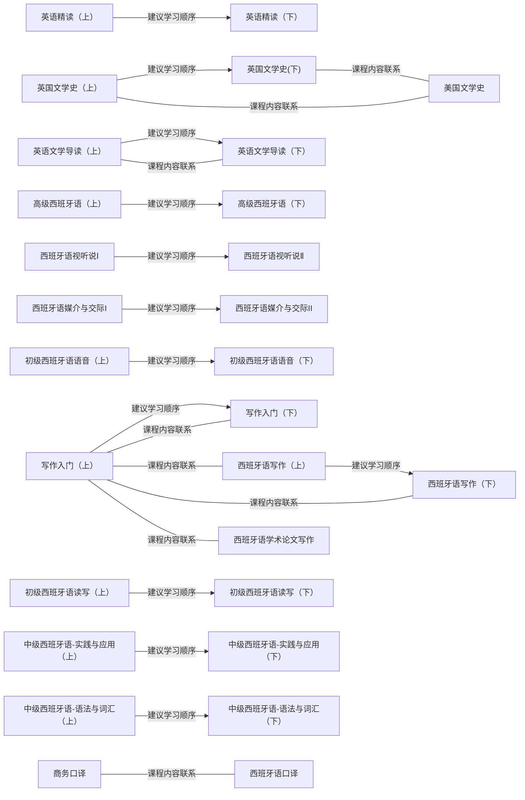

# 西班牙语（西班牙语-英语复语试验班）专业“2+X”教学培养方案

2024 年汇编印刷页 289–292。原表记录 64 个可配对的课程代码。

[本节原页](plan-289.pdf#page=1) · [逐行数据](plan-289.json) · [院系目录](README.md)

## 课程导读

想了解西班牙语与英语的课程安排，可以在原表中找到《初级西班牙语读写（上）》（`FORE130565`）、《英语精读（上）》（`FORE130346`）、《初级西班牙语语音（上）》（`FORE130555`）。 [原书 PDF 第 303 页](plan-289.pdf#page=1) · [原书 PDF 第 304 页](plan-289.pdf#page=2)

图中连接《英语文学导读（上）》（`FORE130348`）和《英语文学导读（下）》（`FORE130352`），两门课都从课程题名标出的“英语文学”切入，可沿这一主题对照阅读。 [原书 PDF 第 305 页](plan-289.pdf#page=3)

## 课程关系图

图中展示最多 20 条关系。下表列出本节全部关系。建议学习顺序供规划课程使用，正式选课资格以教务规定为准。

| 课程 | 关联课程 | 关系 | 依据 |
| --- | --- | --- | --- |
| 英国文学史（上）（FORE130021） | 英国文学史(下)（FORE130022） | 建议学习顺序 | 同节课程题名标明连续分册或序号。 |
| 英语精读（上）（FORE130346） | 英语精读（下）（FORE130350） | 建议学习顺序 | 同节课程题名标明连续分册或序号。 |
| 写作入门（上）（FORE130347） | 写作入门（下）（FORE130351） | 建议学习顺序 | 同节课程题名标明连续分册或序号。 |
| 英语文学导读（上）（FORE130348） | 英语文学导读（下）（FORE130352） | 建议学习顺序 | 同节课程题名标明连续分册或序号。 |
| 高级西班牙语（上）（FORE130479） | 高级西班牙语（下）（FORE130480） | 建议学习顺序 | 同节课程题名标明连续分册或序号。 |
| 西班牙语视听说Ⅰ（FORE130481） | 西班牙语视听说Ⅱ（FORE130482） | 建议学习顺序 | 同节课程题名标明连续分册或序号。 |
| 西班牙语写作（上）（FORE130486） | 西班牙语写作（下）（FORE130487） | 建议学习顺序 | 同节课程题名标明连续分册或序号。 |
| 西班牙语媒介与交际I（FORE130509） | 西班牙语媒介与交际II（FORE130510） | 建议学习顺序 | 同节课程题名标明连续分册或序号。 |
| 初级西班牙语语音（上）（FORE130555） | 初级西班牙语语音（下）（FORE130556） | 建议学习顺序 | 同节课程题名标明连续分册或序号。 |
| 初级西班牙语读写（上）（FORE130565） | 初级西班牙语读写（下）（FORE130566） | 建议学习顺序 | 同节课程题名标明连续分册或序号。 |
| 中级西班牙语-实践与应用（上）（FORE130567） | 中级西班牙语-实践与应用（下）（FORE130568） | 建议学习顺序 | 同节课程题名标明连续分册或序号。 |
| 中级西班牙语-语法与词汇（上）（FORE130569） | 中级西班牙语-语法与词汇（下）（FORE130570） | 建议学习顺序 | 同节课程题名标明连续分册或序号。 |
| 英国文学史（上）（FORE130021） | 美国文学史（FORE130023） | 课程内容联系 | 本方案两门课程的题名均含“文学史”，可据此对照这一主题。 |
| 英国文学史(下)（FORE130022） | 美国文学史（FORE130023） | 课程内容联系 | 本方案两门课程的题名均含“文学史”，可据此对照这一主题。 |
| 商务口译（FORE130323） | 西班牙语口译（FORE130495） | 课程内容联系 | 本方案两门课程的题名均含“口译”，可据此对照这一主题。 |
| 写作入门（上）（FORE130347） | 写作入门（下）（FORE130351） | 课程内容联系 | 本方案两门课程的题名均含“写作”，可据此对照这一主题。 |
| 写作入门（上）（FORE130347） | 西班牙语写作（上）（FORE130486） | 课程内容联系 | 本方案两门课程的题名均含“写作”，可据此对照这一主题。 |
| 写作入门（上）（FORE130347） | 西班牙语写作（下）（FORE130487） | 课程内容联系 | 本方案两门课程的题名均含“写作”，可据此对照这一主题。 |
| 写作入门（上）（FORE130347） | 西班牙语学术论文写作（FORE130489） | 课程内容联系 | 本方案两门课程的题名均含“写作”，可据此对照这一主题。 |
| 英语文学导读（上）（FORE130348） | 英语文学导读（下）（FORE130352） | 课程内容联系 | 本方案两门课程的题名均含“英语文学”，可据此对照这一主题。 |
| 文学经典翻译（FORE130382） | 文化与翻译（FORE130385） | 课程内容联系 | 本方案两门课程的题名均含“翻译”，可据此对照这一主题。 |
| 文化与翻译（FORE130385） | 西班牙语翻译理论与实践（FORE130488） | 课程内容联系 | 本方案两门课程的题名均含“翻译”，可据此对照这一主题。 |
| 西班牙语语法（FORE130492） | 中级西班牙语-语法与词汇（上）（FORE130569） | 课程内容联系 | 本方案两门课程的题名均含“语法”，可据此对照这一主题。 |
| 西班牙语语法（FORE130492） | 中级西班牙语-语法与词汇（下）（FORE130570） | 课程内容联系 | 本方案两门课程的题名均含“语法”，可据此对照这一主题。 |
| 西班牙语媒介与交际I（FORE130509） | 西班牙语媒介与交际II（FORE130510） | 课程内容联系 | 本方案两门课程的题名均含“媒介”，可据此对照这一主题。 |
| 初级西班牙语语音（上）（FORE130555） | 初级西班牙语语音（下）（FORE130556） | 课程内容联系 | 本方案两门课程的题名均含“语音”，可据此对照这一主题。 |
| 英国文学史（上）（FORE130021） | 英国文学史(下)（FORE130022） | 方案排课先后 | 本节原表所列全部明确学期均早于后者。 |
| 英语精读（上）（FORE130346） | 英语精读（下）（FORE130350） | 方案排课先后 | 本节原表所列全部明确学期均早于后者。 |
| 写作入门（上）（FORE130347） | 写作入门（下）（FORE130351） | 方案排课先后 | 本节原表所列全部明确学期均早于后者。 |
| 英语文学导读（上）（FORE130348） | 英语文学导读（下）（FORE130352） | 方案排课先后 | 本节原表所列全部明确学期均早于后者。 |
| 高级西班牙语（上）（FORE130479） | 高级西班牙语（下）（FORE130480） | 方案排课先后 | 本节原表所列全部明确学期均早于后者。 |
| 西班牙语视听说Ⅰ（FORE130481） | 西班牙语视听说Ⅱ（FORE130482） | 方案排课先后 | 本节原表所列全部明确学期均早于后者。 |
| 西班牙语写作（上）（FORE130486） | 西班牙语写作（下）（FORE130487） | 方案排课先后 | 本节原表所列全部明确学期均早于后者。 |
| 初级西班牙语语音（上）（FORE130555） | 初级西班牙语语音（下）（FORE130556） | 方案排课先后 | 本节原表所列全部明确学期均早于后者。 |
| 初级西班牙语读写（上）（FORE130565） | 初级西班牙语读写（下）（FORE130566） | 方案排课先后 | 本节原表所列全部明确学期均早于后者。 |
| 中级西班牙语-实践与应用（上）（FORE130567） | 中级西班牙语-实践与应用（下）（FORE130568） | 方案排课先后 | 本节原表所列全部明确学期均早于后者。 |
| 中级西班牙语-语法与词汇（上）（FORE130569） | 中级西班牙语-语法与词汇（下）（FORE130570） | 方案排课先后 | 本节原表所列全部明确学期均早于后者。 |

## 课程

| 课程代码 | 名称 | 开课学期原文 | 来源（PDF 页） |
| --- | --- | --- | --- |
| FORE130021 | 英国文学史（上） | 3 | 305 |
| FORE130022 | 英国文学史(下) | 4 | 305 |
| FORE130023 | 美国文学史 | 4 | 305 |
| FORE130028 | 实习调查 | 6 | 304 |
| FORE130029 | 毕业论文 | 8 | 304 |
| FORE130194 | 英语文体学 | 5 | 305 |
| FORE130198 | 比较文学 | 6 | 305 |
| FORE130201 | 英美电影文学 | 7 | 305 |
| FORE130203 | 莎士比亚选读 | 6 | 305 |
| FORE130208 | 英语词汇学 | 3 | 305 |
| FORE130272 | 文学研究方法论 | 5 | 305 |
| FORE130322 | 学术前沿专题 | 春，秋 | 304 |
| FORE130323 | 商务口译 | 春，秋 | 305 |
| FORE130334 | 英美小说面面观 | 3 | 305 |
| FORE130336 | 应用语言学导论 | 5 | 305 |
| FORE130345 | 英语演讲 | 5 | 304 |
| FORE130346 | 英语精读（上） | 3 | 304 |
| FORE130347 | 写作入门（上） | 3 | 304 |
| FORE130348 | 英语文学导读（上） | 3 | 305 |
| FORE130349 | 英语辩论 | 春，秋 | 305 |
| FORE130350 | 英语精读（下） | 4 | 304 |
| FORE130351 | 写作入门（下） | 4 | 304 |
| FORE130352 | 英语文学导读（下） | 4 | 305 |
| FORE130374 | 英语语言史 | 3 | 304 |
| FORE130382 | 文学经典翻译 | 春，秋 | 305 |
| FORE130384 | 媒体英语 | 春，秋 | 305 |
| FORE130385 | 文化与翻译 | 春，秋 | 305 |
| FORE130386 | 流行文化的批判性阅读 | 5 | 305 |
| FORE130387 | 英美电影与文化 | 4 | 305 |
| FORE130393 | 全球化与中国文化 | 春，秋 | 304 |
| FORE130471 | 英国中世纪文学导读 | 春，秋 | 305 |
| FORE130479 | 高级西班牙语（上） | 5 | 304 |
| FORE130480 | 高级西班牙语（下） | 6 | 304 |
| FORE130481 | 西班牙语视听说Ⅰ | 2 | 304 |
| FORE130482 | 西班牙语视听说Ⅱ | 3 | 304 |
| FORE130483 | 西班牙语阅读 | 春，秋 | 305 |
| FORE130484 | 西班牙文学及作品导读 | 春，秋 | 304 |
| FORE130485 | 拉丁美洲文学及作品导读 | 春，秋 | 304 |
| FORE130486 | 西班牙语写作（上） | 5 | 304 |
| FORE130487 | 西班牙语写作（下） | 6 | 304 |
| FORE130488 | 西班牙语翻译理论与实践 | 春，秋 | 304 |
| FORE130489 | 西班牙语学术论文写作 | 7 | 304 |
| FORE130490 | 西班牙历史与文化 | 春，秋 | 305 |
| FORE130491 | 拉丁美洲历史文化与艺术 | 春，秋 | 304 |
| FORE130492 | 西班牙语语法 | 春，秋 | 304 |
| FORE130493 | 西班牙语语言学导论 | 春，秋 | 304 |
| FORE130495 | 西班牙语口译 | 春，秋 | 305 |
| FORE130496 | 西班牙语世界文化研究 | 春，秋 | 305 |
| FORE130497 | 中西跨文化交际 | 春，秋 | 305 |
| FORE130498 | 西班牙思想史 | 春，秋 | 304 |
| FORE130499 | 西班牙语报刊选读 | 春，秋 | 304 |
| FORE130500 | 西班牙语电影 | 春，秋 | 305 |
| FORE130509 | 西班牙语媒介与交际I | 春，秋 | 305 |
| FORE130510 | 西班牙语媒介与交际II | 春，秋 | 305 |
| FORE130519 | 语言学概论 | 春，秋 | 305 |
| FORE130527 | 18世纪美国文学 | 春，秋 | 305 |
| FORE130555 | 初级西班牙语语音（上） | 1 | 303 |
| FORE130556 | 初级西班牙语语音（下） | 2 | 303 |
| FORE130565 | 初级西班牙语读写（上） | 1 | 303 |
| FORE130566 | 初级西班牙语读写（下） | 2 | 303 |
| FORE130567 | 中级西班牙语-实践与应用（上） | 3 | 303 |
| FORE130568 | 中级西班牙语-实践与应用（下） | 4 | 303 |
| FORE130569 | 中级西班牙语-语法与词汇（上） | 3 | 303 |
| FORE130570 | 中级西班牙语-语法与词汇（下） | 4 | 304 |
