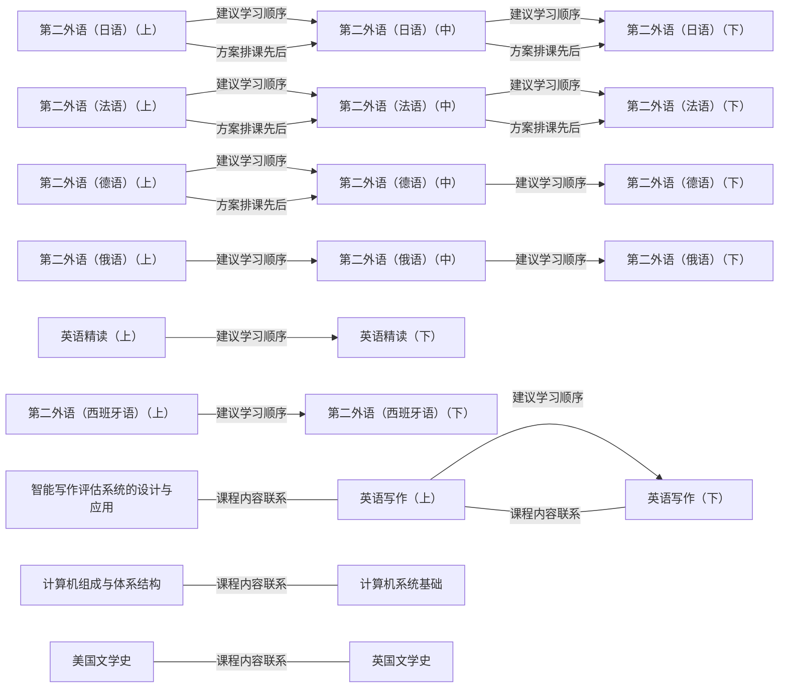

# 英语-计算机科学与技术双学士学位项目“2+X”教学培养方案

2024 年汇编印刷页 295–297。原表记录 62 个可配对的课程代码。

[本节原页](plan-295.pdf#page=1) · [逐行数据](plan-295.json) · [院系目录](README.md)

## 课程关系图

图中展示最多 20 条关系。下表列出本节全部关系。建议学习顺序供规划课程使用，正式选课资格以教务规定为准。

| 课程 | 关联课程 | 关系 | 依据 |
| --- | --- | --- | --- |
| 第二外语（日语）（上）（FORE130180） | 第二外语（日语）（中）（FORE130181） | 建议学习顺序 | 同节课程题名标明连续分册或序号。 |
| 第二外语（日语）（中）（FORE130181） | 第二外语（日语）（下）（FORE130182） | 建议学习顺序 | 同节课程题名标明连续分册或序号。 |
| 第二外语（法语）（上）（FORE130183） | 第二外语（法语）（中）（FORE130184） | 建议学习顺序 | 同节课程题名标明连续分册或序号。 |
| 第二外语（法语）（中）（FORE130184） | 第二外语（法语）（下）（FORE130185） | 建议学习顺序 | 同节课程题名标明连续分册或序号。 |
| 第二外语（德语）（上）（FORE130186） | 第二外语（德语）（中）（FORE130187） | 建议学习顺序 | 同节课程题名标明连续分册或序号。 |
| 第二外语（德语）（中）（FORE130187） | 第二外语（德语）（下）（FORE130188） | 建议学习顺序 | 同节课程题名标明连续分册或序号。 |
| 第二外语（俄语）（上）（FORE130189） | 第二外语（俄语）（中）（FORE130190） | 建议学习顺序 | 同节课程题名标明连续分册或序号。 |
| 第二外语（俄语）（中）（FORE130190） | 第二外语（俄语）（下）（FORE130191） | 建议学习顺序 | 同节课程题名标明连续分册或序号。 |
| 英语精读（上）（FORE130346） | 英语精读（下）（FORE130350） | 建议学习顺序 | 同节课程题名标明连续分册或序号。 |
| 第二外语（西班牙语）（上）（FORE130398） | 第二外语（西班牙语）（下）（FORE130399） | 建议学习顺序 | 同节课程题名标明连续分册或序号。 |
| 英语写作（上）（FORE130587） | 英语写作（下）（FORE130588） | 建议学习顺序 | 同节课程题名标明连续分册或序号。 |
| 智能写作评估系统的设计与应用（AIT531017） | 英语写作（上）（FORE130587） | 课程内容联系 | 本方案两门课程的题名均含“写作”，可据此对照这一主题。 |
| 计算机组成与体系结构（COMP130191） | 计算机系统基础（COMP130201） | 课程内容联系 | 处理器、存储与系统执行模型具有共同内容。 |
| 美国文学史（FORE130023） | 英国文学史（FORE130400） | 课程内容联系 | 本方案两门课程的题名均含“文学史”，可据此对照这一主题。 |
| 英语写作（上）（FORE130587） | 英语写作（下）（FORE130588） | 课程内容联系 | 本方案两门课程的题名均含“写作”，可据此对照这一主题。 |
| 第二外语（日语）（上）（FORE130180） | 第二外语（日语）（中）（FORE130181） | 方案排课先后 | 本节原表所列全部明确学期均早于后者。 |
| 第二外语（日语）（中）（FORE130181） | 第二外语（日语）（下）（FORE130182） | 方案排课先后 | 本节原表所列全部明确学期均早于后者。 |
| 第二外语（法语）（上）（FORE130183） | 第二外语（法语）（中）（FORE130184） | 方案排课先后 | 本节原表所列全部明确学期均早于后者。 |
| 第二外语（法语）（中）（FORE130184） | 第二外语（法语）（下）（FORE130185） | 方案排课先后 | 本节原表所列全部明确学期均早于后者。 |
| 第二外语（德语）（上）（FORE130186） | 第二外语（德语）（中）（FORE130187） | 方案排课先后 | 本节原表所列全部明确学期均早于后者。 |
| 第二外语（德语）（中）（FORE130187） | 第二外语（德语）（下）（FORE130188） | 方案排课先后 | 本节原表所列全部明确学期均早于后者。 |
| 第二外语（俄语）（上）（FORE130189） | 第二外语（俄语）（中）（FORE130190） | 方案排课先后 | 本节原表所列全部明确学期均早于后者。 |
| 第二外语（俄语）（中）（FORE130190） | 第二外语（俄语）（下）（FORE130191） | 方案排课先后 | 本节原表所列全部明确学期均早于后者。 |
| 英语精读（上）（FORE130346） | 英语精读（下）（FORE130350） | 方案排课先后 | 本节原表所列全部明确学期均早于后者。 |
| 第二外语（西班牙语）（上）（FORE130398） | 第二外语（西班牙语）（下）（FORE130399） | 方案排课先后 | 本节原表所列全部明确学期均早于后者。 |
| 英语写作（上）（FORE130587） | 英语写作（下）（FORE130588） | 方案排课先后 | 本节原表所列全部明确学期均早于后者。 |

## 课程

| 课程代码 | 名称 | 开课学期原文 | 来源（PDF 页） |
| --- | --- | --- | --- |
| AIS531002 | AI赋能的语言分析和语言习得 | 春，秋 | 311 |
| AIT531017 | 智能写作评估系统的设计与应用 | 春，秋 | 311 |
| COMP130002 | 数字逻辑与部件设计 | 3 | 310 |
| COMP130004 | 数据结构 | 3 | 310 |
| COMP130006 | 概率论与数理统计 | 5 | 311 |
| COMP130010 | 数据库引论 | 4 | 310 |
| COMP130011 | 算法设计与分析（全英文课程） | 4 | 310 |
| COMP130014 | 编译 | 6 | 310 |
| COMP130015 | 软件工程 | 6 | 310 |
| COMP130110 | 操作系统 | 5 | 310 |
| COMP130135 | 面向对象程序设计 | 2 | 310 |
| COMP130136 | 计算机网络 | 5 | 310 |
| COMP130138 | 人机交互 | 6 | 311 |
| COMP130148 | 数据挖掘技术 | 6 | 311 |
| COMP130149 | 集合与图论 | 3 | 310 |
| COMP130172 | 机器学习 | 5 | 311 |
| COMP130174 | 计算机可视化 | 6 | 311 |
| COMP130191 | 计算机组成与体系结构 | 4 | 310 |
| COMP130201 | 计算机系统基础 | 3 | 310 |
| COMP130207 | 人工智能 | 6 | 310 |
| FORE130023 | 美国文学史 | 6 | 310 |
| FORE130028 | 实习调查 | 6 | 311 |
| FORE130029 | 毕业论文 | 8 | 311 |
| FORE130180 | 第二外语（日语）（上） | 5 | 310 |
| FORE130181 | 第二外语（日语）（中） | 6 | 310 |
| FORE130182 | 第二外语（日语）（下） | 7 | 310 |
| FORE130183 | 第二外语（法语）（上） | 5 | 310 |
| FORE130184 | 第二外语（法语）（中） | 6 | 310 |
| FORE130185 | 第二外语（法语）（下） | 7 | 310 |
| FORE130186 | 第二外语（德语）（上） | 5 | 310 |
| FORE130187 | 第二外语（德语）（中） | 6 | 310 |
| FORE130188 | 第二外语（德语）（下） | 7 | 310 |
| FORE130189 | 第二外语（俄语）（上） | 5 | 310 |
| FORE130190 | 第二外语（俄语）（中） | 6 | 310 |
| FORE130191 | 第二外语（俄语）（下） | 7 | 311 |
| FORE130208 | 英语词汇学 | 春，秋 | 311 |
| FORE130272 | 文学研究方法论 | 5 | 311 |
| FORE130335 | 英语词典学导论 | 3 | 311 |
| FORE130345 | 英语演讲 | 2 | 309 |
| FORE130346 | 英语精读（上） | 1 | 309 |
| FORE130350 | 英语精读（下） | 2 | 309 |
| FORE130358 | 跨文化交际 | 4 | 309 |
| FORE130363 | 口译理论与实践 | 7 | 309 |
| FORE130373 | 英语语音学 | 3 | 311 |
| FORE130374 | 英语语言史 | 春，秋 | 310 |
| FORE130377 | 语言与教育 | 5 | 310 |
| FORE130379 | 语言与社会 | 4 | 311 |
| FORE130380 | 语言心理学 | 7 | 311 |
| FORE130397 | 跨语言语法比较 | 4 | 311 |
| FORE130398 | 第二外语（西班牙语）（上） | 3 | 311 |
| FORE130399 | 第二外语（西班牙语）（下） | 4 | 311 |
| FORE130400 | 英国文学史 | 3 | 310 |
| FORE130519 | 语言学概论 | 春，秋 | 310 |
| FORE130530 | 话语分析 | 6 | 311 |
| FORE130587 | 英语写作（上） | 1 | 309 |
| FORE130588 | 英语写作（下） | 2 | 309 |
| FORE130589 | 英语文学导读 | 2 | 310 |
| FORE130590 | 翻译理论基础 | 3 | 309 |
| FORE130591 | 数字人文导论 | 6 | 311 |
| FORE130593 | 自然语言处理与语言习得 | 4 | 310 |
| FORE130595 | 面向语言信息处理的语言逻辑理论 | 4 | 310 |
| FORE130596 | 面向语言信息处理的句法理论 | 6 | 310 |
