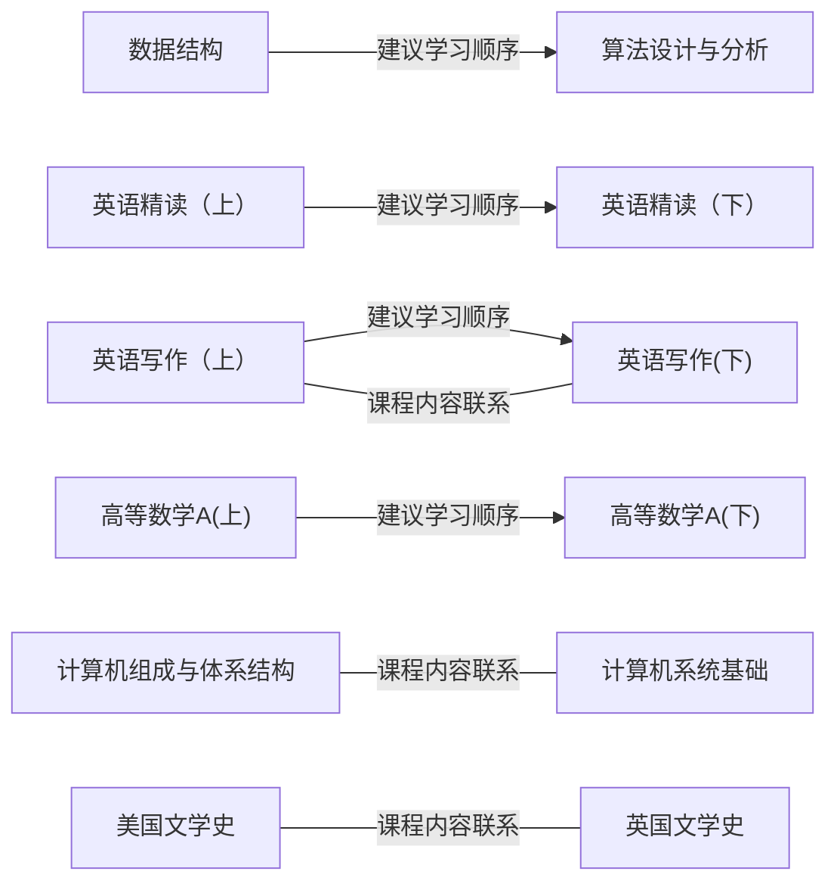

# 英语-计算机科学与技术双学士学位项目“2+X”修读建议

2024 年汇编印刷页 298–299。原表记录 43 个可配对的课程代码。

[本节原页](plan-295.pdf#page=4) · [逐行数据](plan-295.json) · [院系目录](README.md)

## 课程导读

想了解英语与计算机的课程安排，可以在原表中找到《英语精读（上）》（`FORE130346`）、《数据结构》（`COMP130004`）、《英国文学史》（`FORE130400`）。 [原书 PDF 第 312 页](plan-295.pdf#page=4) · [原书 PDF 第 313 页](plan-295.pdf#page=5)

图中连接《英语写作（上）》（`FORE130587`）和《英语写作(下)》（`FORE130588`），两门课都从课程题名标出的“写作”切入，可沿这一主题对照阅读。 [原书 PDF 第 312 页](plan-295.pdf#page=4)

## 课程关系图

图中展示最多 20 条关系。下表列出本节全部关系。建议学习顺序供规划课程使用，正式选课资格以教务规定为准。

| 课程 | 关联课程 | 关系 | 依据 |
| --- | --- | --- | --- |
| 数据结构（COMP130004） | 算法设计与分析（COMP130011） | 建议学习顺序 | 数据组织与基本操作为算法设计提供基础。 |
| 英语精读（上）（FORE130346） | 英语精读（下）（FORE130350） | 建议学习顺序 | 同节课程题名标明连续分册或序号。 |
| 英语写作（上）（FORE130587） | 英语写作(下)（FORE130588） | 建议学习顺序 | 同节课程题名标明连续分册或序号。 |
| 高等数学A(上)（MATH120021） | 高等数学A(下)（MATH120022） | 建议学习顺序 | 同节课程题名标明连续分册或序号。 |
| 计算机组成与体系结构（COMP130191） | 计算机系统基础（COMP130201） | 课程内容联系 | 处理器、存储与系统执行模型具有共同内容。 |
| 美国文学史（FORE130023） | 英国文学史（FORE130400） | 课程内容联系 | 本方案两门课程的题名均含“文学史”，可据此对照这一主题。 |
| 英语写作（上）（FORE130587） | 英语写作(下)（FORE130588） | 课程内容联系 | 本方案两门课程的题名均含“写作”，可据此对照这一主题。 |

## 课程

| 课程代码 | 名称 | 开课学期原文 | 来源（PDF 页） |
| --- | --- | --- | --- |
| CHIN120012 | 中国文学经典 |  | 312 |
| COMP120004 | 线性代数 |  | 312 |
| COMP120006 | 程序设计 |  | 312 |
| COMP130002 | 数字逻辑与部件设计 |  | 313 |
| COMP130004 | 数据结构 |  | 313 |
| COMP130010 | 数据库引论 |  | 313 |
| COMP130011 | 算法设计与分析 |  | 313 |
| COMP130014 | 编译 |  | 313 |
| COMP130015 | 软件工程 |  | 313 |
| COMP130110 | 操作系统 |  | 313 |
| COMP130135 | 面向对象程序设计 |  | 313 |
| COMP130136 | 计算机网络 |  | 313 |
| COMP130149 | 集合与图论 |  | 313 |
| COMP130191 | 计算机组成与体系结构 |  | 313 |
| COMP130201 | 计算机系统基础 |  | 313 |
| COMP130207 | 人工智能 |  | 313 |
| FORE130023 | 美国文学史 |  | 313 |
| FORE130028 | 实习调查 |  | 313 |
| FORE130029 | 毕业论文 |  | 313 |
| FORE130345 | 英语演讲 |  | 312 |
| FORE130346 | 英语精读（上） |  | 312 |
| FORE130350 | 英语精读（下） |  | 312 |
| FORE130358 | 跨文化交际 |  | 312 |
| FORE130363 | 口译理论与实践 |  | 313 |
| FORE130374 | 英语语言史 |  | 312 |
| FORE130377 | 语言与教育 |  | 312 |
| FORE130400 | 英国文学史 |  | 312 |
| FORE130519 | 语言学概论 |  | 312 |
| FORE130587 | 英语写作（上） |  | 312 |
| FORE130588 | 英语写作(下) |  | 312 |
| FORE130589 | 英语文学导读 |  | 312 |
| FORE130590 | 翻译理论基础 |  | 312 |
| FORE130593 | 自然语言处理与语言习得 |  | 312 |
| FORE130595 | 面向语言信息处理的语言逻辑理论 |  | 312 |
| FORE130596 | 面向语言信息处理的句法理论 |  | 313 |
| HIST120012 | 中国古代文明 |  | 312 |
| MATH120021 | 高等数学A(上) |  | 312 |
| MATH120022 | 高等数学A(下) |  | 312 |
| PTSS110082 | 毛泽东思想和中国特色社会主义理论体系概论 |  | 312 |
| PTSS110087 | 马克思主义基本原理 |  | 312 |
| PTSS110088 | 中国近现代史纲要 |  | 312 |
| PTSS110089 | 思想道德与法治 |  | 312 |
| PTSS110090 | 习近平新时代中国特色社会主义思想概论 |  | 312 |
