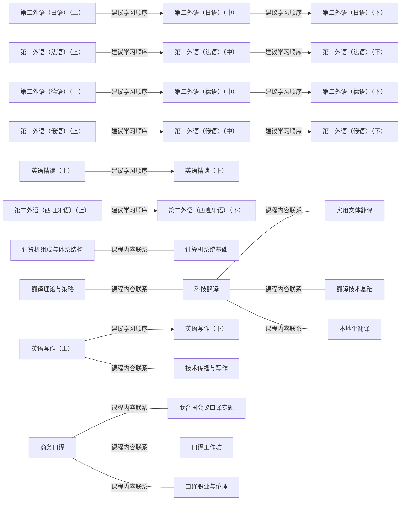

# 翻译-计算机科学与技术双学士学位项目“2+X”教学培养方案

2024 年汇编印刷页 300–302。原表记录 60 个可配对的课程代码。

[本节原页](plan-300.pdf#page=1) · [逐行数据](plan-300.json) · [院系目录](README.md)

## 课程关系图

图中展示最多 20 条关系。下表列出本节全部关系。建议学习顺序供规划课程使用，正式选课资格以教务规定为准。

| 课程 | 关联课程 | 关系 | 依据 |
| --- | --- | --- | --- |
| 第二外语（日语）（上）（FORE130180） | 第二外语（日语）（中）（FORE130181） | 建议学习顺序 | 同节课程题名标明连续分册或序号。 |
| 第二外语（日语）（中）（FORE130181） | 第二外语（日语）（下）（FORE130182） | 建议学习顺序 | 同节课程题名标明连续分册或序号。 |
| 第二外语（法语）（上）（FORE130183） | 第二外语（法语）（中）（FORE130184） | 建议学习顺序 | 同节课程题名标明连续分册或序号。 |
| 第二外语（法语）（中）（FORE130184） | 第二外语（法语）（下）（FORE130185） | 建议学习顺序 | 同节课程题名标明连续分册或序号。 |
| 第二外语（德语）（上）（FORE130186） | 第二外语（德语）（中）（FORE130187） | 建议学习顺序 | 同节课程题名标明连续分册或序号。 |
| 第二外语（德语）（中）（FORE130187） | 第二外语（德语）（下）（FORE130188） | 建议学习顺序 | 同节课程题名标明连续分册或序号。 |
| 第二外语（俄语）（上）（FORE130189） | 第二外语（俄语）（中）（FORE130190） | 建议学习顺序 | 同节课程题名标明连续分册或序号。 |
| 第二外语（俄语）（中）（FORE130190） | 第二外语（俄语）（下）（FORE130191） | 建议学习顺序 | 同节课程题名标明连续分册或序号。 |
| 英语精读（上）（FORE130346） | 英语精读（下）（FORE130350） | 建议学习顺序 | 同节课程题名标明连续分册或序号。 |
| 第二外语（西班牙语）（上）（FORE130398） | 第二外语（西班牙语）（下）（FORE130399） | 建议学习顺序 | 同节课程题名标明连续分册或序号。 |
| 英语写作（上）（FORE130587） | 英语写作（下）（FORE130588） | 建议学习顺序 | 同节课程题名标明连续分册或序号。 |
| 计算机组成与体系结构（COMP130191） | 计算机系统基础（COMP130201） | 课程内容联系 | 处理器、存储与系统执行模型具有共同内容。 |
| 翻译理论与策略（FORE130151） | 科技翻译（FORE130260） | 课程内容联系 | 本方案两门课程的题名均含“翻译”，可据此对照这一主题。 |
| 科技翻译（FORE130260） | 实用文体翻译（FORE130464） | 课程内容联系 | 本方案两门课程的题名均含“翻译”，可据此对照这一主题。 |
| 科技翻译（FORE130260） | 翻译技术基础（FORE130533） | 课程内容联系 | 本方案两门课程的题名均含“翻译”，可据此对照这一主题。 |
| 科技翻译（FORE130260） | 本地化翻译（FORE130534） | 课程内容联系 | 本方案两门课程的题名均含“翻译”，可据此对照这一主题。 |
| 商务口译（FORE130323） | 联合国会议口译专题（FORE130324） | 课程内容联系 | 本方案两门课程的题名均含“口译”，可据此对照这一主题。 |
| 商务口译（FORE130323） | 口译工作坊（FORE130343） | 课程内容联系 | 本方案两门课程的题名均含“口译”，可据此对照这一主题。 |
| 商务口译（FORE130323） | 口译职业与伦理（FORE130535） | 课程内容联系 | 本方案两门课程的题名均含“口译”，可据此对照这一主题。 |
| 英语写作（上）（FORE130587） | 技术传播与写作（FORE130594） | 课程内容联系 | 本方案两门课程的题名均含“写作”，可据此对照这一主题。 |
| 英语写作（下）（FORE130588） | 技术传播与写作（FORE130594） | 课程内容联系 | 本方案两门课程的题名均含“写作”，可据此对照这一主题。 |
| 第二外语（日语）（上）（FORE130180） | 第二外语（日语）（中）（FORE130181） | 方案排课先后 | 本节原表所列全部明确学期均早于后者。 |
| 第二外语（日语）（中）（FORE130181） | 第二外语（日语）（下）（FORE130182） | 方案排课先后 | 本节原表所列全部明确学期均早于后者。 |
| 第二外语（法语）（上）（FORE130183） | 第二外语（法语）（中）（FORE130184） | 方案排课先后 | 本节原表所列全部明确学期均早于后者。 |
| 第二外语（法语）（中）（FORE130184） | 第二外语（法语）（下）（FORE130185） | 方案排课先后 | 本节原表所列全部明确学期均早于后者。 |
| 第二外语（德语）（上）（FORE130186） | 第二外语（德语）（中）（FORE130187） | 方案排课先后 | 本节原表所列全部明确学期均早于后者。 |
| 第二外语（德语）（中）（FORE130187） | 第二外语（德语）（下）（FORE130188） | 方案排课先后 | 本节原表所列全部明确学期均早于后者。 |
| 第二外语（俄语）（上）（FORE130189） | 第二外语（俄语）（中）（FORE130190） | 方案排课先后 | 本节原表所列全部明确学期均早于后者。 |
| 第二外语（俄语）（中）（FORE130190） | 第二外语（俄语）（下）（FORE130191） | 方案排课先后 | 本节原表所列全部明确学期均早于后者。 |
| 英语精读（上）（FORE130346） | 英语精读（下）（FORE130350） | 方案排课先后 | 本节原表所列全部明确学期均早于后者。 |
| 第二外语（西班牙语）（上）（FORE130398） | 第二外语（西班牙语）（下）（FORE130399） | 方案排课先后 | 本节原表所列全部明确学期均早于后者。 |
| 英语写作（上）（FORE130587） | 英语写作（下）（FORE130588） | 方案排课先后 | 本节原表所列全部明确学期均早于后者。 |

## 课程

| 课程代码 | 名称 | 开课学期原文 | 来源（PDF 页） |
| --- | --- | --- | --- |
| COMP130002 | 数字逻辑与部件设计 | 3 | 315 |
| COMP130004 | 数据结构 | 3 | 315 |
| COMP130006 | 概率论与数理统计 | 5 | 316 |
| COMP130010 | 数据库引论 | 4 | 315 |
| COMP130011 | 算法设计与分析（全英文课程） | 4 | 315 |
| COMP130014 | 编译 | 6 | 315 |
| COMP130015 | 软件工程 | 6 | 315 |
| COMP130110 | 操作系统 | 5 | 315 |
| COMP130135 | 面向对象程序设计 | 2 | 315 |
| COMP130136 | 计算机网络 | 5 | 315 |
| COMP130138 | 人机交互 | 6 | 316 |
| COMP130148 | 数据挖掘技术 | 6 | 316 |
| COMP130149 | 集合与图论 | 3 | 315 |
| COMP130172 | 机器学习 | 5 | 316 |
| COMP130174 | 计算机可视化 | 6 | 316 |
| COMP130191 | 计算机组成与体系结构 | 4 | 315 |
| COMP130201 | 计算机系统基础 | 3 | 315 |
| COMP130207 | 人工智能 | 6 | 315 |
| FORE130028 | 实习调查 | 6 | 316 |
| FORE130029 | 毕业论文 | 8 | 316 |
| FORE130141 | 交替传译I | 4 | 315 |
| FORE130144 | 英汉互译技巧I | 4 | 315 |
| FORE130151 | 翻译理论与策略 | 6 | 316 |
| FORE130180 | 第二外语（日语）（上） | 5 | 315 |
| FORE130181 | 第二外语（日语）（中） | 6 | 315 |
| FORE130182 | 第二外语（日语）（下） | 7 | 315 |
| FORE130183 | 第二外语（法语）（上） | 5 | 315 |
| FORE130184 | 第二外语（法语）（中） | 6 | 315 |
| FORE130185 | 第二外语（法语）（下） | 7 | 315 |
| FORE130186 | 第二外语（德语）（上） | 5 | 315 |
| FORE130187 | 第二外语（德语）（中） | 6 | 315 |
| FORE130188 | 第二外语（德语）（下） | 7 | 315 |
| FORE130189 | 第二外语（俄语）（上） | 5 | 315 |
| FORE130190 | 第二外语（俄语）（中） | 6 | 315 |
| FORE130191 | 第二外语（俄语）（下） | 7 | 315 |
| FORE130260 | 科技翻译 | 3 | 316 |
| FORE130286 | 英语听说与译述（上） | 3 | 314 |
| FORE130323 | 商务口译 | 6 | 315 |
| FORE130324 | 联合国会议口译专题 | 8 | 316 |
| FORE130341 | 听说沙龙 | 4 | 314 |
| FORE130343 | 口译工作坊 | 7 | 316 |
| FORE130345 | 英语演讲 | 2 | 314 |
| FORE130346 | 英语精读（上） | 1 | 314 |
| FORE130350 | 英语精读（下） | 2 | 314 |
| FORE130398 | 第二外语（西班牙语）（上） | 3 | 315 |
| FORE130399 | 第二外语（西班牙语）（下） | 4 | 316 |
| FORE130452 | 英语读译 | 4 | 314 |
| FORE130457 | 中西文化比较 | 3 | 316 |
| FORE130460 | 视译基础 | 5 | 315 |
| FORE130462 | 同声传译基础 | 7 | 315 |
| FORE130464 | 实用文体翻译 | 6 | 316 |
| FORE130533 | 翻译技术基础 | 3 | 314 |
| FORE130534 | 本地化翻译 | 4 | 316 |
| FORE130535 | 口译职业与伦理 | 8 | 316 |
| FORE130554 | 英美影视剧字幕翻译 | 3 | 315 |
| FORE130587 | 英语写作（上） | 1 | 314 |
| FORE130588 | 英语写作（下） | 2 | 314 |
| FORE130589 | 英语文学导读 | 2 | 314 |
| FORE130594 | 技术传播与写作 | 5 | 315 |
| FORE130597 | Python与语料库翻译 | 5 | 316 |
