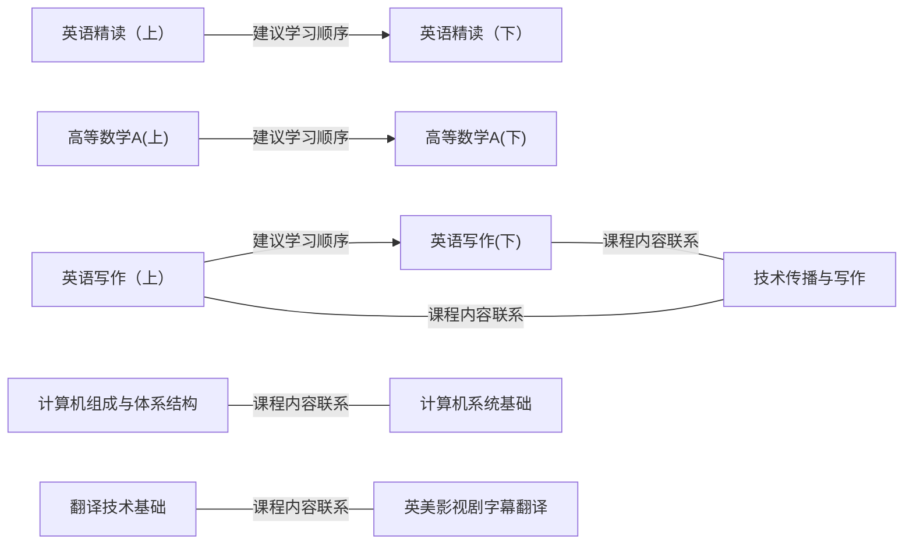

# 翻译-计算机科学与技术双学士学位项目“2+X”修读建议

2024 年汇编印刷页 303–304。原表记录 43 个可配对的课程代码。

[本节原页](plan-300.pdf#page=4) · [逐行数据](plan-300.json) · [院系目录](README.md)

## 课程关系图

图中展示最多 20 条关系。下表列出本节全部关系。建议学习顺序供规划课程使用，正式选课资格以教务规定为准。

| 课程 | 关联课程 | 关系 | 依据 |
| --- | --- | --- | --- |
| 英语精读（上）（FORE130346） | 英语精读（下）（FORE130350） | 建议学习顺序 | 同节课程题名标明连续分册或序号。 |
| 英语写作（上）（FORE130587） | 英语写作(下)（FORE130588） | 建议学习顺序 | 同节课程题名标明连续分册或序号。 |
| 高等数学A(上)（MATH120021） | 高等数学A(下)（MATH120022） | 建议学习顺序 | 同节课程题名标明连续分册或序号。 |
| 计算机组成与体系结构（COMP130191） | 计算机系统基础（COMP130201） | 课程内容联系 | 处理器、存储与系统执行模型具有共同内容。 |
| 翻译技术基础（FORE130533） | 英美影视剧字幕翻译（FORE130554） | 课程内容联系 | 本方案两门课程的题名均含“翻译”，可据此对照这一主题。 |
| 英语写作（上）（FORE130587） | 技术传播与写作（FORE130594） | 课程内容联系 | 本方案两门课程的题名均含“写作”，可据此对照这一主题。 |
| 英语写作(下)（FORE130588） | 技术传播与写作（FORE130594） | 课程内容联系 | 本方案两门课程的题名均含“写作”，可据此对照这一主题。 |

## 课程

| 课程代码 | 名称 | 开课学期原文 | 来源（PDF 页） |
| --- | --- | --- | --- |
| CHIN120012 | 中国文学经典 |  | 317 |
| COMP120004 | 线性代数 |  | 317 |
| COMP120006 | 程序设计 |  | 317 |
| COMP130002 | 数字逻辑与部件设计 |  | 318 |
| COMP130004 | 数据结构 |  | 318 |
| COMP130010 | 数据库引论 |  | 318 |
| COMP130011 | 算法设计与分析（全英文课程） |  | 318 |
| COMP130014 | 编译 |  | 318 |
| COMP130015 | 软件工程 |  | 318 |
| COMP130110 | 操作系统 |  | 318 |
| COMP130135 | 面向对象程序设计 |  | 318 |
| COMP130136 | 计算机网络 |  | 318 |
| COMP130149 | 集合与图论 |  | 318 |
| COMP130191 | 计算机组成与体系结构 |  | 318 |
| COMP130201 | 计算机系统基础 |  | 318 |
| COMP130207 | 人工智能 |  | 318 |
| FORE130028 | 实习调查 |  | 318 |
| FORE130029 | 毕业论文 |  | 318 |
| FORE130135 | 视译基础 |  | 317 |
| FORE130141 | 交替传译I |  | 317 |
| FORE130144 | 英汉互译技巧I |  | 317 |
| FORE130286 | 英语听说与译述（上） |  | 317 |
| FORE130323 | 商务口译 |  | 317 |
| FORE130341 | 听说沙龙 |  | 317 |
| FORE130345 | 英语演讲 |  | 317 |
| FORE130346 | 英语精读（上） |  | 317 |
| FORE130350 | 英语精读（下） |  | 317 |
| FORE130452 | 英语读译 |  | 317 |
| FORE130462 | 同声传译基础 |  | 318 |
| FORE130533 | 翻译技术基础 |  | 317 |
| FORE130554 | 英美影视剧字幕翻译 |  | 317 |
| FORE130587 | 英语写作（上） |  | 317 |
| FORE130588 | 英语写作(下) |  | 317 |
| FORE130589 | 英语文学导读 |  | 317 |
| FORE130594 | 技术传播与写作 |  | 317 |
| HIST120012 | 中国古代文明 |  | 317 |
| MATH120021 | 高等数学A(上) |  | 317 |
| MATH120022 | 高等数学A(下) |  | 317 |
| PTSS110082 | 毛泽东思想和中国特色社会主义理论体系概论 |  | 317 |
| PTSS110087 | 马克思主义基本原理 |  | 317 |
| PTSS110088 | 中国近现代史纲要 |  | 317 |
| PTSS110089 | 思想道德与法治 |  | 317 |
| PTSS110090 | 习近平新时代中国特色社会主义思想概论 |  | 317 |
