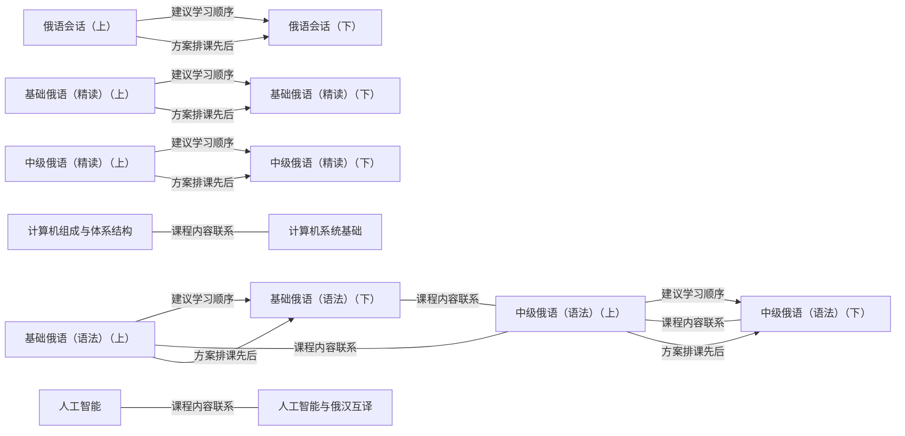

# 俄语-计算机科学与技术双学士学位项目“2+X”教学培养方案

2024 年汇编印刷页 305–307。原表记录 47 个可配对的课程代码。

[本节原页](plan-305.pdf#page=1) · [逐行数据](plan-305.json) · [院系目录](README.md)

## 课程导读

想了解俄语与计算机的课程安排，可以在原表中找到《基础俄语（精读）（上）》（`FORE130557`）、《数据结构》（`COMP130004`）、《俄罗斯文学史》（`FORE130468`）。 [原书 PDF 第 319 页](plan-305.pdf#page=1) · [原书 PDF 第 320 页](plan-305.pdf#page=2)

图中连接《基础俄语（语法）（上）》（`FORE130559`）和《中级俄语（语法）（上）》（`FORE130563`），两门课都从课程题名标出的“语法”切入，可沿这一主题对照阅读。 [原书 PDF 第 319 页](plan-305.pdf#page=1)

## 课程关系图

图中展示最多 20 条关系。下表列出本节全部关系。建议学习顺序供规划课程使用，正式选课资格以教务规定为准。

| 课程 | 关联课程 | 关系 | 依据 |
| --- | --- | --- | --- |
| 俄语会话（上）（FORE130405） | 俄语会话（下）（FORE130406） | 建议学习顺序 | 同节课程题名标明连续分册或序号。 |
| 基础俄语（精读）（上）（FORE130557） | 基础俄语（精读）（下）（FORE130558） | 建议学习顺序 | 同节课程题名标明连续分册或序号。 |
| 基础俄语（语法）（上）（FORE130559） | 基础俄语（语法）（下）（FORE130560） | 建议学习顺序 | 同节课程题名标明连续分册或序号。 |
| 中级俄语（精读）（上）（FORE130561） | 中级俄语（精读）（下）（FORE130562） | 建议学习顺序 | 同节课程题名标明连续分册或序号。 |
| 中级俄语（语法）（上）（FORE130563） | 中级俄语（语法）（下）（FORE130564） | 建议学习顺序 | 同节课程题名标明连续分册或序号。 |
| 计算机组成与体系结构（COMP130191） | 计算机系统基础（COMP130201） | 课程内容联系 | 处理器、存储与系统执行模型具有共同内容。 |
| 人工智能（COMP130207） | 人工智能与俄汉互译（FORE130598） | 课程内容联系 | 本方案两门课程的题名均含“人工智能”，可据此对照这一主题。 |
| 基础俄语（语法）（上）（FORE130559） | 中级俄语（语法）（上）（FORE130563） | 课程内容联系 | 本方案两门课程的题名均含“语法”，可据此对照这一主题。 |
| 基础俄语（语法）（下）（FORE130560） | 中级俄语（语法）（上）（FORE130563） | 课程内容联系 | 本方案两门课程的题名均含“语法”，可据此对照这一主题。 |
| 中级俄语（语法）（上）（FORE130563） | 中级俄语（语法）（下）（FORE130564） | 课程内容联系 | 本方案两门课程的题名均含“语法”，可据此对照这一主题。 |
| 俄语会话（上）（FORE130405） | 俄语会话（下）（FORE130406） | 方案排课先后 | 本节原表所列全部明确学期均早于后者。 |
| 基础俄语（精读）（上）（FORE130557） | 基础俄语（精读）（下）（FORE130558） | 方案排课先后 | 本节原表所列全部明确学期均早于后者。 |
| 基础俄语（语法）（上）（FORE130559） | 基础俄语（语法）（下）（FORE130560） | 方案排课先后 | 本节原表所列全部明确学期均早于后者。 |
| 中级俄语（精读）（上）（FORE130561） | 中级俄语（精读）（下）（FORE130562） | 方案排课先后 | 本节原表所列全部明确学期均早于后者。 |
| 中级俄语（语法）（上）（FORE130563） | 中级俄语（语法）（下）（FORE130564） | 方案排课先后 | 本节原表所列全部明确学期均早于后者。 |

## 课程

| 课程代码 | 名称 | 开课学期原文 | 来源（PDF 页） |
| --- | --- | --- | --- |
| COMP130002 | 数字逻辑与部件设计 | 3 | 320 |
| COMP130004 | 数据结构 | 3 | 320 |
| COMP130006 | 概率论与数理统计 | 5 | 321 |
| COMP130010 | 数据库引论 | 4 | 320 |
| COMP130011 | 算法设计与分析（全英文课程） | 4 | 320 |
| COMP130014 | 编译 | 6 | 320 |
| COMP130015 | 软件工程 | 6 | 320 |
| COMP130110 | 操作系统 | 5 | 320 |
| COMP130135 | 面向对象程序设计 | 2 | 320 |
| COMP130136 | 计算机网络 | 5 | 320 |
| COMP130138 | 人机交互 | 6 | 321 |
| COMP130148 | 数据挖掘技术 | 6 | 321 |
| COMP130149 | 集合与图论 | 3 | 320 |
| COMP130172 | 机器学习 | 5 | 321 |
| COMP130174 | 计算机可视化 | 6 | 321 |
| COMP130191 | 计算机组成与体系结构 | 4 | 320 |
| COMP130201 | 计算机系统基础 | 3 | 320 |
| COMP130207 | 人工智能 | 6 | 320 |
| FORE130028 | 实习调查 | 6 | 320 |
| FORE130029 | 毕业论文 | 8 | 320 |
| FORE130099 | 俄语视听说II(上) | 3 | 320 |
| FORE130107 | 翻译理论与技巧（俄语） | 6 | 320 |
| FORE130109 | 俄语报刊 | 5 | 320 |
| FORE130244 | 俄语影视 | 春，秋 | 320 |
| FORE130246 | 俄罗斯概况 | 3 | 320 |
| FORE130311 | 俄语视听说Ⅰ | 2 | 320 |
| FORE130405 | 俄语会话（上） | 1 | 319 |
| FORE130406 | 俄语会话（下） | 2 | 319 |
| FORE130407 | 俄罗斯文化 | 4 | 320 |
| FORE130412 | 俄语高级写作 | 7 | 320 |
| FORE130468 | 俄罗斯文学史 | 2 | 320 |
| FORE130545 | 俄语言语礼节 | 春，秋 | 320 |
| FORE130547 | 俄国历史 | 春，秋 | 320 |
| FORE130550 | 高级俄语（上） | 5 | 320 |
| FORE130557 | 基础俄语（精读）（上） | 1 | 319 |
| FORE130558 | 基础俄语（精读）（下） | 2 | 319 |
| FORE130559 | 基础俄语（语法）（上） | 1 | 319 |
| FORE130560 | 基础俄语（语法）（下） | 2 | 319 |
| FORE130561 | 中级俄语（精读）（上） | 3 | 319 |
| FORE130562 | 中级俄语（精读）（下） | 4 | 319 |
| FORE130563 | 中级俄语（语法）（上） | 3 | 319 |
| FORE130564 | 中级俄语（语法）（下） | 4 | 319 |
| FORE130591 | 数字人文导论 | 5 | 320 |
| FORE130598 | 人工智能与俄汉互译 | 5 | 321 |
| FORE130599 | 俄语语料库技术与应用 | 6 | 321 |
| FORE130600 | 俄语网络舆情分析原理与方法 | 7 | 321 |
| FORE130601 | 计算机俄语文章阅读 | 4 | 320 |
