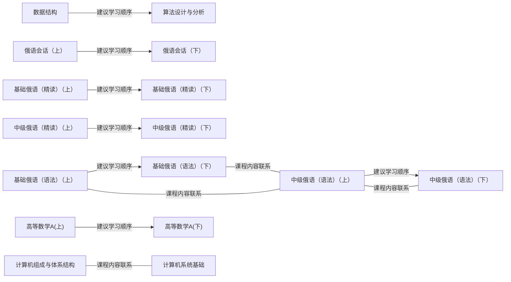

# 俄语-计算机科学与技术双学士学位项目“2+X”修读建议

2024 年汇编印刷页 308–309。原表记录 39 个可配对的课程代码。

[本节原页](plan-305.pdf#page=4) · [逐行数据](plan-305.json) · [院系目录](README.md)

## 课程导读

想了解俄语与计算机的课程安排，可以在原表中找到《基础俄语（精读）（上）》（`FORE130557`）、《数据结构》（`COMP130004`）、《算法设计与分析》（`COMP130011`）。 [原书 PDF 第 322 页](plan-305.pdf#page=4) · [原书 PDF 第 323 页](plan-305.pdf#page=5)

图中连接《基础俄语（语法）（上）》（`FORE130559`）和《中级俄语（语法）（上）》（`FORE130563`），两门课都从课程题名标出的“语法”切入，可沿这一主题对照阅读。 [原书 PDF 第 322 页](plan-305.pdf#page=4)

## 课程关系图

图中展示最多 20 条关系。下表列出本节全部关系。建议学习顺序供规划课程使用，正式选课资格以教务规定为准。

| 课程 | 关联课程 | 关系 | 依据 |
| --- | --- | --- | --- |
| 数据结构（COMP130004） | 算法设计与分析（COMP130011） | 建议学习顺序 | 数据组织与基本操作为算法设计提供基础。 |
| 俄语会话（上）（FORE130405） | 俄语会话（下）（FORE130406） | 建议学习顺序 | 同节课程题名标明连续分册或序号。 |
| 基础俄语（精读）（上）（FORE130557） | 基础俄语（精读）（下）（FORE130558） | 建议学习顺序 | 同节课程题名标明连续分册或序号。 |
| 基础俄语（语法）（上）（FORE130559） | 基础俄语（语法）（下）（FORE130560） | 建议学习顺序 | 同节课程题名标明连续分册或序号。 |
| 中级俄语（精读）（上）（FORE130561） | 中级俄语（精读）（下）（FORE130562） | 建议学习顺序 | 同节课程题名标明连续分册或序号。 |
| 中级俄语（语法）（上）（FORE130563） | 中级俄语（语法）（下）（FORE130564） | 建议学习顺序 | 同节课程题名标明连续分册或序号。 |
| 高等数学A(上)（MATH120021） | 高等数学A(下)（MATH120022） | 建议学习顺序 | 同节课程题名标明连续分册或序号。 |
| 计算机组成与体系结构（COMP130191） | 计算机系统基础（COMP130201） | 课程内容联系 | 处理器、存储与系统执行模型具有共同内容。 |
| 基础俄语（语法）（上）（FORE130559） | 中级俄语（语法）（上）（FORE130563） | 课程内容联系 | 本方案两门课程的题名均含“语法”，可据此对照这一主题。 |
| 基础俄语（语法）（下）（FORE130560） | 中级俄语（语法）（上）（FORE130563） | 课程内容联系 | 本方案两门课程的题名均含“语法”，可据此对照这一主题。 |
| 中级俄语（语法）（上）（FORE130563） | 中级俄语（语法）（下）（FORE130564） | 课程内容联系 | 本方案两门课程的题名均含“语法”，可据此对照这一主题。 |

## 课程

| 课程代码 | 名称 | 开课学期原文 | 来源（PDF 页） |
| --- | --- | --- | --- |
| CHIN120012 | 中国文学经典 |  | 322 |
| COMP120004 | 线性代数 |  | 322 |
| COMP120006 | 程序设计 |  | 322 |
| COMP130002 | 数字逻辑与部件设计 |  | 323 |
| COMP130004 | 数据结构 |  | 323 |
| COMP130010 | 数据库引论 |  | 323 |
| COMP130011 | 算法设计与分析 |  | 323 |
| COMP130014 | 编译 |  | 323 |
| COMP130015 | 软件工程 |  | 323 |
| COMP130110 | 操作系统 |  | 323 |
| COMP130135 | 面向对象程序设计 |  | 323 |
| COMP130136 | 计算机网络 |  | 323 |
| COMP130149 | 集合与图论 |  | 323 |
| COMP130191 | 计算机组成与体系结构 |  | 323 |
| COMP130201 | 计算机系统基础 |  | 323 |
| COMP130207 | 人工智能 |  | 323 |
| FORE130028 | 实习调查 |  | 323 |
| FORE130029 | 毕业论文 |  | 323 |
| FORE130405 | 俄语会话（上） |  | 322 |
| FORE130406 | 俄语会话（下） |  | 322 |
| FORE130412 | 俄语高级写作 |  | 323 |
| FORE130550 | 高级俄语（上） |  | 322 |
| FORE130557 | 基础俄语（精读）（上） |  | 322 |
| FORE130558 | 基础俄语（精读）（下） |  | 322 |
| FORE130559 | 基础俄语（语法）（上） |  | 322 |
| FORE130560 | 基础俄语（语法）（下） |  | 322 |
| FORE130561 | 中级俄语（精读）（上） |  | 322 |
| FORE130562 | 中级俄语（精读）（下） |  | 322 |
| FORE130563 | 中级俄语（语法）（上） |  | 322 |
| FORE130564 | 中级俄语（语法）（下） |  | 322 |
| FORE130591 | 数字人文导论 |  | 322 |
| HIST120012 | 中国古代文明 |  | 322 |
| MATH120021 | 高等数学A(上) |  | 322 |
| MATH120022 | 高等数学A(下) |  | 322 |
| PTSS110082 | 毛泽东思想和中国特色社会主义理论体系概论 |  | 322 |
| PTSS110087 | 马克思主义基本原理 |  | 322 |
| PTSS110088 | 中国近现代史纲要 |  | 322 |
| PTSS110089 | 思想道德与法治 |  | 322 |
| PTSS110090 | 习近平新时代中国特色社会主义思想概论 |  | 322 |
