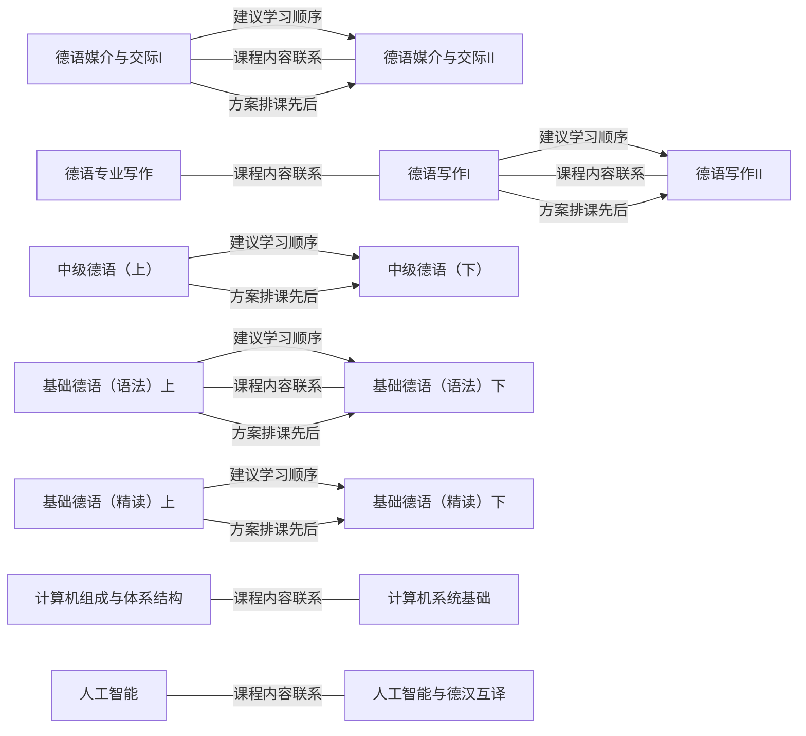

# 德语-计算机科学与技术双学士学位项目“2+X”教学培养方案

2024 年汇编印刷页 310–312。原表记录 44 个可配对的课程代码。

[本节原页](plan-310.pdf#page=1) · [逐行数据](plan-310.json) · [院系目录](README.md)

## 课程关系图

图中展示最多 20 条关系。下表列出本节全部关系。建议学习顺序供规划课程使用，正式选课资格以教务规定为准。

| 课程 | 关联课程 | 关系 | 依据 |
| --- | --- | --- | --- |
| 德语媒介与交际I（FORE130413） | 德语媒介与交际II（FORE130414） | 建议学习顺序 | 同节课程题名标明连续分册或序号。 |
| 德语写作I（FORE130416） | 德语写作II（FORE130418） | 建议学习顺序 | 同节课程题名标明连续分册或序号。 |
| 中级德语（上）（FORE130573） | 中级德语（下）（FORE130574） | 建议学习顺序 | 同节课程题名标明连续分册或序号。 |
| 基础德语（语法）上（FORE130577） | 基础德语（语法）下（FORE130578） | 建议学习顺序 | 同节课程题名标明连续分册或序号。 |
| 基础德语（精读）上（FORE130579） | 基础德语（精读）下（FORE130580） | 建议学习顺序 | 同节课程题名标明连续分册或序号。 |
| 计算机组成与体系结构（COMP130191） | 计算机系统基础（COMP130201） | 课程内容联系 | 处理器、存储与系统执行模型具有共同内容。 |
| 人工智能（COMP130207） | 人工智能与德汉互译（FORE130602） | 课程内容联系 | 本方案两门课程的题名均含“人工智能”，可据此对照这一主题。 |
| 德语专业写作（FORE130338） | 德语写作I（FORE130416） | 课程内容联系 | 本方案两门课程的题名均含“写作”，可据此对照这一主题。 |
| 德语媒介与交际I（FORE130413） | 德语媒介与交际II（FORE130414） | 课程内容联系 | 本方案两门课程的题名均含“媒介”，可据此对照这一主题。 |
| 德语写作I（FORE130416） | 德语写作II（FORE130418） | 课程内容联系 | 本方案两门课程的题名均含“写作”，可据此对照这一主题。 |
| 基础德语（语法）上（FORE130577） | 基础德语（语法）下（FORE130578） | 课程内容联系 | 本方案两门课程的题名均含“语法”，可据此对照这一主题。 |
| 德语媒介与交际I（FORE130413） | 德语媒介与交际II（FORE130414） | 方案排课先后 | 本节原表所列全部明确学期均早于后者。 |
| 德语写作I（FORE130416） | 德语写作II（FORE130418） | 方案排课先后 | 本节原表所列全部明确学期均早于后者。 |
| 中级德语（上）（FORE130573） | 中级德语（下）（FORE130574） | 方案排课先后 | 本节原表所列全部明确学期均早于后者。 |
| 基础德语（语法）上（FORE130577） | 基础德语（语法）下（FORE130578） | 方案排课先后 | 本节原表所列全部明确学期均早于后者。 |
| 基础德语（精读）上（FORE130579） | 基础德语（精读）下（FORE130580） | 方案排课先后 | 本节原表所列全部明确学期均早于后者。 |

## 课程

| 课程代码 | 名称 | 开课学期原文 | 来源（PDF 页） |
| --- | --- | --- | --- |
| COMP130002 | 数字逻辑与部件设计 | 3 | 325 |
| COMP130004 | 数据结构 | 3 | 325 |
| COMP130006 | 概率论与数理统计 | 5 | 326 |
| COMP130010 | 数据库引论 | 4 | 325 |
| COMP130011 | 算法设计与分析（全英文课程） | 4 | 325 |
| COMP130014 | 编译 | 6 | 325 |
| COMP130015 | 软件工程 | 6 | 325 |
| COMP130110 | 操作系统 | 5 | 325 |
| COMP130135 | 面向对象程序设计 | 2 | 325 |
| COMP130136 | 计算机网络 | 5 | 325 |
| COMP130138 | 人机交互 | 6 | 326 |
| COMP130148 | 数据挖掘技术 | 6 | 326 |
| COMP130149 | 集合与图论 | 3 | 325 |
| COMP130172 | 机器学习 | 5 | 326 |
| COMP130174 | 计算机可视化 | 6 | 326 |
| COMP130191 | 计算机组成与体系结构 | 4 | 325 |
| COMP130201 | 计算机系统基础 | 3 | 325 |
| COMP130207 | 人工智能 | 6 | 325 |
| FORE130028 | 实习调查 | 6 | 325 |
| FORE130029 | 毕业论文 | 8 | 325 |
| FORE130050 | 德语文学史及作品选读（上） | 7 | 325 |
| FORE130214 | 德语语言学概论 | 春，秋 | 325 |
| FORE130217 | 德语影视 | 春，秋 | 325 |
| FORE130276 | 奥地利文化 | 春，秋 | 325 |
| FORE130331 | 跨文化交际 | 春，秋 | 325 |
| FORE130338 | 德语专业写作 | 7 | 325 |
| FORE130340 | 德语国家社会与文化 | 春，秋 | 325 |
| FORE130413 | 德语媒介与交际I | 2 | 324 |
| FORE130414 | 德语媒介与交际II | 3 | 324 |
| FORE130416 | 德语写作I | 4 | 324 |
| FORE130418 | 德语写作II | 6 | 325 |
| FORE130537 | 翻译理论与翻译技巧（上） | 7 | 325 |
| FORE130573 | 中级德语（上） | 3 | 324 |
| FORE130574 | 中级德语（下） | 4 | 324 |
| FORE130575 | 中德文化交流的历史与现状 | 春，秋 | 325 |
| FORE130577 | 基础德语（语法）上 | 1 | 324 |
| FORE130578 | 基础德语（语法）下 | 2 | 324 |
| FORE130579 | 基础德语（精读）上 | 1 | 324 |
| FORE130580 | 基础德语（精读）下 | 2 | 324 |
| FORE130591 | 数字人文导论 | 7 | 325 |
| FORE130602 | 人工智能与德汉互译 | 春，秋 | 326 |
| FORE130603 | 德语语料库技术与应用基础 | 春，秋 | 325 |
| FORE130604 | 德语文学中的科技专题 | 春，秋 | 325 |
| FORE130605 | 德语语言研究中的编程方法 | 春，秋 | 325 |
