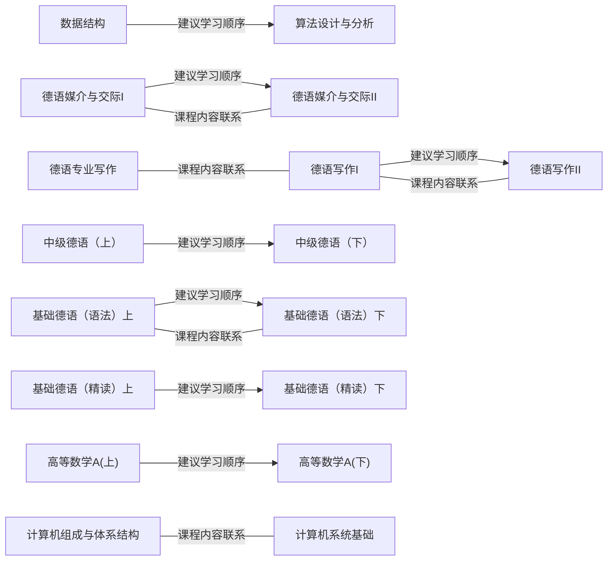

# 德语-计算机科学与技术双学士学位项目“2+X”修读建议

2024 年汇编印刷页 313–314。原表记录 40 个可配对的课程代码。

[本节原页](plan-310.pdf#page=4) · [逐行数据](plan-310.json) · [院系目录](README.md)

## 课程关系图

图中展示最多 20 条关系。下表列出本节全部关系。建议学习顺序供规划课程使用，正式选课资格以教务规定为准。

| 课程 | 关联课程 | 关系 | 依据 |
| --- | --- | --- | --- |
| 数据结构（COMP130004） | 算法设计与分析（COMP130011） | 建议学习顺序 | 数据组织与基本操作为算法设计提供基础。 |
| 德语媒介与交际I（FORE130413） | 德语媒介与交际II（FORE130414） | 建议学习顺序 | 同节课程题名标明连续分册或序号。 |
| 德语写作I（FORE130416） | 德语写作II（FORE130418） | 建议学习顺序 | 同节课程题名标明连续分册或序号。 |
| 中级德语（上）（FORE130573） | 中级德语（下）（FORE130574） | 建议学习顺序 | 同节课程题名标明连续分册或序号。 |
| 基础德语（语法）上（FORE130577） | 基础德语（语法）下（FORE130578） | 建议学习顺序 | 同节课程题名标明连续分册或序号。 |
| 基础德语（精读）上（FORE130579） | 基础德语（精读）下（FORE130580） | 建议学习顺序 | 同节课程题名标明连续分册或序号。 |
| 高等数学A(上)（MATH120021） | 高等数学A(下)（MATH120022） | 建议学习顺序 | 同节课程题名标明连续分册或序号。 |
| 计算机组成与体系结构（COMP130191） | 计算机系统基础（COMP130201） | 课程内容联系 | 处理器、存储与系统执行模型具有共同内容。 |
| 德语专业写作（FORE130338） | 德语写作I（FORE130416） | 课程内容联系 | 本方案两门课程的题名均含“写作”，可据此对照这一主题。 |
| 德语媒介与交际I（FORE130413） | 德语媒介与交际II（FORE130414） | 课程内容联系 | 本方案两门课程的题名均含“媒介”，可据此对照这一主题。 |
| 德语写作I（FORE130416） | 德语写作II（FORE130418） | 课程内容联系 | 本方案两门课程的题名均含“写作”，可据此对照这一主题。 |
| 基础德语（语法）上（FORE130577） | 基础德语（语法）下（FORE130578） | 课程内容联系 | 本方案两门课程的题名均含“语法”，可据此对照这一主题。 |

## 课程

| 课程代码 | 名称 | 开课学期原文 | 来源（PDF 页） |
| --- | --- | --- | --- |
| CHIN120012 | 中国文学经典 |  | 327 |
| COMP120004 | 线性代数 |  | 327 |
| COMP120006 | 程序设计 |  | 327 |
| COMP130002 | 数字逻辑与部件设计 |  | 328 |
| COMP130004 | 数据结构 |  | 328 |
| COMP130010 | 数据库引论 |  | 328 |
| COMP130011 | 算法设计与分析 |  | 328 |
| COMP130014 | 编译 |  | 328 |
| COMP130015 | 软件工程 |  | 328 |
| COMP130110 | 操作系统 |  | 328 |
| COMP130135 | 面向对象程序设计 |  | 328 |
| COMP130136 | 计算机网络 |  | 328 |
| COMP130149 | 集合与图论 |  | 328 |
| COMP130191 | 计算机组成与体系结构 |  | 328 |
| COMP130201 | 计算机系统基础 |  | 328 |
| COMP130207 | 人工智能 |  | 328 |
| FORE130028 | 实习调查 |  | 328 |
| FORE130029 | 毕业论文 |  | 328 |
| FORE130050 | 德语文学史及作品选读（上） |  | 328 |
| FORE130338 | 德语专业写作 |  | 328 |
| FORE130413 | 德语媒介与交际I |  | 327 |
| FORE130414 | 德语媒介与交际II |  | 327 |
| FORE130416 | 德语写作I |  | 327 |
| FORE130418 | 德语写作II |  | 327 |
| FORE130537 | 翻译理论与翻译技巧（上） |  | 327 |
| FORE130573 | 中级德语（上） |  | 327 |
| FORE130574 | 中级德语（下） |  | 327 |
| FORE130577 | 基础德语（语法）上 |  | 327 |
| FORE130578 | 基础德语（语法）下 |  | 327 |
| FORE130579 | 基础德语（精读）上 |  | 327 |
| FORE130580 | 基础德语（精读）下 |  | 327 |
| FORE130591 | 数字人文导论 |  | 328 |
| HIST120012 | 中国古代文明 |  | 327 |
| MATH120021 | 高等数学A(上) |  | 327 |
| MATH120022 | 高等数学A(下) |  | 327 |
| PTSS110082 | 毛泽东思想和中国特色社会主义理论体系概论 |  | 327 |
| PTSS110087 | 马克思主义基本原理 |  | 327 |
| PTSS110088 | 中国近现代史纲要 |  | 327 |
| PTSS110089 | 思想道德与法治 |  | 327 |
| PTSS110090 | 习近平新时代中国特色社会主义思想概论 |  | 327 |
