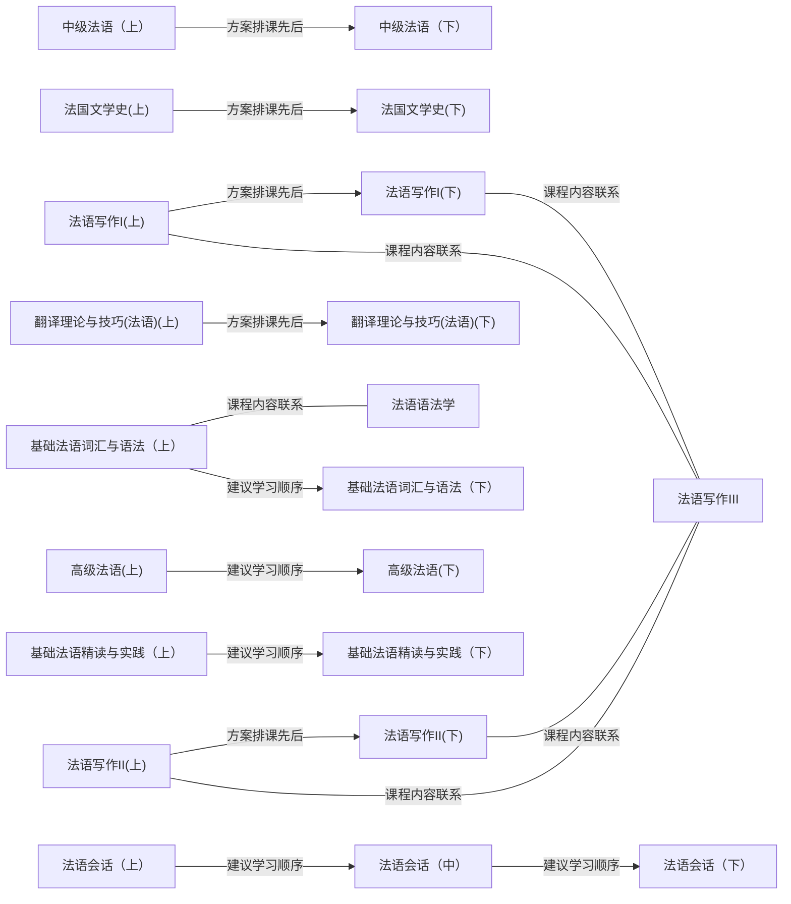

# 2024 法语专业“2+X”教学培养方案

外国语言文学学院 · 法语 · 方案 72750 · 42 个不同课程或科研条目。

[官方 Word](https://github.com/pythonbug225/fudan-course-atlas/blob/research/schoolwide-cohorts-2023-2025/research/contributions/%E5%85%A8%E6%A0%A1%E5%9F%B9%E5%85%BB%E6%96%B9%E6%A1%882023-2025/%E5%B7%B2%E6%9C%89%E9%99%A2%E7%B3%BB%E8%A7%84%E8%8C%83%E6%95%B0%E6%8D%AE/%E5%A4%96%E5%9B%BD%E8%AF%AD%E8%A8%80%E6%96%87%E5%AD%A6%E5%AD%A6%E9%99%A2/2024/originals/plan-72750.docx) · [教务详情](https://fdjwgl.fudan.edu.cn/manager/bizType/2/major-program-search/info/72750?skipAuth=1) · [方案快照](https://github.com/pythonbug225/fudan-course-atlas/blob/research/schoolwide-cohorts-2023-2025/research/contributions/%E5%85%A8%E6%A0%A1%E5%9F%B9%E5%85%BB%E6%96%B9%E6%A1%882023-2025/%E5%B7%B2%E6%9C%89%E9%99%A2%E7%B3%BB%E8%A7%84%E8%8C%83%E6%95%B0%E6%8D%AE/%E5%A4%96%E5%9B%BD%E8%AF%AD%E8%A8%80%E6%96%87%E5%AD%A6%E5%AD%A6%E9%99%A2/2024/raw/plan-72750.json.gz) · [年级目录](https://github.com/pythonbug225/fudan-course-atlas/blob/research/schoolwide-cohorts-2023-2025/research/contributions/%E5%85%A8%E6%A0%A1%E5%9F%B9%E5%85%BB%E6%96%B9%E6%A1%882023-2025/%E5%B7%B2%E6%9C%89%E9%99%A2%E7%B3%BB%E8%A7%84%E8%8C%83%E6%95%B0%E6%8D%AE/%E5%A4%96%E5%9B%BD%E8%AF%AD%E8%A8%80%E6%96%87%E5%AD%A6%E5%AD%A6%E9%99%A2/2024/README.md)

## 修读导读

- **建议先学**　《中级法语（上）》（`FORE20037`） → 《中级法语（下）》（`FORE20052`）。题名列出连续册次或级别。按级别积累词汇和句式，后一阶段阅读新材料时可回查前一阶段的例句。方案分别列在第3、4学期。

- **可以对照着读**　《法语写作I(上)》（`FORE20006`）与《法语写作III》（`FORE40003`）。两门课的题名都涉及写作。选同一材料分别拟提纲，比较两种写作的读者、证据和段落安排。

- **查模块选课**　《法语写作I(下)》（`FORE20007`）、《法语写作II(上)》（`FORE30004`）列在“专业核心教育课程”中。原表见 `/courseModules/8`。

## 课程关系图

图中展示部分关系。下表保留全部已建立的课程对，来源位置使用本方案 JSON Pointer。

## 先修与内容联系

| 类型 | 起点 | 终点 | 依据 | 原表定位 |
| --- | --- | --- | --- | --- |
| 建议学习顺序 | 法语会话（上） (FORE10023) | 法语会话（中） (FORE20053) | 同方案的课程题名具有连续分册或序号。  | `/courseModules/11/planCourses/0`、`/courseModules/11/planCourses/16` |
| 建议学习顺序 | 基础法语词汇与语法（上） (FORE10042) | 基础法语词汇与语法（下） (FORE10043) | 同方案的课程题名具有连续分册或序号。  | `/courseModules/8/planCourses/17`、`/courseModules/8/planCourses/19` |
| 建议学习顺序 | 基础法语精读与实践（上） (FORE10044) | 基础法语精读与实践（下） (FORE10045) | 同方案的课程题名具有连续分册或序号。  | `/courseModules/8/planCourses/18`、`/courseModules/8/planCourses/20` |
| 建议学习顺序 | 法语写作I(上) (FORE20006) | 法语写作I(下) (FORE20007) | 同方案的课程题名具有连续分册或序号。  | `/courseModules/8/planCourses/16`、`/courseModules/8/planCourses/5` |
| 建议学习顺序 | 中级法语（上） (FORE20037) | 中级法语（下） (FORE20052) | 同方案的课程题名具有连续分册或序号。  | `/courseModules/8/planCourses/1`、`/courseModules/8/planCourses/4` |
| 建议学习顺序 | 法语会话（中） (FORE20053) | 法语会话（下） (FORE20038) | 同方案的课程题名具有连续分册或序号。  | `/courseModules/11/planCourses/16`、`/courseModules/11/planCourses/12` |
| 建议学习顺序 | 法语写作II(上) (FORE30004) | 法语写作II(下) (FORE30005) | 同方案的课程题名具有连续分册或序号。  | `/courseModules/8/planCourses/6`、`/courseModules/8/planCourses/11` |
| 建议学习顺序 | 翻译理论与技巧(法语)(上) (FORE30006) | 翻译理论与技巧(法语)(下) (FORE30007) | 同方案的课程题名具有连续分册或序号。  | `/courseModules/8/planCourses/8`、`/courseModules/8/planCourses/12` |
| 建议学习顺序 | 法国文学史(上) (FORE30009) | 法国文学史(下) (FORE30010) | 同方案的课程题名具有连续分册或序号。  | `/courseModules/8/planCourses/2`、`/courseModules/8/planCourses/3` |
| 建议学习顺序 | 高级法语(上) (FORE30031) | 高级法语(下) (FORE30032) | 同方案的课程题名具有连续分册或序号。  | `/courseModules/8/planCourses/10`、`/courseModules/8/planCourses/13` |
| 方案排课先后 | 基础法语词汇与语法（上） (FORE10042) | 基础法语词汇与语法（下） (FORE10043) | 同方案该课程全部明确数字学期均早于后者。  | `/courseModules/8/planCourses/17`、`/courseModules/8/planCourses/19` |
| 方案排课先后 | 基础法语精读与实践（上） (FORE10044) | 基础法语精读与实践（下） (FORE10045) | 同方案该课程全部明确数字学期均早于后者。  | `/courseModules/8/planCourses/18`、`/courseModules/8/planCourses/20` |
| 方案排课先后 | 法语写作I(上) (FORE20006) | 法语写作I(下) (FORE20007) | 同方案该课程全部明确数字学期均早于后者。  | `/courseModules/8/planCourses/16`、`/courseModules/8/planCourses/5` |
| 方案排课先后 | 中级法语（上） (FORE20037) | 中级法语（下） (FORE20052) | 同方案该课程全部明确数字学期均早于后者。  | `/courseModules/8/planCourses/1`、`/courseModules/8/planCourses/4` |
| 方案排课先后 | 法语写作II(上) (FORE30004) | 法语写作II(下) (FORE30005) | 同方案该课程全部明确数字学期均早于后者。  | `/courseModules/8/planCourses/6`、`/courseModules/8/planCourses/11` |
| 方案排课先后 | 翻译理论与技巧(法语)(上) (FORE30006) | 翻译理论与技巧(法语)(下) (FORE30007) | 同方案该课程全部明确数字学期均早于后者。  | `/courseModules/8/planCourses/8`、`/courseModules/8/planCourses/12` |
| 方案排课先后 | 法国文学史(上) (FORE30009) | 法国文学史(下) (FORE30010) | 同方案该课程全部明确数字学期均早于后者。  | `/courseModules/8/planCourses/2`、`/courseModules/8/planCourses/3` |
| 方案排课先后 | 高级法语(上) (FORE30031) | 高级法语(下) (FORE30032) | 同方案该课程全部明确数字学期均早于后者。  | `/courseModules/8/planCourses/10`、`/courseModules/8/planCourses/13` |
| 课程内容联系 | 基础法语词汇与语法（上） (FORE10042) | 法语语法学 (FORE20019) | 本方案两门课程的题名均含“语法”，可据此对照这一主题。  | `/courseModules/8/planCourses/17`、`/courseModules/11/planCourses/1` |
| 课程内容联系 | 基础法语词汇与语法（下） (FORE10043) | 法语语法学 (FORE20019) | 本方案两门课程的题名均含“语法”，可据此对照这一主题。  | `/courseModules/8/planCourses/19`、`/courseModules/11/planCourses/1` |
| 课程内容联系 | 法语写作I(上) (FORE20006) | 法语写作III (FORE40003) | 本方案两门课程的题名均含“写作”，可据此对照这一主题。  | `/courseModules/8/planCourses/16`、`/courseModules/8/planCourses/14` |
| 课程内容联系 | 法语写作I(下) (FORE20007) | 法语写作III (FORE40003) | 本方案两门课程的题名均含“写作”，可据此对照这一主题。  | `/courseModules/8/planCourses/5`、`/courseModules/8/planCourses/14` |
| 课程内容联系 | 法语写作II(上) (FORE30004) | 法语写作III (FORE40003) | 本方案两门课程的题名均含“写作”，可据此对照这一主题。  | `/courseModules/8/planCourses/6`、`/courseModules/8/planCourses/14` |
| 课程内容联系 | 法语写作II(下) (FORE30005) | 法语写作III (FORE40003) | 本方案两门课程的题名均含“写作”，可据此对照这一主题。  | `/courseModules/8/planCourses/11`、`/courseModules/8/planCourses/14` |
| 课程内容联系 | 翻译理论与技巧(法语)(上) (FORE30006) | 翻译理论与技巧(法语)(下) (FORE30007) | 本方案两门课程的题名均含“翻译”，可据此对照这一主题。  | `/courseModules/8/planCourses/8`、`/courseModules/8/planCourses/12` |
| 课程内容联系 | 法国文学史(上) (FORE30009) | 法国文学史(下) (FORE30010) | 本方案两门课程的题名均含“文学史”，可据此对照这一主题。  | `/courseModules/8/planCourses/2`、`/courseModules/8/planCourses/3` |
| 课程内容联系 | 法国当代戏剧 (FORE40027) | 法国古典戏剧 (FORE50084) | 本方案两门课程的题名均含“戏剧”，可据此对照这一主题。  | `/courseModules/11/planCourses/10`、`/courseModules/11/planCourses/8` |
| 课程内容联系 | 哲学导论 (PHIL10002) | 逻辑学 (PHIL10003) | 论证与概念分析是哲学讨论的共同方法。  | `/courseModules/7/planCourses/2`、`/courseModules/7/planCourses/3` |

本次未从可定位的明确表述中确认课程对课程预修。学期安排、系列分册与编辑建议均保留各自的依据。

## 课程表

同一课程在不同模块分别出现时，按原表逐行列出。季节字段保留原值。

| 课程 | 代码 | 学分 | 学期 | 模块 |
| --- | --- | ---: | --- | --- |
| 中国文学经典 | CHIN10005 | 3.0 | SPRING、AUTUMN | 培养方案 / 专业培养课程 / 大类基础课程 / 人文类基础课程 / 必修课程 |
| 中国古代文明 | HIST10006 | 3.0 | SPRING、AUTUMN | 培养方案 / 专业培养课程 / 大类基础课程 / 人文类基础课程 / 必修课程 |
| 哲学导论 | PHIL10002 | 3.0 | SPRING、AUTUMN | 培养方案 / 专业培养课程 / 大类基础课程 / 人文类基础课程 / 必修课程 |
| 逻辑学 | PHIL10003 | 3.0 | SPRING、AUTUMN | 培养方案 / 专业培养课程 / 大类基础课程 / 人文类基础课程 / 必修课程 |
| 毕业论文 | FORE40080 | 4.0 | 第8学期 | 培养方案 / 专业培养课程 / 专业核心教育课程 |
| 中级法语（上） | FORE20037 | 6.0 | 第3学期 | 培养方案 / 专业培养课程 / 专业核心教育课程 |
| 法国文学史(上) | FORE30009 | 2.0 | 第3学期 | 培养方案 / 专业培养课程 / 专业核心教育课程 |
| 法国文学史(下) | FORE30010 | 2.0 | 第4学期 | 培养方案 / 专业培养课程 / 专业核心教育课程 |
| 中级法语（下） | FORE20052 | 6.0 | 第4学期 | 培养方案 / 专业培养课程 / 专业核心教育课程 |
| 法语写作I(下) | FORE20007 | 2.0 | 第4学期 | 培养方案 / 专业培养课程 / 专业核心教育课程 |
| 法语写作II(上) | FORE30004 | 2.0 | 第5学期 | 培养方案 / 专业培养课程 / 专业核心教育课程 |
| 法语初级视听 | FORE10024 | 2.0 | 第1学期 | 培养方案 / 专业培养课程 / 专业核心教育课程 |
| 翻译理论与技巧(法语)(上) | FORE30006 | 2.0 | 第5学期 | 培养方案 / 专业培养课程 / 专业核心教育课程 |
| 法国概况 | FORE30008 | 2.0 | 第5学期 | 培养方案 / 专业培养课程 / 专业核心教育课程 |
| 高级法语(上) | FORE30031 | 4.0 | 第5学期 | 培养方案 / 专业培养课程 / 专业核心教育课程 |
| 法语写作II(下) | FORE30005 | 2.0 | 第6学期 | 培养方案 / 专业培养课程 / 专业核心教育课程 |
| 翻译理论与技巧(法语)(下) | FORE30007 | 2.0 | 第6学期 | 培养方案 / 专业培养课程 / 专业核心教育课程 |
| 高级法语(下) | FORE30032 | 4.0 | 第6学期 | 培养方案 / 专业培养课程 / 专业核心教育课程 |
| 法语写作III | FORE40003 | 2.0 | 第7学期 | 培养方案 / 专业培养课程 / 专业核心教育课程 |
| 实习调查 | FORE30001 | 2.0 | 第6学期 | 培养方案 / 专业培养课程 / 专业核心教育课程 |
| 法语写作I(上) | FORE20006 | 2.0 | 第3学期 | 培养方案 / 专业培养课程 / 专业核心教育课程 |
| 基础法语词汇与语法（上） | FORE10042 | 4.0 | 第1学期 | 培养方案 / 专业培养课程 / 专业核心教育课程 |
| 基础法语精读与实践（上） | FORE10044 | 4.0 | 第1学期 | 培养方案 / 专业培养课程 / 专业核心教育课程 |
| 基础法语词汇与语法（下） | FORE10043 | 4.0 | 第2学期 | 培养方案 / 专业培养课程 / 专业核心教育课程 |
| 基础法语精读与实践（下） | FORE10045 | 4.0 | 第2学期 | 培养方案 / 专业培养课程 / 专业核心教育课程 |
| 法语会话（上） | FORE10023 | 2.0 | SPRING、AUTUMN | 培养方案 / 专业进阶课程（双进阶） |
| 法语语法学 | FORE20019 | 2.0 | SPRING、AUTUMN | 培养方案 / 专业进阶课程（双进阶） |
| 法国现当代文艺思潮 | FORE50085 | 2.0 | SPRING、AUTUMN | 培养方案 / 专业进阶课程（双进阶） |
| 法国文化 | FORE30022 | 2.0 | SPRING、AUTUMN | 培养方案 / 专业进阶课程（双进阶） |
| 中法文化比较 | FORE40014 | 2.0 | SPRING、AUTUMN | 培养方案 / 专业进阶课程（双进阶） |
| 法国现代短篇小说 | FORE50024 | 2.0 | SPRING、AUTUMN | 培养方案 / 专业进阶课程（双进阶） |
| 法语报刊 | FORE40004 | 2.0 | SPRING、AUTUMN | 培养方案 / 专业进阶课程（双进阶） |
| 学术前沿专题 | FORE50043 | 2.0 | SPRING、AUTUMN | 培养方案 / 专业进阶课程（双进阶） |
| 法国古典戏剧 | FORE50084 | 2.0 | SPRING、AUTUMN | 培养方案 / 专业进阶课程（双进阶） |
| 法语散文选读 | FORE50025 | 2.0 | SPRING、AUTUMN | 培养方案 / 专业进阶课程（双进阶） |
| 法国当代戏剧 | FORE40027 | 2.0 | SPRING、AUTUMN | 培养方案 / 专业进阶课程（双进阶） |
| 法语影视 | FORE30021 | 2.0 | SPRING、AUTUMN | 培养方案 / 专业进阶课程（双进阶） |
| 法语会话（下） | FORE20038 | 2.0 | SPRING、AUTUMN | 培养方案 / 专业进阶课程（双进阶） |
| 中法文学关系 | FORE40045 | 2.0 | SPRING、AUTUMN | 培养方案 / 专业进阶课程（双进阶） |
| 法国喜剧语言赏析 | FORE50115 | 2.0 | SPRING、AUTUMN | 培养方案 / 专业进阶课程（双进阶） |
| 法国文学精选•精评•精译 | FORE40048 | 2.0 | SPRING、AUTUMN | 培养方案 / 专业进阶课程（双进阶） |
| 法语会话（中） | FORE20053 | 2.0 | SPRING、AUTUMN | 培养方案 / 专业进阶课程（双进阶） |
| 法语会话（上） | FORE10023 | 2.0 | SPRING、AUTUMN | 培养方案 / 专业进阶课程（单进阶） |
| 法语语法学 | FORE20019 | 2.0 | SPRING、AUTUMN | 培养方案 / 专业进阶课程（单进阶） |
| 法国现当代文艺思潮 | FORE50085 | 2.0 | SPRING、AUTUMN | 培养方案 / 专业进阶课程（单进阶） |
| 法国文化 | FORE30022 | 2.0 | SPRING、AUTUMN | 培养方案 / 专业进阶课程（单进阶） |
| 中法文化比较 | FORE40014 | 2.0 | SPRING、AUTUMN | 培养方案 / 专业进阶课程（单进阶） |
| 法国现代短篇小说 | FORE50024 | 2.0 | SPRING、AUTUMN | 培养方案 / 专业进阶课程（单进阶） |
| 法语报刊 | FORE40004 | 2.0 | SPRING、AUTUMN | 培养方案 / 专业进阶课程（单进阶） |
| 学术前沿专题 | FORE50043 | 2.0 | SPRING、AUTUMN | 培养方案 / 专业进阶课程（单进阶） |
| 法国古典戏剧 | FORE50084 | 2.0 | SPRING、AUTUMN | 培养方案 / 专业进阶课程（单进阶） |
| 法语散文选读 | FORE50025 | 2.0 | SPRING、AUTUMN | 培养方案 / 专业进阶课程（单进阶） |
| 法国当代戏剧 | FORE40027 | 2.0 | SPRING、AUTUMN | 培养方案 / 专业进阶课程（单进阶） |
| 法语影视 | FORE30021 | 2.0 | SPRING、AUTUMN | 培养方案 / 专业进阶课程（单进阶） |
| 法语会话（下） | FORE20038 | 2.0 | SPRING、AUTUMN | 培养方案 / 专业进阶课程（单进阶） |
| 中法文学关系 | FORE40045 | 2.0 | SPRING、AUTUMN | 培养方案 / 专业进阶课程（单进阶） |
| 法国喜剧语言赏析 | FORE50115 | 2.0 | SPRING、AUTUMN | 培养方案 / 专业进阶课程（单进阶） |
| 法国文学精选•精评•精译 | FORE40048 | 2.0 | SPRING、AUTUMN | 培养方案 / 专业进阶课程（单进阶） |
| 法语会话（中） | FORE20053 | 2.0 | SPRING、AUTUMN | 培养方案 / 专业进阶课程（单进阶） |
