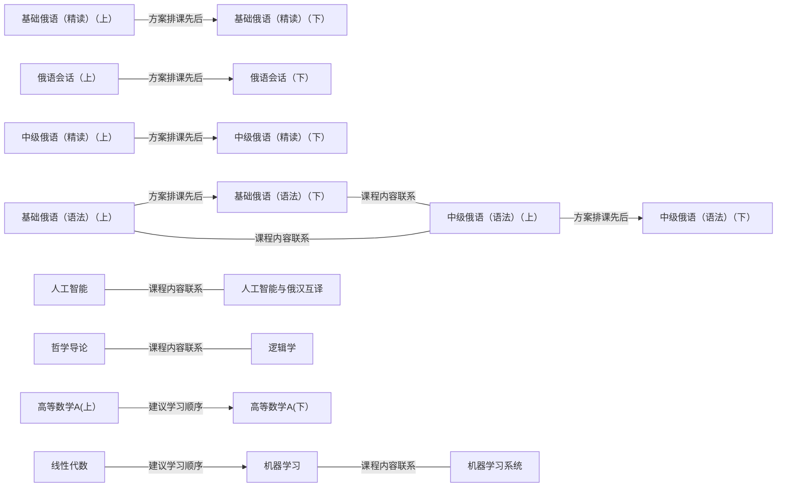

# 2024 俄语-计算机科学与技术双学士学位项目教学培养方案

外国语言文学学院 · 俄语-计算机科学与技术(双学士学位项目) · 方案 72773 · 68 个不同课程或科研条目。

[官方 Word](https://github.com/pythonbug225/fudan-course-atlas/blob/research/schoolwide-cohorts-2023-2025/research/contributions/%E5%85%A8%E6%A0%A1%E5%9F%B9%E5%85%BB%E6%96%B9%E6%A1%882023-2025/%E5%B7%B2%E6%9C%89%E9%99%A2%E7%B3%BB%E8%A7%84%E8%8C%83%E6%95%B0%E6%8D%AE/%E5%A4%96%E5%9B%BD%E8%AF%AD%E8%A8%80%E6%96%87%E5%AD%A6%E5%AD%A6%E9%99%A2/2024/originals/plan-72773.docx) · [教务详情](https://fdjwgl.fudan.edu.cn/manager/bizType/2/major-program-search/info/72773?skipAuth=1) · [方案快照](https://github.com/pythonbug225/fudan-course-atlas/blob/research/schoolwide-cohorts-2023-2025/research/contributions/%E5%85%A8%E6%A0%A1%E5%9F%B9%E5%85%BB%E6%96%B9%E6%A1%882023-2025/%E5%B7%B2%E6%9C%89%E9%99%A2%E7%B3%BB%E8%A7%84%E8%8C%83%E6%95%B0%E6%8D%AE/%E5%A4%96%E5%9B%BD%E8%AF%AD%E8%A8%80%E6%96%87%E5%AD%A6%E5%AD%A6%E9%99%A2/2024/raw/plan-72773.json.gz) · [年级目录](https://github.com/pythonbug225/fudan-course-atlas/blob/research/schoolwide-cohorts-2023-2025/research/contributions/%E5%85%A8%E6%A0%A1%E5%9F%B9%E5%85%BB%E6%96%B9%E6%A1%882023-2025/%E5%B7%B2%E6%9C%89%E9%99%A2%E7%B3%BB%E8%A7%84%E8%8C%83%E6%95%B0%E6%8D%AE/%E5%A4%96%E5%9B%BD%E8%AF%AD%E8%A8%80%E6%96%87%E5%AD%A6%E5%AD%A6%E9%99%A2/2024/README.md)

## 修读导读

- **建议先学**　《基础俄语（精读）（上）》（`FORE10032`） → 《基础俄语（精读）（下）》（`FORE10033`）。题名列出连续册次或级别。按级别积累词汇和句式，后一阶段阅读新材料时可回查前一阶段的例句。方案分别列在第1、2学期。

- **可以对照着读**　《基础俄语（语法）（上）》（`FORE10034`）与《中级俄语（语法）（上）》（`FORE20057`）。两门课的题名都涉及语法。选一个例句，分别标出两门课分析的语法单位，再比较分析能解释哪些用法。

- **查模块选课**　《基础俄语（语法）（下）》（`FORE10035`）、《俄语会话（上）》（`FORE10019`）列在“专业核心教育课程 / A组”中。原表见 `/courseModules/11`。

## 课程关系图

图中展示部分关系。下表保留全部已建立的课程对，来源位置使用本方案 JSON Pointer。

## 先修与内容联系

| 类型 | 起点 | 终点 | 依据 | 原表定位 |
| --- | --- | --- | --- | --- |
| 建议学习顺序 | 线性代数 (CS10003) | 机器学习 (CS30045) | 向量、矩阵及线性映射为理解学习模型提供数学准备。  | `/courseModules/9/planCourses/2`、`/courseModules/17/planCourses/2` |
| 建议学习顺序 | 俄语会话（上） (FORE10019) | 俄语会话（下） (FORE10020) | 同方案的课程题名具有连续分册或序号。  | `/courseModules/11/planCourses/4`、`/courseModules/11/planCourses/5` |
| 建议学习顺序 | 基础俄语（精读）（上） (FORE10032) | 基础俄语（精读）（下） (FORE10033) | 同方案的课程题名具有连续分册或序号。  | `/courseModules/11/planCourses/0`、`/courseModules/11/planCourses/2` |
| 建议学习顺序 | 基础俄语（语法）（上） (FORE10034) | 基础俄语（语法）（下） (FORE10035) | 同方案的课程题名具有连续分册或序号。  | `/courseModules/11/planCourses/1`、`/courseModules/11/planCourses/3` |
| 建议学习顺序 | 中级俄语（精读）（上） (FORE20055) | 中级俄语（精读）（下） (FORE20056) | 同方案的课程题名具有连续分册或序号。  | `/courseModules/11/planCourses/6`、`/courseModules/11/planCourses/8` |
| 建议学习顺序 | 中级俄语（语法）（上） (FORE20057) | 中级俄语（语法）（下） (FORE20058) | 同方案的课程题名具有连续分册或序号。  | `/courseModules/11/planCourses/7`、`/courseModules/11/planCourses/9` |
| 建议学习顺序 | 高等数学A(上） (MATH10015) | 高等数学A(下） (MATH10016) | 同方案的课程题名具有连续分册或序号。  | `/courseModules/9/planCourses/0`、`/courseModules/9/planCourses/1` |
| 方案排课先后 | 线性代数 (CS10003) | 机器学习 (CS30045) | 同方案该课程全部明确数字学期均早于后者。  | `/courseModules/9/planCourses/2`、`/courseModules/17/planCourses/2` |
| 方案排课先后 | 俄语会话（上） (FORE10019) | 俄语会话（下） (FORE10020) | 同方案该课程全部明确数字学期均早于后者。  | `/courseModules/11/planCourses/4`、`/courseModules/11/planCourses/5` |
| 方案排课先后 | 基础俄语（精读）（上） (FORE10032) | 基础俄语（精读）（下） (FORE10033) | 同方案该课程全部明确数字学期均早于后者。  | `/courseModules/11/planCourses/0`、`/courseModules/11/planCourses/2` |
| 方案排课先后 | 基础俄语（语法）（上） (FORE10034) | 基础俄语（语法）（下） (FORE10035) | 同方案该课程全部明确数字学期均早于后者。  | `/courseModules/11/planCourses/1`、`/courseModules/11/planCourses/3` |
| 方案排课先后 | 中级俄语（精读）（上） (FORE20055) | 中级俄语（精读）（下） (FORE20056) | 同方案该课程全部明确数字学期均早于后者。  | `/courseModules/11/planCourses/6`、`/courseModules/11/planCourses/8` |
| 方案排课先后 | 中级俄语（语法）（上） (FORE20057) | 中级俄语（语法）（下） (FORE20058) | 同方案该课程全部明确数字学期均早于后者。  | `/courseModules/11/planCourses/7`、`/courseModules/11/planCourses/9` |
| 方案排课先后 | 高等数学A(上） (MATH10015) | 高等数学A(下） (MATH10016) | 同方案该课程全部明确数字学期均早于后者。  | `/courseModules/9/planCourses/0`、`/courseModules/9/planCourses/1` |
| 课程内容联系 | 机器学习 (CS30045) | 机器学习系统 (CS30058) | 本方案两门课程的题名均含“机器学习”，可据此对照这一主题。  | `/courseModules/17/planCourses/2`、`/courseModules/17/planCourses/14` |
| 课程内容联系 | 人工智能 (CS30057) | 人工智能与俄汉互译 (FORE50126) | 本方案两门课程的题名均含“人工智能”，可据此对照这一主题。  | `/courseModules/12/planCourses/14`、`/courseModules/16/planCourses/10` |
| 课程内容联系 | 基础俄语（语法）（上） (FORE10034) | 中级俄语（语法）（上） (FORE20057) | 本方案两门课程的题名均含“语法”，可据此对照这一主题。  | `/courseModules/11/planCourses/1`、`/courseModules/11/planCourses/7` |
| 课程内容联系 | 基础俄语（语法）（下） (FORE10035) | 中级俄语（语法）（上） (FORE20057) | 本方案两门课程的题名均含“语法”，可据此对照这一主题。  | `/courseModules/11/planCourses/3`、`/courseModules/11/planCourses/7` |
| 课程内容联系 | 中级俄语（语法）（上） (FORE20057) | 中级俄语（语法）（下） (FORE20058) | 本方案两门课程的题名均含“语法”，可据此对照这一主题。  | `/courseModules/11/planCourses/7`、`/courseModules/11/planCourses/9` |
| 课程内容联系 | 哲学导论 (PHIL10002) | 逻辑学 (PHIL10003) | 论证与概念分析是哲学讨论的共同方法。  | `/courseModules/7/planCourses/2`、`/courseModules/7/planCourses/3` |

本次未从可定位的明确表述中确认课程对课程预修。学期安排、系列分册与编辑建议均保留各自的依据。

## 按原方案模块阅读

同一模块展示原表中的课程归属。模块内课程之间的先后仍须逐项查阅。

- **技术科学类基础课程（交叉科学类适用）**　线性代数、程序设计、高等数学A(上）、高等数学A(下）（原表模块 9）

## 课程表

同一课程在不同模块分别出现时，按原表逐行列出。季节字段保留原值。

| 课程 | 代码 | 学分 | 学期 | 模块 |
| --- | --- | ---: | --- | --- |
| 中国文学经典 | CHIN10005 | 3.0 | SPRING、AUTUMN | 培养方案 / 专业培养课程 / 大类基础课程 / 人文类基础课程 / 必修课程 |
| 中国古代文明 | HIST10006 | 3.0 | SPRING、AUTUMN | 培养方案 / 专业培养课程 / 大类基础课程 / 人文类基础课程 / 必修课程 |
| 哲学导论 | PHIL10002 | 3.0 | SPRING、AUTUMN | 培养方案 / 专业培养课程 / 大类基础课程 / 人文类基础课程 / 必修课程 |
| 逻辑学 | PHIL10003 | 3.0 | SPRING、AUTUMN | 培养方案 / 专业培养课程 / 大类基础课程 / 人文类基础课程 / 必修课程 |
| 高等数学A(上） | MATH10015 | 5.0 | 第1学期 | 培养方案 / 专业培养课程 / 大类基础课程 / 技术科学类基础课程 / 技术科学类基础课程（交叉科学类适用） |
| 高等数学A(下） | MATH10016 | 5.0 | 第2学期 | 培养方案 / 专业培养课程 / 大类基础课程 / 技术科学类基础课程 / 技术科学类基础课程（交叉科学类适用） |
| 线性代数 | CS10003 | 3.0 | 第1学期 | 培养方案 / 专业培养课程 / 大类基础课程 / 技术科学类基础课程 / 技术科学类基础课程（交叉科学类适用） |
| 程序设计 | CS10004 | 4.0 | 第1学期 | 培养方案 / 专业培养课程 / 大类基础课程 / 技术科学类基础课程 / 技术科学类基础课程（交叉科学类适用） |
| 基础俄语（精读）（上） | FORE10032 | 6.0 | 第1学期 | 培养方案 / 专业培养课程 / 专业核心教育课程 / A组 |
| 基础俄语（语法）（上） | FORE10034 | 4.0 | 第1学期 | 培养方案 / 专业培养课程 / 专业核心教育课程 / A组 |
| 基础俄语（精读）（下） | FORE10033 | 6.0 | 第2学期 | 培养方案 / 专业培养课程 / 专业核心教育课程 / A组 |
| 基础俄语（语法）（下） | FORE10035 | 4.0 | 第2学期 | 培养方案 / 专业培养课程 / 专业核心教育课程 / A组 |
| 俄语会话（上） | FORE10019 | 2.0 | 第1学期 | 培养方案 / 专业培养课程 / 专业核心教育课程 / A组 |
| 俄语会话（下） | FORE10020 | 2.0 | 第2学期 | 培养方案 / 专业培养课程 / 专业核心教育课程 / A组 |
| 中级俄语（精读）（上） | FORE20055 | 4.0 | 第3学期 | 培养方案 / 专业培养课程 / 专业核心教育课程 / A组 |
| 中级俄语（语法）（上） | FORE20057 | 4.0 | 第3学期 | 培养方案 / 专业培养课程 / 专业核心教育课程 / A组 |
| 中级俄语（精读）（下） | FORE20056 | 4.0 | 第4学期 | 培养方案 / 专业培养课程 / 专业核心教育课程 / A组 |
| 中级俄语（语法）（下） | FORE20058 | 4.0 | 第4学期 | 培养方案 / 专业培养课程 / 专业核心教育课程 / A组 |
| 高级俄语（上） | FORE30053 | 4.0 | 第5学期 | 培养方案 / 专业培养课程 / 专业核心教育课程 / A组 |
| 数字人文导论 | FORE50125 | 2.0 | 第5学期 | 培养方案 / 专业培养课程 / 专业核心教育课程 / A组 |
| 俄语高级写作 | FORE40026 | 2.0 | 第7学期 | 培养方案 / 专业培养课程 / 专业核心教育课程 / A组 |
| 面向对象程序设计 | CS20012 | 2.0 | 第2学期 | 培养方案 / 专业培养课程 / 专业核心教育课程 / B组 |
| 数字逻辑与部件设计 | CS20008 | 3.0 | 第3学期 | 培养方案 / 专业培养课程 / 专业核心教育课程 / B组 |
| 数据结构 | CS20009 | 4.0 | 第3学期 | 培养方案 / 专业培养课程 / 专业核心教育课程 / B组 |
| 数据结构 | AIE310007 | 4.0 | 第3学期 | 培养方案 / 专业培养课程 / 专业核心教育课程 / B组 |
| 集合与图论 | CS30043 | 3.0 | 第3学期 | 培养方案 / 专业培养课程 / 专业核心教育课程 / B组 |
| 计算机系统基础 | CS10005 | 3.0 | 第3学期 | 培养方案 / 专业培养课程 / 专业核心教育课程 / B组 |
| 计算机系统基础 | AIE210006 | 3.0 | 第3学期 | 培养方案 / 专业培养课程 / 专业核心教育课程 / B组 |
| 数据库引论 | CS20010 | 3.0 | 第4学期 | 培养方案 / 专业培养课程 / 专业核心教育课程 / B组 |
| 计算机组成与体系结构 | CS30052 | 4.0 | 第4学期 | 培养方案 / 专业培养课程 / 专业核心教育课程 / B组 |
| 算法设计与分析 | CS30016 | 3.0 | 第4学期 | 培养方案 / 专业培养课程 / 专业核心教育课程 / B组 |
| 操作系统 | CS30031 | 3.0 | 第5学期 | 培养方案 / 专业培养课程 / 专业核心教育课程 / B组 |
| 计算机网络 | CS30036 | 3.0 | 第5学期 | 培养方案 / 专业培养课程 / 专业核心教育课程 / B组 |
| 软件工程 | CS30018 | 3.0 | 第6学期 | 培养方案 / 专业培养课程 / 专业核心教育课程 / B组 |
| 编译 | CS30017 | 3.0 | 第6学期 | 培养方案 / 专业培养课程 / 专业核心教育课程 / B组 |
| 人工智能 | CS30057 | 3.0 | 第6学期 | 培养方案 / 专业培养课程 / 专业核心教育课程 / B组 |
| 实习调查 | FORE30001 | 2.0 | 第6学期 | 培养方案 / 专业培养课程 / 专业核心教育课程 / C组 |
| 毕业论文 | FORE40080 | 4.0 | 第8学期 | 培养方案 / 专业培养课程 / 专业核心教育课程 / C组 |
| 俄语视听说Ⅰ | FORE50042 | 2.0 | 第2学期 | 培养方案 / 专业进阶课程 / A组 |
| 俄罗斯文学史 | FORE50091 | 2.0 | 第2学期 | 培养方案 / 专业进阶课程 / A组 |
| 俄罗斯概况 | FORE20020 | 2.0 | 第3学期 | 培养方案 / 专业进阶课程 / A组 |
| 俄语视听说II(上) | FORE50005 | 2.0 | 第3学期 | 培养方案 / 专业进阶课程 / A组 |
| 俄语言语礼节 | FORE50117 | 2.0 | SPRING、AUTUMN | 培养方案 / 专业进阶课程 / A组 |
| 俄罗斯文化 | FORE50081 | 2.0 | 第4学期 | 培养方案 / 专业进阶课程 / A组 |
| 俄语报刊 | FORE50006 | 2.0 | 第5学期 | 培养方案 / 专业进阶课程 / A组 |
| 俄语影视 | FORE50032 | 2.0 | SPRING、AUTUMN | 培养方案 / 专业进阶课程 / A组 |
| 俄国历史 | FORE50119 | 2.0 | SPRING、AUTUMN | 培养方案 / 专业进阶课程 / A组 |
| 计算机俄语文章阅读 | FORE50129 | 2.0 | 第4学期 | 培养方案 / 专业进阶课程 / A组 |
| 人工智能与俄汉互译 | FORE50126 | 2.0 | 第5学期 | 培养方案 / 专业进阶课程 / A组 |
| 俄语语料库技术与应用 | FORE50127 | 2.0 | 第6学期 | 培养方案 / 专业进阶课程 / A组 |
| 俄语网络舆情分析原理与方法 | FORE50128 | 2.0 | 第7学期 | 培养方案 / 专业进阶课程 / A组 |
| 翻译理论与技巧(俄语) | FORE30015 | 2.0 | 第6学期 | 培养方案 / 专业进阶课程 / A组 |
| 概率论与数理统计 | STAT30014 | 4.0 | 第5学期 | 培养方案 / 专业进阶课程 / B组 |
| 概率论与数理统计 | STAT30001 | 3.0 | 第5学期 | 培养方案 / 专业进阶课程 / B组 |
| 机器学习 | CS30045 | 3.0 | 第5学期 | 培养方案 / 专业进阶课程 / B组 |
| 数据挖掘技术 | CS30042 | 3.0 | 第6学期 | 培养方案 / 专业进阶课程 / B组 |
| 计算机可视化 | CS30047 | 2.0 | 第6学期 | 培养方案 / 专业进阶课程 / B组 |
| 人机交互 | CS30038 | 2.0 | 第6学期 | 培养方案 / 专业进阶课程 / B组 |
| 代数结构与数理逻辑 | CS30015 | 3.0 | 第4学期 | 培养方案 / 专业进阶课程 / B组 |
| 计算理论基础 | CS30021 | 3.0 | 第5学期 | 培养方案 / 专业进阶课程 / B组 |
| 自然语言处理与大语言模型 | AIE410002 | 3.0 | 第5学期 | 培养方案 / 专业进阶课程 / B组 |
| 计算机视觉 | CS30034 | 3.0 | 第5学期 | 培养方案 / 专业进阶课程 / B组 |
| 云计算与虚拟化技术 | CS30055 | 3.0 | 第6学期 | 培养方案 / 专业进阶课程 / B组 |
| 分布式系统 | CS30033 | 3.0 | 第7学期 | 培养方案 / 专业进阶课程 / B组 |
| 计算机安全原理与实践 | CSEC50002 | 4.0 | 第7学期 | 培养方案 / 专业进阶课程 / B组 |
| 机器人学导论 | CS70012 | 3.0 | 第8学期 | 培养方案 / 专业进阶课程 / B组 |
| 机器学习系统 | CS30058 | 3.0 | 第7学期、第8学期 | 培养方案 / 专业进阶课程 / B组 |
| 强化学习 | CS70027 | 3.0 | 第7学期、第8学期 | 培养方案 / 专业进阶课程 / B组 |
